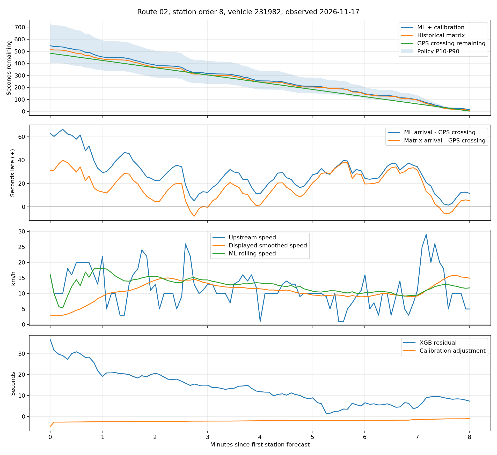

# Theo dõi ETA tại một trạm: hệ thống thực sự đang biết gì?

Quan sát ngày 17/11/2026, giờ Hà Nội. Trạm **Bệnh viện Việt Đức, 40 Tràng Thi**, tuyến **02 chiều về**, `station_order=8`, `station_id=727`. Dùng phiên đã thu có packet upstream, không tạo dữ liệu mới. Chọn trạm sau khi thu vì có xe đi qua trong phiên; đây là nghiên cứu tình huống, không phải chọn mẫu đại diện hay tập nghiệm thu độc lập.

## 1. Trả lời trước về nguồn dự báo

“Baseline” ở đây là **baseline matrix lịch sử**: thời gian đi giữa các trạm theo tuyến, chiều, loại ngày và giờ. Từ vị trí hiện tại, code tính phần đoạn còn lại rồi cộng các đoạn tới trạm đích. Nó không phải một model ML khác.

| Chế độ | Đầu vào lịch sử | Dự báo trung tâm | Điều đã/chưa nối |
|---|---|---|---|
| Local trong các phiên live 02/27 | DB local hiện hữu | Baseline matrix + residual XGBoost + calibrator | Có ML thật; chưa chứng minh bộ dữ liệu/model này là một release đồng bộ từ HDFS. |
| Release hiện nay | SQLite/Parquet xuất từ HDFS | Baseline matrix, không gọi ML | Đã kiểm tra đường lưu trữ → web; chưa hoàn thành đường release → ML tương thích. |

Phiên raw có **4.990 kết quả `ml_calibrated`** trong trace, tất cả ở mode `local`. Model SHA-256 là `eb524de9e2838880bc9d4cc4ce0bf8f8d77024665e36bbc70b99ebf0d3034ef2`. Không lấy phép đo release baseline-only làm bằng chứng về ML. Release baseline-only là trạng thái tích hợp còn thiếu, không phải thiết kế đích đã hoàn thiện.

Baseline matrix vẫn dùng vị trí GPS hiện tại để tính quãng đường còn lại. Nhưng khi ML tắt, ETA trung tâm không được hiệu chỉnh bằng rolling speed/fleet/incidents; các trường giao thông và buffer vẫn được policy tính riêng. Vì thế phải phân biệt “có nhận GPS” với “đã dùng đủ thông tin hiện tại để dự báo”.

## 2. Cách lần theo một gói

Giữ nguyên **180 response HTTP** tại trạm này, gồm **214 dự báo** của hai xe. Xe chính `231982`, biển `29B-205.96`, có **97 dự báo liên tiếp**; xe sau được theo dõi bằng ID `231981`.

Mỗi dòng timeline giữ request ID để tìm response, trace feature và model. File `packets.json`/`traces.json` trong thư mục runtime giữ toàn bộ nội dung; `changes.json` giữ thay đổi của từng cặp gói và giải thích phép tính của model. Không chỉ trích các gói đẹp.

Xe chính qua **vị trí trạm trên hình học tuyến** giữa **19:19:47,044 và 19:19:52,328**; nội suy khoảng **19:19:50,807**. Đây là nhãn từ GPS, không phải đo thời điểm mở cửa, dừng hay rời trạm. Mọi nhận xét “sớm/trễ” dưới đây so với mốc qua vị trí này; chưa lượng hóa hết cache upstream hay sai số hình học.

## 3. Xe chính: có đếm xuống, nhưng ML đang giúp hay làm xấu đi?

| Giờ truy vấn | Còn cách trạm (m) | Còn số trạm | Matrix (giây) | ML sau calibration (giây) | Thời gian tới mốc GPS (giây) | Giờ đến hệ thống báo |
|---|---:|---:|---:|---:|---:|---|
| 19:11:46 | 1.714,1 | 6 | 514,81 | 546,7 | 483,84 | 19:20:53 |
| 19:12:37 | 1.464,8 | 5 | 450,01 | 473,1 | 433,71 | 19:20:30 |
| 19:13:27 | 1.305,6 | 4 | 402,97 | 418,9 | 383,48 | 19:20:26 |
| 19:15:07 | 989,1 | 3 | 300,59 | 311,3 | 283,35 | 19:20:18 |
| 19:16:47 | 695,1 | 3 | 203,90 | 210,8 | 183,43 | 19:20:18 |
| 19:18:27 | 420,9 | 2 | 112,07 | 114,9 | 83,47 | 19:20:22 |
| 19:19:47 | 32,9 | 1 | 8,60 | 14,8 | 3,38 | 19:20:02 |



**Thông tin hữu ích đã tạo ra:** GPS được chuyển thành vị trí trên tuyến, khoảng cách và số trạm còn lại; ETA đi từ khoảng 9 phút xuống còn 15 giây; xe được loại khỏi danh sách sau khi qua trạm. Người dùng có thể phân biệt xe đang tới với xe đã qua. Đây là chức năng thực, không chỉ có số MAE.

**Điều chưa tốt:** ETA giảm không có nghĩa giờ đến đã ổn định. Cần xem `giờ truy vấn + ETA`. Ở đây giờ đến báo ban đầu là 19:20:53, sau đó sửa dần nhưng vẫn thường muộn hơn mốc GPS. Trong 97 gói, ML chỉ gần mốc nội suy hơn matrix ở **6 gói**. Đây là kết quả của một xe, không suy rộng toàn bộ model; nhưng đủ bác bỏ lời giải thích rằng ML luôn làm tốt hơn trên tình huống này.

Gói đầu tính đúng theo code:

```text
matrix                         514,810 giây
XGBoost dự báo residual         +36,710 giây
trước calibration              551,520 giây
calibration                     −4,817 giây
HTTP ETA                       546,7   giây
GPS nội suy còn                483,837 giây
```

Matrix đã cao hơn mốc GPS khoảng 31 giây; ML cộng thêm khoảng 32 giây sau calibration nên làm sai lệch tăng lên khoảng 63 giây. Không có cơ sở gọi phần cộng thêm này là “đã nhận ra ùn tắc”: dữ liệu không xác nhận điều đó.

Gói cuối còn 32,9 m: matrix 8,6 giây; residual +7,30; calibration −1,08; ETA 14,8 giây. Khoảng GPS suy ra còn 3,38 giây. Không được kết luận máy học kém mọi lúc từ một gói, nhưng đây là trường hợp phần cộng thêm có ý nghĩa lớn khi xe sát trạm.

## 4. Các trường thay đổi gì, có thực sự mang thông tin mới không?

Danh mục **đủ 54 feature**, giá trị đầu/cuối/min/max/số giá trị khác nhau có trong [summary JSON](viet_duc_summary.json), khóa `all_feature_ranges`. Nội dung từng gói ở runtime, không mất các trường chỉ vì bảng dưới gom theo ý nghĩa.

| Nhóm / trường | Điều thấy trong chuỗi và code | Kết luận được phép đưa ra |
|---|---|---|
| `s_bus_m`, `remaining_distance_m`, `current_station_order`, `n_stations_ahead`, tiến độ tuyến | Vị trí tiến tới trạm; khoảng cách 1.714,1 → 32,9 m; số trạm 6 → 1. | Đây là tín hiệu hiện tại có ích. Quãng đường là theo hình học tuyến; chưa phải vị trí dừng đỗ được xác nhận. |
| `baseline_eta_*`, độ phân tán, tier | Giảm khi xe đi qua các đoạn; `baseline_tier0_frac=1` ở xe chính. | Có sử dụng lịch sử theo vị trí; tier tốt không chứng minh lịch sử phù hợp ngày đang chạy hoặc nhãn đúng. |
| `raw_speed_kmh`, `speed_kmh`, `ego_speed_*` | Gói đầu lần lượt upstream 16; hiển thị 3; rolling ML 16 km/h. Gói cuối: upstream 5; hiển thị 14,9; rolling ML 11,8. | Ba đại lượng khác nhau: upstream, tốc độ làm mượt cho hiển thị, tốc độ tính từ quãng đường theo cửa sổ cho ML. Không đọc tốc độ hiển thị rồi suy ra ML dùng đúng con số ấy. Mượt có độ trễ; tên “vận tốc hiện tại” dễ gây hiểu nhầm. |
| `ego_accel_kmh_per_min`, tỷ lệ tốc độ và các feature physics | Tính từ tốc độ/cửa sổ, khoảng cách và baseline; `physics_probe_corrected_eta_sec` vẫn thay đổi. | Có thay đổi không có nghĩa có nguồn đo mới: physics là phép kết hợp lại các đầu vào, không phải một phép đo ETA độc lập. |
| `ego_trip_elapsed_sec` | Online tính bằng tổng thời gian baseline từ đầu tuyến tới vị trí hiện tại. Train lấy thời gian đã trôi từ đầu trajectory. | Online không đo thực thời gian chuyến. Đây là khác biệt ý nghĩa train/serve cần kiểm chứng ưu tiên, không chỉ khác nhịp lấy mẫu. |
| `ego_cum_delay_vs_baseline_sec` | Online gán **0**, kể cả sau khi tiến trình đã theo dõi xe nhiều phút. Train có tính chênh thời gian thực và baseline khi có bracket. | Model online không nhận được độ trễ tích lũy thực qua trường này. Không thể dùng giá trị 0 để kết luận xe đang đúng lịch. |
| `recent_corridor_tt_sum_sec`, `recent_*congestion*`, `recent_seg_coverage_ratio` | Online gán thời gian bằng baseline; coverage **0**; hai tỷ lệ congestion **1**. Không có bước cập nhật probe thật trong `build_features`. | Đây là giá trị thay thế, không phải bằng chứng giao thông mới nhất bình thường. Hiện code giữ như vậy cả khi đã có lịch sử RAM, không chỉ vài gói đầu. Train có tính probe từ xe đi trước, nên cần đánh giá độ lệch ngữ nghĩa này. |
| Xe trước/sau, headway, số xe | Fleet thay đổi theo snapshot GPS; ở xe chính không có xe nào trong hành lang tới trạm, nhưng vẫn có xe dẫn ở phía xa ngoài hành lang đó. | Có ngữ cảnh đội xe. `lead_bus_time_headway_sec` là khoảng cách chia tốc độ xe đang xét, không phải đo trực tiếp khoảng cách thời gian hai xe qua một trạm. Xe dẫn ngoài hành lang không chứng minh tình hình đoạn còn lại. |
| `inc_ahead_*`, `inc_dist_to_nearest_m` | Tất cả số lượng/delay bằng 0, khoảng cách gần nhất 25.000 m trong chuỗi. Code dùng giá trị này cả khi không có record phù hợp. | Không có record phù hợp không đồng nghĩa đường chắc chắn không có sự cố. Chưa chứng minh độ phủ/độ mới nguồn incidents trong phiên. |
| Tuyến/chiều/đích, loại ngày, giờ, profile tuyến | Cố định ở phần lớn trường; sin/cos thời gian thay đổi. | Là bối cảnh lịch sử/model, không phải cảm biến giao thông mới. |

Hai nhóm đáng lo nhất là **thời gian chuyến/độ trễ** và **probe xe trước**: tên field gợi ý quan sát thực, nhưng online hiện điền bằng baseline/default. Vì vậy “model đủ 54 feature” chưa đồng nghĩa nhận đủ 54 loại thông tin có ý nghĩa như khi học.

## 5. Xe kế tiếp: tọa độ đứng yên nhưng ETA vẫn giảm

Tại cùng trạm, xe `231981` có đoạn:

| Giờ | Khoảng cách (m) | Rolling ML (km/h) | Tốc độ hiển thị (km/h) | ETA (giây) | Giờ đến dự báo | Tuổi ping (giây) |
|---|---:|---:|---:|---:|---|---:|
| 19:17:12 | 2.471,3 | 10,00 | 10,0 | 691,0 | 19:28:43 | 0,5 |
| 19:18:17 | 2.471,3 | 0,05 | 4,6 | 661,8 | 19:29:19 | 0,3 |
| 19:18:32 | 2.472,4 | 0,00 | 3,3 | 667,2 | 19:29:40 | 0,4 |
| 19:19:32 | 2.472,4 | 0,00 | 0,1 | 660,0 | 19:30:32 | 0,5 |

Từ 19:17:12 tới 19:18:17, tọa độ không đổi trong khoảng 64,46 giây nhưng ETA giảm 29,2 giây. **Giờ đến thực ra lùi khoảng 35 giây**, không phải hệ thống cho rằng xe đã tiến gần hơn. Do đó chỉ nhìn ETA tăng/giảm là chưa đủ.

Tốc độ rolling gần 0 chứng minh bộ tính có nhận ra không có dịch chuyển trong quan sát. Nhưng matrix giữ nguyên và không có độ trễ chuyến/probe thực; model còn lại có thể giảm residual khi tốc độ đổi. Không có nhãn đến trạm của xe sau trong phiên để kết luận sai số cuối; cũng không biết chắc xe đứng thật hay upstream giữ tọa độ cũ. Không nên kể một câu chuyện “kẹt xe rồi hết kẹt” từ chuỗi này.

`ping_age` vẫn rất nhỏ vì với TimBus, service gán `updated_at` bằng **thời điểm fetch**, không phải timestamp thiết bị đo GPS. Cờ “mới dưới 1 giây” không bảo đảm vị trí vật lý mới dưới 1 giây. Đây là hạn chế logic của ý nghĩa timestamp, ảnh hưởng diễn giải stale GPS và ground truth; không chỉ là chuyện HTTP thành công.

## 6. Xe tiến 40 m nhưng ETA tăng: tách được phép tính, chưa giải thích được giao thông

Hai request `d02745aa-8d74-4b18-aa31-770ab038ef36` và `6f1363cc-8747-49c1-92bc-50e0ba08d737`, cùng xe `231981`:

| Trường | 19:19:57 | 19:20:02 | Thay đổi |
|---|---:|---:|---:|
| Còn cách trạm (m) | 2.336,7 | 2.296,3 | −40,4 |
| Rolling speed ML (km/h) | 2,80 | 3,52 | +0,72 |
| Matrix (giây) | 644,07 | 636,03 | −8,04 |
| Residual model (giây) | −12,65 | +11,74 | **+24,39** |
| Hiệu chỉnh calibration (giây) | −5,03 | −5,08 | −0,04 |
| ETA HTTP (giây) | 626,4 | 642,7 | **+16,3** |

Trong khoảng 5,55 giây, xe tiến gần, rolling speed tăng, ETA physics giảm 1.054,5 → 982,65 giây; tuy vậy giờ đến báo lùi **21,85 giây**. Trace xác nhận cú nhảy chủ yếu đến từ residual XGBoost, không phải đổi matrix/calibrator hay đổi xe.

Đã tính đóng góp từng feature theo chính model để đối chiếu: tổng đóng góp khớp residual; thay đổi đóng góp lớn gồm speed ratio −14,62 giây, roll5 +10,23, roll3 +8,56, elapsed +5,95. Đây là phân rã phép tính của cây với feature tương tác, **không phải nguyên nhân vật lý**. Một feature giữ nguyên cũng có thể đổi đóng góp vì các feature khác đổi; không được dùng bảng này để nói nó vừa đo được một sự kiện mới.

Chưa có tín hiệu xác nhận đường xấu đi ở cặp gói này. Một mô hình ETA có thể tăng dự báo hợp lý khi có tin mới, nhưng ở đây chưa chứng minh được lợi ích của cú nhảy. Cần kiểm tra các tình huống tương tự và đối chiếu nhãn trước khi quyết định sửa model hay ổn định hiển thị; không ép ETA luôn giảm hoặc thêm làm mượt để che nó.

## 7. Các trường giao diện có giúp hành khách quyết định đúng không?

**Phút nguyên:** 546,7 giây hiển thị “10 phút” vì dùng `ceil`, không phải kết quả ML dự báo đúng 600 giây. Ở sát trạm, 14,8 giây vẫn thành “~1 phút”. Công thức chạy đúng, nhưng nhãn này giấu khác biệt quan trọng giữa xe còn 15 giây và còn gần một phút. Nên có trạng thái sắp đến cho phạm vi sát trạm; chưa sửa trong lượt phân tích này.

**Ùn tắc:** gói đầu báo `UN_TAC` vì tốc độ hiển thị 3 km/h, trong khi upstream/feature instant ML là 16 km/h. Code dùng ngưỡng tốc độ hiển thị dưới 10 km/h hoặc chênh ML–matrix trên 120 giây; không phát hiện nguyên nhân xe chậm. Tốc độ seed/làm mượt, dừng đón khách, đèn đỏ và cache GPS đều có thể tạo nhãn này. Nên mô tả là xe di chuyển chậm hoặc công bố cách suy ra; chưa đủ cơ sở gọi là xác nhận ùn tắc đường.

**`delay_seconds`/`is_delayed`:** đó là phần dương của ML ETA trừ matrix, không phải trễ so với lịch chạy hay thời gian thực đã chờ. Khi fallback matrix, phần này bằng 0 theo công thức, dù ngoài thực tế xe có thể chậm. Không được đọc `is_delayed=false` thành xe đúng giờ.

**Khoảng P10–P90:** code cộng các P10/P90 của đoạn trong matrix và điều chỉnh quanh ETA trung tâm, không có model dự báo quantile riêng cho chuyến. Tổng các phân vị đoạn không tự là phân vị tổng thời gian. Gói cuối báo [6,7; 18,2] giây trong khi mốc GPS nội suy còn 3,38 giây. Do bracket GPS còn bất định, không dùng riêng gói đó để kết luận coverage vật lý; nhưng tên “safe” không phải bảo đảm an toàn.

**Giờ khuyến nghị có mặt tại trạm:** hiện bằng `now + max(0, ETA − buffer)`. Nó vẫn phụ thuộc ETA vốn có thể cao. Trong chuỗi xe chính, **24/97** khuyến nghị muộn hơn mốc qua trạm nội suy; **18/97** còn muộn hơn cả đầu phải bracket GPS. Gói cuối xe còn khoảng 33 m, buffer gần 0 do suy giảm trong khoảng 30–150 m, nên optimistic ETA cũng 14,8 giây và khuyến nghị khoảng 19:20:02, sau bracket GPS kết thúc 19:19:52. Kết luận được: policy chưa bảo đảm có mặt trước khi xe qua vị trí trạm. Chưa biết xe còn dừng bao lâu, nên không khẳng định đã làm hành khách lỡ xe; cũng không được quảng bá chống lỡ xe từ công thức này.

**Đổi xe đầu danh sách:** lúc 19:19:47 xe chính còn ETA 14,8 giây; lúc 19:19:52 nó biến khỏi danh sách và xe sau lên đầu với ETA 636,9 giây. Đây là đổi xe sau khi xe trước qua trạm, không phải cùng xe đột ngột trễ thêm 10 phút. Khi phân tích và khi hiển thị phải giữ identity xe; không nối mù trường ETA của phần tử đầu mảng.

## 8. Kết luận và việc nên làm tiếp

Hệ thống đã chuyển GPS và lịch sử thành thông tin hữu ích về **xe nào sắp tới, còn bao xa, còn mấy trạm và thời gian dự kiến**. Nhưng trong trường hợp này, phần matrix giải thích phần lớn xu hướng đếm xuống; phần ML thường cộng thêm thời gian làm xa mốc GPS hơn. Chưa có bằng chứng rằng các trường probe/độ trễ chuyến đang cung cấp hiểu biết hiện tại như tên gọi của chúng.

Các vấn đề ưu tiên từ quan sát này:

1. Đối soát ý nghĩa train/serve của `ego_trip_elapsed_sec`, `ego_cum_delay_vs_baseline_sec` và nhóm recent probe. Xác định cái nào thật sự chưa quan sát được, cái nào tính được từ raw và lịch sử phiên. Không thay default bằng một con số tự nghĩ ra.
2. Tách thời điểm fetch khỏi tuổi GPS thực/độ lâu tọa độ không đổi; chưa có timestamp thiết bị thì công bố chưa biết. Dùng điều này khi đánh giá stale và tạo nhãn.
3. Kiểm chứng policy giờ khuyến nghị, cảnh báo chậm, lượng tử phút và khoảng dự báo bằng chuỗi sự kiện, không chỉ test công thức.
4. Theo dõi thêm những xe tới cùng trạm, nhất là đoạn đứng/chậm, chuyển đoạn, mất dữ liệu và đổi xe đầu danh sách; tìm các cú nhảy tương tự. Dùng dữ liệu thời gian mới cho kết luận cuối.
5. Hoàn thiện hợp đồng dữ liệu/model trong release HDFS. Baseline-only hiện tại không thay thế công việc nối và kiểm chứng ML với release.

**Lượt này bổ sung công cụ phân tích và bằng chứng; chưa sửa model, thuật toán serving hay thay dữ liệu gốc.** Giữ quyết định của nhóm: rà dữ liệu trước, chưa train lại toàn bộ.

## 9. Tự kiểm chứng

- [Timeline CSV — mọi dự báo của hai xe tại trạm](viet_duc_timeline.csv).
- [Summary JSON — toàn bộ 54 feature và các kết quả đối chiếu](viet_duc_summary.json).
- [Hash nguồn và file bằng chứng](viet_duc_source_hashes.json).
- Raw đầy đủ cùng kết quả phân rã từng cặp: `runtime/eta_station_case_20261117_viet_duc_v2/`. Raw upstream gốc vẫn ở `runtime/eta_live_session_20261117_raw/`.
- Mã frozen dùng khi thu nằm dưới `runtime/eta_live_session_20261117_raw/code/`. Các giải thích policy/feature phải đối chiếu bản này, không giả định code sửa sau đó là code đã tạo packet.

```powershell
python scripts/analyze_eta_station_case.py --session runtime/eta_live_session_20261117_raw --analysis runtime/eta_live_analysis_20261117_raw --output runtime/eta_station_case_recheck --route 02 --station-order 8 --vehicle 231982
```

Lần chạy này replay **214/214** dự báo tại trạm bằng model đóng băng, residual khớp trace, calibration khớp HTTP trong sai số làm tròn 0,05 giây. Model lưu 708 cây nhưng `XGBRegressor.predict` dùng early-stopping tới iteration 677, tức **678 cây**; giải thích đóng góp phải dùng cùng khoảng cây. Đây chỉ là kiểm tra phân rã đúng phép tính, không phải bằng chứng hành vi hợp lý — các phần 3–8 mới là đánh giá logic của trường hợp này.
