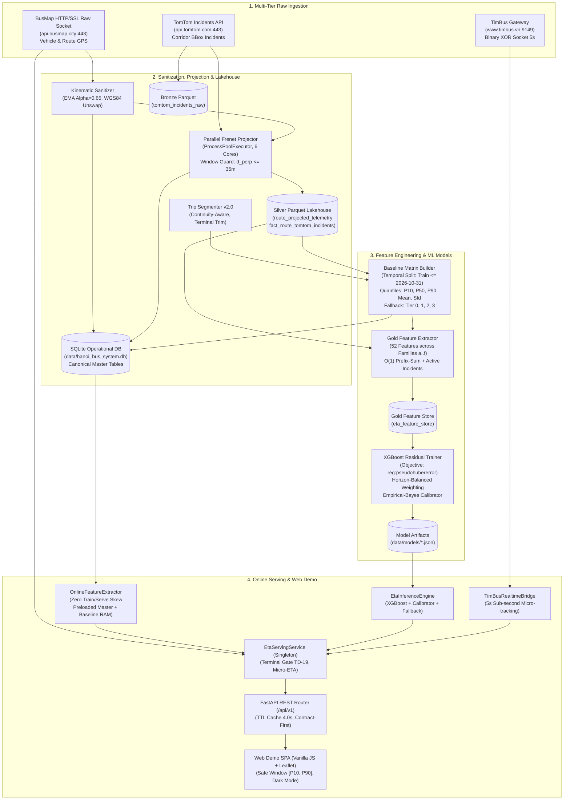

# GROUND TRUTH SPECIFICATION: HANOI BUS BIG DATA & REAL-TIME ETA PREDICTION SYSTEM

> **Document ID:** `SPEC-SYS-00-GROUND-TRUTH`  
> **Author:** `@architect`  
> **Source Code Commit / Baseline:** Verified directly against live codebase (`module_1_*`, `module_2_*`, `module_3_*`, `config/`, `scripts/`, `experiments/`)  
> **Status:** RATIFIED GROUND TRUTH SPECIFICATION (Code-as-Truth)  
> **Constraint Note:** Formulated strictly without consulting legacy documentation files in `docs/` to eliminate context poisoning.

---

## 1. TỔNG QUAN HỆ THỐNG & MÔ HÌNH KIẾN TRÚC TOÀN CỤC

Hệ thống **Hanoi Bus Big Data & Real-time ETA Prediction** là nền tảng xử lý dữ liệu lớn và dự báo thời gian thực thời điểm xe buýt đến trạm (Live ETA) cho mạng lưới 48 tuyến xe buýt hành lang đô thị Hà Nội. Hệ thống kết hợp:
1. **Thu thập dữ liệu viễn trắc đa nguồn (Multi-Tier Ingestion)**: BusMap API (REST + Raw SSL Socket), TomTom Traffic API (Incidents BBox), và TimBus (Giao thức nhị phân đối xứng XOR qua Reverse Engineering).
2. **Chuẩn hóa động học & Chiếu không gian Frenet 1D (Frenet Spatial Projection)**: Chuyển đổi tọa độ WGS84 $(lat, lon)$ sang hệ tọa độ cong 1 chiều dọc tim đường $(s, d_\perp)$, loại bỏ độ lệch ngang và đảm bảo tính tăng đơn điệu của hành trình.
3. **Kiến trúc Hồ dữ liệu Medallion (Bronze - Silver - Gold Lakehouse)**: Phân tầng lưu trữ trên Parquet nén Snappy (phân vùng Hive theo `route_code` và `dt`) kết hợp CSDL vận hành SQLite phục vụ truy vấn chỉ số trực tuyến.
4. **Mô hình học máy dự báo ETA phần dư (Horizon-Balanced Residual XGBoost Regressor)**: Dự báo độ lệch thời gian di chuyển so với Ma trận phân vị lịch sử (Baseline Matrix), tích hợp bộ hiệu chuẩn Empirical-Bayes và cơ chế nội suy vi mô (Micro-ETA Interpolation 5s).
5. **Cổng giao tiếp dịch vụ trực tuyến (FastAPI RESTful Engine & SPA Web App)**: Cung cấp API chuẩn Contract-First Pydantic v2, TTL Cache 4s, bộ phân định trạng thái cổng bến Terminal Gate (TD-19) và giao diện trực quan hóa Leaflet.

### Sơ đồ luồng kiến trúc hệ thống (Mermaid)



---

## 2. LUỒNG DỮ LIỆU THỰC TẾ & KHẾ ƯỚC DỮ LIỆU (IN-PIPELINE DATA FLOW & CONTRACTS)

### 2.1. Phân tầng Medallion Data Pipeline

| Tầng | Định dạng / Lưu trữ | Đường dẫn lưu trữ | Khế ước Schema / Cột dữ liệu chính | Ràng buộc chất lượng (Quality Invariants) |
| :--- | :--- | :--- | :--- | :--- |
| **Raw Ingestion** | JSONL (Append-only) | `data/raw/bus/YYYY-MM-DD.jsonl`<br>`data/raw/incidents/YYYY-MM-DD.jsonl` | `vehicle_id`, `plate`, `Lat`, `Lng`, `Speed`, `Deg`, `direction`, `lastUpdateTime`, `currentStationId`, `_crawled_at` | JSON hợp lệ, có timestamp `_crawled_at` lúc nhận gói HTTP. |
| **Bronze Layer** | Apache Parquet (Snappy) | `data/lakehouse/bronze/tomtom_incidents_raw/dt=YYYY-MM-DD/` | `incident_id`, `timestamp`, `icon_category`, `magnitude_of_delay`, `delay_seconds`, `length_meters`, `coordinates_json`, `description` | 100% snapshot sự cố gốc nguyên vẹn. |
| **Silver Lakehouse** | Apache Parquet (Snappy, Hive Partitions) | `data/lakehouse/silver/route_projected_telemetry/route_code=XX/dt=YYYY-MM-DD/` | `ping_id`, `route_id`, `vehicle_id`, `plate`, `device_update_time`, `device_epoch`, `direction`, `lat`, `lon`, `s_bus_m`, `cross_track_m`, `derived_speed_kmh` | $d_\perp \le 35.0\text{ m}$; `direction` $\in \{\text{"go"}, \text{"re"}\}$; không chứa NaN ở $s, epoch$. |
| **Silver Incidents** | Apache Parquet (Snappy, Hive Partitions) | `data/lakehouse/silver/fact_route_tomtom_incidents/route_code=XX/` | `incident_id`, `episode_idx`, `direction`, `from_station_order`, `to_station_order`, `s_min_m`, `s_max_m`, `overlap_length_m`, `t_start_epoch`, `t_end_epoch`, `delay_seconds`, `magnitude_of_delay` | Thời gian nhân quả 0% future data leakage: $[t_{\text{batch}}, \min(t_{\text{next}}, t_{\text{batch}} + 900\text{s})]$; $\cos\theta \ge 0.50$. |
| **Gold Lakehouse** | Apache Parquet (Snappy, Hive Partitions) | `data/lakehouse/gold/eta_feature_store/split={train,test}/route_code=XX/` | 60 cột: 8 Metadata/Target + 52 Cột đặc trưng (Họ a, b, c, d, e, f). | Chia tách thời gian nghiêm ngặt: Train $\le 2026\text{-}10\text{-}31$; Test $\ge 2026\text{-}11\text{-}01$. |
| **CSDL Vận hành** | SQLite 3 (WAL Mode) | `data/hanoi_bus_system.db` | Bảng chuẩn: `canonical_route_master`, `canonical_shape_master`, `canonical_station_master`, `route_projected_telemetry`, `fact_route_tomtom_incidents`, `agg_segment_travel_times`. Views: `v_bus_to_next_station`, `v_active_fleet_summary`. | Tính toàn vẹn khóa ngoại logical, chỉ mục B-Tree trên `(route_code, direction, s_bus_m)` và `(vehicle_id, device_epoch)`. |

---

### 2.2. Chi tiết Cấu trúc Bảng CSDL SQLite (`data/hanoi_bus_system.db`)

#### 1. Bảng `canonical_route_master`
*Nguồn gốc:* Migration từ `hanoi_bus_routes.geojson` và `hn.routeinfo.json`.
```sql
CREATE TABLE canonical_route_master (
    route_id INTEGER PRIMARY KEY,
    route_code TEXT NOT NULL,
    route_name TEXT NOT NULL,
    company_name TEXT,
    operation_time TEXT,
    headway TEXT,
    total_trips INTEGER,
    point_count_go INTEGER,
    point_count_re INTEGER,
    station_count_go INTEGER,
    station_count_re INTEGER
);
CREATE INDEX idx_crm_code ON canonical_route_master(route_code);
```

#### 2. Bảng `canonical_shape_master`
*Mô tả:* Tọa độ tim đường chuẩn WGS84 kèm khoảng cách tích lũy $s$ (mét) tính từ bến xuất phát.
```sql
CREATE TABLE canonical_shape_master (
    route_id INTEGER NOT NULL,
    route_code TEXT NOT NULL,
    direction TEXT NOT NULL,              -- 'go' hoặc 're'
    point_order INTEGER NOT NULL,
    lat REAL NOT NULL,
    lon REAL NOT NULL,
    cum_distance_m REAL NOT NULL,
    PRIMARY KEY (route_id, direction, point_order)
);
CREATE INDEX idx_csm_route_dir ON canonical_shape_master(route_id, direction);
CREATE INDEX idx_csm_code_dir ON canonical_shape_master(route_code, direction);
```

#### 3. Bảng `canonical_station_master`
*Mô tả:* Danh bạ trạm dừng chuẩn được chiếu vuông góc vào tim đường với hành lang tiến tăng đơn điệu ($s_{k+1} \ge s_k + 15\text{m}$).
```sql
CREATE TABLE canonical_station_master (
    station_id INTEGER NOT NULL,
    route_id INTEGER NOT NULL,
    route_code TEXT NOT NULL,
    direction TEXT NOT NULL,              -- 'go' hoặc 're'
    station_order INTEGER NOT NULL,       -- Thứ tự dọc tuyến (0 .. N-1)
    station_name TEXT NOT NULL,
    address TEXT,
    lat REAL NOT NULL,
    lon REAL NOT NULL,
    cum_distance_m REAL NOT NULL,        -- Lý trình s_station dọc tim đường (m)
    snap_dist_m REAL NOT NULL,           -- Khoảng cách lệch tim đường khi chiếu (m)
    PRIMARY KEY (route_id, direction, station_order)
);
CREATE INDEX idx_cstat_route_dir ON canonical_station_master(route_id, direction);
CREATE INDEX idx_cstat_code_dir ON canonical_station_master(route_code, direction);
```

#### 4. Bảng `route_projected_telemetry` (Silver Operational Telemetry)
*Mô tả:* Dữ liệu viễn trắc đã được lọc nhiễu, chiếu không gian Frenet và nội suy vận tốc vi phân.
```sql
CREATE TABLE route_projected_telemetry (
    ping_id INTEGER PRIMARY KEY,
    route_code TEXT NOT NULL,
    route_id INTEGER NOT NULL,
    vehicle_id INTEGER NOT NULL,
    plate TEXT,
    device_update_time TEXT NOT NULL,
    device_epoch REAL NOT NULL,
    direction TEXT NOT NULL,              -- 'go' hoặc 're'
    lat REAL NOT NULL,
    lon REAL NOT NULL,
    s_bus_m REAL NOT NULL,               -- Tọa độ dọc trục Frenet (m)
    cross_track_m REAL NOT NULL,         -- Sai số lệch tim d_perp (m) <= 35.0m
    derived_speed_kmh REAL               -- Vận tốc vi phân động học delta_s / delta_t
);
CREATE INDEX idx_rpt_route_code ON route_projected_telemetry (route_code);
CREATE INDEX idx_rpt_route_id ON route_projected_telemetry (route_id);
CREATE INDEX idx_rpt_vehicle_epoch ON route_projected_telemetry (vehicle_id, device_epoch);
CREATE INDEX idx_rpt_route_dir_s ON route_projected_telemetry (route_code, direction, s_bus_m);
```

#### 5. Bảng `fact_route_tomtom_incidents` (Causal Episodic Incidents)
*Mô tả:* Sự cố giao thông TomTom được cắt lớp nhân quả và chiếu lên các chặng liên trạm.
```sql
CREATE TABLE fact_route_tomtom_incidents (
    incident_id TEXT NOT NULL,
    episode_idx INTEGER NOT NULL,
    route_code TEXT NOT NULL,
    direction TEXT NOT NULL,
    from_station_order INTEGER NOT NULL,
    to_station_order INTEGER NOT NULL,
    from_station_name TEXT,
    to_station_name TEXT,
    s_min_m REAL NOT NULL,
    s_max_m REAL NOT NULL,
    overlap_length_m REAL NOT NULL,
    t_start_epoch INTEGER NOT NULL,
    t_end_epoch INTEGER NOT NULL,
    t_start_utc TEXT NOT NULL,
    t_end_utc TEXT NOT NULL,
    icon_category INTEGER,
    magnitude_of_delay INTEGER,          -- 1: Nhẹ, 2: Vừa, 3: Nặng, 0: Thi công
    delay_seconds INTEGER,
    d_perp_m REAL,
    description TEXT,
    PRIMARY KEY (incident_id, episode_idx, route_code, direction, from_station_order, to_station_order)
);
CREATE INDEX idx_fact_inc_route_time ON fact_route_tomtom_incidents (route_code, direction, t_start_epoch, t_end_epoch);
CREATE INDEX idx_fact_inc_station_pair ON fact_route_tomtom_incidents (route_code, direction, from_station_order, to_station_order);
```

#### 6. Bảng `agg_segment_travel_times` (Historical Baseline Travel Time Matrix)
*Mô tả:* Ma trận thời gian chạy thống kê phi tham số xây dựng độc lập trên tập Train.
```sql
CREATE TABLE agg_segment_travel_times (
    route_code TEXT NOT NULL,
    direction TEXT NOT NULL,
    from_station_order INTEGER NOT NULL,
    to_station_order INTEGER NOT NULL,
    from_station_id INTEGER NOT NULL,
    to_station_id INTEGER NOT NULL,
    from_station_name TEXT,
    to_station_name TEXT,
    segment_length_m REAL NOT NULL,
    day_type INTEGER NOT NULL,           -- 0: Weekday, 1: Saturday, 2: Sunday
    hour_slot INTEGER NOT NULL,          -- Khung giờ [5 .. 21]
    sample_count INTEGER NOT NULL,
    quality_tier INTEGER NOT NULL,       -- 0: Trực tiếp đủ mẫu, 1: Thưa, 2: Ghép lân cận, 3: Động học vật lý
    tt_p10_sec REAL NOT NULL,            -- Phân vị an toàn (giây)
    tt_p50_sec REAL NOT NULL,            -- Trung vị kỳ vọng Baseline (giây)
    tt_p90_sec REAL NOT NULL,            -- Phân vị trễ tắc đường (giây)
    tt_mean_sec REAL NOT NULL,           -- Giá trị trung bình (giây)
    tt_std_sec REAL NOT NULL,            -- Độ lệch chuẩn (giây)
    PRIMARY KEY (route_code, direction, from_station_order, to_station_order, day_type, hour_slot)
);
```

---

### 2.3. Khế ước API Trực tuyến (Web Demo & REST Contracts - Pydantic v2)

Tập trung tại file `module_3_bus_eta_prediction/step_3_5_web_demo/contract.py`:

```python
class RouteItem(BaseModel):
    route_code: str
    route_id: int
    route_name: str
    has_go_direction: bool = True
    has_re_direction: bool = True

class StationGeometryItem(BaseModel):
    station_order: int
    station_id: int
    station_name: str
    lat: float
    lon: float
    cum_distance_m: float

class RouteGeometryResponse(BaseModel):
    route_code: str
    direction: str                       # 'go' | 're'
    route_length_m: float
    shape_geojson: GeoJsonLineString     # coordinates: [[lon, lat], ...]
    stations: List[StationGeometryItem]

class PredictionItem(BaseModel):
    target_station_order: int
    target_station_id: int
    target_station_name: str
    target_distance_m: float
    eta_seconds: float                   # Dự báo XGBoost + Calibrator
    eta_minutes: float
    baseline_p10_sec: Optional[float]
    baseline_p50_sec: Optional[float]
    baseline_p90_sec: Optional[float]
    safe_arrival_time: str               # HH:MM (Khuyến nghị có mặt theo P10)
    expected_arrival_time: str           # HH:MM (Dự kiến đến theo ETA)
    safe_window: str                     # "HH:MM – HH:MM" ([P10, P90])

class LiveBusItem(BaseModel):
    vehicle_id: str
    plate: str
    status: str                          # 'ACTIVE_IN_TRANSIT' | 'AT_ORIGIN_TERMINAL' | 'AT_DESTINATION_TERMINAL' | 'DETOUR_OFF_CORRIDOR'
    lat: float
    lon: float
    speed_kmh: float
    heading_deg: float
    current_s_bus_m: Optional[float]
    cross_track_m: Optional[float]
    current_station_order: Optional[int]
    current_station_name: Optional[str]
    message: Optional[str]
    telemetry_source: Optional[str]       # 'timbus_5s' | 'busmap_relay'
    predictions: List[PredictionItem]

class LiveEtaResponse(BaseModel):
    route_code: str
    direction: str
    timestamp: str                       # ISO-8601
    cached: bool
    total_buses: int
    active_in_transit_count: int
    traffic_condition: str               # "Thông thoáng" | "Ùn ứ chậm" | "Kẹt xe cục bộ" | "Ca đêm..."
    buses: List[LiveBusItem]

class HealthResponse(BaseModel):
    status: str = "healthy"
    service_initialized: bool
    uptime_seconds: float
    active_cache_entries: int
    memory_rss_mb: float
```

---

## 3. DANH SÁCH INTERFACE, CLASSES CHÍNH VÀ METHOD SIGNATURES

### 3.1. Phân hệ Thu thập & Tiền xử lý (Module 1)

#### `module_1_data_ingestion_and_preprocessing.step_1_1_busmap_crawler_and_relay`
- **`socket_client.py`**:
  - `get_busmap_ip() -> str`: Cache DNS trong RAM cho `api.busmap.city`, TTL 600s.
  - `fetch_single_bus_raw(v_id: int) -> Optional[Dict[str, Any]]`: Gửi raw HTTP qua SSL socket, đóng dấu `_crawled_at`, tự động retry 1 lần khi gặp 429 kèm xoay Device-ID.
- **`device_pool.py`**:
  - `get_current_progressive_pool_size() -> int`: Tính kích thước bể thiết bị lũy tiến (300 $\to$ 5.000 thiết bị).
  - `get_busmap_device_id(v_id: Optional[int]=None, bad_device_id: Optional[str]=None, force_rotate: bool=False) -> str`: Cấp phát Device-ID từ danh bạ 5.000 khóa SHA-256 xác định.
- **`catalog_refresher.py`**:
  - `fetch_route_buses_live(route_id: int, direction: int = 0) -> List[Dict[str, Any]]`: Truy vấn HTTP GET endpoint `route_bus_gps` của BusMap kèm header chữ ký epoch/proof MD5 (`BUSMAP_SALT = ":Bus2019M@p_"`).
  - `audit_vehicle(vid: int) -> Dict[str, Any]`: Đánh giá trạng thái `ACTIVE | DEPOT | STALE | OFFLINE`.
  - `run_daily_catalog_refresh() -> None`: Rà soát đầu ngày (05:00 sáng), thanh lọc xe zombie treo $>48\text{h}$ và tự bổ sung xe mới vào `data/metadata/hust_cluster_config.json`.
- **`incident_client.py`**:
  - `fetch_tomtom_incidents(api_key: str, bbox: str) -> List[Dict[str, Any]]`: Truy vấn sự cố TomTom với Circuit Breaker ngắt kết nối ngay nếu nhận mã HTTP 403/429.
  - `load_tomtom_quota_state() -> Dict[str, int]`: Đọc sổ cái hạn ngạch ngày/tháng từ `data/metadata/tomtom_quota_tracker.json`.

#### `module_1_data_ingestion_and_preprocessing.step_1_3_telemetry_kinematic_sanitizer`
- **`telemetry_sanitizer.py`**:
  - `sanitize_and_validate_telemetry(raw: Dict[str, Any], vid: int, target_route_ids: Set[int], kinematic_cache: Dict[int, Any], crawl_time_iso: Optional[str]=None) -> Optional[Dict[str, Any]]`:
    - Đảo ngược Lat/Lon do BusMap hoán vị (`std_lon = float(raw["Lat"])`, `std_lat = float(raw["Lng"])`).
    - Tính $v_{\text{calc}}$ và làm mịn EMA ($\alpha = 0.65$).
    - Gán nhãn `quality_status`: `ACTIVE_VALID`, `IDLE_DEPOT`, `OUT_OF_BOUNDS`, `REASSIGNED_ROUTE`, `GPS_DRIFT_JUMP`, `STALE_PING`.
- **`trip_segmenter.py`**:
  - `segment_trajectory_into_trips(pings: List[Tuple[Any, ...]], epoch_idx: int=4, s_idx: int=10, shape_len_m: Optional[float]=None, trim_terminals: bool=True) -> List[List[Tuple[Any, ...]]]`:
    - Phân tách chuỗi ping đã sắp xếp theo thời gian thành các chuyến xe đơn điệu tiến.
    - Cắt tỉa đuôi đỗ bến xuất phát/đích (`trim_terminal_stationary_ends`).
    - Cho phép bắc cầu nối chuyến detour nếu $300\text{s} < \Delta t \le 1800\text{s}$ và vận tốc trung bình đạt $2 \le v \le 60\text{ km/h}$.

#### `module_1_data_ingestion_and_preprocessing.step_1_4_frenet_spatial_projection`
- **`multi_route_projector.py`**:
  - `project_points_to_shape(vehicle_pings: List[Tuple[Any, ...]], shape_pts: List[Tuple[float, float, float]]) -> List[Tuple[int, float, float]]`: Chiếu vector trực giao GPS lên đoạn thẳng tim đường, áp dụng cửa sổ trượt tiến giới hạn $\Delta s$ theo vận tốc cực đại ($22.22\text{ m/s}$).
  - `worker_project_route(args: Tuple[...]) -> Tuple[int, str, int, list, float]`: Hàm worker độc lập cho từng tiến trình CPU (`ProcessPoolExecutor`).
  - `run_parallel_projection(db_path: str, num_workers: Optional[int]=None) -> None`: Điều phối chạy song song 6 lõi CPU trên toàn bộ 48 tuyến.
- **`tomtom_incident_projector.py`**:
  - `build_route_segment_grid(shapes: list) -> dict`: Lập chỉ mục không gian dạng lưới $O(1)$ cho các đoạn tim đường.
  - `project_linestring_to_route_grid(...) -> list`: Chiếu LineString sự cố TomTom lên tim đường tuyến buýt với điều kiện $\cos\theta \ge 0.50$ và $d_\perp \le 35\text{m}$.

---

### 3.2. Phân hệ Lưu trữ & Hồ dữ liệu (Module 2)

#### `module_2_big_data_storage_and_lakehouse.step_2_1_sqlite_operational_store.db_manager`
```python
class OperationalDatabaseManager:
    def __init__(self, db_path: Optional[str] = None) -> None: ...
    def get_connection(self) -> sqlite3.Connection: ...
    def ensure_unified_views(self) -> None: ...
    def get_route_telemetry_df(self, route_code: str, direction: Optional[str] = None) -> pd.DataFrame: ...
    def get_route_stations(self, route_code: str, direction: str = "go") -> List[Dict[str, Any]]: ...
    def get_database_statistics(self) -> Dict[str, Any]: ...
```

#### `module_2_big_data_storage_and_lakehouse.step_2_2_parquet_medallion_lakehouse.lakehouse_exporter`
- `export_bronze_tomtom_incidents(lakehouse_root: str, incidents_glob: str, force_overwrite: bool=False) -> Dict[str, float]`: Xuất Bronze Parquet nén Snappy từ raw JSONL.
- `export_to_parquet_lakehouse(db_path: str, lakehouse_root: str, top_routes_only: Optional[int]=None, force_overwrite: bool=False) -> Dict[str, object]`: Xuất Silver Telemetry (lọc $d_\perp \le 35\text{m}$) và Silver Incidents phân vùng Hive theo `route_code` và `dt`.

---

### 3.3. Phân hệ Dự báo ETA & Phục vụ Trực tuyến (Module 3)

#### `module_3_bus_eta_prediction.step_3_1_historical_baseline_model.baseline_matrix_builder`
- `get_active_corridor_stations(st_list: List[Tuple[int, int, str, float]]) -> List[Tuple[int, int, str, float]]`: Loại trừ 2 trạm đầu cuối bến (Trạm 0 và Trạm N) theo quy chuẩn TD-19, chỉ giữ dải trạm nội tuyến $[1 .. N-1]$.
- `get_bus_terminal_or_corridor_status(s_bus_m: float, st_list: List[Tuple[...]]) -> str`: Phân định trạng thái xe: `AT_ORIGIN_TERMINAL`, `AT_DESTINATION_TERMINAL`, `ACTIVE_IN_TRANSIT`.
- `extract_bracketed_station_arrivals(trip: List[Tuple[...]], stations: List[Tuple[...]], epoch_idx: int=1, s_idx: int=2) -> Dict[int, float]`: Nội suy tuyến tính thời điểm qua trạm từ cặp ping kẹp chặt ($0 < \Delta t \le 150\text{s}$, $0 \le \Delta s \le \max(1000\text{m}, 1.35 \times s_{\text{seg}})$).
- `build_and_evaluate_baseline_matrix() -> Dict[str, Any]`: Xây dựng ma trận thời gian chạy `agg_segment_travel_times` trên tập Train và đánh giá trên tập Test độc lập.

#### `module_3_bus_eta_prediction.step_3_3_machine_learning_models.eta_model_trainer`
- `train_xgb_residual_model(fit_df: pd.DataFrame, val_df: pd.DataFrame, feature_cols: List[str], model_label: str, ...) -> Tuple[xgb.XGBRegressor, float]`: Huấn luyện mô hình XGBoost dự báo phần dư với trọng số nghịch đảo phương sai.
- `predict_eta_with_residual_model(model: xgb.XGBRegressor, df: pd.DataFrame, feature_cols: List[str]) -> np.ndarray`: Suy luận $\text{ETA} = \max(5.0, \text{Baseline P50} + \Delta\widehat{\text{ETA}})$.
- `build_empirical_bayes_calibrator(...) -> Dict[Tuple[int, int, int], Tuple[float, float]]`: Xây dựng bộ hiệu chuẩn co cụm Bayes theo `(route_idx, direction_id, horizon_bucket)`.
- `apply_per_route_calibrator(df: pd.DataFrame, raw_preds: np.ndarray, calibrator: Dict[...]) -> np.ndarray`: Áp dụng hiệu chuẩn co cụm lên dự báo thô.

#### `module_3_bus_eta_prediction.step_3_4_eta_serving_and_evaluation.online_feature_extractor`
```python
class OnlineFeatureExtractor:
    def __init__(self, db_path: str = DEFAULT_DB_PATH) -> None: ...
    def project_coordinate(self, route_code: str, direction: str, lat: float, lon: float) -> Tuple[float, float, bool]: ...
    def get_terminal_gate_status(self, route_code: str, direction: str, s_bus_m: float) -> str: ...
    def update_vehicle_trace(self, vehicle_id: str, epoch: float, s_bus_m: float, speed_kmh: float) -> None: ...
    def record_segment_traversal(self, route_code: str, direction: str, from_order: int, to_order: int, tt_sec: float, epoch: float) -> None: ...
    def extract_features_for_ego(
        self,
        route_code: str,
        direction: str,
        vehicle_id: str,
        device_epoch: float,
        s_bus_m: float,
        speed_kmh: float,
        target_station_order: Optional[int] = None
    ) -> pd.DataFrame: ...
```

#### `module_3_bus_eta_prediction.step_3_4_eta_serving_and_evaluation.eta_inference_engine`
```python
class EtaInferenceEngine:
    def __init__(self, tag: str = "_r3_big", model_dir: str = MODEL_DIR) -> None: ...
    def validate(self, df: pd.DataFrame) -> None: ...
    def predict(self, df: pd.DataFrame, calibrate: bool = True) -> np.ndarray: ...
```

#### `module_3_bus_eta_prediction.step_3_4_eta_serving_and_evaluation.eta_serving_service`
```python
class EtaServingService:
    @classmethod
    def get_instance(cls, tag: str = "_r3_big", db_path: str = DEFAULT_DB_PATH) -> "EtaServingService": ...
    def predict_for_vehicle(
        self,
        route_code: str,
        direction: Union[str, int],
        vehicle_id: Union[str, int],
        lat: float,
        lon: float,
        speed_kmh: float = 0.0,
        device_epoch: Optional[float] = None,
        target_station_order: Optional[int] = None,
        is_vehicle_query: bool = False
    ) -> Dict[str, Any]: ...
    def predict_route_snapshot_live(
        self,
        route_code: str,
        direction: Union[str, int] = 0,
        target_station_id: Optional[int] = None
    ) -> Dict[str, Any]: ...
```

#### `module_3_bus_eta_prediction.step_3_5_web_demo.timbus_bridge`
```python
class TimBusRealtimeBridge:
    @classmethod
    def get_instance(cls, service: Optional[EtaServingService] = None) -> "TimBusRealtimeBridge": ...
    def project_timbus_telemetry(self, route_code: str, direction: str, lat: float, lon: float) -> Tuple[float, float, bool]: ...
    def interpolate_micro_eta(self, predictions: List[Dict[str, Any]], old_s_bus: float, new_s_bus: float, current_speed_kmh: float) -> List[Dict[str, Any]]: ...
    def resolve_bus_telemetry_state(self, route_code: str, direction: str, bus_item: Dict[str, Any], tb_record: Optional[Any]) -> Dict[str, Any]: ...
    def enrich_snapshot_with_timbus(self, route_code: str, direction: Union[str, int], raw_snapshot: Dict[str, Any], timeout: float = 2.0) -> Dict[str, Any]: ...
```

---

## 4. CÁC MÔ HÌNH TOÁN HỌC & MACHINE LEARNING ĐANG THỰC SỰ SỬ DỤNG

### 4.1. Chiếu không gian Frenet 1D & Cửa sổ trượt Monotonic
Cho một điểm vị trí xe buýt $P = (\lambda_P, \phi_P)$ (kinh độ, vĩ độ) và đa tuyến tim đường chuẩn gồm chuỗi đoạn thẳng nối các điểm $S_i = (\lambda_i, \phi_i, s_i)$.
Hệ số co giãn khoảng cách mét cục bộ theo hình cầu ellipsoid WGS84:
$$k_x = 111320.0 \cdot \cos\left(\frac{\phi_P \cdot \pi}{180}\right), \quad k_y = 110540.0$$
Khoảng cách vector và hình chiếu trực giao tham số $t \in [0, 1]$:
$$\mathbf{v} = (x_2 - x_1, y_2 - y_1), \quad \mathbf{u} = (x_P - x_1, y_P - y_1)$$
$$t^* = \text{clip}\left(\frac{\mathbf{u} \cdot \mathbf{v}}{\|\mathbf{v}\|^2}, 0.0, 1.0\right)$$
$$s_P = s_1 + t^* \cdot (s_2 - s_1), \quad d_\perp = \|\mathbf{u} - t^* \mathbf{v}\|$$

**Cửa sổ trượt tiến thích ứng (Monotonic Forward Window Guard):**
Để ngăn hiện tượng nhảy giật lùi vị trí do nhiễu đa đường GPS hoặc giao lộ tự cắt vòng:
$$s_{\min} = \max(0, s_{\text{prev}} - 20.0\text{ m}), \quad s_{\max} = s_{\text{prev}} + \max(1500.0\text{ m}, \Delta t \cdot 22.22\text{ m/s})$$
Chỉ tìm kiếm phân đoạn tim đường trong cửa sổ $[s_{\min}, s_{\max}]$. Điểm chiếu chỉ được chấp nhận vào tầng Silver nếu $d_\perp \le 35.0\text{ m}$.

---

### 4.2. Vận tốc Vi phân Động học & Làm mịn EMA
Vận tốc tức thời được tính toán từ độ dời lý trình dọc tim đường:
$$v_{\text{calc}} = \frac{\Delta s}{\Delta t} \times 3.6 \quad (\text{km/h})$$
Với điều kiện thời gian kẹp $3.0\text{s} \le \Delta t \le 300.0\text{s}$. Nếu $v_{\text{calc}} > 80.0\text{ km/h}$, đánh dấu là nhiễu giật nhảy GPS (`GPS_DRIFT_JUMP`).
Vận tốc sau làm mịn Exponential Moving Average:
$$v_{\text{smooth}}^{(t)} = \alpha \cdot v_{\text{calc}}^{(t)} + (1 - \alpha) \cdot v_{\text{smooth}}^{(t-1)}, \quad \alpha = 0.65$$

---

### 4.3. Ma trận Phân vị Thời gian Chạy Lịch sử (Baseline Quantile Matrix)
Trên tập huấn luyện độc lập ($\text{Train} \le 2026\text{-}10\text{-}31$), với mỗi đoạn liên trạm $k \to k+1$, loại ngày $d \in \{0, 1, 2\}$ và khung giờ $h \in [5, 21]$, phân phối thời gian chạy mẫu $T_{k, k+1, d, h}$ được ước lượng phi tham số:
$$\text{P10} = \text{Percentile}_{10}(T), \quad \text{P50} = \text{Median}(T), \quad \text{P90} = \text{Percentile}_{90}(T)$$
Bất biến toán học đảm bảo: $\text{P10} \le \text{P50} \le \text{P90}$.

**Hệ thống phân cấp bù trũng dữ liệu (Multi-Tier Fallback Hierarchy):**
- **Tier 0**: Đủ mẫu trực tiếp ($N \ge 10$ cho ngày thường; $N \ge 5$ cho Thứ 7/Chủ Nhật sau khi trượt kernel 3 giờ $[h-1, h, h+1]$ cùng loại ngày khi $N_{\text{direct}} < 8$).
- **Tier 1**: Mẫu thưa ($3 \le N < 10$).
- **Tier 2**: Ghép mẫu các giờ lân cận $[h-1, h+1]$ hoặc gom toàn bộ mẫu của đoạn theo loại ngày.
- **Tier 3**: Bù trừ động học vật lý dựa trên chiều dài đoạn và vận tốc trung bình tuyến:
  $$\text{P50} = \frac{s_{k+1} - s_k}{v_{\text{route}}}, \quad \text{P10} = 0.75 \times \text{P50}, \quad \text{P90} = 1.35 \times \text{P50}$$

Thời gian chạy Baseline đa trạm từ vị trí xe tại $s_{\text{bus}}$ đến trạm đích $K$ được tính bằng cấu trúc cộng dồn tiền tố $O(1)$ (Prefix Sum):
$$\text{Baseline P50}(s_{\text{bus}} \to K) = \text{P50}_{\text{fractional}}(s_{\text{bus}} \to k_{\text{next}}) + \sum_{j = k_{\text{next}}}^{K - 1} \text{P50}(j \to j+1)$$

---

### 4.4. Mô hình Học máy XGBoost Dự báo Phần dư (Residual Learning)
Thay vì dự báo trực tiếp giá trị ETA tuyệt đối (dẫn đến sai số tích lũy lớn ở chặng dài), mô hình học máy tập trung dự báo phần dư gia tốc / trễ giao thông so với ma trận phân vị:
$$\Delta \text{ETA} = \text{Actual ETA} - \text{Baseline P50}$$

**Hàm mục tiêu & Trọng số cân bằng chân trời (Horizon-Balanced Weighting):**
Sử dụng hàm tổn thất Pseudo-Huber kháng nhiễu cực đoan:
$$L_\delta(y, \hat{y}) = \delta^2 \left( \sqrt{1 + \left(\frac{y - \hat{y}}{\delta}\right)^2} - 1 \right), \quad \delta = 90.0\text{ s}$$
Trọng số mẫu tỉ lệ nghịch với độ lệch chuẩn kỳ vọng của chặng hành trình:
$$w_i = \frac{1}{\sqrt{\max(60.0, \text{Baseline P50}_i)}}$$
Cơ chế này ngăn không cho các chặng hành trình dài (>15 trạm, phương sai lớn) áp đảo làm giảm độ chính xác của các chặng ngắn (1..5 trạm).

**Bộ hiệu chuẩn Empirical-Bayes Co cụm Phần dư:**
Với mỗi nhóm $(\text{route\_id}, \text{direction\_id}, \text{horizon\_bucket})$, độ lệch trung bình $\mu_{\text{group}}$ và phương sai được co cụm về phân phối tổng thể:
$$\Delta\mu_{\text{cal}} = \frac{N_{\text{group}}}{N_{\text{group}} + \tau} \bar{r}_{\text{group}} + \frac{\tau}{N_{\text{group}} + \tau} \bar{r}_{\text{global}}$$
$$\widehat{\text{ETA}} = \max\left(5.0, \text{Baseline P50} + \Delta\widehat{\text{ETA}}_{\text{XGB}} - \Delta\mu_{\text{cal}}\right)$$

---

### 4.5. Không gian Đặc trưng 52/54 Chiều (Feature Store Schema)

| Họ đặc trưng | Số lượng | Danh sách các cột đặc trưng | Ý nghĩa vật lý / Causal Mechanism |
| :--- | :--- | :--- | :--- |
| **(a) Trạng thái & Động học Xe chủ** | 21 | `route_id_idx`, `direction_id`, `current_station_order`, `target_station_order`, `day_type`, `day_of_week`, `hour_slot`, `sin_time`, `cos_time`, `s_bus_m`, `s_target_m`, `remaining_distance_m`, `n_stations_ahead`, `progress_ratio`, `target_progress_ratio`, `dist_to_next_station_m`, `ego_speed_instant_kmh`, `ego_speed_roll3_kmh`, `ego_speed_roll5_kmh`, `ego_accel_kmh_per_min`, `ego_speed_ratio_vs_baseline` | Vị trí không gian, pha chu kỳ thời gian (sin/cos), vận tốc tức thời, vận tốc cuộn 3 nhịp, gia tốc vi phân và tỷ số so với lịch sử. |
| **(b) Đội xe Cùng tuyến Phía trước / Sau** | 8 | `lead_bus_dist_ahead_m`, `lead_bus_time_headway_sec`, `lead_bus_speed_kmh`, `lead_bus_speed_ratio`, `follow_bus_dist_behind_m`, `follow_bus_speed_kmh`, `n_active_buses_on_route`, `n_buses_in_corridor_ahead` | Khoảng cách và giãn cách thời gian tới xe đi trước/sau; phát hiện hiện tượng chùm xe (Bus Bunching). |
| **(c) Xe tiền trạm Vừa đi qua (Recent Probe)** | 4 | `recent_corridor_tt_sum_sec`, `recent_corridor_congestion_ratio`, `recent_seg_coverage_ratio`, `recent_next_seg_congestion_ratio` | Thông tin thực đo thời gian chạy của xe buýt chạy ngay trước trong cửa sổ 30 phút. |
| **(d) Ma trận Thống kê Lịch sử** | 9 | `baseline_eta_p50_sec`, `baseline_eta_mean_sec`, `baseline_eta_p10_sec`, `baseline_eta_p90_sec`, `baseline_eta_iqr_sec`, `baseline_eta_rss_std_sec`, `baseline_skew_sec`, `baseline_max_seg_p90_sec`, `baseline_tier0_frac` | Thời gian chạy trung vị, độ phân tán IQR, tổng độ lệch chuẩn hình học RSS và tỷ lệ ô chất lượng cao Tier 0. |
| **(e) Sự cố TomTom Phía trước** | 6 | `inc_ahead_count`, `inc_ahead_total_delay_sec`, `inc_ahead_max_delay_sec`, `inc_ahead_max_magnitude`, `inc_ahead_jam_length_m`, `inc_dist_to_nearest_m` | Số lượng sự cố, tổng độ trễ khai báo từ TomTom, chiều dài đoạn ùn tắc và khoảng cách tới sự cố gần nhất. |
| **(f) Hồ sơ Tuyến & Tương tác Vật lý** | 4 | `route_base_speed_kmh`, `route_station_spacing_m`, `physics_kinematic_eta_sec`, `physics_probe_corrected_eta_sec` | Vận tốc đặc trưng tuyến, khoảng cách trạm trung bình và mô hình vật lý hiệu chỉnh trực tiếp. |

---

### 4.6. Cơ chế Nội suy Vi mô (TimBus 5s Micro-ETA Interpolation)
Khi xe nhận được tín hiệu GPS tần suất cao 5 giây từ TimBus di chuyển được khoảng cách $\Delta s = s_{\text{timbus}} - s_{\text{busmap}} > 0$:
$$v_{\text{eff}} = \max\left(2.5, \min\left(18.0, \frac{v_{\text{timbus}}}{3.6}\right)\right) \quad (\text{m/s})$$
$$\Delta t_{\text{saved}} = \min\left(300.0, \max\left(0.0, \frac{\Delta s}{v_{\text{eff}}}\right)\right) \quad (\text{s})$$
$$\text{ETA}_{\text{updated}} = \max(5.0, \text{ETA}_{\text{macro}} - \Delta t_{\text{saved}})$$
Cơ chế này giúp đồng hồ đếm ngược trôi mượt từng giây mà không gây phá vỡ biên giới hạn phân vị vĩ mô của mô hình ML.

---

## 5. ĐIỂM NGHẼN, NỢ KỸ THUẬT VÀ CẢNH BÁO TỪ MÃ NGUỒN (TECHNICAL DEBT AUDIT)

Qua khảo sát toàn diện từng dòng mã nguồn đang thực thi, kiến trúc sư ghi nhận các cảnh báo kỹ thuật sau:

### 5.1. Bất đối xứng Quy ước Tọa độ giữa các API BusMap (Coordinate Swapping Anomaly)
- **Vấn đề mã nguồn:** 
  - Endpoint chi tiết xe `vehicle_hn/get?id=...` (trong `socket_client.py` và `telemetry_sanitizer.py`) trả về tọa độ bị hoán vị: trường `"Lat"` là Kinh độ (105.xxx), trường `"Lng"` là Vĩ độ (21.xxx).
  - Endpoint lộ trình `route_bus_gps?routeId=...` (trong `catalog_refresher.py` và `eta_serving_service.py`) lại trả về tọa độ chuẩn: trường `"Lat"` là Vĩ độ (21.xxx), trường `"Lng"` là Kinh độ (105.xxx).
- **Rủi ro:** Nếu bất kỳ module nào gọi nhầm hàm giải mã hoặc truyền sai tham số `is_vehicle_query`, xe buýt sẽ bị chiếu văng ra ngoài biển Đông hoặc biên giới do hoán vị Lat/Lon, dẫn đến 100% bản tin bị rơi vào cờ `OUT_OF_BOUNDS` hoặc `DETOUR_OFF_CORRIDOR`.
- **Hiện trạng:** Đã được cô lập an toàn bằng cờ `is_vehicle_query` tại `EtaServingService.predict_for_vehicle`, nhưng cần bảo lưu nghiêm ngặt khế ước này.

### 5.2. Lệch tên biến hằng số trong Bộ lọc Nhiễu Động học (`telemetry_sanitizer.py`)
- **Vấn đề mã nguồn:** Tại dòng 75 của `telemetry_sanitizer.py`:
  ```python
  dist = haversine_distance(prev_lat, prev_lon, std_lat, std_lon)
  if dist < BUS_STOPPED_SPEED_KMPH:
      calc_speed = 0.0
  ```
  Hàm `haversine_distance` trả về khoảng cách mét ($m$). Hằng số `BUS_STOPPED_SPEED_KMPH` được định nghĩa trong `system_config.py` có giá trị là `5.0`.
- **Tác động:** Về mặt toán học, so sánh $dist < 5.0\text{ m}$ là ngưỡng bán kính đứng yên (GPS jitter radius) hoàn toàn hợp lý trong thực tế. Tuy nhiên việc dùng hằng số có hậu tố tên `_KMPH` (vận tốc km/h) để so sánh với biến khoảng cách mét là một nợ kỹ thuật về mặt định danh biến (Semantic naming debt).

### 5.3. Độ phức tạp truy vấn trong SQL View `v_bus_to_next_station`
- **Vấn đề mã nguồn:** Trong `OperationalDatabaseManager.ensure_unified_views`:
  ```sql
  AND s.cum_distance_m = (
      SELECT MIN(s2.cum_distance_m)
      FROM canonical_station_master s2
      WHERE s2.route_code = t.route_code
        AND s2.direction = t.direction 
        AND s2.cum_distance_m >= t.s_bus_m
  )
  ```
- **Tác động:** Đây là truy vấn con tương quan (Correlated Subquery) thực thi trên từng dòng của `route_projected_telemetry`. Mặc dù trên bảng trạm dừng ($M \approx 40$ trạm/tuyến) tốc độ xử lý nhanh, nhưng khi bảng viễn trắc tăng trưởng $> 5.000.000$ dòng, việc `SELECT` toàn bảng từ View này mà không có mệnh đề `WHERE route_code = ...` sẽ gây nghẽn CPU SQLite.

### 5.4. Giao thức TimBus Gateway chạy trên HTTP không mã hóa TLS và Phụ thuộc IP tĩnh
- **Vấn đề mã nguồn:** Trong `experiments/timbus/timbus_tracker.py`, kết nối đến TimBus Gateway sử dụng `http://www.timbus.vn:9149/SearchBuyt/VehicleState` qua cổng raw TCP 9149 HTTP 1.1.
- **Rủi ro:** Giao thức sử dụng mã hóa đối xứng dòng XOR tự thiết kế, gửi qua mạng Internet công cộng không qua TLS. Cổng 9149 có thể bị tường lửa doanh nghiệp hoặc các môi trường Cloud chặn cổng lạ ngoài 80/443.
- **Biện pháp phòng ngừa:** `TimBusRealtimeBridge` đã trang bị đầy đủ Fallback State Machine (TD-38), tự động rớt về `busmap_relay` nếu cổng 9149 timeout sau 2.0 giây.

### 5.5. Hạn ngạch TomTom Incident API & Vô hiệu hóa Toàn phần TomTom Flow
- **Vấn đề mã nguồn:** TomTom Flow API đã bị vô hiệu hóa 100% (`ENABLE_TOMTOM_FLOW = False`) để bảo toàn hạn ngạch và tính tổng quát hóa mô hình. TomTom Incidents API bị giới hạn trần 80 requests/ngày (2.500 reqs/tháng).
- **Cơ chế an toàn:** Đã có Circuit Breaker tự ngắt kết nối khi gặp HTTP 403/429 và bộ đếm hạn mức lưu trạng thái bền vững tại `data/metadata/tomtom_quota_tracker.json`.

---

## 6. TIÊU CHÍ NGHIỆM THU ĐẶC TẢ (VERIFIABLE ACCEPTANCE CRITERIA)

Một thành phần triển khai hoặc bản vá mới trong hệ thống chỉ được coi là đạt yêu cầu khi thỏa mãn 100% các tiêu chí sau:

1. **Bất biến Không gian Frenet (Frenet Invariant)**:
   - 100% các bản tin trong tầng Silver Parquet và CSDL vận hành có sai số lệch tim $d_\perp \le 35.0\text{ m}$.
   - Tuyệt đối không hoán đổi chiều di chuyển: ping chiều `go` chỉ được chiếu lên polyline `go`, ping chiều `re` chỉ được chiếu lên polyline `re` (Bảo toàn TD-37).
2. **Bất biến Phân vị Thời gian Chạy (Quantile Monotonicity)**:
   - Trên toàn bộ 169.830 ô của bảng `agg_segment_travel_times`, điều kiện $\text{P10} \le \text{P50} \le \text{P90}$ và $\text{P10} \ge 0$ phải đúng 100%.
   - Không được xảy ra tình trạng rò rỉ dữ liệu tương lai (Data Leakage): Toàn bộ ma trận Baseline và mô hình huấn luyện chỉ được học trên dữ liệu $\le 2026\text{-}10\text{-}31$.
3. **Độ lệch Đặc trưng Bằng Không (Zero Train/Serve Skew)**:
   - Vector đặc trưng $\mathbf{x} \in \mathbb{R}^{54}$ trích xuất từ `OnlineFeatureExtractor` khi đối soát với `Gold Feature Store` trên cùng một bộ dữ liệu lịch sử phải có độ lệch sai số tuyệt đối $< 0.05$ trên tất cả các cột đặc trưng xương sống.
4. **Hiệu năng Phục vụ Trực tuyến (Serving SLA)**:
   - Độ trễ trích xuất đặc trưng và suy luận mô hình cho một xe buýt đơn lẻ phải đạt $P_{95} \le 10\text{ ms}$.
   - Tần suất làm mới dữ liệu web demo đạt 5.0 giây/chu kỳ với bộ đệm TTL Cache 4.0s bảo vệ Gateway.
5. **Cổng Phân định Bến (Terminal Gate Invariant TD-19)**:
   - Xe có $s < s_{\text{station}}[1]$ phải trả về trạng thái `AT_ORIGIN_TERMINAL`.
   - Xe có $s \ge s_{\text{station}}[N-1]$ phải trả về trạng thái `AT_DESTINATION_TERMINAL`.
   - Chỉ các xe nằm trong dải trạm $[1 .. N-1]$ mới được kích hoạt mô hình học máy tính ETA chặng tiếp theo.
