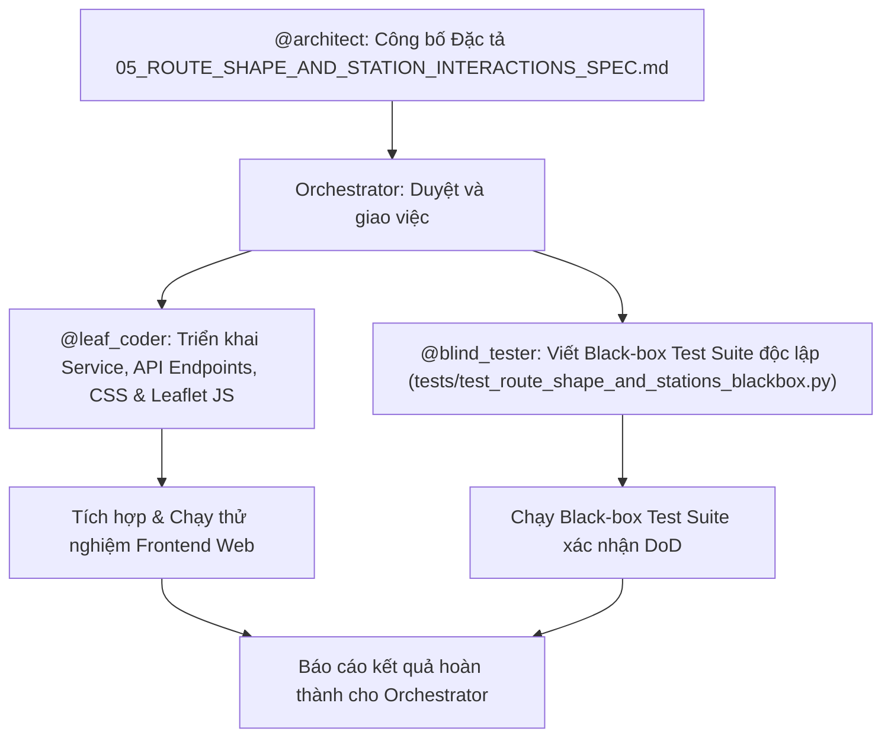

# SPEC-05: ĐẶC TẢ GIAO DIỆN & DỮ LIỆU - VẼ TIM TUYẾN, TRẠM DỪNG ĐÁNH SỐ VÀ TƯƠNG TÁC TRẠM CHUẨN TRÊN NỀN VỆ TINH ESRI

> Thiết kế giữ để tra hợp đồng; trạng thái/số liệu/giao diện gốc cần đối chiếu code/test. Xem [chỉ mục](README.md). Không tự thực thi phân công agent hoặc lệnh dọn file lịch sử.

> **Verification note (2026-11-10):** Historic PASS statements are pending re-verification. Until the split migration is wired, `busmap_service.py` owns the public route facade; no current black-box suite exists.

- **Mã tài liệu**: `docs/specs/05_ROUTE_SHAPE_AND_STATION_INTERACTIONS_SPEC.md`
- **Phiên bản**: 1.0.0
- **Tác giả**: `@architect`
- **Người thực hiện**: `@leaf_coder`
- **Người kiểm thử độc lập**: `@blind_tester`
- **Ngày ban hành**: 2026-11-09
- **Trạng thái**: PHÊ DUYỆT / SẴN SÀNG TRIỂN KHAI (APPROVED FOR IMPLEMENTATION)

---

## 1. TỔNG QUAN HỆ THỐNG & ĐỘNG LỰC THIẾT KẾ (SYSTEM CONTEXT & MOTIVATION)

### 1.1. Bối cảnh & Yêu cầu từ Người dùng
Trong kiến trúc hiển thị xe buýt thời gian thực (BusMap Discrete Tracking), người dùng cần kiểm tra và giám sát tuyến đường thực tế trên nền bản đồ ảnh vệ tinh **Esri World Imagery**. Để đạt được mục tiêu này, hệ thống cần:
1. **Vẽ tim tuyến (Route Shape Polyline)**: Hiển thị đầy đủ hình học quỹ đạo đường đi thực tế của tuyến xe buýt theo từng chiều hành trình (Đi / Về), đảm bảo tim tuyến bám sát mạng lưới giao thông Hà Nội.
2. **Vẽ toàn bộ trạm dừng (Bus Stops)**: Hiển thị trực quan tất cả các trạm đón/trả khách của tuyến theo thứ tự di chuyển.
3. **Đánh số thứ tự trạm trực quan (Numbered Badge Marker)**: Để người dùng thẩm định và phát hiện lỗi dữ liệu (như trạm bị nhảy cóc, lộn ngược chiều, hoặc đứt gãy), mỗi trạm dừng phải được đánh số thứ tự dạng huy hiệu tròn `(1, 2, ..., N)`.
4. **Phân biệt màu sắc theo chiều (Directional Color Coding)**:
   - **Chiều đi (`direction=0` / Go)**: Sử dụng gam màu **Xanh lá (Emerald Green `#10b981`)**.
   - **Chiều về (`direction=1` / Re)**: Sử dụng gam màu **Xanh dương (Vibrant Sky Blue `#3b82f6`)**.
5. **Tương tác Popup trạm chuẩn mực (Interactive Station Card)**: Khi người dùng nhấp chọn (click) vào bất kỳ trạm nào, hiển thị Popup Leaflet với thông tin chuẩn xác: Tên trạm, Thứ tự trạm/Tổng số trạm, Mã trạm, Lý trình (km từ đầu bến), Địa chỉ, và Tọa độ GPS.
6. **Tự động căn khung hình (Auto fitBounds)**: Khi đổi tuyến hoặc đổi chiều, bản đồ phải tự động thu phóng và căn giữa theo toàn bộ tim tuyến của hành trình đó.

### 1.2. Nguồn dữ liệu thực tế (Database Schema Source)
Toàn bộ dữ liệu tim tuyến và trạm dừng đã được chuẩn hóa và lưu trữ sẵn sàng trong CSDL SQLite `data/hanoi_bus_system.db`:

#### Bảng `canonical_shape_master`:
Chứa chuỗi tọa độ tim tuyến chi tiết:
```sql
CREATE TABLE canonical_shape_master (
    route_id INTEGER NOT NULL,
    route_code TEXT NOT NULL,
    direction TEXT NOT NULL,       -- 'go' (BusMap dir 0) hoặc 're' (BusMap dir 1)
    point_order INTEGER NOT NULL,  -- Thứ tự điểm 0, 1, 2, ...
    lat REAL NOT NULL,             -- Vĩ độ WGS84
    lon REAL NOT NULL,             -- Kinh độ WGS84
    cum_distance_m REAL NOT NULL,  -- Lý trình lũy kế từ đầu tuyến (mét)
    PRIMARY KEY (route_id, direction, point_order)
);
```

#### Bảng `canonical_station_master`:
Chứa danh mục trạm dừng đã được vector hóa và gióng vuông góc (orthogonal snapping) lên tim tuyến:
```sql
CREATE TABLE canonical_station_master (
    station_id INTEGER NOT NULL,   -- Mã định danh trạm gốc
    route_id INTEGER NOT NULL,     -- ID tuyến BusMap
    route_code TEXT NOT NULL,      -- Số hiệu tuyến ('27', '01', 'E01', ...)
    direction TEXT NOT NULL,       -- 'go' hoặc 're'
    station_order INTEGER NOT NULL,-- Thứ tự trạm từ đầu bến: 0, 1, 2, ..., N-1
    station_name TEXT NOT NULL,    -- Tên trạm dừng (VD: '(B) Nam Thăng Long')
    address TEXT,                  -- Địa chỉ trạm dừng
    lat REAL NOT NULL,             -- Vĩ độ trạm WGS84
    lon REAL NOT NULL,             -- Kinh độ trạm WGS84
    cum_distance_m REAL NOT NULL,  -- Lý trình lũy kế trạm tính từ đầu bến (mét)
    snap_dist_m REAL NOT NULL,     -- Khoảng cách trôi dạt so với tim tuyến (mét)
    PRIMARY KEY (route_id, direction, station_order)
);
```

#### Bảng `canonical_route_master`:
Chứa thông tin tổng quan của tuyến:
```sql
CREATE TABLE canonical_route_master (
    route_id INTEGER PRIMARY KEY,
    route_code TEXT NOT NULL,
    route_name TEXT NOT NULL,
    company_name TEXT,
    operation_time TEXT,
    headway TEXT,
    total_trips INTEGER,
    point_count_go INTEGER,
    point_count_re INTEGER,
    station_count_go INTEGER,
    station_count_re INTEGER
);
```

---

## 2. MÔ HÌNH HÌNH HỌC & ĐẶC TẢ NGHIỆP VỤ (MATHEMATICAL MODEL & BUSINESS LOGIC)

### 2.1. Quy ước Ánh xạ Chiều Hành trình (Direction Semantics Mapping)
Để đảm bảo tính nhất quán tuyệt đối giữa API Frontend (`direction=0|1`), Upstream BusMap API (`direction=0|1`), và CSDL SQLite (`direction='go'|'re'`), bảng quy ước được thiết lập bất biến:

| Tham số API Query (`direction`) | Giá trị CSDL (`direction`) | Ý nghĩa Hành trình | Tên Chiều trên Giao diện | Mã màu Chủ đạo |
| :--- | :--- | :--- | :--- | :--- |
| `0` (hoặc `"go"`, `"0"`) | `'go'` | Chiều đi / Outbound (Bến A $\rightarrow$ Bến B) | **Chiều đi** | **Xanh lá (Emerald `#10b981`)** |
| `1` (hoặc `"re"`, `"1"`) | `'re'` | Chiều về / Inbound (Bến B $\rightarrow$ Bến A) | **Chiều về** | **Xanh dương (Blue `#3b82f6`)** |

> [!IMPORTANT]
> Bộ phân giải tham số API phải hỗ trợ chuyển đổi linh hoạt:
> - Giá trị số nguyên: `0` $\rightarrow$ `'go'`, `1` $\rightarrow$ `'re'`.
> - Chuỗi ký tự: `"0"` $\rightarrow$ `'go'`, `"1"` $\rightarrow$ `'re'`, `"go"` $\rightarrow$ `'go'`, `"re"` $\rightarrow$ `'re'`.
> - Nếu nhập giá trị khác, API trả về mã lỗi HTTP 400 Bad Request.

### 2.2. Mô hình Toán học Quỹ đạo Tim tuyến (Polyline Trajectory)
Quỹ đạo tim tuyến chiều $d \in \{\text{'go'}, \text{'re'}\}$ của tuyến $R$ là chuỗi tuần tự gồm $M$ điểm:
$$\mathcal{L}_{R, d} = \Big[ P_0, P_1, P_2, \dots, P_{M-1} \Big]$$
trong đó mỗi điểm $P_i = (\phi_i, \lambda_i, s_i)$ thỏa mãn:
1. **Phạm vi địa lý Hà Nội (Hanoi Bounding Box)**:
   $$20.50 \le \phi_i \le 21.50 \quad \text{và} \quad 105.50 \le \lambda_i \le 106.30 \quad (\forall i \in [0, M-1])$$
2. **Lý trình lũy kế tăng đơn điệu ngặt hoặc không giảm (Monotonic Distance Invariant)**:
   $$s_0 = 0.0 \quad \text{và} \quad s_i \ge s_{i-1} \quad (\forall i \ge 1)$$
3. **Định dạng trả về Leaflet Polyline**: Mảng tọa độ 2 chiều `[[lat, lon], ...]`.

### 2.3. Mô hình Toán học Trạm dừng Đánh số (Numbered Station Sequence)
Tập hợp trạm dừng chiều $d$ của tuyến $R$ là chuỗi tuần tự gồm $K$ trạm:
$$\mathcal{S}_{R, d} = \Big[ S_0, S_1, S_2, \dots, S_{K-1} \Big]$$
trong đó mỗi trạm $S_k = (\text{id}_k, \text{order}_k, \text{name}_k, \phi_k, \lambda_k, s_k)$ thỏa mãn:
1. **Thứ tự lập chỉ mục (Zero-based Indexing)**:
   $$\text{order}_k = k \in \{0, 1, \dots, K-1\}$$
2. **Số hiệu hiển thị trên Huy hiệu (1-based Human Display Number)**:
   $$\text{badge\_number}_k = k + 1 \in \{1, 2, \dots, K\}$$
3. **Lý trình trạm tăng đơn điệu theo chiều chuyển động**:
   $$s_k \ge s_{k-1} \quad (\forall k \ge 1)$$
4. **Khoảng cách hiển thị chuẩn km**:
   $$\text{dist\_km}_k = \frac{s_k}{1000.0} \quad (\text{định dạng hiển thị: } 2 \text{ chữ số thập phân, ví dụ } 2.17 \text{ km})$$

---

## 3. ĐẶC TẢ HỢP ĐỒNG API (API ENDPOINTS CONTRACT)

Hệ thống bổ sung 2 endpoints RESTful vào FastAPI Server (`module_3_bus_eta_prediction/step_3_5_web_demo/app.py`).

### 3.1. Endpoint 1: Lấy Tim Tuyến (`GET /api/route-shape`)

#### Request:
- **Phương thức**: `GET`
- **Đường dẫn**: `/api/route-shape`
- **Tham số Query**:
  - `route_id` (*Optional, int*): Mã route_id số nguyên (ví dụ: `27`, `1`, `101103`).
  - `route` (*Optional, str*): Số hiệu tuyến (ví dụ: `"27"`, `"01"`, `"E01"`, `"03A"`).
  - `direction` (*Optional, Union[int, str]*, mặc định = `0`): `0` hoặc `1` (hoặc `"go"`, `"re"`).
  *(Lưu ý: Bắt buộc phải cung cấp ít nhất một trong hai tham số `route_id` hoặc `route`).*

#### Phản hồi Thành công (`200 OK`):
- **Content-Type**: `application/json`
- **Cấu trúc JSON**:
```json
{
  "route_id": 27,
  "route_code": "27",
  "direction": 0,
  "direction_str": "go",
  "point_count": 307,
  "total_distance_m": 20896.2,
  "coordinates": [
    [21.067283, 105.787067],
    [21.067283, 105.787069],
    [21.066389, 105.788274],
    [21.066474, 105.788364]
  ]
}
```

#### Phản hồi Lỗi:
- `400 Bad Request`:
  - Khi không truyền cả `route_id` lẫn `route`: `{"detail": "Cần cung cấp ít nhất một tham số: 'route_id' hoặc 'route'"}`.
  - Khi `direction` không hợp lệ: `{"detail": "Tham số 'direction' không hợp lệ. Chỉ chấp nhận 0, 1, 'go', hoặc 're'"}`.
- `404 Not Found`:
  - Tuyến không tồn tại trong CSDL: `{"detail": "Không tìm thấy tuyến '999' trong danh mục"}`.
  - Không có dữ liệu hình học tim tuyến: `{"detail": "Không có dữ liệu tim tuyến cho tuyến '27' chiều 0"}`.

---

### 3.2. Endpoint 2: Lấy Danh sách Trạm Dừng (`GET /api/route-stations`)

#### Request:
- **Phương thức**: `GET`
- **Đường dẫn**: `/api/route-stations`
- **Tham số Query**:
  - `route_id` (*Optional, int*): Mã route_id số nguyên.
  - `route` (*Optional, str*): Số hiệu tuyến (ví dụ: `"27"`, `"01"`).
  - `direction` (*Optional, Union[int, str]*, mặc định = `0`): `0` hoặc `1`.

#### Phản hồi Thành công (`200 OK`):
- **Content-Type**: `application/json`
- **Cấu trúc JSON**:
```json
{
  "route_id": 27,
  "route_code": "27",
  "direction": 0,
  "direction_str": "go",
  "station_count": 41,
  "stations": [
    {
      "station_order": 0,
      "station_id": 1774,
      "station_name": "(B) Nam Thăng Long",
      "address": "Tuyến 27",
      "lat": 21.067283,
      "lon": 105.787067,
      "cum_distance_m": 0.0
    },
    {
      "station_order": 1,
      "station_id": 600,
      "station_name": "Trước 100m ngõ 218 Phạm Văn Đồng",
      "address": "đối diện công viên Hòa Bình",
      "lat": 21.062196,
      "lon": 105.783753,
      "cum_distance_m": 1315.6
    },
    {
      "station_order": 2,
      "station_id": 602,
      "station_name": "Siêu thị Metro Thăng Long",
      "address": "Đối diện ngõ 599 Phạm Văn Đồng",
      "lat": 21.054733,
      "lon": 105.781917,
      "cum_distance_m": 2169.2
    }
  ]
}
```

#### Phản hồi Lỗi:
- `400 Bad Request`: Tương tự Endpoint 1 đối với tham số đầu vào sai.
- `404 Not Found`: Tuyến không tồn tại hoặc không có trạm dừng nào cho chiều này.

---

## 4. ĐẶC TẢ TẦNG DỊCH VỤ PYTHON & CẤU TRÚC DTO

Triển khai mở rộng trong `module_3_bus_eta_prediction/step_3_4_eta_serving_and_evaluation/busmap_service.py`.

### 4.1. Data Transfer Objects (Pydantic Models)

```python
class StationItemDTO(BaseModel):
    station_order: int = Field(..., description="Thứ tự trạm từ đầu bến (0-based)")
    station_id: int = Field(..., description="ID trạm dừng gốc")
    station_name: str = Field(..., description="Tên trạm dừng")
    address: Optional[str] = Field(default="", description="Địa chỉ trạm dừng")
    lat: float = Field(..., description="Vĩ độ WGS84")
    lon: float = Field(..., description="Kinh độ WGS84")
    cum_distance_m: float = Field(..., description="Lý trình lũy kế từ trạm xuất phát (mét)")

class RouteStationsResponse(BaseModel):
    route_id: int
    route_code: str
    direction: int
    direction_str: str
    station_count: int
    stations: List[StationItemDTO]

class RouteShapeResponse(BaseModel):
    route_id: int
    route_code: str
    direction: int
    direction_str: str
    point_count: int
    total_distance_m: float
    coordinates: List[List[float]] = Field(..., description="Danh sách [lat, lon]")
```

### 4.2. Phương thức Bổ sung trong `BusMapServingService`

```python
def normalize_direction(direction_val: Union[int, str]) -> tuple[int, str]:
    """
    Chuẩn hóa tham số direction thành cặp (dir_int, dir_str):
    0, '0', 'go' -> (0, 'go')
    1, '1', 're' -> (1, 're')
    Khác -> raise ValueError("Invalid direction")
    """

class BusMapServingService:
    ...
    def get_route_shape(self, route_ident: Union[str, int], direction: Union[int, str] = 0) -> RouteShapeResponse:
        """
        Truy vấn chuỗi tọa độ tim tuyến từ canonical_shape_master theo route_id và direction.
        Sắp xếp theo point_order ASC.
        """

    def get_route_stations(self, route_ident: Union[str, int], direction: Union[int, str] = 0) -> RouteStationsResponse:
        """
        Truy vấn danh sách trạm dừng từ canonical_station_master theo route_id và direction.
        Sắp xếp theo station_order ASC.
        """
```

### 4.3. Hiệu năng & Bộ nhớ Đệm (In-Memory LRU Cache)
Do bảng `canonical_shape_master` và `canonical_station_master` là dữ liệu tĩnh trong suốt phiên phục vụ, `BusMapServingService` sử dụng từ điển bộ nhớ đệm (Dictionary Cache) hoặc `@lru_cache` để nạp dữ liệu một lần. Thời gian phản hồi cho mỗi request shape/station phải đạt **dưới 5ms**.

---

## 5. THIẾT KẾ GIAO DIỆN NGƯỜI DÙNG & TƯƠNG TÁC BẢN ĐỒ (UI/UX SPECIFICATION)

### 5.1. Kiến trúc Lớp Bản đồ (Map Layer Architecture)
Leaflet Map duy trì thứ tự xếp lớp (z-index) nghiêm ngặt để đảm bảo khả năng quan sát trên nền vệ tinh:

```
[Layer 5: Topmost]  Xe buýt di chuyển (Bus Vehicle SVG DivIcon)   z-index: 600
[Layer 4]           Trạm dừng đánh số (Numbered Badge DivIcon)   z-index: 500
[Layer 3]           Tim tuyến (Polyline)                         z-index: 400
[Layer 2]           Esri World Boundaries and Places             z-index: 200
[Layer 1: Bottom]   Esri World Imagery (Nền vệ tinh chuẩn)       z-index: 100
```

### 5.2. Tim Tuyến (Polyline Styling & Behavior)
1. **Màu sắc theo Chiều**:
   - **Chiều đi (`direction=0` / Go)**: `#10b981` (Emerald Green rực rỡ, độ tương phản cao trên nền ảnh vệ tinh tối).
   - **Chiều về (`direction=1` / Re)**: `#38bdf8` / `#2563eb` (Sky Blue / Electric Blue).
2. **Thuộc tính Leaflet Polyline**:
   - `weight`: `4` (độ dày 4px).
   - `opacity`: `0.9` (độ rõ nét cao).
   - `lineJoin`: `'round'` (bo góc mượt mà).
   - `smoothFactor`: `1.0`.
3. **Quản lý Vòng đời (Lifecycle)**:
   - Sử dụng một biến quản lý `routeShapePolyline` hoặc `L.layerGroup()`.
   - Trước khi vẽ hình tuyến mới, gọi `routeShapePolyline.remove()` để giải phóng lớp cũ.

### 5.3. Trạm Dừng - Huy hiệu Đánh số (Numbered Badge DivIcon)
Đáp ứng trực tiếp yêu cầu hiển thị rõ ràng số thứ tự và chiều để người dùng kiểm toán dữ liệu trạm:

```
           +-----------+
           |     1     |  <-- station_order + 1
           +-----------+
              (Badge)
```

1. **Quy cách Kỹ thuật HTML / CSS**:
   - Sử dụng `L.divIcon` với thẻ HTML:
     ```html
     <div class="station-badge station-badge-go">1</div>
     ```
   - Kích thước icon: `iconSize: [22, 22]`, `iconAnchor: [11, 11]`, `popupAnchor: [0, -12]`.
   - Lớp CSS chuẩn:
     ```css
     .station-badge {
       width: 22px;
       height: 22px;
       border-radius: 50%;
       border: 2px solid #ffffff;
       display: flex;
       align-items: center;
       justify-content: center;
       font-family: 'Inter', sans-serif;
       font-size: 10px;
       font-weight: 700;
       color: #ffffff;
       box-shadow: 0 2px 6px rgba(0, 0, 0, 0.6);
       transition: transform 0.15s ease, box-shadow 0.15s ease;
       cursor: pointer;
       user-select: none;
     }

     /* Chiều đi: Xanh lá Emerald */
     .station-badge-go {
       background-color: #10b981;
     }

     /* Chiều về: Xanh dương Vibrant */
     .station-badge-re {
       background-color: #3b82f6;
     }

     /* Hover state */
     .station-badge:hover {
       transform: scale(1.3);
       box-shadow: 0 4px 12px rgba(0, 0, 0, 0.9);
       z-index: 1000 !important;
     }
     ```

2. **Quản lý Nhóm Trạm (Station Layer Group)**:
   - Toàn bộ trạm dừng được gắn vào `stationsLayerGroup = L.layerGroup().addTo(map)`.
   - Khi chuyển tuyến hoặc chuyển chiều: `stationsLayerGroup.clearLayers()`.

### 5.4. Leaflet Popup Trạm Dừng Chuẩn Mực (Standard Station Popup)
Khi nhấp chọn một trạm dừng, Popup hiển thị thẻ thông tin định dạng chuẩn:

```
+------------------------------------------------+
|  (B) Nam Thăng Long                 [Chiều đi] |
|  Trạm số: 1 / 41                               |
+------------------------------------------------+
|  Mã trạm:    #1774                             |
|  Lý trình:   0.00 km                           |
|  Địa chỉ:    Tuyến 27                          |
|  Tọa độ GPS: 21.067283, 105.787067             |
+------------------------------------------------+
```

1. **Cấu trúc HTML Popup (`buildStationPopupContent`)**:
   ```javascript
   function buildStationPopupContent(station, index, totalStations, direction) {
     const isGo = direction === 0 || direction === 'go';
     const dirLabel = isGo ? 'Chiều đi' : 'Chiều về';
     const dirBadgeClass = isGo ? 'badge-go' : 'badge-re';
     const distKm = (station.cum_distance_m / 1000.0).toFixed(2);
     const addressStr = station.address ? station.address : 'Đang cập nhật';

     return `
       <div class="station-popup">
         <div class="station-popup-header">
           <div class="station-popup-title">${station.station_name}</div>
           <span class="station-dir-badge ${dirBadgeClass}">${dirLabel}</span>
         </div>
         <div class="station-popup-order">Trạm số: <strong>${index + 1}</strong> / ${totalStations}</div>
         <div class="station-popup-divider"></div>
         <div class="station-popup-row">
           <span class="popup-label">Mã trạm:</span>
           <span class="popup-value">#${station.station_id}</span>
         </div>
         <div class="station-popup-row">
           <span class="popup-label">Lý trình từ bến:</span>
           <span class="popup-value">${distKm} km</span>
         </div>
         <div class="station-popup-row">
           <span class="popup-label">Địa chỉ:</span>
           <span class="popup-value">${addressStr}</span>
         </div>
         <div class="station-popup-row">
           <span class="popup-label">Tọa độ WGS84:</span>
           <span class="popup-value">${station.lat.toFixed(6)}, ${station.lon.toFixed(6)}</span>
         </div>
       </div>
     `;
   }
   ```

2. **Quy tắc Tương tác & Trải nghiệm (Interaction UX)**:
   - **Tự động căn chỉnh màn hình (`map.fitBounds`)**:
     Ngay khi dữ liệu `route-shape` được trả về thành công, gọi:
     ```javascript
     map.fitBounds(polyline.getBounds(), {
       padding: [40, 40],
       maxZoom: 16,
       animate: true,
       duration: 0.8
     });
     ```
   - **Tải dữ liệu song song (Parallel Fetching)**:
     Khi người dùng chọn tuyến hoặc chọn chiều, ứng dụng đồng thời kích hoạt 3 lệnh fetch bất đồng bộ qua `Promise.all`:
     1. `pollVehicles()` (Xe buýt thời gian thực)
     2. `fetchRouteShape(currentRouteId, currentDirection)` (Tim tuyến)
     3. `fetchRouteStations(currentRouteId, currentDirection)` (Trạm dừng)

---

## 6. TIÊU CHUẨN NGHIỆM THU ĐỘC LẬP - DEFINITION OF DONE (DOD) CHO @BLIND_TESTER

`@blind_tester` sẽ xây dựng kịch bản kiểm thử độc lập (Black-box Test Suite) trong tập tin:
`tests/test_route_shape_and_stations_blackbox.py`
Tất cả các tiêu chí sau đây phải vượt qua 100% với mã thoát `exit code = 0`.

### TC-01: Kiểm tra Hợp đồng Schema & Định dạng Dữ liệu (Schema Validation)
- Gọi `GET /api/route-shape?route_id=27&direction=0`:
  - Mã HTTP: `200 OK`.
  - Phản hồi chứa các trường: `route_id` (int), `route_code` (str), `direction` (int: 0), `direction_str` (str: "go"), `point_count` (int > 0), `total_distance_m` (float > 0), `coordinates` (list of `[lat, lon]`).
  - Số lượng điểm `coordinates` khớp chính xác với `point_count`.
- Gọi `GET /api/route-stations?route_id=27&direction=0`:
  - Mã HTTP: `200 OK`.
  - Phản hồi chứa: `route_id` (int), `station_count` (int > 0), `stations` (list of objects).
  - Mỗi object trong `stations` chứa đầy đủ: `station_order`, `station_id`, `station_name`, `address`, `lat`, `lon`, `cum_distance_m`.

### TC-02: Kiểm tra Tính Hợp lệ Không gian & BBox Hà Nội (Spatial & BBox Validity)
- Tất cả các điểm trong `coordinates` của `/api/route-shape` phải nằm trong Bounding Box Hà Nội:
  $$20.50 \le \text{lat} \le 21.50 \quad \text{và} \quad 105.50 \le \text{lon} \le 106.30$$
- Tất cả các trạm trong `stations` của `/api/route-stations` phải nằm trong Bounding Box Hà Nội:
  $$20.50 \le \text{lat} \le 21.50 \quad \text{và} \quad 105.50 \le \text{lon} \le 106.30$$

### TC-03: Kiểm tra Tính Đơn điệu của Lý trình & Thứ tự Trạm (Monotonicity & Continuity)
- Đối với danh sách trạm `stations`:
  - `station_order` bắt đầu từ `0` và tăng tuần tự liên tục không nhảy cóc:
    $$\text{station\_order}[k] == k \quad \forall k \in [0, N-1]$$
  - Trạm đầu tiên có `cum_distance_m == 0.0`.
  - Lý trình tăng đơn điệu không giảm:
    $$\text{cum\_distance\_m}[k] \ge \text{cum\_distance\_m}[k-1] \quad \forall k \ge 1$$
  - Trạm cuối cùng có `cum_distance_m > 5000.0` (tối thiểu 5km cho tuyến nội đô).

### TC-04: Tính Phân biệt Hai Chiều Hành trình (Direction Determinism)
- Với tuyến `27`:
  - Dữ liệu `direction=0` (Chiều đi) và `direction=1` (Chiều về) phải là hai tập hợp điểm và trạm hoàn toàn khác nhau.
  - Trạm đầu của `direction=0` là `(B) Nam Thăng Long`.
  - Trạm đầu của `direction=1` là `(A) BX Yên Nghĩa`.
  - Số lượng điểm hình học tim tuyến và số lượng trạm dừng của 2 chiều phải khớp với số liệu trong bảng `canonical_route_master` (`point_count_go`, `point_count_re`, `station_count_go`, `station_count_re`).

### TC-05: Khả năng Phân giải Tuyến Đa dạng (Route Resolution Parity)
- Truy vấn bằng `route_id` hoặc số hiệu `route` (ví dụ `route=27`, `route=03A`, `route=E01`) phải cho kết quả tương đương 100%:
  - `/api/route-shape?route_id=27&direction=0` $\equiv$ `/api/route-shape?route=27&direction=0`
  - `/api/route-stations?route_id=27&direction=0` $\equiv$ `/api/route-stations?route=27&direction=0`
  - `/api/route-shape?route=03A&direction=0` trả về mã `200 OK`.
  - `/api/route-shape?route=E01&direction=0` trả về mã `200 OK`.

### TC-06: Xử lý Biên & Phòng vệ Lỗi Đầu vào (Error Handling & Robustness)
- Yêu cầu thiếu cả `route_id` và `route`: Trả về `400 Bad Request`.
- `direction` không hợp lệ (ví dụ `direction=99` hoặc `direction=unknown`): Trả về `400 Bad Request`.
- Mã tuyến không tồn tại (ví dụ `route=999` hoặc `route_id=999999`): Trả về `404 Not Found`.

### TC-07: Kiểm thử Giao diện & Đánh số Huy hiệu (UI Integration & Visual Markers)
- File `app.js` và `style.css` phải chứa định nghĩa:
  - Khởi tạo layer polyline tim tuyến với màu sắc tương ứng theo chiều (`#10b981` cho chiều đi, `#3b82f6` cho chiều về).
  - Tạo `L.divIcon` cho trạm dừng hiển thị số thứ tự `station_order + 1`.
  - Nội dung Popup hiển thị đầy đủ tên trạm, mã trạm, thứ tự trạm/tổng số trạm, và lý trình dạng km.
  - Lệnh gọi `map.fitBounds()` khi người dùng chuyển đổi tuyến hoặc chiều.

---

## 7. KẾ HOẠCH PHÂN CÔNG & ĐIỀU PHỐI (EXECUTION WORKFLOW)



1. **`@architect`** (hoàn tất): Xuất bản bản đặc tả này vào `docs/specs/05_ROUTE_SHAPE_AND_STATION_INTERACTIONS_SPEC.md`.
2. **`@leaf_coder`**:
   - Mở rộng `busmap_service.py` để bổ sung `get_route_shape` và `get_route_stations`.
   - Mở rộng `app.py` để bổ sung endpoint `/api/route-shape` và `/api/route-stations`.
   - Cập nhật `app.js`, `style.css`, `index.html` để vẽ tim tuyến, huy hiệu trạm đánh số theo màu chiều, popup chuẩn mực và auto fitBounds.
3. **`@blind_tester`**:
   - Viết black-box test suite `tests/test_route_shape_and_stations_blackbox.py` dựa trên Mục 6 của đặc tả.
   - Chạy kiểm thử tự động xác nhận toàn bộ tiêu chí DoD.
