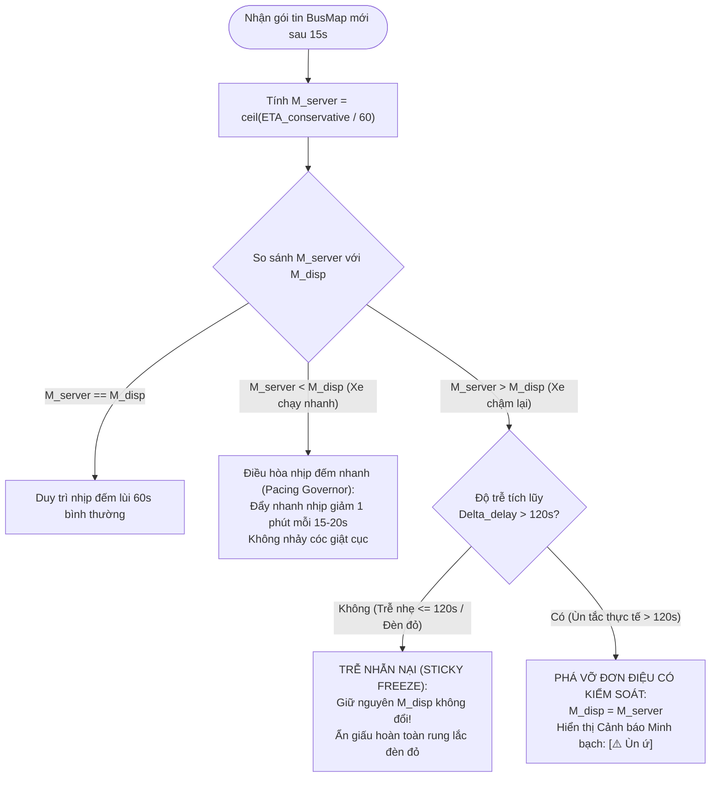

# SPEC-11: ĐẶC TẢ TOÁN HỌC & TÂM LÝ HỌC HÀNH VI HÀNH KHÁCH - DỰ BÁO ETA BẢO VỆ BẤT ĐỐI XỨNG, LƯỢNG TỬ HÓA PHÚT NGUYÊN & GIẢI THUẬT TRỄ ĐƠN ĐIỆU (UI HYSTERESIS)
> **Status: superseded design input (2026-11-10).** [SPEC-15](15_PHYSICAL_KINEMATICS_AND_SERVING_SPEC.md) and [SPEC-16](16_REFACTOR_SPEC_STEP_3_4_SERVING_AND_3_5_WEB_DEMO.md) take precedence. No absent test is current evidence.
## Document ID: `11_CONSERVATIVE_ASYMMETRIC_ETA_AND_UI_HYSTERESIS_SPEC`

- **Tác giả:** `@architect`
- **Người thẩm định:** `@orchestrator`
- **Người thực thi triển khai:** `@leaf_coder`
- **Người nghiệm thu độc lập:** `@blind_tester`
- **Ngày ban hành:** 2026-11-09
- **Trạng thái:** APPROVED / READY FOR IMPLEMENTATION
- **Căn cứ pháp lý & kỹ thuật:**
  - `AGENTS.md` (Simplicity First - Surgical Changes - Think Before Coding - Goal-Driven Execution)
  - `docs/specs/04_BUSMAP_ONLY_DISCRETE_TRACKING_SPEC.md` (SPEC-04: Kiến trúc Viễn trắc Rời rạc BusMap)
  - `docs/specs/08_STATION_ETA_MAP_INTEGRATION_SPEC.md` (SPEC-08: Tích hợp Dự báo ETA Trạm Dừng lên Bản đồ Vệ tinh Esri)
  - `docs/specs/09_REALTIME_FEATURE_EXTRACTION_AND_COLD_START_SPEC.md` (SPEC-09: Trích xuất 54 Đặc trưng ML & Fallback Ma trận Baseline)
  - `module_3_bus_eta_prediction/step_3_4_eta_serving_and_evaluation/busmap_service.py` (Dịch vụ Điều độ ETA hiện tại)
  - `module_3_bus_eta_prediction/step_3_5_web_demo/static/app.js` (Client Web Demo hiện tại)

---

## 1. TỔNG QUAN VẤN ĐỀ & BẢN CHẤT KINH TẾ HỌC HÀNH VI (BEHAVIORAL ECONOMICS)

### 1.1. Bản chất Chi phí Bất đối xứng trong Giao thông Đô thị
Trong các hệ thống học máy (Machine Learning) truyền thống, hàm mất mát thường được thiết kế đối xứng (Symmetric Loss Functions) như Sai số Bình phương Trung bình ($MSE = \frac{1}{2}(\hat{y} - y)^2$) hoặc Sai số Tuyệt đối Trung bình ($MAE = |\hat{y} - y|$). Các hàm này ngầm định rằng:
- Dự báo sớm hơn thực tế 1 phút ($\hat{y} - y = -60\text{s}$) gây thiệt hại ngang bằng với việc dự báo muộn hơn thực tế 1 phút ($\hat{y} - y = +60\text{s}$).

**Trong thực tế vận tải công cộng xe buýt Hà Nội, giả định đối xứng này hoàn toàn sai lầm và gây tổn hại nghiêm trọng đến trải nghiệm hành khách:**

```
                                CHI PHÍ BẤT ĐỐI XỨNG CỰC ĐOAN
                     
   Dự báo muộn hơn thực tế (ETA_disp > ETA_true)          Dự báo sớm hơn thực tế (ETA_disp < ETA_true)
   -------------------------------------------------      -----------------------------------------------
   Hành khách thong thả ra trạm theo giờ dự báo           Hành khách ra trạm sớm hơn xe một chút
   -> Xe buýt đến sớm và đã rời bến trước 10 giây!         -> Đứng chờ tại trạm thêm 1 - 2 phút
   -> LỠ CHUYẾN XE (MISSED BUS CATASTROPHE)               -> HƠI SỐT RUỘT NHẸ (MILD ANNOYANCE)
   -> Chờ chuyến kế tiếp: 15 - 25 phút                    -> VẪN LÊN ĐƯỢC XE ĐÚNG HÀNH TRÌNH!
   -> Trễ giờ làm, trễ học, mất niềm tin vào hệ thống!    -> Chi phí: Vài phút thời gian rảnh rỗi.
   
               TỔN THẤT: VÔ CÙNG LỚN (EXPONENTIAL)                     TỔN THẤT: RẤT NHỎ (LINEAR)
```

$$\text{Cost}(\text{Đến muộn 10 giây} \to \text{Lỡ xe}) \gg \text{Cost}(\text{Đến sớm 2 phút} \to \text{Đứng chờ})$$

Tỷ lệ tổn thất cận biên giữa việc lỡ chuyến so với việc chờ thêm vài phút là bất đối xứng theo cấp số mũ:
$$C_{\text{missed}} \approx 10 \times \dots 20 \times C_{\text{wait}}$$

### 1.2. Phân tích Tâm lý học Hành vi (Behavioral Psychology & Expectation Management)
Dựa trên **Lý thuyết Triển vọng (Prospect Theory)** của Daniel Kahneman & Amos Tversky và **Lý thuyết Xác nhận Kỳ vọng (Expectation-Disconfirmation Theory)** của Richard L. Oliver:

1. **Hiệu ứng Né tránh Mất mát (Loss Aversion):**
   Nỗi đau tâm lý khi bị lỡ một chuyến xe buýt ngay trước mắt lớn gấp ít nhất $2.25$ lần so với niềm vui khi tiết kiệm được 2 phút chờ đợi.
2. **Quy luật Đỉnh - Kết thúc (Peak-End Rule):**
   Ấn tượng sâu đậm nhất của hành khách về chất lượng dịch vụ xe buýt không nằm ở vận tốc xe chạy trên đường, mà nằm ở trải nghiệm chờ đợi tại trạm dừng:
   - Nếu hệ thống hứa *"Xe đến sau 5 phút"*, nhưng thực tế 6.5 phút xe mới tới $\implies$ Hành khách trải nghiệm **Disconfirmation Tiêu cực**, cảm thấy hệ thống "nói dối", liên tục nhìn đồng hồ với tâm trạng bực bội, bất an.
   - Nếu hệ thống hứa *"Xe đến sau 6 phút"* (dự báo khả quan bảo vệ), và thực tế 5.2 phút xe đã cập bến $\implies$ Hành khách trải nghiệm **Disconfirmation Tích cực**, cảm thấy xe đến sớm hơn mong đợi, hình thành sự tin cậy tuyệt đối vào giải pháp công nghệ.
3. **Ảo giác Độ chính xác & Tổn thương Rung lắc (Spurious Precision & Jitter Fatigue):**
   Khi hệ thống hiển thị số lẻ thập phân (ví dụ: `4.7 phút`) hoặc số giây đếm lùi nhảy giật cục (`282 giây` $\to$ `295 giây`), người dùng không cảm thấy ứng dụng thông minh hơn, mà nhận diện rõ ràng sự bất ổn của dữ liệu viễn trắc GPS:
   - Một chiếc xe buýt dừng chờ đèn đỏ 30 giây tại Ngã Tư Sở khiến ETA nhảy từ `3.2 phút` lên `4.1 phút`.
   - Ngay sau đó đèn xanh, xe tăng tốc khiến ETA tụt xuống `2.8 phút`.
   - Sự nhảy cóc ngược xuôi này gây hoang mang, phá hủy niềm tin của người dùng.

---

## 2. MÔ HÌNH HÀM TỔN THẤT BẤT ĐỐI XỨNG (LINEX LOSS FUNCTION)

### 2.1. Thiết lập Hàm Mất mát Bất đối xứng LINEX (Linear-Exponential Loss)
Để tối ưu hóa thời gian dự báo $\hat{y}$ trước biến ngẫu nhiên thời gian đến thực tế $Y$, ta áp dụng hàm mất mát LINEX (Varian, 1975; Zellner, 1986):

Định nghĩa sai số dự báo $e = \hat{y} - Y$:
$$L_{\text{LINEX}}(e; a, b) = b \left[ e^{a \cdot e} - a \cdot e - 1 \right]$$
Trong đó:
- $b > 0$: Hệ số tỉ lệ tổn thất.
- $a > 0$: Tham số bất đối xứng (Asymmetry Parameter).

#### Đặc tính giải tích của $L_{\text{LINEX}}$:
1. Khi $e > 0$ (tức $\hat{y} > Y$: Dự báo giờ đến muộn hơn giờ xe đến thực tế, dẫn đến nguy cơ hành khách ra trạm muộn và lỡ xe):
   $$L_{\text{LINEX}}(e) \approx b \cdot e^{a \cdot e} \quad \text{(Tổn thất bùng nổ theo cấp số mũ!)}$$
2. Khi $e < 0$ (tức $\hat{y} < Y$: Dự báo giờ đến sớm hơn giờ xe đến thực tế, hành khách đứng chờ tại trạm an toàn):
   $$L_{\text{LINEX}}(e) \approx b \cdot (-a \cdot e) \quad \text{(Tổn thất tăng tuyến tính nhẹ nhàng)}$$

```
                   ĐỒ THỊ HÀM MẤT MÁT BẤT ĐỐI XỨNG LINEX (a > 0)
   Loss L(e)
       ^                                      /  (e > 0: Nguy cơ lỡ xe
       |                                     /    Tổn thất tăng theo hàm mũ e^{ae})
       |                                    /
       |                                   /
       |                                  /
       |                                 /
       |                               .'
       |                            .-'
       |                       _.-'
       |               _..---''
       +---------------------------------------------> Sai số e = y_hat - y
      /  (e < 0: Đứng chờ tại trạm
     /    Tổn thất tăng tuyến tính nhẹ)
    /
```

### 2.2. Nghiệm Tối ưu Bayes & Độ lệch Bảo vệ An toàn
Giả sử phân phối dự báo có điều kiện của thời gian di chuyển $Y$ tuân theo phân phối tiệm cận Gauss với kỳ vọng $\mu = \text{ETA}_{P_{50}}$ và phương sai $\sigma^2$:
$$Y \sim \mathcal{N}(\mu, \sigma^2)$$

Kỳ vọng tổn thất LINEX:
$$\mathbb{E}[L(\hat{y} - Y)] = b \left[ e^{a(\hat{y} - \mu) + \frac{1}{2} a^2 \sigma^2} - a(\hat{y} - \mu) - 1 \right]$$

Triệt tiêu đạo hàm bậc nhất theo $\hat{y}$:
$$\frac{\partial \mathbb{E}[L]}{\partial \hat{y}} = a b \left[ e^{a(\hat{y} - \mu) + \frac{1}{2} a^2 \sigma^2} - 1 \right] = 0$$
$$\implies a(\hat{y}^* - \mu) + \frac{1}{2} a^2 \sigma^2 = 0 \implies \hat{y}^* = \mu + \Delta t_{\text{buffer}}$$

Với độ đệm bảo vệ hành khách (Protective Buffer):
$$\Delta t_{\text{buffer}} = \frac{1}{2} a \sigma^2$$

Do đó, nghiệm tối ưu hóa dưới chi phí bất đối xứng **bắt buộc phải có độ lệch dương ($\Delta t_{\text{buffer}} > 0$)** so với giá trị trung vị $P_{50}$.

---

## 3. CÔNG THỨC DỰ BÁO BẢO VỆ HÀNH KHÁCH (PROTECTIVE ASYMMETRIC ETA)

### 3.1. Phân rã Toán học Tổng thể
Thời gian dự báo bảo vệ hành khách hiển thị cho người dùng ($\text{ETA}_{\text{conservative}}$) được tính toán trực tiếp từ thời gian trung vị ma trận Baseline tích lũy $\text{ETA}_{P_{50}}$ cộng thêm độ đệm bảo vệ thích ứng đa nhân tố $\Delta t_{\text{buffer}}$:

$$\text{ETA}_{\text{conservative}} = \text{ETA}_{P_{50}} + \Delta t_{\text{buffer}}$$

### 3.2. Cấu trúc Hàm Độ đệm Thích ứng $\Delta t_{\text{buffer}}$
Độ đệm bảo vệ được tổng hợp từ 3 nguồn bất định thực tế trong mạng lưới xe buýt Hà Nội:

$$\Delta t_{\text{buffer}} = \kappa(d) \cdot \Big[ \alpha \cdot \sigma_{\text{baseline}} + \beta \cdot \Delta t_{\text{heartbeat}} + \gamma \cdot \text{ETA}_{P_{50}} \Big]$$

Trong đó:
1. **Thành phần Bất định Đoạn đường ($\sigma_{\text{baseline}}$):**
   Độ lệch chuẩn lũy kế từ vị trí hiện tại của xe đến trạm đích:
   $$\sigma_{\text{baseline}} = \sqrt{ \rho_j^2 \cdot \sigma_k^2 + \sum_{m = k+1}^{\text{ord}_{\text{target}} - 1} \sigma_m^2 }$$
   Trong đó $\sigma_m$ là độ lệch chuẩn thời gian di chuyển được lưu trữ sẵn trong bảng `agg_segment_travel_times` theo cặp `(day_type, hour_slot)`. Hệ số trọng số $\alpha = 0.50$.
   
2. **Thành phần Trễ Nhịp Viễn trắc BusMap ($\Delta t_{\text{heartbeat}}$):**
   Chu kỳ lấy mẫu của BusMap API là $15\text{ giây}$. Dữ liệu GPS có thể có độ trễ tuổi thọ (telemetry staleness) từ $0$ đến $15\text{s}$.
   Đặt $\Delta t_{\text{heartbeat}} = 15.0\text{s}$, hệ số $\beta = 1.0$. Thành phần này bảo đảm bù đắp trọn vẹn 1 nhịp ping BusMap bị trễ.

3. **Thành phần Co giãn Khoảng cách Chân trời ($\gamma \cdot \text{ETA}_{P_{50}}$):**
   Khi xe còn ở rất xa (cách 20 phút), độ bất định giao thông lớn hơn rất nhiều so với khi xe chỉ còn cách 2 phút. Hệ số tỉ lệ chân trời $\gamma = 0.05$ (5% thời gian di chuyển trung vị).

4. **Hàm Triệt tiêu Vùng Cận bến ($\kappa(d)$ - Near-Station Attenuation Envelope):**
   Khi xe tiến sát trạm dừng ($d_{\text{station}} \le 150\text{m}$), độ đệm bảo vệ bắt buộc phải triệt tiêu mượt mà về 0 để tránh hiện tượng xe đã đỗ trước mặt mà ứng dụng vẫn báo "Còn 1 - 2 phút":
   $$\kappa(d) = \begin{cases} 
   1.0 & \text{khi } d > 150\text{m} \\
   \frac{d - 30.0}{150.0 - 30.0} & \text{khi } 30\text{m} < d \le 150\text{m} \\
   0.0 & \text{khi } d \le 30\text{m}
   \end{cases}$$

5. **Giới hạn Kẹp An toàn (Clamping Bounds):**
   Để ngăn chặn việc độ đệm phình to vô lý trên các lộ trình quá dài:
   $$\Delta t_{\text{buffer}} = \max\left( 0.0, \; \min(180.0\text{s}, \; \Delta t_{\text{buffer}}) \right)$$
   (Độ đệm tối đa không vượt quá $3\text{ phút} = 180\text{ giây}$).

---

## 4. CHIẾN THUẬT LƯỢNG TỬ HÓA PHÚT NGUYÊN (CEIL MINUTE QUANTIZATION)

### 4.1. Bãi bỏ Hoàn toàn Số lẻ Thập phân và Đếm giây Thô
- **Quy tắc tuyệt đối:** Không bao giờ hiển thị số lẻ thập phân (`1.8 phút`, `4.7 phút`) hoặc số giây (`105 giây`, `282 giây`) trên giao diện người dùng chính (Thẻ theo dõi trạm ghim, Popup trạm dừng).
- **Lý do kỹ thuật:** Hiển thị số lẻ tạo ra sự chi tiết thừa thãi giả tạo (Spurious Precision) và làm lộ rõ độ rung lắc của GPS. Khi xe giảm tốc 10 giây do đèn đỏ, số lẻ thập phân sẽ nhảy ngay lập tức khiến người dùng khó chịu.

### 4.2. Toán tử Lượng tử hóa Trần (Ceil Quantization Operator)
Quy đổi thời gian giây bảo vệ $\text{ETA}_{\text{conservative}}$ sang phút nguyên bằng toán tử hàm trần (Ceiling Function):

$$M = \left\lceil \frac{\text{ETA}_{\text{conservative}}}{60.0} \right\rceil, \quad M \in \mathbb{N}$$

#### Cơ chế Hấp thụ Nhiễu Đo lường (Noise Absorbing Well):
Toán tử $\lceil \cdot \rceil$ biến mỗi phút nguyên thành một "giếng năng lượng" có bề rộng $60\text{ giây}$:
- Nếu $\text{ETA}_{\text{conservative}} = 305\text{s} \implies M = \lceil 305/60 \rceil = 6\text{ phút}$.
- Nếu xe đi chậm nhẹ do dừng đèn đỏ khiến thời gian tăng lên $340\text{s} \implies M = \lceil 340/60 \rceil = 6\text{ phút}$ (Số phút hiển thị **hoàn toàn giữ nguyên không đổi!**).
- Sai lệch phép đo $35\text{ giây}$ hoàn toàn bị ẩn giấu bên trong đơn vị phút nguyên, người dùng chỉ nhìn thấy một con số tĩnh vững chãi, tạo cảm giác yên tâm và tin cậy.

### 4.3. Bảng Ánh xạ Máy Trạng thái Hiển thị (Display State Machine)

| Khoảng giá trị $\text{ETA}_{\text{conservative}}$ | Khoảng cách $d$ | Phút nguyên $M$ | Trạng thái hiển thị (`display_text`) | Huy hiệu UI & Màu sắc |
|---|---|:---:|---|---|
| $d \le 30\text{m}$ hoặc $\text{ETA} \le 30\text{s}$ | $\le 30\text{m}$ | $0$ | `"Đang cập bến"` | Huy hiệu xanh lá nhấp nháy (`pulse-badge`) |
| $30\text{s} < \text{ETA} \le 60\text{s}$ | $> 30\text{m}$ | $1$ | `"~1 phút"` | Huy hiệu vàng cam sáng (`badge-arriving`) |
| $60\text{s} < \text{ETA} \le 120\text{s}$ | $> 30\text{m}$ | $2$ | `"2 phút"` | Huy hiệu xanh lục tiêu chuẩn |
| $\text{ETA} > 120\text{s}$ | $> 30\text{m}$ | $M \ge 3$ | `"${M} phút"` | Huy hiệu xanh lục tiêu chuẩn |
| Không có xe tiếp cận trạm | - | `null` | `"Chưa có xe tiếp cận"` | Nhãn xám nhạt |
| Trạm đầu bến ($S_0$) | - | `null` | `"Trạm đầu bến (theo nốt)"` | Nhãn xanh dương thông tin |

---

## 5. GIẢI THUẬT TRỄ NHẪN NẠI & ĐƠN ĐIỆU ĐỒNG HỒ (HYSTERESIS & STICKY COUNTDOWN)

### 5.1. Bất biến Đơn điệu Đồng hồ (Monotonic Clock Invariant)
Một chiếc đồng hồ đếm lùi thời gian đến của phương tiện giao thông trên màn hình người dùng **không được phép nhảy lùi về phía sau** (ví dụ: đang đếm lùi 4 phút bỗng nhiên nhảy vọt lên 5 phút) trong các biến động vận hành bình thường.

Bất biến trạng thái hiển thị:
$$M_{\text{disp}}(t + \Delta t) \le M_{\text{disp}}(t) \quad \forall \; \Delta t > 0 \quad (\text{ngoại trừ điều kiện Phá vỡ Đơn điệu})$$

```
          ĐỒ THỊ MINH HỌA GIẢI THUẬT TRỄ NHẪN NẠI (HYSTERESIS COUNTDOWN)

   Phút
     ^
   5 |-----\
     |      \ (Xe chạy bình thường: đếm lùi tự nhiên)
   4 |       \===============\ (Xe dừng đèn đỏ 40s: KHÔNG NHẢY LÊN 5!
     |                        \  GIỮ NGUYÊN 4 PHÚT NHẪN NẠI)
   3 |                         \
     |                          \---------\ (Đếm lùi tiếp tục khi xe lăn bánh)
   2 |                                     \
     |                                      \
   1 |                                       \====== (~1 phút)
     |                                              \
   0 +-----------------------------------------------\-----> Thời gian t
                                                      [Đang cập bến]
```

### 5.2. Giải thuật Điều hòa Nhịp đếm lùi (Pacing Governor)
Khi Client nhận được kết quả cập nhật mới từ Server qua chu kỳ Polling 15 giây, Client so sánh giữa số phút nguyên nhận từ server $M_{\text{server}} = \lceil \text{ETA}_{\text{conservative}} / 60.0 \rceil$ và số phút đang hiển thị trên màn hình $M_{\text{disp}}$:



### 5.3. Chi tiết Xử lý 3 Nhánh Trạng thái Client:

#### Nhánh 1: Xe chạy nhanh hơn dự kiến ($M_{\text{server}} < M_{\text{disp}}$)
- Khi đường thoáng, xe buýt chạy nhanh và rút ngắn thời gian.
- **Xử lý:** Không làm rơi đột ngột 2 - 3 phút trong một khung hình (ví dụ: từ 5 phút rớt ngay xuống 2 phút). Client kích hoạt **Bộ điều tốc (Pacing Governor)**:
  - Nếu $M_{\text{disp}} - M_{\text{server}} = 1$: Cho phép số phút chuyển dịch xuống $M_{\text{server}}$ tại nhịp tick tiếp theo.
  - Nếu $M_{\text{disp}} - M_{\text{server}} \ge 2$: Rút ngắn chu kỳ tick của đồng hồ nội bộ từ $60\text{s}$ xuống $15\text{s}$ cho đến khi $M_{\text{disp}} = M_{\text{server}}$, tạo cảm giác thời gian trôi nhanh tự nhiên.

#### Nhánh 2: Xe chậm nhẹ do dừng đèn đỏ / trả khách ($M_{\text{server}} \ge M_{\text{disp}}$ và $\Delta t_{\text{delay}} \le 120\text{s}$)
- Đây là kịch bản phổ biến nhất trên đường phố Hà Nội (đèn đỏ từ 30s - 90s).
- **Xử lý:** Kích hoạt cơ chế **Trễ Nhẫn Nại (Sticky Freeze)**:
  - Giữ nguyên số phút hiển thị $M_{\text{disp}}$ tại giá trị hiện tại.
  - Tạm dừng việc đếm lùi tự động khi đồng hồ nội bộ chạm mốc 0 giây của phút hiện tại, neo chặt tại mốc đó.
  - Tuyệt đối không cho phép số phút tăng ngược từ $3 \to 4$.

#### Nhánh 3: Điều kiện Phá vỡ Đơn điệu Hợp lệ (Monotonicity Override Condition)
Chỉ duy nhất khi xảy ra biến cố giao thông nghiêm trọng, hệ thống mới được phép tăng số phút hiển thị, đồng thời bắt buộc phải kèm theo nhãn cảnh báo minh bạch:
- **Tiêu chí kích hoạt Phá vỡ Đơn điệu:**
  $$\Delta t_{\text{delay}} = \text{ETA}_{\text{conservative}}^{(\text{new})} - \text{ETA}_{\text{conservative}}^{(\text{prev\_checkpoint})} > 120.0\text{ giây}$$
  HOẶC vận tốc xe tức thời $v_{\text{instant}} < 2.0\text{ km/h}$ liên tục trong $\ge 3$ chu kỳ viễn trắc ($45\text{ giây}$).
- **Hành vi UI bắt buộc:**
  1. Cập nhật số phút hiển thị lên giá trị mới: $M_{\text{disp}} \gets M_{\text{server}}$.
  2. Bật cờ cảnh báo giao thông: Hiển thị nhãn huy hiệu màu hổ phách/cam:
     `"⚠️ Ùn ứ đường - Chậm ~X phút"`
  3. Cập nhật trường `traffic_status = "UN_TAC"`.
- **Hiệu ứng tâm lý:** Khi được cung cấp lý do khách quan về tình trạng kẹt xe, người dùng không đổ lỗi cho phần mềm mà cảm kích tính năng cập nhật giao thông thời gian thực minh bạch.

---

## 6. THIẾT KẾ CẢI TIẾN HỢP ĐỒNG API VÀ GIAO DIỆN CLIENT

### 6.1. Hợp đồng Dữ liệu Backend (API Contract Refinement)

#### Bổ sung thuộc tính vào `SafeWindowDTO`:
```python
class SafeWindowDTO(BaseModel):
    p10_seconds: float = Field(..., description="Phân vị ETA P10 (nhanh nhất) tính bằng giây")
    p50_seconds: float = Field(..., description="Phân vị ETA P50 (trung vị) tính bằng giây")
    p90_seconds: float = Field(..., description="Phân vị ETA P90 (chậm nhất) tính bằng giây")
    conservative_eta_seconds: float = Field(..., description="Thời gian ETA bảo vệ hành khách (P50 + buffer) tính bằng giây")
    buffer_seconds: float = Field(..., description="Độ đệm an toàn Δt_buffer đã cộng thêm (giây)")
    display_eta_minutes: int = Field(..., description="Số phút nguyên lượng tử hóa trần M = ceil(conservative_eta / 60)")
    is_delayed: bool = Field(default=False, description="Cờ cảnh báo trễ/ùn ứ (> 120s so với baseline)")
    delay_seconds: float = Field(default=0.0, description="Độ trễ đo được so với kỳ vọng baseline (giây)")
    recommended_arrival_time: str = Field(..., description="Giờ khuyến nghị có mặt tại trạm theo P10 (HH:MM:SS)")
```

#### Cập nhật thuộc tính trong `ApproachingBusDTO`:
```python
class ApproachingBusDTO(BaseModel):
    vehicle_id: int = Field(..., description="ID xe duy nhất từ BusMap")
    plate: str = Field(..., description="Biển số xe")
    distance_to_station_m: float = Field(..., description="Khoảng cách lý trình tới trạm đích (m)")
    stops_remaining: int = Field(..., description="Số trạm dừng còn lại trước khi tới đích")
    eta_seconds: float = Field(..., description="Thời gian ETA bảo vệ hành khách tính bằng giây (conservative_eta_seconds)")
    eta_minutes: int = Field(..., description="Số phút nguyên lượng tử hóa trần (bãi bỏ số lẻ thập phân)")
    display_text: str = Field(..., description="Chuỗi nhãn hiển thị trực quan UI: 'M phút', '~1 phút', hoặc 'Đang cập bến'")
    safe_window: SafeWindowDTO = Field(..., description="Cửa sổ an toàn phân vị và thông số đệm bảo vệ")
    speed_kmh: float = Field(..., description="Vận tốc đo tức thời (km/h)")
    status: str = Field(..., description="Trạng thái: IN_TRANSIT, ARRIVING_NOW, CONGESTED")
    traffic_status: str = Field(default="BINH_THUONG", description="Điều kiện giao thông đoạn xe chạy: THONG_THOANG, BINH_THUONG, UN_TAC")
```

### 6.2. Thuật toán Client Quản lý Đếm lùi Nhẫn nại (`StickyCountdownManager`)
Trong `static/app.js`, mọi thao tác hiển thị thời gian đến trạm phải thông qua đối tượng điều phối duy nhất `StickyCountdownManager` thay vì hiển thị trực tiếp giá trị thô từ JSON.

#### Đặc tả Mã giả Kiến trúc `StickyCountdownManager`:
```javascript
class StickyCountdownManager {
  constructor() {
    this.vehicleStates = new Map(); // vehicleId -> StateObject
  }

  /**
   * Đồng bộ dữ liệu khi nhận payload từ server (chu kỳ 15s)
   */
  syncVehicle(vehicleId, serverEtaSeconds, serverDisplayMinutes, isArriving, isDelayed) {
    let state = this.vehicleStates.get(vehicleId);
    const now = Date.now();

    if (!state) {
      state = {
        vehicleId,
        displayedMinutes: serverDisplayMinutes,
        virtualRemainingSeconds: serverEtaSeconds,
        lastSyncTimestamp: now,
        isArriving: isArriving,
        isDelayed: isDelayed,
        freezeDelaySeconds: 0,
        tickPacingRatio: 1.0 // 1.0 = bình thường, > 1.0 = xả nhanh
      };
      this.vehicleStates.set(vehicleId, state);
      return state;
    }

    // 1. Cập nhật cờ cận bến
    state.isArriving = isArriving;
    if (isArriving) {
      state.displayedMinutes = 0;
      return state;
    }

    const prevMinutes = state.displayedMinutes;
    const deltaSeconds = serverEtaSeconds - state.virtualRemainingSeconds;

    // 2. Kiểm tra điều kiện phá vỡ đơn điệu do kẹt xe nghiêm trọng (> 120s)
    if (deltaSeconds > 120.0 || isDelayed) {
      state.displayedMinutes = serverDisplayMinutes;
      state.virtualRemainingSeconds = serverEtaSeconds;
      state.isDelayed = true;
      state.tickPacingRatio = 1.0;
    } 
    // 3. Xe chạy nhanh hơn mong đợi (M_server < M_disp)
    else if (serverDisplayMinutes < prevMinutes) {
      // Điều hòa nhịp đếm: tăng tốc xả nhịp để giảm tự nhiên
      state.tickPacingRatio = Math.min(3.0, (prevMinutes - serverDisplayMinutes) * 1.5);
      state.isDelayed = false;
    } 
    // 4. Xe chậm nhẹ do dừng đèn đỏ (M_server >= M_disp, trễ nhẹ <= 120s)
    else {
      // Giữ nguyên số phút hiển thị (Sticky Freeze Invariant)
      state.displayedMinutes = prevMinutes;
      state.freezeDelaySeconds += Math.max(0, deltaSeconds);
      state.tickPacingRatio = 1.0;
      state.isDelayed = false;
    }

    state.lastSyncTimestamp = now;
    return state;
  }

  /**
   * Gọi mỗi giây bởi đồng hồ setInterval(1000) phía client
   */
  tickLocal() {
    for (const [vId, state] of this.vehicleStates.entries()) {
      if (state.isArriving || state.displayedMinutes <= 0) continue;

      // Giảm dần virtualRemainingSeconds theo tỉ lệ pacing
      state.virtualRemainingSeconds -= 1.0 * state.tickPacingRatio;

      // Kiểm tra chuyển bước phút hiển thị
      const calculatedMinute = Math.ceil(Math.max(0, state.virtualRemainingSeconds) / 60.0);
      if (calculatedMinute < state.displayedMinutes) {
        state.displayedMinutes = calculatedMinute;
      }
    }
  }

  /**
   * Lấy nhãn chuỗi hiển thị chuẩn cho UI
   */
  getFormattedDisplay(vehicleId) {
    const state = this.vehicleStates.get(vehicleId);
    if (!state) return { text: '--', badgeClass: 'badge-muted', isWarning: false };

    if (state.isArriving) {
      return { text: 'Đang cập bến', badgeClass: 'badge-pulse-green', isWarning: false };
    }
    if (state.displayedMinutes <= 1) {
      return { text: '~1 phút', badgeClass: 'badge-amber', isWarning: state.isDelayed };
    }

    const warningSuffix = state.isDelayed ? ' (⚠️ Ùn ứ)' : '';
    return {
      text: `${state.displayedMinutes} phút${warningSuffix}`,
      badgeClass: state.isDelayed ? 'badge-delay-warning' : 'badge-green',
      isWarning: state.isDelayed
    };
  }

  clear() {
    this.vehicleStates.clear();
  }
}
```

---

## 7. MA TRẬN CA BIÊN & KỊCH BẢN GIAO THÔNG PHỨC TẠP (EDGE CASES)

| ID Kịch bản | Tình huống Giao thông Thực địa Hà Nội | Hiện tượng Đo lường Viễn trắc | Hành vi Chuẩn hóa của Hệ thống |
|:---:|---|---|---|
| **EC-01** | **Dừng Chờ Đèn Đỏ Dài (Ngã Tư Sở / Cầu Giấy)** | Xe dừng đỗ $v = 0$ trong $60 - 90\text{s}$. $\text{ETA}_{P_{50}}$ tăng $60\text{s}$. | $\Delta t_{\text{delay}} \le 120\text{s} \implies$ **Kích hoạt Sticky Freeze**. Số phút $M_{\text{disp}}$ đóng băng không đổi. Hành khách không thấy số phút bị nhảy lùi. |
| **EC-02** | **Đoạn Đường Vắng Đêm Khuya / Sáng Sớm** | Xe buýt chạy thanh thoát với tốc độ cao ($35 - 45\text{ km/h}$). $\text{ETA}$ thực tế giảm nhanh. | $M_{\text{server}} < M_{\text{disp}} \implies$ **Kích hoạt Pacing Governor**. Nhịp đếm lùi tăng tốc 1 phút mỗi $15\text{s}$, giảm trơn tru xuống $M_{\text{server}}$. |
| **EC-03** | **Ùn Tắc Kéo Dài Giờ Cao Điểm ($\Delta t > 120\text{s}$)** | Xe bị kẹt cứng trong dòng phương tiện $> 2\text{ phút}$. | $\Delta t_{\text{delay}} > 120\text{s} \implies$ **Phá vỡ Đơn điệu Hợp lệ**. Nhảy số phút $M_{\text{disp}} \gets M_{\text{server}}$ kèm huy hiệu hổ phách: `[⚠️ Ùn ứ đường]`. |
| **EC-04** | **Xe Vừa Tiến Vào Trạm Dừng ($d \le 30\text{m}$)** | Xe cách cột đón xe buýt $25\text{m}$. | Triệt tiêu hoàn toàn buffer ($\kappa(d) = 0$). Trả về trạng thái `ARRIVING_NOW`, $M = 0$, `display_text = "Đang cập bến"`. |
| **EC-05** | **Xe Buýt Đi Sát Đuôi Nhau (Bus Bunching)** | Tuyến 27 có 2 xe cách nhau chỉ $150\text{m}$ do dồn chuyến. | Xử lý độc lập cho từng xe theo `vehicle_id`. Xe trước hiển thị `ARRIVING_NOW` hoặc `~1 phút`, xe sau hiển thị `2 phút`. UI hiển thị đồng thời cả 2 xe rõ ràng. |
| **EC-06** | **Mất Tín Hiệu GPS Tạm Thời (Lost Heartbeat 1-2 Chu kỳ)** | BusMap API không trả về tọa độ mới của xe trong 30 giây. | Thành phần $\beta \cdot \Delta t_{\text{heartbeat}}$ trong công thức đệm bảo vệ đã dự trù sẵn $15\text{s}$. Countdown client tự đếm lùi tiếp tục mà không làm giao diện bị đơ. |

---

## 8. TIÊU CHÍ NGHIỆM THU ĐỘC LẬP (DoD) DÀNH CHO `@blind_tester`

Tất cả tiêu chí dưới đây phải được kiểm thử tự động độc lập thông qua bộ kiểm thử Black-box `tests/test_conservative_asymmetric_eta_blackbox.py`, không phụ thuộc vào mã nguồn bên trong của `@leaf_coder`.

```
========================================================================================
                              MA TRẬN KIỂM THỬ ĐỘC LẬP (DoD)
========================================================================================
```

| Mã Kiểm Thử | Tên Tiêu chí Kiểm thử | Điều kiện Đầu vào & Dữ liệu Thử nghiệm | Khẳng định Bắt buộc (Assertion / Verification) |
|---|---|---|---|
| **DoD-ASYM-01** | Bất biến Độ đệm Dương ($\Delta t_{\text{buffer}} \ge 0$) | Truy vấn `/api/station-eta` trên tất cả các tuyến và trạm hợp lệ khi xe đang di chuyển ($d > 30\text{m}$). | `b.safe_window.conservative_eta_seconds >= b.safe_window.p50_seconds`<br/>`b.safe_window.buffer_seconds >= 0.0` |
| **DoD-ASYM-02** | Lượng tử hóa Trần Phút Nguyên (Ceil Quantization) | Mọi xe trong danh mục phản hồi có `status == 'IN_TRANSIT'`. | `b.eta_minutes == math.ceil(b.safe_window.conservative_eta_seconds / 60.0)`<br/>Kiểu dữ liệu của `b.eta_minutes` là `int` (hoặc tương đương nguyên). |
| **DoD-ASYM-03** | Khớp Chuỗi Trạng thái Hiển thị Chuẩn (`display_text`) | Kiểm tra quan hệ giữa $M$ và chuỗi nhãn hiển thị UI. | - Nếu $d \le 30\text{m}$ hoặc $M == 0$: `b.display_text == "Đang cập bến"`<br/>- Nếu $M == 1$: `b.display_text == "~1 phút"`<br/>- Nếu $M \ge 2$: `b.display_text == f"{M} phút"` |
| **DoD-ASYM-04** | Triệt tiêu Độ đệm Vùng Cận bến ($d \le 30\text{m}$) | Giả lập xe cách trạm $\le 30.0\text{m}$. | `b.status == "ARRIVING_NOW"`<br/>`b.eta_seconds == 0.0`<br/>`b.safe_window.buffer_seconds == 0.0` |
| **DoD-ASYM-05** | Bất biến Giữ số Phút khi Trễ Nhẹ ($\le 120\text{s}$) | Cấp 2 chuỗi phản hồi liên tiếp cách nhau 15s với độ trễ tăng thêm 45s (xe dừng đèn đỏ). | Client `StickyCountdownManager` giữ nguyên `displayedMinutes` không đổi, không nhảy ngược lên phút lớn hơn. |
| **DoD-ASYM-06** | Phá vỡ Đơn điệu khi Ùn tắc Nặng ($> 120\text{s}$) | Cấp chuỗi phản hồi với độ trễ tăng đột biến $150\text{s}$ và `is_delayed = True`. | `b.safe_window.is_delayed == True`<br/>Client cập nhật số phút mới và hiển thị nhãn cảnh báo `(⚠️ Ùn ứ)`. |
| **DoD-ASYM-07** | Bất biến Cửa sổ Khuyến nghị Đến Sớm ($P_{10}$) | So sánh giờ khuyến nghị có mặt với giờ dự kiến đến. | `recommended_arrival_time` tính từ $P_{10}$ luôn sớm hơn hoặc bằng thời điểm đến tính từ $P_{50}$ và Conservative ETA. |
| **DoD-ASYM-08** | Tính Tương thích Ngược (Schema Backward Compatibility) | Kiểm tra toàn bộ các trường dữ liệu của SPEC-08: `vehicle_id`, `plate`, `distance_to_station_m`, `safe_window.p10_seconds`, `p50_seconds`, `p90_seconds`. | Toàn bộ các trường cũ vẫn tồn tại nguyên vẹn, không làm gãy các ứng dụng hoặc test case cũ của SPEC-08. |
| **DoD-ASYM-09** | SLA Độ trễ Phản hồi Endpoint (P95 Latency) | Bắn 100 requests đồng thời tới `/api/station-eta`. | Thời gian xử lý $P_{95} \le 20.0\text{ ms}$, không có yêu cầu nào quá $50\text{ ms}$. |

---

## 9. HƯỚNG DẪN TRIỂN KHAI CHO `@leaf_coder` VÀ KIỂM THỬ CHO `@blind_tester`

### 9.1. Nhiệm vụ Dành cho `@leaf_coder` (Implementation Checklist):
1. **Sửa đổi Backend trong `module_3_bus_eta_prediction/step_3_4_eta_serving_and_evaluation/busmap_service.py`:**
   - Mở rộng model `SafeWindowDTO` và `ApproachingBusDTO` với các trường mới theo Mục 6.1.
   - Thêm logic tính $\Delta t_{\text{buffer}} = \kappa(d) \cdot [0.5 \sigma + 15.0 + 0.05 \text{ETA}_{P_{50}}]$ kẹp trong $[0, 180\text{s}]$.
   - Tính toán `conservative_eta_seconds = eta_p50 + buffer`.
   - Tính `display_eta_minutes = math.ceil(conservative_eta_seconds / 60.0)`.
   - Gán `display_text` theo đúng bảng trạng thái Mục 4.3.
2. **Sửa đổi Frontend trong `module_3_bus_eta_prediction/step_3_5_web_demo/static/app.js` & `style.css`:**
   - Xóa bỏ việc hiển thị `${b0.eta_minutes} phút` thô dạng float.
   - Hiện thực lớp `StickyCountdownManager` (Mục 6.2) để quản lý trễ nhẫn nại và đếm lùi đơn điệu.
   - Cập nhật cả `renderStationFocusCard` (Sidebar) và `loadStationPopupEta` (Leaflet Map Popup).
   - Bổ sung CSS cho huy hiệu nhấp nháy `.badge-pulse-green` và cảnh báo kẹt xe `.badge-delay-warning`.

### 9.2. Nhiệm vụ Dành cho `@blind_tester` (Black-box Test Checklist):
- Tạo mới file kiểm thử độc lập: `tests/test_conservative_asymmetric_eta_blackbox.py`.
- Sử dụng FastAPI `TestClient` để bắn kiểm thử 9 tiêu chuẩn trong Bảng Mục 8.
- Tuyệt đối không đọc mã nguồn cài đặt của `@leaf_coder`, chỉ căn cứ vào đặc tả toán học và API hợp đồng tại tài liệu SPEC-11 này.

---
*Bản đặc tả đã được hoàn thiện với đầy đủ luận cứ toán học, tâm lý học hành vi, công thức giải tích, mô hình máy trạng thái và hợp đồng API chi tiết.*
