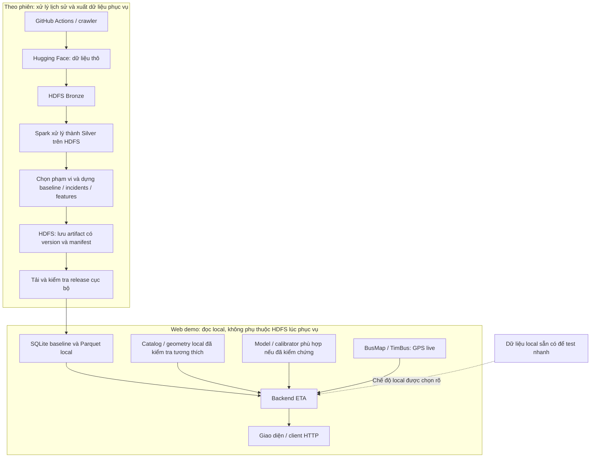

# SPEC-41 — Checklist lưu trữ, web demo, pipeline và kiểm chứng mô hình ML

Đối chiếu mã trên `main` ngày 17/11/2026. Đây là kế hoạch, không phải báo cáo nghiệm thu.
Đã bắt đầu triển khai phần nguồn phục vụ release/local; chưa thu GPS/ETA live hay chạy lại pipeline toàn lịch sử. Tiến độ và bằng chứng ở cuối file.
`[ ]` nghĩa là chưa nghiệm thu, kể cả khi đã có một phần mã. Chỉ đánh dấu hoàn thành khi có input/version, lệnh chạy, kết quả và điều kiện đạt được lưu lại.
Không dùng tài liệu cũ, số dòng/file hoặc “chạy không lỗi” làm bằng chứng đúng.

## 1. Hiện trạng xác nhận từ mã

| Nguồn kiểm tra | Điều thực sự có | Điều chưa được chứng minh |
|---|---|---|
| [eta_snapshot.py](../../module_2_big_data_storage_and_lakehouse/step_2_4_hdfs_history/eta_snapshot.py) | Materialize Silver thành cache; build local tạo `baseline.db`, incidents/feature Parquet; publish/download/verify/activate release bằng manifest/hash. | Toàn bộ Gold xử lý phân tán; release đã tương thích đầy đủ với web và model. |
| [run_hdfs_eta_workflow.py](../../scripts/run_hdfs_eta_workflow.py) | Đã điều phối source window/snapshot → cache → Gold → publish → download → activate, kiểm tra workspace/code khi chạy lại. | Chưa có điều phối nào; hoặc đã điều phối cả train/eval/promote model. |
| [serving_service.py](../../module_3_bus_eta_prediction/step_3_4_eta_serving_and_evaluation/serving_service.py), [data_access.py](../../module_3_bus_eta_prediction/step_3_4_eta_serving_and_evaluation/data_access.py), [model_runtime.py](../../module_3_bus_eta_prediction/step_3_4_eta_serving_and_evaluation/model_runtime.py) | Web có lựa chọn release pointer khi khởi động: baseline/incidents từ release, catalog local được đối soát; chưa bật model riêng với release. Không chọn pointer thì dùng nguồn local hiện hữu. | Activate CLI tự đổi nguồn của process web đang chạy; baseline-only release đã kiểm chứng model ML. |
| [release CLI](../../scripts/eta_snapshot_pipeline.py), [offline verifier](../../scripts/verify_eta_offline_release.py) | CLI tra baseline từ local/release; có kiểm tra offline, corruption và giữ release cũ khi refresh lỗi. | Đã kiểm chứng HTTP web chạy từ release khi Docker tắt. |
| [consumer verifier](../../scripts/verify_eta_snapshot_consumers.py), [integration verifier](../../scripts/verify_eta_history_integration.py) | Có đối soát bảng/Parquet, chạy lại offline và smoke prediction với model global. Verifier tự giới hạn kết luận về accuracy và route index. | Chưa có kiểm tra tích hợp nào; hoặc đã chứng minh tính đúng tổng quát và ETA live chính xác. |
| [eta_model_trainer.py](../../module_3_bus_eta_prediction/step_3_3_machine_learning_models/eta_model_trainer.py) | Có temporal fit/validation, early stopping, pruning, calibrator và tính metrics trên test; objective hiện là `reg:pseudohubererror`. | Model chưa từng được đánh giá; hoặc các bước/metrics đó đủ chứng minh nhãn đúng, không leakage, model serving khớp report và ETA live tin cậy. |

**Kiến trúc duy nhất trong kế hoạch:** HDFS lưu lịch sử; job batch xử lý và xuất SQLite cùng Parquet/model cần thiết thành local release; web demo chỉ đọc bản đã xuất. Cập nhật release là thao tác riêng, ngoài request người dùng. Không có nhánh API truy vấn HDFS trong kiến trúc này. Cần hoàn thiện nối release ở nhóm A; không cần quyết định lại việc có dùng SQLite hay không, không yêu cầu Docker 24/7.

**Trạng thái ML:** model hiện là ứng viên cần kiểm chứng. Có số đo offline trong mã không đồng nghĩa đã nghiệm thu đúng/đủ; quan sát “chạy khá tốt” cũng chưa chứng minh chất lượng. Kiểm chứng tính đúng pipeline (D), chất lượng mô hình (M) và hành vi live (C) là ba lớp bằng chứng khác nhau.

## 2. A — Thống nhất và nối nguồn lưu trữ (P0)

- [x] **A1. Thực thi luồng HDFS → batch → SQLite/local release → demo.** Phân biệt raw HF, lịch sử/xử lý HDFS, release SQLite phục vụ ETA và dữ liệu local để test nhanh. SQLite là bản dẫn xuất có thể tái dựng, không thay kho lịch sử.
  **AC:** bảng nguồn đọc/ghi khớp runtime; các endpoint demo chỉ đọc local release hoặc nguồn local được chọn rõ, kể cả khi cache lạnh. Refresh release là thao tác riêng khỏi request người dùng. Chặn Docker/HDFS thì demo từ release vẫn khởi động/phục vụ được. Quy định rõ default, fallback và nguồn xuất hiện trong log/API.

- [ ] **A2. Kiểm chứng hợp đồng release với consumer.** Đối chiếu catalog, shapes, stations, baseline, incidents, model/calibrator và mapping `route_id_idx`. DB tạo cho domain builder không mặc định thay thế đầy đủ operational DB của web; model hiện nạp riêng.
  **AC:** version/hash/phạm vi các thành phần được ghép có trong manifest; từ chối schema/mapping/version không tương thích; không đánh lại route index theo số tuyến của release. Catalog rộng hơn baseline phải có trạng thái hỗ trợ/fallback rõ, không lẫn dữ liệu tuyến khác.

- [ ] **A3. Nối web vào release và giữ lựa chọn local.** Truyền nguồn nhất quán cho `DataAccess`, `IncidentsProvider`, model runtime; không trộn các bản không được kiểm tra tương thích.
  **AC:** HTTP thực xác nhận artifact đang dùng; baseline kiểm soát được phản ánh đúng vào đầu vào/tính ETA; restart chọn đúng nguồn. Release hỏng/refresh thất bại giữ bản hợp lệ trước. Web chạy từ release đã tải khi chặn Docker/HDFS; fallback được công bố, không xảy ra ngầm.

- [ ] **A4. Đo phục vụ demo và cập nhật release riêng.** Đo ETA HTTP/SQLite-local và thời gian batch dựng/tải/activate release.
  **AC:** có cold/warm p50/p95 latency, tỷ lệ lỗi và request đồng thời của demo; chi phí refresh và snapshot/artifact ID riêng. Đối soát output release với nguồn đã xử lý. Polling 5 giây không tự chứng minh đáp ứng trong 5 giây. Đặt mục tiêu hiệu năng sau phép đo.

## 3. B — Vòng đời demo và tàn dư (P0)

- [ ] **B1. Truy nguồn câu hỏi lưu dữ liệu lúc thoát.** Rà mã tracked chưa tìm thấy `input()`, `Read-Host`, prompt lưu hoặc shutdown hook trong `run_demo.ps1`, web `app.py` và JS. Chưa tái hiện hiện tượng người dùng báo.
  **AC:** lưu command/PID/log start-stop, xác định câu hỏi thuộc app, launcher cũ, file ngoài Git hay shell. Sửa đúng nguồn nếu xác nhận; Ctrl+C/stdin đóng không chờ nhập hoặc tạo batch lịch sử ngoài ý muốn. Không xóa ghi nhận quota hợp lệ của crawler chỉ vì nó có xử lý Ctrl+C.

- [ ] **B2. Rà entrypoint và side effect theo module.** Kiểm tra launcher web, crawler, ingest, projection, export, train và verify; ghi nguồn đọc/ghi, hành vi import/start/stop.
  **AC:** demo không tự chạy crawler/ingest/export khi thoát nếu chưa chọn chế độ ấy; chỉ còn hướng dẫn chạy hiện hành. Phân loại giữ/sửa/bỏ theo caller và vai trò, không xóa vì tên cũ hoặc thư mục rỗng.

- [ ] **B3. Sửa nhãn và contract sai nguồn.** `app.py`/health còn nói `busmap_discrete_only`/100% BusMap trong khi service có TimBus; rà FE, DTO, README và log tương ứng.
  **AC:** phân biệt app sống với upstream hoạt động; xác định được nguồn GPS, baseline/model và artifact. Cập nhật test hợp đồng. Không nhồi chi tiết nội bộ lên giao diện.

## 4. C — Thu GPS/ETA live và đánh giá bằng client (P0–P1)

- [ ] **C1. Client HTTP như FE.** Gọi routes/stations/live-vehicles/station-eta theo nhịp khuyến nghị, có backpressure; chọn tuyến/chiều/trạm rõ, gồm nguồn TimBus và BusMap-only khi có xe.
  **AC:** lưu params, request ID, UTC gửi/nhận, monotonic latency, status và response đầy đủ; GPS/tuổi ping/nguồn, tốc độ raw/làm mượt, ETA P50/optimistic/window và `prediction_source`. Manifest ghi commit/config/model/nguồn serving. Phân biệt timestamp upstream/query/nhận; hai response gần nhau chưa chắc cùng GPS snapshot. Không gắn nhãn observed cho dữ liệu tự tạo.

- [ ] **C2. Trace giải thích từng dự báo và replay.** Ghi có kiểm soát tại backend theo request ID: vị trí chiếu, feature, baseline, delta model, calibrator, bước lọc xe khi API chưa đủ thông tin.
  **AC:** truy ngược một ETA tới input/model và replay offline được. Response HTTP không đồng nghĩa packet upstream thô; cần packet upstream thì thu riêng, nối lineage rõ ràng.

- [ ] **C3. Ground truth đến trạm.** Ghép xe/tuyến/chiều/lượt chạy; đăng ký trước quy tắc qua trạm/vào vùng trạm và giới hạn gap, xử lý jitter/quay đầu.
  **AC:** giữ quan sát cuối trước/đầu sau cùng khoảng bất định; nội suy phải ghi là ước lượng từ GPS, không phải đo thời điểm dừng đỗ. Xe chưa tới/mất theo dõi được ghi censored. Không dùng ETA dự báo làm nhãn.

- [ ] **C4. Phân rã sai số có mẫu số rõ.** Báo cáo signed error, MAE, median/p90 absolute error (giây), WAPE, phân phối % lỗi và tỷ lệ trong ngưỡng đã công bố; nhóm 1/2/5/10/15 trạm khi đủ dữ liệu.
  **AC:** mỗi nhóm có số forecast, số lượt đến trạm độc lập, coverage, số loại/lý do; tách ML/fallback, BusMap/TimBus, cold/warm history. Tách thời gian còn lại quá nhỏ để % lỗi không che kết quả. Đo coverage thực của P10–P90, không mặc định là khoảng tin cậy đã hiệu chỉnh.
  **Mục tiêu pilot đề xuất, chưa phải số liệu:** phiên 30–60 phút, tối thiểu 30 lượt đến trạm độc lập cho đánh giá thăm dò. Không đủ thì ghi rõ và thu tiếp; con số này không bảo đảm ý nghĩa thống kê hay đủ từng nhóm.

- [ ] **C5. Kiểm chứng khác nhịp mẫu trước khi đổi feature vận tốc.** Offline dùng lag 3/5 mẫu, online dùng cửa sổ thời gian; cùng số mẫu không đồng nghĩa cùng khoảng quan sát.
  **AC:** đo phân phối timestamp train/live, replay đúng nhịp và thử mất/trùng/gói muộn; so sánh phương án trên cùng dữ liệu có nhãn và cùng model. Tách tập chọn phương án khỏi tập báo cáo cuối. Chỉ đổi feature/retrain khi có kết quả, không đổi theo trực giác.

## 5. D — Hợp đồng và bất biến kiểm chứng pipeline (P1)

- [ ] **D1. Hợp đồng từng ranh giới.** Raw HF → Bronze → normalize → projected Silver → baseline/incidents → feature → train/eval → release → HTTP; gồm đường local tương ứng.
  **AC:** kiểm tra thực thi schema/type/unit/nullability, khóa, timezone/direction, geometry/catalog, provenance/version. Có ma trận nguồn/tuyến/ngày được hỗ trợ. Không dùng 48/54/176/96 trong doc như cùng một phạm vi hoặc suy ra tuyến chưa có dữ liệu đã được xử lý.

- [ ] **D2. Đối soát, tính xác định và chia dữ liệu.** Spark hiện đã chặn publish nếu `raw_bus_rows != accepted + rejected + duplicate`, có lineage/rejects; cần mở rộng kiểm chứng, không bắt đầu từ giả định chưa có gì.
  **AC:** fixture có kết quả tính độc lập; thử đảo file/event, nhập lại, chia/gộp batch, đổi partition/worker và conflict cùng khóa. Đối soát riêng bus/incidents, giữ lý do loại và provenance. Chỉ đòi tương đương các cách chia khi giữ đủ ngữ cảnh lịch sử/boundary; không ép đoạn mất ping trước cho cùng vận tốc/chuyến.

- [ ] **D3. Trường hợp biên liên module.** Tuyến `02` khác `2`; hướng 0/1/go/re, qua nửa đêm Hà Nội, offset, duplicate/conflict, đổi chuyến, thiếu geometry, lệch hành lang, mất GPS/ngày rỗng.
  **AC:** mỗi ca có kết quả hoặc lý do loại mong đợi, tổng đếm khớp; kiểm tra local/phân tán trên phạm vi tương đương đã định nghĩa.

- [ ] **D4. Nhãn, split và dữ liệu tương lai.** Xác minh baseline fit đúng phần cho phép; feature ở t chỉ dùng thông tin có sẵn tới t. Nhãn tương lai dùng đánh giá không được lọt vào feature.
  **AC:** test nhãn từ trajectory biết trước; trip qua ranh giới split; fleet/probe/incidents theo thời điểm; mapping category và schema model/calibrator. Rà cả model full/pruned ở từng consumer. Prediction hữu hạn hoặc hai thư mục train/test chưa chứng minh không leakage.

- [ ] **D5. Điều phối và chạy lại an toàn.** Tái sử dụng U6/checkpoint/manifest, chỉ bổ sung phần thiếu, không tạo pipeline cạnh tranh. Chạy fixture nhỏ có nhãn từ raw tới HTTP.
  **AC:** lệnh tái lập, code/config/input/model hash và coverage từng stage; test failpoint publish, tải dở, hash sai, resume không nhân đôi hoặc đổi active release sai. Có train/eval nhỏ để kiểm chứng vòng huấn luyện; nếu chỉ pin model để inference thì phải ghi rõ chưa kiểm chứng train.

- [ ] **D6. Quy mô và phạm vi còn thiếu.** Silver có xử lý phân tán; build Gold hiện materialize về pandas/SQLite local, không mặc định chịu được toàn bộ lịch sử.
  **AC:** đo thời gian/RAM/disk từng stage theo tuyến/ngày, đặt giới hạn và chia job/checkpoint cho Gold/train; bảng đã làm/chưa làm/lý do. Mở rộng theo ngân sách laptop; tách observed/replay/synthetic scale. Không yêu cầu lấy được dữ liệu thực mà nhóm không có quyền tiếp cận.

## 6. M — Kiểm chứng mô hình ML hiện tại (P0 thiết kế, P1 thực nghiệm)

- [ ] **M1. Định danh chính xác model đang đánh giá và đang phục vụ.** Đối chiếu artifact full/pruned, feature list/order, calibrator, category mapping, dữ liệu train và code/config tạo chúng. Không mặc định report của pruned áp dụng cho runtime đang nạp full.
  **AC:** một manifest gắn hash model/metadata với input snapshot, split, mapping, code/config và kết quả đánh giá. Chỗ không khôi phục được provenance phải ghi là chưa xác minh; không điền bằng suy đoán. Ưu tiên đánh giá lại artifact hiện có, chưa cần train lại job dài chỉ để có log mới.

- [ ] **M2. Kiểm toán dữ liệu học, nhãn và thiết kế đánh giá.** Dùng kết quả D3/D4, kiểm tra trực tiếp trajectory và các ETA label mẫu; truy train/validation/test theo ngày/chuyến, dữ liệu trùng, cách lấy mẫu/trọng số, baseline fit và thời điểm feature có sẵn.
  **AC:** có bảng coverage và số xe/chuyến/ngày/tuyến độc lập từng tập, các mẫu đối soát nhãn cùng sai lệch; test cuối không dùng để chọn feature, tham số hay calibrator. Rà việc dùng validation cho early stopping/pruning/calibration và công bố giới hạn, không tự coi việc có validation là leakage hay bảo đảm không overfit. Nếu test cũ đã dùng để chọn phương án, chọn tập thời gian mới cho kết luận cuối và ghi rõ lịch sử sử dụng.

- [ ] **M3. Chứng minh đóng góp của ML trên cùng tập đánh giá.** So sánh baseline, model residual chưa calibration, model có calibration và full/pruned khi có artifact phù hợp; giữ nguyên tập nhãn/phạm vi giữa các phương án.
  **AC:** báo cáo metrics như C4 theo horizon/tuyến/chiều/ngày, cả nhóm ML thua baseline và dữ liệu hiếm, không chỉ trung bình chung hoặc các tuyến tốt nhất. Tách forecast lặp của cùng một lượt xe; khoảng bất định/so sánh theo nhóm chuyến/ngày khi đủ mẫu. Ablation dùng để chọn phương án trên validation, không lựa theo kết quả test cuối.

- [ ] **M4. Kiểm chứng ý nghĩa đầu ra và calibration.** Runtime gọi đầu ra là P50, nhưng objective pseudohuber không tự chứng minh đây là trung vị có điều kiện; P10/P90 và optimistic/buffer cũng cần kiểm chứng riêng.
  **AC:** đo tỷ lệ actual nằm dưới/trên dự báo, signed bias và coverage/độ rộng khoảng theo từng nhóm; mô tả đúng nguồn/cách tạo từng giá trị. Không gọi khoảng dự báo là bảo đảm xác suất nếu chưa có bằng chứng. Nếu đổi sang quantile hoặc sửa calibrator thì phải đánh giá lại; chưa tự đổi objective chỉ vì tên P50.

- [ ] **M5. Kiểm chứng khả năng áp dụng cho serving.** Dùng replay C2/C5 và dữ liệu live có nhãn C3; xét nhịp train/BusMap/TimBus, thiếu/lỗi/stale GPS, cold start, tuyến/ngày ít dữ liệu và tuyến ngoài phạm vi học nếu có.
  **AC:** so offline/replay/runtime trên cùng input khi thực sự tương đương; tách sai khác do feature, model, calibration và logic serving. Chưa có đủ dữ liệu của nhóm nào phải ghi chưa kết luận, không mở rộng kết quả vài tuyến thành toàn Hà Nội. Kiểm thử lỗi HTTP/state không được dùng thay cho bằng chứng accuracy.

- [ ] **M6. Ra quyết định sử dụng và điều kiện phải đánh giá lại.** Chốt trước phép thử cuối các tiêu chí chấp nhận: chất lượng so baseline, sai lệch/đuôi lỗi theo horizon, coverage và chi phí inference phù hợp demo; không đặt ngưỡng hồi tố để model qua.
  **AC:** có kết luận chấp nhận trong phạm vi nào/chưa đủ bằng chứng/không đạt, và fallback khi model không phù hợp hoặc thiếu dữ liệu. Release ghi model nào đã được kiểm chứng với nguồn nào. Đổi schema, mapping, baseline, cadence hoặc artifact phải kích hoạt các kiểm tra liên quan. Không đánh dấu đạt chỉ vì predict hữu hạn hay app trông hợp lý.

## 7. E — Vận hành và tài liệu (P2)

- [ ] **E1. Cập nhật HF và dọn staging có giới hạn.** Rà runner nhập thủ công/retry trước khi thêm lịch; chỉ tự động theo phiên được bật nếu cần, có checkpoint và hạn mức.
  **AC:** tắt/mở không bỏ sót/nhân đôi; không GC dữ liệu còn được snapshot/release tham chiếu; không cần online 24/7. Chỉ thêm compaction khi có số đo cho thấy cần.

- [ ] **E2. Dọn verifier/hướng dẫn sai giai đoạn.** Ví dụ xác nhận được: `scripts/verify_canonical_architecture.py` vẫn assert không được có Gold, không thể là tiêu chí tổng thể cho dự án đã có baseline/features.
  **AC:** phân loại theo stage, sửa/bỏ có caller rõ, không hạ ngưỡng để qua test; README/link/lệnh và kiến trúc đúng nguồn hiện hành. Không refactor JS/CSS chỉ vì dài.

- [ ] **E3. Gói bằng chứng cuối.** Manifest trỏ log kiểm tra, thống kê dữ liệu, report ETA và giới hạn.
  **AC:** tái tạo được số liệu; phân biệt mock/replay/live; checklist cập nhật theo mã đã nghiệm thu. Không lấy số test pass của phiên cũ để nghiệm thu mã mới.

## 8. Thứ tự và điểm dừng

1. **A1 → B1/B2 → A2/A3:** nối đúng release SQLite/local, không query HDFS trong demo; kiểm chứng offline và dừng không hỏi lưu ngoài ý muốn.
2. **M1 + thiết kế M2/M6 → C1/C2:** pin model và xác định protocol đánh giá trước khi thu; chưa chờ retrain lớn. Có thể thu tiếp trong khi làm D.
3. **D1–D5 → C3/C5 + M2–M5:** kiểm chứng nhãn/pipeline, đánh giá offline và khác nhịp, đối chiếu live. Sau đó mới quyết định đổi feature/model. Bàn giao dữ liệu và report, không chỉ script/ảnh ETA.
4. **C4/M6 → A4/D6 → E:** kết luận phạm vi model được chấp nhận, đo quy mô, mở rộng phù hợp, đóng bằng chứng/tài liệu.

Mỗi phần lớn báo cáo mã thay đổi, input/phạm vi kiểm chứng, số đo, AC đạt/chưa đạt và việc tiếp theo. Không đánh dấu cả module hoàn thành từ một đường chạy mẫu; không xóa phần đã có chỉ vì checklist cũ mô tả thiếu hoặc sai.

## 9. Tiến độ triển khai ngày 17/11/2026

- **A1 đạt; A2/A3 đã có phần baseline-only:** `-ReleasePointer`/`ETA_RELEASE_POINTER` chọn release tại startup, `-LocalData` chọn local. Release được verify hash, đối chiếu chính xác route ID/station/shape của các tuyến có baseline với catalog local; incidents chỉ đọc dưới release. HTTP test dùng DB local có giá trị 999 giây, release 100 giây để xác nhận nguồn, đồng thời chặn gọi HDFS/process ngoài. Gói hỏng, pointer lệch và geometry khác bị từ chối; process pin release cho tới restart.
- **A2/A3 chưa nghiệm thu trọn vẹn:** chưa có hợp đồng model/calibrator/mapping gắn release. Chế độ release cố ý chỉ dự báo baseline, health công bố lý do không bật ML; chế độ local giữ model ứng viên. Catalog có thể rộng hơn các tuyến có baseline quan sát; health công bố `baseline_routes`.
- **B1 đã kiểm tra một đường chạy, còn mở:** launcher thật với full-history release, cổng riêng và stdin đóng dừng graceful, không cưỡng bức, artifact giữ nguyên. Chưa tái hiện câu hỏi lưu người dùng báo; chưa kết luận mọi entrypoint đều sạch.
- **B3 đã sửa backend/nhãn chính:** health công bố hybrid GPS, nguồn serving và `upstream_checked=false`; không tuyên bố upstream tốt hoặc ML đã đạt. Chưa rà xong mọi DTO/log/entrypoint nên chưa đánh dấu toàn mục.
- **M1 mới hoàn thành inventory artifact:** serving dùng full 54 feature/708 cây; report phân phối dùng pruned 53 feature/635 cây. Cả hai khớp feature list/order tương ứng trong metadata, nhưng chưa khôi phục provenance tập train/mapping và chưa nghiệm thu accuracy. Xem [inventory thực đo](../evidence/eta_model_inventory_20261117.json).
- Bằng chứng/lệnh tái lập phần nguồn và giới hạn: [kết quả phần đầu](../evidence/eta_release_serving_20261117.md). Các mục C, D và M2–M6 vẫn chưa nghiệm thu.
