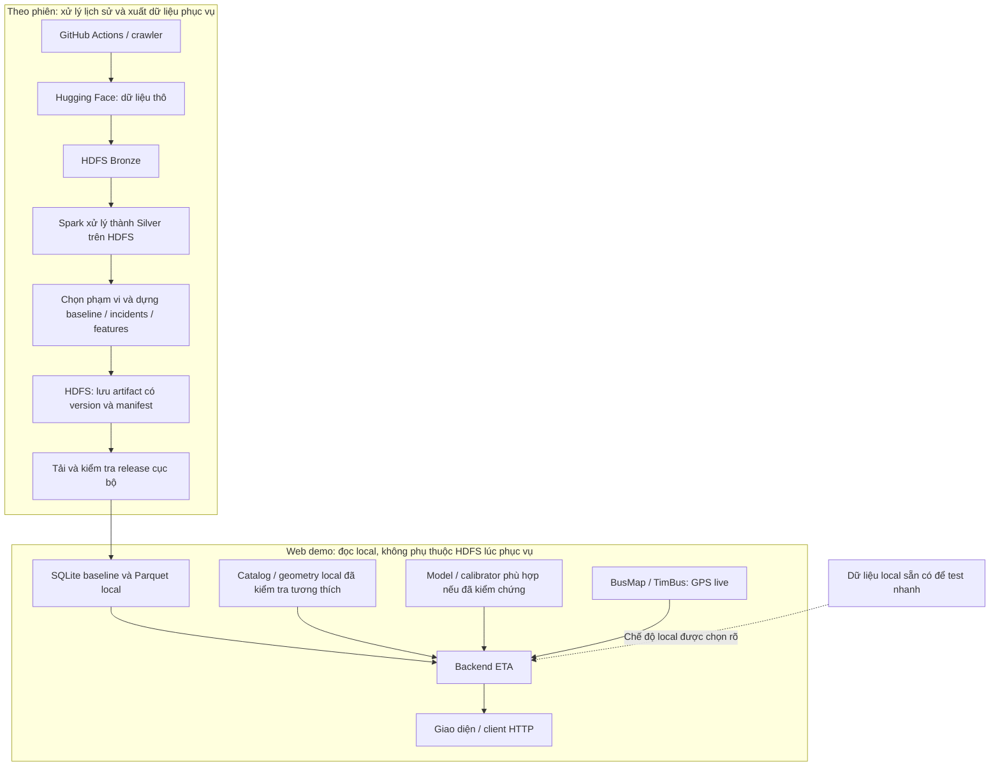

# SPEC-41 — Checklist lưu trữ, web demo, pipeline và kiểm chứng mô hình ML

Đối chiếu mã trên `main` ngày 17/11/2026. Đây là kế hoạch, không phải báo cáo nghiệm thu.
Đã nối release/local, thu GPS/ETA live, đánh giá lại model và kiểm tra snapshot Silver toàn lịch sử. Gold/train mới chỉ chạy phạm vi nhỏ; chưa nghiệm thu toàn bộ pipeline hay chất lượng ML. Tiến độ, số đo và phần còn thiếu ở mục 9.
`[ ]` nghĩa là chưa nghiệm thu, kể cả khi đã có một phần mã. Chỉ đánh dấu hoàn thành khi có input/version, lệnh chạy, kết quả và điều kiện đạt được lưu lại.
Không dùng tài liệu cũ, số dòng/file hoặc “chạy không lỗi” làm bằng chứng đúng.

## 1. Hiện trạng xác nhận từ mã

| Nguồn kiểm tra | Điều thực sự có | Điều chưa được chứng minh |
|---|---|---|
| [eta_snapshot.py](../../module_2_big_data_storage_and_lakehouse/step_2_4_hdfs_history/eta_snapshot.py) | Materialize Silver thành cache; build local tạo `baseline.db`, incidents/feature Parquet; publish/download/verify/activate release bằng manifest/hash. | Toàn bộ Gold xử lý phân tán; release đã tương thích đầy đủ với web và model. |
| [run_hdfs_eta_workflow.py](../../scripts/run_hdfs_eta_workflow.py) | Đã điều phối source window/snapshot → cache → Gold → publish → download → activate, kiểm tra workspace/code khi chạy lại. | Chưa có điều phối nào; hoặc đã điều phối cả train/eval/promote model. |
| [serving_service.py](../../module_3_bus_eta_prediction/step_3_4_eta_serving_and_evaluation/serving_service.py), [data_access.py](../../module_3_bus_eta_prediction/step_3_4_eta_serving_and_evaluation/data_access.py), [model_runtime.py](../../module_3_bus_eta_prediction/step_3_4_eta_serving_and_evaluation/model_runtime.py) | Web có lựa chọn release pointer khi khởi động: baseline/incidents từ release, catalog local được đối soát; chưa bật model riêng với release. Không chọn pointer thì dùng nguồn local hiện hữu. | Activate CLI tự đổi nguồn của process web đang chạy; baseline-only release đã kiểm chứng model ML. |
| [release CLI](../../scripts/eta_snapshot_pipeline.py), [offline verifier](../../scripts/verify_eta_offline_release.py) | CLI tra baseline từ local/release; có kiểm tra offline, corruption và giữ release cũ khi refresh lỗi. | Đã kiểm chứng HTTP web chạy từ release khi Docker tắt. |
| [consumer verifier](../../scripts/verify_eta_snapshot_consumers.py), [integration verifier](../../scripts/verify_eta_history_integration.py) | Có đối soát bảng/Parquet, chạy lại offline và smoke prediction với model global. Verifier tự giới hạn kết luận về accuracy và route index. | Chưa có kiểm tra tích hợp nào; hoặc đã chứng minh tính đúng tổng quát và ETA live chính xác. |
| [eta_model_trainer.py](../../module_3_bus_eta_prediction/step_3_3_machine_learning_models/eta_model_trainer.py) | Có temporal fit/validation, early stopping, pruning, calibrator và tính metrics trên test; objective hiện là `reg:pseudohubererror`. | Model chưa từng được đánh giá; hoặc các bước/metrics đó đủ chứng minh nhãn đúng, không leakage, model serving khớp report và ETA live tin cậy. |

**Kiến trúc duy nhất trong kế hoạch:** HDFS lưu lịch sử; job batch xử lý và xuất SQLite cùng Parquet/model cần thiết thành local release; web demo chỉ đọc bản đã xuất. Cập nhật release là thao tác riêng, ngoài request người dùng. Không có nhánh API truy vấn HDFS trong kiến trúc này. Đã nối release baseline-only ở nhóm A; phần model đi cùng release chưa được nghiệm thu; không cần quyết định lại việc có dùng SQLite hay không, không yêu cầu Docker 24/7.

**Phân biệt baseline:** trong tài liệu này, baseline là **baseline matrix lịch sử giữa các trạm**, không phải một model ML khác. Mode local trong các phiên live 02/27 có gọi XGBoost + calibrator; mode release hiện chỉ dùng matrix. Đây là phần tích hợp ML với release chưa hoàn thiện, không phải thiết kế đích đã đủ. Không lấy benchmark baseline-only để kết luận về hành vi ML.

**Trạng thái ML:** model hiện là ứng viên cần kiểm chứng. Có số đo offline trong mã không đồng nghĩa đã nghiệm thu đúng/đủ; quan sát “chạy khá tốt” cũng chưa chứng minh chất lượng. Kiểm chứng tính đúng pipeline (D), chất lượng mô hình (M) và hành vi live (C) là ba lớp bằng chứng khác nhau.



## 2. A — Thống nhất và nối nguồn lưu trữ (P0)

- [x] **A1. Thực thi luồng HDFS → batch → SQLite/local release → demo.** Phân biệt raw HF, lịch sử/xử lý HDFS, release SQLite phục vụ ETA và dữ liệu local để test nhanh. SQLite là bản dẫn xuất có thể tái dựng, không thay kho lịch sử.
  **AC:** bảng nguồn đọc/ghi khớp runtime; các endpoint demo chỉ đọc local release hoặc nguồn local được chọn rõ, kể cả khi cache lạnh. Refresh release là thao tác riêng khỏi request người dùng. Chặn Docker/HDFS thì demo từ release vẫn khởi động/phục vụ được. Quy định rõ default, fallback và nguồn xuất hiện trong log/API.

- [ ] **A2. Kiểm chứng hợp đồng release với consumer.** Đối chiếu catalog, shapes, stations, baseline, incidents, model/calibrator và mapping `route_id_idx`. DB tạo cho domain builder không mặc định thay thế đầy đủ operational DB của web; model hiện nạp riêng.
  **AC:** version/hash/phạm vi các thành phần được ghép có trong manifest; từ chối schema/mapping/version không tương thích; không đánh lại route index theo số tuyến của release. Catalog rộng hơn baseline phải có trạng thái hỗ trợ/fallback rõ, không lẫn dữ liệu tuyến khác.

- [ ] **A3. Nối web vào release và giữ lựa chọn local.** Truyền nguồn nhất quán cho `DataAccess`, `IncidentsProvider`, model runtime; không trộn các bản không được kiểm tra tương thích.
  **AC:** HTTP thực xác nhận artifact đang dùng; baseline kiểm soát được phản ánh đúng vào đầu vào/tính ETA; restart chọn đúng nguồn. Release hỏng/refresh thất bại giữ bản hợp lệ trước. Web chạy từ release đã tải khi chặn Docker/HDFS; fallback được công bố, không xảy ra ngầm.

- [ ] **A4. Đo phục vụ demo và cập nhật release riêng.** Đo ETA HTTP/SQLite-local và thời gian batch dựng/tải/activate release.
  **AC:** có cold/warm p50/p95 latency, tỷ lệ lỗi và request đồng thời của demo; chi phí refresh và snapshot/artifact ID riêng. Đối soát output release với nguồn đã xử lý. Polling 5 giây không tự chứng minh đáp ứng trong 5 giây. Đặt mục tiêu hiệu năng sau phép đo.

## 3. B — Vòng đời demo và tàn dư (P0)

- [ ] **B1. Truy nguồn câu hỏi lưu dữ liệu lúc thoát.** Rà mã tracked chưa tìm thấy `input()`, `Read-Host`, prompt lưu hoặc shutdown hook trong `run_demo.ps1`, web `app.py` và JS. Chưa tái hiện hiện tượng người dùng báo.
  **AC:** lưu command/PID/log start-stop, xác định câu hỏi thuộc app, launcher cũ, file ngoài Git hay shell. Sửa đúng nguồn nếu xác nhận; Ctrl+C/stdin đóng không chờ nhập hoặc tạo batch lịch sử ngoài ý muốn. Không xóa ghi nhận quota hợp lệ của crawler chỉ vì nó có xử lý Ctrl+C.

- [ ] **B2. Rà entrypoint và side effect theo module.** Kiểm tra launcher web, crawler, ingest, projection, export, train và verify; ghi nguồn đọc/ghi, hành vi import/start/stop.
  **AC:** demo không tự chạy crawler/ingest/export khi thoát nếu chưa chọn chế độ ấy; chỉ còn hướng dẫn chạy hiện hành. Phân loại giữ/sửa/bỏ theo caller và vai trò, không xóa vì tên cũ hoặc thư mục rỗng.

- [ ] **B3. Sửa nhãn và contract sai nguồn.** Đã sửa nhãn backend/health sang hybrid BusMap–TimBus và công bố nguồn serving; tiếp tục rà FE, DTO, README và log tương ứng.
  **AC:** phân biệt app sống với upstream hoạt động; xác định được nguồn GPS, baseline/model và artifact. Cập nhật test hợp đồng. Không nhồi chi tiết nội bộ lên giao diện.

## 4. C — Thu GPS/ETA live và đánh giá bằng client (P0–P1)

- [ ] **C1. Client HTTP như FE.** Gọi routes/stations/live-vehicles/station-eta theo nhịp khuyến nghị, có backpressure; chọn tuyến/chiều/trạm rõ, gồm nguồn TimBus và BusMap-only khi có xe.
  **AC:** lưu params, request ID, UTC gửi/nhận, monotonic latency, status và response đầy đủ; GPS/tuổi ping/nguồn, tốc độ raw/làm mượt, ETA P50/optimistic/window và `prediction_source`. Manifest ghi commit/config/model/nguồn serving. Phân biệt timestamp upstream/query/nhận; hai response gần nhau chưa chắc cùng GPS snapshot. Không gắn nhãn observed cho dữ liệu tự tạo.

- [ ] **C2. Trace giải thích từng dự báo và replay.** Ghi có kiểm soát tại backend theo request ID: vị trí chiếu, feature, baseline, delta model, calibrator, bước lọc xe khi API chưa đủ thông tin.
  **AC:** truy ngược một ETA tới input/model và replay offline được. Response HTTP không đồng nghĩa packet upstream thô; cần packet upstream thì thu riêng, nối lineage rõ ràng.

- [ ] **C3. Ground truth đến trạm.** Ghép xe/tuyến/chiều/lượt chạy; đăng ký trước quy tắc qua trạm/vào vùng trạm và giới hạn gap, xử lý jitter/quay đầu.
  **AC:** giữ quan sát cuối trước/đầu sau cùng khoảng bất định; nội suy phải ghi là ước lượng từ GPS, không phải đo thời điểm dừng đỗ. Xe chưa tới/mất theo dõi được ghi censored. Không dùng ETA dự báo làm nhãn.

- [ ] **C4. Phân tích logic theo chuỗi tại một trạm trước, sau đó mới tổng hợp sai số.** Theo dõi cùng một xe từ xa tới lúc qua trạm; đọc từng packet ETA/GPS/feature và giữ identity khi đổi xe đầu danh sách. Đánh giá ETA có đếm xuống hợp lý, giờ đến dự báo có trôi/nhảy, tọa độ lặp, chờ tại chỗ, tốc độ, probe, delay, incidents, calibration, nhãn giao thông và khuyến nghị có mặt tại trạm. Tách nguyên nhân được code/packet xác nhận khỏi diễn giải chưa có bằng chứng. **AC bổ sung:** có timeline đầy đủ, đồ thị và các đoạn đối chiếu trước/sau; nhận xét tác dụng thực cho hành khách, không dùng trung bình sai lệch thay cho phân tích hành vi.
  **Phần thống kê bổ trợ:** Báo cáo signed error, MAE, median/p90 absolute error (giây), WAPE, phân phối % lỗi và tỷ lệ trong ngưỡng đã công bố; nhóm 1/2/5/10/15 trạm khi đủ dữ liệu.
  **AC:** mỗi nhóm có số forecast, số lượt đến trạm độc lập, coverage, số loại/lý do; tách ML/fallback, BusMap/TimBus, cold/warm history. Tách thời gian còn lại quá nhỏ để % lỗi không che kết quả. Đo coverage thực của P10–P90, không mặc định là khoảng tin cậy đã hiệu chỉnh.
  **Mục tiêu pilot đề xuất, chưa phải số liệu:** phiên 30–60 phút, tối thiểu 30 lượt đến trạm độc lập cho đánh giá thăm dò. Không đủ thì ghi rõ và thu tiếp; con số này không bảo đảm ý nghĩa thống kê hay đủ từng nhóm.

- [ ] **C5. Kiểm chứng khác nhịp mẫu trước khi đổi feature vận tốc.** Offline dùng lag 3/5 mẫu, online dùng cửa sổ thời gian; cùng số mẫu không đồng nghĩa cùng khoảng quan sát.
  **AC:** đo phân phối timestamp train/live, replay đúng nhịp và thử mất/trùng/gói muộn; so sánh phương án trên cùng dữ liệu có nhãn và cùng model. Tách tập chọn phương án khỏi tập báo cáo cuối. Chỉ đổi feature/retrain khi có kết quả, không đổi theo trực giác.

## 5. D — Hợp đồng và bất biến kiểm chứng pipeline (P1)

- [ ] **D1. Hợp đồng từng ranh giới.** Raw HF → Bronze → normalize → projected Silver → baseline/incidents → feature → train/eval → release → HTTP; gồm đường local tương ứng.
  **AC:** kiểm tra thực thi schema/type/unit/nullability, khóa, timezone/direction, geometry/catalog, provenance/version. Có ma trận nguồn/tuyến/ngày được hỗ trợ. Không dùng 48/54/176/96 trong doc như cùng một phạm vi hoặc suy ra tuyến chưa có dữ liệu đã được xử lý.

- [ ] **D2. Đối soát, tính xác định và chia dữ liệu.** Spark hiện đã chặn publish nếu `raw_bus_rows != accepted + rejected + duplicate`, có lineage/rejects; cần mở rộng kiểm chứng, không bắt đầu từ giả định chưa có gì.
  **AC:** fixture có kết quả tính độc lập; thử đảo file/event, nhập lại, chia/gộp batch, đổi partition/worker và conflict cùng khóa. Đối soát riêng bus/incidents, giữ lý do loại và provenance. Chỉ đòi tương đương các cách chia khi giữ đủ ngữ cảnh lịch sử/boundary; không ép đoạn mất ping trước cho cùng vận tốc/chuyến.

- [ ] **D3. Trường hợp biên liên module.** Tuyến `02` khác `2`; hướng 0/1/go/re, qua nửa đêm Hà Nội, offset, duplicate/conflict, đổi chuyến, thiếu geometry, lệch hành lang, mất GPS/ngày rỗng.
  **AC:** mỗi ca có kết quả hoặc lý do loại mong đợi, tổng đếm khớp; kiểm tra local/phân tán trên phạm vi tương đương đã định nghĩa.

- [ ] **D4. Nhãn, split và dữ liệu tương lai.** Xác minh baseline fit đúng phần cho phép; feature ở t chỉ dùng thông tin có sẵn tới t. Nhãn tương lai dùng đánh giá không được lọt vào feature.
  **AC:** test nhãn từ trajectory biết trước; trip qua ranh giới split; fleet/probe/incidents theo thời điểm; mapping category và schema model/calibrator. Rà cả model full/pruned ở từng consumer. Prediction hữu hạn hoặc hai thư mục train/test chưa chứng minh không leakage.

- [ ] **D5. Điều phối và chạy lại an toàn.** Tái sử dụng U6/checkpoint/manifest, chỉ bổ sung phần thiếu, không tạo pipeline cạnh tranh. Chạy fixture nhỏ có nhãn từ raw tới HTTP.
  **AC:** lệnh tái lập, code/config/input/model hash và coverage từng stage; test failpoint publish, tải dở, hash sai, resume không nhân đôi hoặc đổi active release sai. Có train/eval nhỏ để kiểm chứng vòng huấn luyện; nếu chỉ pin model để inference thì phải ghi rõ chưa kiểm chứng train.

- [ ] **D6. Quy mô và phạm vi còn thiếu.** Silver có xử lý phân tán; build Gold hiện materialize về pandas/SQLite local, không mặc định chịu được toàn bộ lịch sử.
  **AC:** đo thời gian/RAM/disk từng stage theo tuyến/ngày, đặt giới hạn và chia job/checkpoint cho Gold/train; bảng đã làm/chưa làm/lý do. Mở rộng theo ngân sách laptop; tách observed/replay/synthetic scale. Không yêu cầu lấy được dữ liệu thực mà nhóm không có quyền tiếp cận.

## 6. M — Kiểm chứng mô hình ML hiện tại (P0 thiết kế, P1 thực nghiệm)

- [ ] **M1. Định danh chính xác model đang đánh giá và đang phục vụ.** Đối chiếu artifact full/pruned, feature list/order, calibrator, category mapping, dữ liệu train và code/config tạo chúng. Không mặc định report của pruned áp dụng cho runtime đang nạp full.
  **AC:** một manifest gắn hash model/metadata với input snapshot, split, mapping, code/config và kết quả đánh giá. Chỗ không khôi phục được provenance phải ghi là chưa xác minh; không điền bằng suy đoán. Ưu tiên đánh giá lại artifact hiện có, chưa cần train lại job dài chỉ để có log mới.

- [ ] **M2. Kiểm toán dữ liệu học, nhãn và thiết kế đánh giá.** Dùng kết quả D3/D4, kiểm tra trực tiếp trajectory và các ETA label mẫu; truy train/validation/test theo ngày/chuyến, dữ liệu trùng, cách lấy mẫu/trọng số, baseline fit và thời điểm feature có sẵn.
  **AC:** có bảng coverage và số xe/chuyến/ngày/tuyến độc lập từng tập, các mẫu đối soát nhãn cùng sai lệch; test cuối không dùng để chọn feature, tham số hay calibrator. Rà việc dùng validation cho early stopping/pruning/calibration và công bố giới hạn, không tự coi việc có validation là leakage hay bảo đảm không overfit. Nếu test cũ đã dùng để chọn phương án, chọn tập thời gian mới cho kết luận cuối và ghi rõ lịch sử sử dụng.

- [ ] **M3. Chứng minh đóng góp của ML trên cùng tập đánh giá.** So sánh baseline, model residual chưa calibration, model có calibration và full/pruned khi có artifact phù hợp; giữ nguyên tập nhãn/phạm vi giữa các phương án.
  **AC:** báo cáo metrics như C4 theo horizon/tuyến/chiều/ngày, cả nhóm ML thua baseline và dữ liệu hiếm, không chỉ trung bình chung hoặc các tuyến tốt nhất. Tách forecast lặp của cùng một lượt xe; khoảng bất định/so sánh theo nhóm chuyến/ngày khi đủ mẫu. Ablation dùng để chọn phương án trên validation, không lựa theo kết quả test cuối.

- [ ] **M4. Kiểm chứng ý nghĩa đầu ra và calibration.** Runtime gọi đầu ra là P50, nhưng objective pseudohuber không tự chứng minh đây là trung vị có điều kiện; P10/P90 và optimistic/buffer cũng cần kiểm chứng riêng.
  **AC:** đo tỷ lệ actual nằm dưới/trên dự báo, signed bias và coverage/độ rộng khoảng theo từng nhóm; mô tả đúng nguồn/cách tạo từng giá trị. Không gọi khoảng dự báo là bảo đảm xác suất nếu chưa có bằng chứng. Nếu đổi sang quantile hoặc sửa calibrator thì phải đánh giá lại; chưa tự đổi objective chỉ vì tên P50.

- [ ] **M5. Kiểm chứng khả năng áp dụng cho serving.** Dùng replay C2/C5 và dữ liệu live có nhãn C3; xét nhịp train/BusMap/TimBus, thiếu/lỗi/stale GPS, cold start, tuyến/ngày ít dữ liệu và tuyến ngoài phạm vi học nếu có.
  **AC:** so offline/replay/runtime trên cùng input khi thực sự tương đương; tách sai khác do feature, model, calibration và logic serving. Chưa có đủ dữ liệu của nhóm nào phải ghi chưa kết luận, không mở rộng kết quả vài tuyến thành toàn Hà Nội. Kiểm thử lỗi HTTP/state không được dùng thay cho bằng chứng accuracy.

- [ ] **M6. Ra quyết định sử dụng và điều kiện phải đánh giá lại.** Chốt trước phép thử cuối các tiêu chí chấp nhận: chất lượng so baseline, sai lệch/đuôi lỗi theo horizon, coverage và chi phí inference phù hợp demo; không đặt ngưỡng hồi tố để model qua.
  **AC:** có kết luận chấp nhận trong phạm vi nào/chưa đủ bằng chứng/không đạt, và fallback khi model không phù hợp hoặc thiếu dữ liệu. Release ghi model nào đã được kiểm chứng với nguồn nào. Đổi schema, mapping, baseline, cadence hoặc artifact phải kích hoạt các kiểm tra liên quan. Không đánh dấu đạt chỉ vì predict hữu hạn hay app trông hợp lý.

## 7. E — Vận hành và tài liệu (P2)

- [ ] **E1. Cập nhật HF và dọn staging có giới hạn.** Rà runner nhập thủ công/retry trước khi thêm lịch; chỉ tự động theo phiên được bật nếu cần, có checkpoint và hạn mức.
  **AC:** tắt/mở không bỏ sót/nhân đôi; không GC dữ liệu còn được snapshot/release tham chiếu; không cần online 24/7. Chỉ thêm compaction khi có số đo cho thấy cần.

- [ ] **E2. Dọn verifier/hướng dẫn sai giai đoạn.** Đã sửa `scripts/verify_canonical_architecture.py` để kiểm tra cấu trúc theo stage, bỏ yêu cầu cũ không được có Gold; tiếp tục đối chiếu hướng dẫn và caller.
  **AC:** phân loại theo stage, sửa/bỏ có caller rõ, không hạ ngưỡng để qua test; README/link/lệnh và kiến trúc đúng nguồn hiện hành. Không refactor JS/CSS chỉ vì dài.

- [ ] **E3. Gói bằng chứng cuối.** Manifest trỏ log kiểm tra, thống kê dữ liệu, report ETA và giới hạn.
  **AC:** tái tạo được số liệu; phân biệt mock/replay/live; checklist cập nhật theo mã đã nghiệm thu. Không lấy số test pass của phiên cũ để nghiệm thu mã mới.

## 8. Thứ tự và điểm dừng

1. **A1 → B1/B2 → A2/A3:** nối đúng release SQLite/local, không query HDFS trong demo; kiểm chứng offline và dừng không hỏi lưu ngoài ý muốn.
2. **M1 + thiết kế M2/M6 → C1/C2:** pin model và xác định protocol đánh giá trước khi thu; chưa chờ retrain lớn. Có thể thu tiếp trong khi làm D.
3. **D1–D5 → C3/C5 + M2–M5:** kiểm chứng nhãn/pipeline, đánh giá offline và khác nhịp, đối chiếu live. Sau đó mới quyết định đổi feature/model. Bàn giao dữ liệu và report, không chỉ script/ảnh ETA.
4. **C4/M6 → A4/D6 → E:** kết luận phạm vi model được chấp nhận, đo quy mô, mở rộng phù hợp, đóng bằng chứng/tài liệu.

Mỗi phần lớn báo cáo mã thay đổi, input/phạm vi kiểm chứng, số đo, AC đạt/chưa đạt và việc tiếp theo. Không đánh dấu cả module hoàn thành từ một đường chạy mẫu; không xóa phần đã có chỉ vì checklist cũ mô tả thiếu hoặc sai.

## 9. Tiến độ tạm thời — cập nhật ngày 17/11/2026

### 9.1. Quyết định và phạm vi hiện tại

**Quyết định của nhóm:** tạm giữ model hiện tại để rà soát dữ liệu trước; chưa chạy lại toàn bộ global training, chưa thay objective/feature theo trực giác và chưa promote model mới. Đây không phải quyết định nghiệm thu chất lượng model. Chế độ local giữ model ứng viên; chế độ release tiếp tục baseline-only và công bố trạng thái trong health.

Kiến trúc vẫn là **HDFS → batch → SQLite/Parquet local release → web**. Request của web không truy vấn HDFS. Giữ lựa chọn local để test nhanh mà không phải bật Docker. HDFS là kho lịch sử và đầu vào tái dựng, SQLite là bản phục vụ dẫn xuất.

Báo cáo này là ảnh chụp tiến độ của mã đang sửa, **chưa phải nghiệm thu toàn bộ SPEC-41**. Không cộng số test ở các lần chạy khác nhau, không dùng kết quả cũ thay cho kiểm tra tổng thể mã cuối.

### 9.2. Checklist theo nhóm

Các ô ở mục 2–7 vẫn để mở nếu chưa đạt toàn bộ AC. Bảng này phân biệt phần đã làm với việc cần làm tiếp.

| Mục | Đã thực hiện / kết quả kiểm chứng | Còn thiếu để đóng mục |
|---|---|---|
| A1 | Đã đạt: chọn release/local rõ; demo đọc local, không gọi HDFS trong request. | Duy trì khi thay nguồn/model. |
| A2–A3 | Verify hash; đối soát catalog/route ID/station/shape; pin release đến restart; thử corruption/pointer sai; HTTP phân biệt baseline release 100 giây với local 999 giây. | Bundle model/calibrator/mapping gắn release chưa nghiệm thu. Hiện chỉ chấp nhận đường baseline-only. |
| A4 | Đã đo HTTP thật trên localhost, cold/warm và 4 client đồng thời; tách fixture GPS khỏi upstream thật. | Tổng hợp chi phí refresh đầy đủ và chốt ngân sách hiệu năng theo phạm vi demo. |
| B1 | Launcher thật với stdin đóng đã dừng graceful, không hỏi lưu, không đổi artifact. Rà source chưa tái hiện được prompt người dùng báo. | Chưa xác định được command/file thực sự tạo prompt; không tuyên bố đã sửa một lỗi chưa tái hiện. |
| B2–B3 | Rà các entrypoint chính; sửa health hybrid GPS, nguồn artifact/model, trạng thái upstream chưa kiểm tra. | Hoàn tất bảng side effect/caller và rà nhãn còn lại. |
| C1 | Đã có client HTTP, backpressure, manifest, request ID; thu hai chiều tuyến 02/27 và tuyến 110. | Đóng gói lệnh và coverage cuối; không suy rộng các tuyến/ngày chưa thu. |
| C2 | Đã trace feature/model/calibrator và replay; có phiên lưu cả HTTP bytes và packet upstream, liên kết request ID. | Hoàn tất bộ bằng chứng tự chứa; phân biệt replay model với replay toàn bộ trạng thái HTTP. |
| C3 | Nhãn qua trạm từ GPS độc lập với ETA; giữ bracket, loại gap/jitter/reset và giữ censored. Có 49 lượt qua trạm trong pilot gộp. | Nhãn là ước lượng qua vị trí trạm, chưa đo thời điểm dừng đỗ thực tế. |
| C4 | Có MAE, median/p90, bias, % lỗi, coverage và nhóm 1/2/5/10/15 trạm; đếm theo lượt qua trạm và cụm xe. | Chưa tách đầy đủ cold/warm history; BusMap-only chưa có nhãn hợp lệ; thiếu nhiều ngày. |
| C5 | Đo khác nhịp train/live; replay có kiểm soát không thấy feature lệch; thử đổi sang đếm mẫu cho kết quả kém hơn trên pilot. | Chưa đủ phép thử mất/trùng/gói muộn và tập xác nhận độc lập; giữ cửa sổ thời gian hiện tại. |
| D1–D3 | Verify Silver toàn lịch sử; thêm guard ID/provenance/JSON; kiểm tra timezone và schema, mapping/split feature hiện có. Hai build Gold cùng đầu vào cho cùng ID và hash. | Hoàn tất ma trận ranh giới và fixture độc lập liên module; chưa phủ mọi cách chia batch/worker/conflict. |
| D4 | Phát hiện cấu hình baseline có thể dùng cả ngày validation; thêm cutoff riêng, tách trajectory ở ranh split và chặn train thiếu manifest/hash hợp lệ. | Rà nhãn/feature fleet/probe/incidents toàn diện; không khẳng định đã làm sạch model cũ. |
| D5 | Workflow scoped từ Silver tới Gold/release; train nhỏ, reload đúng, không đổi model gốc; từ chối ghi đè output feature/model có dữ liệu. | Chưa có một fixture khép kín raw → train → HTTP; còn kiểm tra failure/resume liên stage. |
| D6 | Có số đo Spark/Silver và benchmark serving; Gold thử trên 2 tuyến × 3 ngày. | Chưa đo RAM/disk/thời gian đủ từng stage và chưa chạy Gold/train toàn lịch sử. Gold hiện là xử lý local. |
| M1 | Pin hash full/pruned/metadata, đối chiếu feature list; đánh giá hai artifact riêng. | Chưa khôi phục được provenance lần train cũ. |
| M2 | Rà split/schema/domain; có bằng chứng nguy cơ baseline lấn validation và guard cho train mới. | Ưu tiên tiếp theo: đối soát raw → trajectory → label → feature; coverage xe/chuyến/ngày và lịch sử dùng test. |
| M3–M4 | Đánh giá baseline/full/full calibrated/pruned trên cùng 3.704.820 dòng test; có pilot live và khoảng bất định theo cụm xe. | Chưa kết luận ưu thế tổng quát; tên P50/P10/P90 không phải bảo đảm xác suất. |
| M5 | Replay dự báo model khớp sai số làm tròn HTTP; sửa route không thuộc mapping bị gán nhầm index 0. | Chưa đủ chứng cứ cho mọi cadence, cold start, tuyến/ngày và lỗi nguồn. |
| M6 | Đã chốt hướng tạm thời: giữ model ứng viên, rà dữ liệu trước; release baseline-only. | Chưa chốt tiêu chí trước phép thử cuối, chưa nghiệm thu ML hay promote model mới. |
| E1 | Runner HF có hạn mức/checkpoint; thử nhận 2 file, retry không nhân đôi; giữ raw. | Chưa nhận hết dữ liệu ngày thử; chưa nghiệm thu đầy đủ mọi kịch bản khôi phục. Không thêm GC khi chưa cần. |
| E2 | Viết lại verifier theo stage và rút gọn README chính/module 2/HDFS. | Rà nốt runbook/link/lệnh còn cũ. Không sửa specs 38–40. |
| E3 | Có manifest/log/raw/report tại `runtime/`; lưu bản tổng hợp và hash nguồn nhỏ trong Git. | Chưa đóng gói cuối, chưa chạy kiểm tra tổng thể trên mã cuối, chưa commit toàn bộ thay đổi hiện tại. |

### 9.3. Số liệu chính và cách hiểu

**Lưu trữ/pipeline.** Snapshot Silver `c331ba5f2fb26cdd33744047b4cf28eeb586924e05479302e546af325d048058` được verify lại: 12.988.883 dòng bus raw; 9.718.018 sự kiện duy nhất; 7.568.398 dòng được chấp nhận; 1.463 partition. Kiểm tra accounting, uniqueness, lineage và partition index đều đạt. Chênh lệch các tổng không được gọi chung là “dữ liệu lỗi”: phải đọc reject/duplicate accounting theo manifest. Thời gian 1.636,261 giây và peak worker RSS 319.808 KiB trong manifest là số đo lần xử lý Spark gốc, không phải thời gian lần verify này.

Build sạch trên tuyến 02/27, ngày 22/10, 27/10 và 01/11: baseline chỉ fit đến 23/10/2026; 7.599 ô baseline; 416 chuyến dùng fit; feature có 114.253 dòng train và 57.373 dòng test. Hai build độc lập cho **cùng hash toàn bộ file và cùng artifact ID** `fbd3cdc53b12740cbd33b0c61c0f4d840f971eceae581ec56b140037ef40d480`. Kết quả này chỉ chứng minh tính xác định trên phạm vi đó. Thời gian chạy đã tách khỏi định danh artifact để không tạo version mới chỉ vì khác thời gian xử lý.

Train thử giới hạn 10.000 dòng fit, 4.000 validation và 57.373 test; reload cho dự báo đúng như trước lưu, model gốc không đổi. Model thử có MAE 111,54 giây, baseline 106,53 giây: **không promote**, chỉ dùng kiểm tra vòng train/save/load.

**ML offline — nhãn feature store hiện có, chưa chứng nhận nguồn nhãn.**

| Phương án | Dòng test | MAE (giây) |
|---|---:|---:|
| Baseline | 3.704.820 | 114,98 |
| Full chưa calibration | 3.704.820 | 96,56 |
| Full có calibration | 3.704.820 | 95,76 |
| Pruned chưa calibration | 3.704.820 | 96,70 |

Tập test gồm 47 tuyến; kiểm tra domain/split/schema không phát hiện vi phạm trong các quy tắc đã cài. Điều này không chứng minh nhãn đúng hoặc model cũ không leakage. Chưa phục dựng đầy đủ input/code/config của lần train cũ.

**Pilot live — hai phiên không chồng thời gian của tuyến 02/27.** 7.199 request, không lỗi HTTP; 16.428 dự báo thu được; 7.346 dự báo có nhãn hợp lệ, thuộc 49 lượt qua trạm và 20 cụm xe. Forecast lặp không phải mẫu độc lập. Các dự báo còn lại vẫn giữ trong report phiên với trạng thái không quan sát được/không hợp lệ/đã qua trạm, không đưa vào mẫu số accuracy.

MAE ML **59,31 giây**, baseline **62,13 giây**; median absolute error lần lượt **36,17 và 35,13 giây**. ML không thắng mọi thước đo. So sánh MAE cân bằng theo lượt qua trạm, bootstrap theo cụm xe: chênh ML − baseline **−0,61 giây**, khoảng 95% **[−4,81; +3,36] giây**, còn chứa 0; chưa đủ bằng chứng ưu thế rõ ràng. Coverage khoảng dự báo là **85,16%** trên pilot; không được gọi là bảo đảm P10–P90 đã hiệu chỉnh.

| Còn cách trạm | Dự báo có nhãn | Lượt qua trạm | MAE ML (giây) | MAPE với thời gian thực còn lại ≥30 giây |
|---|---:|---:|---:|---:|
| 1 trạm | 865 | 49 | 12,45 | 21,23% (574 dự báo) |
| 2 trạm | 915 | 45 | 21,78 | 13,43% (915) |
| 5 trạm | 592 | 36 | 52,89 | 13,63% (592) |
| 10 trạm | 235 | 15 | 79,29 | 9,17% (235) |
| 15 trạm | 47 | 3 | 160,71 | 14,41% (47) |

Các hàng chỉ là đúng khoảng cách trạm được chọn, không bao phủ toàn bộ 7.346 dự báo. Một lượt xe có thể xuất hiện ở nhiều hàng. Nhóm 15 trạm rất ít lượt, chưa đại diện. Nhãn là nội suy GPS, bracket trung vị 5,28 giây; không phải đo dừng đỗ, chưa lượng hóa hết độ trễ cache upstream. Tuyến 110 có 405 request, 266 dự báo baseline nhưng **0 nhãn qua trạm hợp lệ** theo ngưỡng gap 40 giây đã khai báo trước; không báo accuracy cho tuyến này.

**Nhịp mẫu.** Với tuyến 02, median thời gian bao phủ lag 3/5 offline khoảng 240/395 giây; TimBus live khoảng 15/25 giây. Vì vậy không ép online dùng cùng số mẫu. Trên 1.145 dự báo pilot replay, cửa sổ thời gian giữ MAE 33,65 giây, cách đếm mẫu 39,18 giây; replay cửa sổ hiện tại không phát hiện feature lệch. Đây là phân tích độ nhạy, chưa phải phép thử cuối độc lập để chọn feature.

**Hiệu năng demo.** Benchmark TCP localhost dùng GPS thực đã thu rồi phát lại, không gọi upstream: 3 lần khởi động/mode, mỗi mode 45 request warm tuần tự và 60 request với 4 client đồng thời. Release baseline-only có warm p95 lần lượt **27,73/28,05 ms**; local candidate **41,42/124,30 ms**. Request ETA live thực ở phiên 02/27 đầu có p95 khoảng **621 ms**, bao gồm điều kiện upstream thực. Không dùng số fixture để hứa độ trễ Internet hay khả năng nhiều máy.

### 9.4. Dữ liệu raw để kiểm chứng

Theo yêu cầu giữ toàn bộ dữ liệu thu được: không lấy mẫu bớt, không dọn các phiên đã thu. File runtime hiện chỉ lưu trên máy này, **không nằm trong Git và chưa có bản sao dự phòng được xác minh**. Không commit hàng chục nghìn packet vào repo mã nguồn. Authorization/cookie/API key không được ghi vào bộ packet; các bytes phản hồi và payload phục vụ giải mã được giữ.

| Vị trí tương đối từ root repo | Nội dung / giới hạn |
|---|---|
| `runtime/eta_live_session_20261117_02_27/` | Phiên chiều 0: 3.602 HTTP request; body đã parse, trace, geometry/model/code đóng băng; chưa có bytes upstream gốc. |
| `runtime/eta_live_session_20261117_02_27_return/` | Phiên chiều 1: 3.597 request; body đã parse và trace; chưa có bytes upstream gốc. |
| `runtime/eta_live_session_20261117_110/` | Phiên BusMap-only; giữ cả dự báo không ghép được nhãn. |
| `runtime/eta_live_session_20261117_raw/` | Phiên 15 phút có đầy đủ 1.807 HTTP response bytes và 18.791 lượt upstream: 366 BusMap, 18.425 TimBus; 29.848 byte object duy nhất, ledger giữ từng lượt kể cả nội dung trùng/lỗi. |
| `runtime/eta_raw_verification_20261117.json` | Kiểm tra hash/bytes; 18.416 bản TimBus giải mã kiểm chứng được, các lượt lỗi vẫn giữ; 0 upstream mất liên kết request ID. Không phải mọi lượt upstream đều là một quan sát GPS mới. |
| `runtime/eta_live_pilot_summary_20261117.json` | Report gộp 2 phiên không chồng thời gian; các report từng phiên giữ nhãn/censored và lý do. |
| `runtime/eta_candidate_evaluation_20261117/` | Manifest nguồn và dự báo Parquet từng tuyến, report offline đầy đủ. |
| `runtime/spec41_completed_20261117/build_a/`, `build_b/` | Hai artifact độc lập dùng đối chiếu tính xác định trên phạm vi nhỏ. |

Phiên `raw` chồng thời gian với phiên `return`, **không gộp thành dữ liệu độc lập** trong báo cáo pilot. Từ lúc bật raw capture mới có bytes gốc; không thể bổ sung ngược bytes upstream đã không thu trước đó. Manifest phiên, artifact bundle, local inputs và code đóng băng nằm cùng thư mục phiên. Bản tổng hợp nhỏ kèm SHA-256 của các report gốc: [progress_20261117.json](../evidence/spec41_20261117/progress_20261117.json).

Lệnh kiểm tra lại (chọn output mới, không ghi đè bằng chứng cũ):

```powershell
python scripts/verify_eta_raw_session.py --session runtime/eta_live_session_20261117_raw --require-upstream --output runtime/eta_raw_verification_recheck.json
python scripts/summarize_eta_sessions.py --pair runtime/eta_live_session_20261117_02_27 runtime/eta_live_analysis_20261117_02_27 --pair runtime/eta_live_session_20261117_02_27_return runtime/eta_live_analysis_20261117_return --output runtime/eta_live_pilot_recheck.json
```

Verifier hiện có thêm kiểm tra các bundle bổ sung; log verify raw đã lưu là từ lần chạy trước khi thêm các kiểm tra đó. Không coi log cũ là bằng chứng mọi nhánh mới đều đã chạy.

### 9.5. Thứ tự tiếp tục sau báo cáo tạm thời

1. **Rà logic trước khi bổ sung thống kê:** dùng chuỗi một trạm/một xe làm đơn vị phân tích; bắt đầu từ các vấn đề đã thấy ở nghiên cứu tình huống Việt Đức bên dưới. Sau đó **rà dữ liệu trước ML:** truy raw → Silver/trajectory → bracket đến trạm → label/feature; lượng hóa lỗi/loại và coverage theo ngày/xe/chuyến; kiểm tra baseline fit, split, fleet/probe/incidents theo thời điểm. Giữ nguyên model gốc và tất cả raw.
2. Hoàn tất fixture khép kín raw → train nhỏ → HTTP, các ca biên/failpoint và replay từ bundle tự chứa. Chỉ sửa code khi có ca tái hiện hoặc vi phạm hợp đồng cụ thể.
3. Hoàn tất đo tài nguyên/refresh và tài liệu/entrypoint; chạy bộ kiểm tra phù hợp trên mã cuối, đóng gói bằng chứng, commit các thay đổi đã xử lý.
4. Khi dữ liệu đủ tin cậy mới đề xuất tiêu chí nghiệm thu ML và tập xác nhận thời gian mới. Chưa chạy lại toàn bộ global training theo quyết định hiện tại của nhóm.

Lần kiểm tra focused gần nhất cho data contract: **16 test đạt trong 1,80 giây**, log `runtime/spec41_data_contract_final_tests.log`. Các lần khác kiểm tra trace/raw hoặc snapshot có log riêng, nhưng **chưa thay thế bộ kiểm tra tổng thể sau tất cả thay đổi**. SPEC-41 còn mở; không quy đổi tiến độ thành % vì các mục không đồng trọng lượng và còn phụ thuộc kết quả rà dữ liệu.

### 9.6. Điều chỉnh trọng tâm: kiểm chứng logic ETA theo yêu cầu nhóm

Bảng metrics và replay kỹ thuật ở trên chưa trả lời đủ hệ thống đang hiểu gì từ dữ liệu. Đã bổ sung [nghiên cứu tình huống trạm Việt Đức](../evidence/spec41_20261117/VIET_DUC_STATION_CASE.md), gồm 180 response tại một trạm, 214 dự báo của hai xe, timeline và đồ thị; giữ nguyên packet và phân rã từng cặp. Đây là phân tích hồi cứu trên phiên raw hiện có, không phải dữ liệu live mới hay tập xác nhận độc lập.

Các quan sát làm thay đổi ưu tiên công việc:

- Xe chính có 97 gói từ cách 1,7 km tới sát trạm. Dự báo đầu báo 19:20:53, GPS nội suy qua vị trí trạm khoảng 19:19:50; ML gần mốc GPS hơn matrix ở 6/97 gói. Không suy rộng kết quả một xe thành chất lượng toàn model.
- Có đoạn xe sau không đổi tọa độ hơn một phút, rolling speed gần 0 nhưng tuổi ping dưới một giây. TimBus hiện dùng fetch timestamp, chưa chứng minh tuổi GPS thiết bị.
- Online gán nhóm recent probe bằng baseline/default và cumulative delay bằng 0; elapsed time suy từ baseline, trong khi train có tính thời gian trajectory/probe thực. Đây là khác biệt ngữ nghĩa cần kiểm chứng trước khi nói đủ feature hoặc hiểu được giao thông hiện tại.
- Cùng xe tiến thêm 40,4 m, matrix giảm 8,04 giây nhưng residual tăng 24,39 giây, làm ETA tăng 16,3 giây. Xác nhận được phép tính, chưa có bằng chứng cú nhảy phản ánh giao thông xấu đi.
- Khuyến nghị có mặt tại trạm có 18/97 lần muộn hơn cả đầu phải bracket GPS. Chưa biết thời gian dừng đỗ nên không khẳng định hành khách đã lỡ xe; cũng chưa được gọi policy là bảo đảm chống lỡ xe. Nhãn ùn tắc/trễ/P10–P90/phút nguyên cần kiểm chứng về ý nghĩa sử dụng, không chỉ đúng công thức.

**Ưu tiên tiếp:** D4/M2/M5 về ý nghĩa train–serve của elapsed/delay/probe; C2/C3 về tuổi GPS và dữ liệu lặp; C4/M4 về diễn biến giờ đến và policy hành khách; A2/A3 về nối release với ML. Chưa sửa thuật toán serving/model từ các phát hiện này; giữ nguyên dữ liệu để đối chiếu. Các ô AC chưa đạt vẫn để mở.

### 9.7. Thí nghiệm nguyên nhân biến động tốc độ / ETA

Đã bổ sung [thí nghiệm ba giả thuyết và replay trạng thái](../evidence/spec41_20261117/BEHAVIOR_PROBES_AND_SPEED_RESET.md). Không có phiên live mới, không đổi model hay thuật toán serving.

- Xác nhận một trường hợp **cold start lại giữa phiên**: phép chiếu global đổi giữa hai nhánh gần nhau, lý trình lùi 119,2 m làm xóa ring 111 mẫu. Hai mẫu sau reset chỉ cách 4,73 giây, dưới ngưỡng 10 giây; tốc độ xe dẫn fallback raw TimBus 17 → 3 km/h.
- Cả hai tốc độ có trong packet TimBus gốc, không phải chuyển TimBus sang BusMap ở sự kiện này. Chưa loại trừ lỗi phối hợp nguồn ở trường hợp khác.
- Replay đủ 54 feature khớp hai request. Giữ cặp feature tốc độ xe dẫn cũ thì ETA khoảng 1.279,21 giây thay vì 1.358,13 giây; xác định được nguyên nhân tính toán, chưa chứng minh phản ứng có ích bằng nhãn đến trạm.
- Không thấy sai đơn vị/phép chia trong ca này; vấn đề nằm ở giả định chọn nhánh/reset và fallback không phân biệt độ tin cậy. Heading TimBus hiện suy từ đoạn được chọn, chưa phải bằng chứng độc lập xác nhận hướng xe. Chưa sửa bằng cách ép lý trình tăng.
- Trên cả phiên: probe coverage và cumulative delay bằng 0 ở 4.990/4.990 dự báo; train hiện có các trường này khác 0 khoảng 83,37% và 93,85%. Ưu tiên kiểm chứng ngữ nghĩa train–serve.
- Bổ sung các ca khuyến nghị muộn và tọa độ lặp; không gộp forecast lặp hoặc nhiều trạm của cùng xe thành mẫu độc lập. 15 test focused đạt; AC tổng thể còn mở.

### 9.8. Thử phương án sửa, biểu đồ phần trăm và EDA streaming

Đã có [báo cáo thí nghiệm kèm hình và dữ liệu từng gói](../evidence/spec41_20261117/STREAMING_REPAIR_EXPERIMENTS.md). Đây là shadow replay raw, chưa bật phương án thử vào serving.

- Replay gốc khớp 54 feature trên 4.990 forecast, ETA lệch tối đa 0,049995 giây do làm tròn. Thử giữ tốc độ sau reset, chọn nhánh bằng hướng dịch chuyển và kết hợp.
- Cách giữ tốc độ chặn cú nhảy +78,38 giây ở cặp gói ban đầu nhưng sau đó xuất hiện cú nhảy +81,40 giây: chưa sửa gốc. Motion giảm số cú nhảy ≥30 giây từ 10 xuống 7 nhưng MAE trên nhãn cố định tăng nhẹ 33,654 → 33,672 giây; chưa promote. Nhãn GPS và tập dòng HTTP giữ nguyên nên chưa nghiệm thu toàn pipeline sau đổi phép chiếu.
- Giả lập gửi trùng không đổi dự báo. Bỏ 20% lần đọc không tương đương mất 20% GPS; thử bỏ 1.047/5.275 mẫu timestamp riêng biệt làm MAE lên 34,058 giây và cú nhảy lên 15. Timestamp riêng của TimBus chưa đồng nghĩa heartbeat thiết bị riêng.
- Tạo biểu đồ theo ảnh tham khảo, đúng dấu (actual − predicted)/actual. Nhóm cách 1 trạm: đầy đủ 245 forecast; bản còn ≥30 giây có 160 forecast, trung vị −8,50%, dải 80% [−39,03%; +20,44%]. Giữ cả CSV/đuôi ngoài trục và mẫu sát 0, không lọc ngầm.
- Có EDA tác động từng field/nhóm, biểu đồ chuỗi sau sửa và % lỗi theo thời gian thực còn lại. Elapsed time có tác động đáng kể, tiếp tục ưu tiên rà ý nghĩa train–serve. Can thiệp feature không được gọi là quan sát hay nguyên nhân vật lý.
- 35 test focused đạt, gồm hồi quy serving TimBus/release. Không thay model, không xóa raw, chưa đóng AC còn thiếu.

### 9.9. Đính chính phạm vi kiểm thử feature — 18/11/2026

**Pipeline feature live chưa đạt.** Các kết quả 35 test focused trước đó không bao phủ đầy đủ ngữ nghĩa producer. Đã xác nhận [thiếu probe và nguồn incident hết hiệu lực](../evidence/spec41_20261117/LIVE_FEATURE_CONTRACT_GAPS.md).

- Serving chưa có bộ ghi nhận thời gian xe trước hoàn thành đoạn; bốn feature probe được gán baseline/default, không chỉ trong cold start. Offline có xử lý sự kiện hoàn thành đoạn, nên hai luồng chưa cùng ngữ nghĩa.
- Incident có logic đọc Parquet/lọc thời gian/chiều/vị trí; nhưng partition của cả 02/27 trong phiên raw hết hiệu lực chậm nhất 07/11, không có record hiệu lực ngày 17/11. Raw phiên này không thu TomTom live. Không coi vector 0 là bằng chứng không có incident hoặc nguồn live hoạt động.
- Bổ sung acceptance không mock producer: xe trước đã đi hết đoạn 10 giây so với baseline 20 giây phải tạo coverage 1/ratio 0,5; test **thất bại** vì nhận default. Ca incident Parquet hợp lệ tới vector rồi hết hạn **qua**, chỉ chứng minh phép tính. Tổng lần chạy **1 failed, 1 passed**; không skip/xfail ca thiếu chức năng.
- D4/M2/M5 tiếp tục mở. Trước khi nghiệm thu ML phải có kiểm chứng nguồn và hành vi kích hoạt từng nhóm feature, không chỉ schema/replay/HTTP. Sửa phép chiếu không thay thế việc này.

### 9.10. So sánh phép chiếu bằng raw live — 18/11/2026

[Báo cáo, chuỗi gói và hình học nhánh](../evidence/spec41_20261117/PROJECTION_LIVE_COMPARISON_20261118.md). Chưa đổi code production, chưa có phiên live mới.

- Thử nearest hiện tại, đúng hàm cửa sổ offline và HMM online sigma 15/25; 5.266 quan sát timestamp mới, 45 luồng xe/tuyến/chiều, 4.990 dự báo đối chiếu.
- Ở ca 172/174, offline loại điểm xe dẫn; HMM giữ chuỗi trên nhánh phù hợp hướng GPS, sửa lịch sử tốc độ và không đẩy cú nhảy sang gói sau. Trong phút sự kiện, mức tăng ETA lớn nhất 78,38 → 4,69 giây; kiểm tra hết 69 forecast còn lại của xe/trạm này: global tối đa 78,38 s, offline 82,04 s, HMM 6,85 s. Chưa có nhãn đến trạm của xe sau để kết luận accuracy riêng ca đó.
- HMM giữ được 4.976–4.977 dòng dự báo cũ, so với offline 4.918. Trên giao 1.086 nhãn, MAE global 33,614 s và HMM khoảng 33,635 s: không tuyên bố cải thiện accuracy. Nhãn gốc phụ thuộc phép chiếu cũ.
- P95 HMM chiếu khoảng 0,10–0,12 ms/quan sát mới; đo toàn state + feature tăng khoảng 10–11% trong lượt replay. Chưa benchmark HTTP/concurrency hoặc 2.000 xe.
- Ưu tiên HMM để chuẩn bị cài chung, chưa activate. Phải giải quyết vòng đời gần bến/đổi chiều và phục hồi không khớp, nối đồng bộ tốc độ/lọc xe/ETA, xác nhận nhánh độc lập. Không chỉ sửa `project_point` một nơi.
- Kiểm tra gồm cả feature acceptance đang đỏ: 1 failed, 16 passed; probe xe trước vẫn thiếu. Không nghiệm thu pipeline ML hoặc TomTom live từ thí nghiệm chiếu.

### 9.11. Đã cài HMM chung và reset lượt xe — 18/11/2026

[Thay đổi đã cài và bằng chứng](../evidence/spec41_20261117/HMM_INSTALLED_20261118.md).

- Offline và serving dùng chung kernel RouteHMM; tốc độ/feature/lọc trạm/ETA dùng cùng kết quả chiếu. Xóa lịch sử khi xác nhận đảo chiều gần bến, chờ chiều mới thay vì ép chiều cũ; khi nhận chiều mới khởi tạo lại cả matcher, ring, macro EMA và passed-station/cache. Gói cũ không đảo trạng thái trở lại.
- Parity raw: 5.264 quan sát chuẩn hóa, 0 khác biệt offline/serving. Replay HTTP code production với upstream/clock phát lại: 1.440 request, 4.976 forecast ML; 14 forecast cũ bị từ chối chuyển tiếp, không giả dữ liệu bù.
- Ca đã biết: cú nhảy +78,38 s thành −0,6 s; hết 69 forecast sau sự kiện, mức tăng lớn nhất 6,8 s. Ca gần bến 231970 có reset/chờ chiều mới rồi khởi tạo chiều mới trong trace. Không khẳng định rút ngắn độ trễ upstream hoặc cải thiện accuracy.
- Đã đổi fingerprint snapshot HDFS để bao gồm kernel mới; không ghi đè/rebuild toàn bộ lịch sử, active release hoặc model hiện hữu. Các artifact cũ chưa được tái chứng nhận theo policy mới.
- Bộ test tổng thể còn đỏ: 2 failed (probe chưa triển khai và kiểm tra DOM payload chưa xác minh), 192 passed, 11 HDFS live opt-in skipped. Không nghiệm thu toàn SPEC-41.
