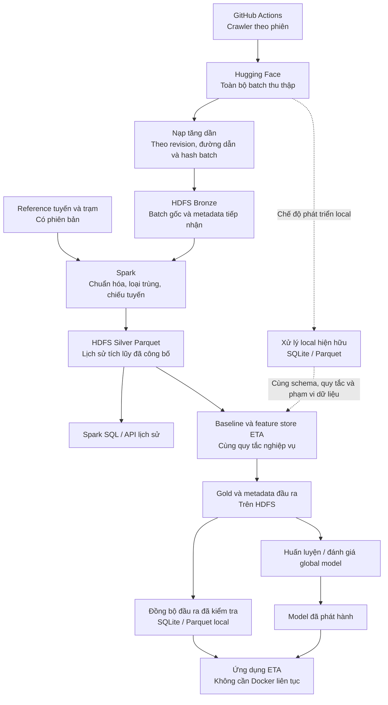

# Kế hoạch thống nhất lưu trữ và triển khai xuyên module

Trạng thái: kiến trúc đã được người dùng chốt; các giai đoạn triển khai dưới đây chưa được nghiệm thu. Lượt cập nhật này chỉ chỉnh tài liệu.

Tài liệu này là kế hoạch điều phối hiện hành của nhánh HDFS. SPEC-25 được giữ nguyên như đặc tả lát cắt ban đầu. Các kế hoạch thử nghiệm P3A/P3B và kế hoạch nối snapshot cũ đã được dọn; runbook/evidence giữ kết quả trong phạm vi thử nghiệm. [Chỉ mục HDFS](../HDFS_README.md) dẫn tới tài liệu đang dùng. Code và kết quả kiểm chứng quyết định những gì đã thực hiện; tài liệu này mô tả đích đến.

## 1. Quyết định kiến trúc

**GitHub Actions thu thập; Hugging Face giữ batch thô; HDFS tổ chức lịch sử để xử lý và khai thác; SQLite/local Parquet phục vụ ứng dụng và phát triển offline.**

GitHub Actions và HF ghép thành cơ chế thu thập qua nhiều phiên khi nhóm không có máy chủ riêng. Không suy diễn thành cam kết không có khoảng trống thu thập. HF không phải kho feature, model hoặc nơi phát hành Silver mặc định. Không có thành phần riêng tên “stable pool”.

HDFS phải được dùng cho lịch sử tích lũy và tác vụ ETA hiện tại: Spark đọc Bronze để xây Silver; lịch sử Silver cung cấp dữ liệu cho baseline và feature store; các đầu ra chuẩn được tái sử dụng cho huấn luyện, đánh giá và đồng bộ phục vụ. Việc chứa một bản sao thô hoặc chạy synthetic riêng chưa đáp ứng mục tiêu tích hợp.

Parquet là định dạng bảng, không phải một backend ngang hàng với HDFS/HF. Cùng bảng có thể nằm trên HDFS hoặc ổ local, với cùng schema và snapshot dữ liệu.

Sơ đồ là kiến trúc đích. Không diễn giải các mũi tên là đã cài đặt xong. Giai đoạn đầu có thể chạy thuật toán baseline/feature hiện hữu trên cache Silver tải từ HDFS rồi đăng ký Gold lên HDFS; phải ghi rõ xử lý đó chạy local. Chỉ các bước thực sự chạy Spark trên HDFS mới được gọi là xử lý phân tán. Không cần viết lại toàn bộ thuật toán ML bằng Spark.

## 2. Trách nhiệm và hợp đồng dữ liệu

| Thành phần | Giữ gì / làm gì | Không giao thêm trách nhiệm |
| --- | --- | --- |
| GitHub Actions | Thu thập theo phiên, đẩy batch và tiếp sức | Không phụ thuộc Docker/HDFS trên laptop |
| Hugging Face | Kho batch đầu vào để tải lại, tiếp nhận bù | Không coi là Silver chỉ vì file có đuôi Parquet |
| Local staging/spool | File tải hoàn tất, retry và receipt | Không là nguồn lịch sử phân tán thay HDFS |
| HDFS Bronze | Bản batch gốc đã nhận, hash, revision và đường dẫn HF | Không sửa nội dung gốc để vừa schema envelope |
| HDFS Silver | Bảng đã chuẩn hóa/chiếu tuyến và loại trùng trên lịch sử tích lũy | Không công bố run dở hoặc cộng trùng nhiều run |
| HDFS Gold | Thống kê, baseline, feature đã kiểm tra và lineage | Không ghi đè âm thầm sản phẩm đang sử dụng |
| SQLite | Trạng thái/bảng phục vụ và backend local hiện hữu | Không bắt HDFS truy cập cho từng request ETA |
| Local Parquet | Cache hoặc backend xử lý local với schema chung | Không gọi local là HDFS khi Docker tắt |

“Thô” nghĩa là batch đúng như crawler đã lưu: có thể đã qua sanitizer ở crawler, không được tuyên bố là phản hồi API nguyên bản nếu code không lưu như vậy.

Các hợp đồng cần chốt trước code giai đoạn tương ứng:

- Batch: dataset HF, revision đã chọn, đường dẫn, byte hash, kích thước, trạng thái nhận. Chốt revision cho mỗi lượt; không đọc `main` đang thay đổi giữa lượt rồi gọi là một snapshot.
- Bronze: lưu byte gốc và metadata riêng; envelope chuẩn phục vụ transform là bản dẫn xuất có liên kết ngược, không thay thế batch gốc. Batch trùng bytes có thể nhận biết; bản thay đổi cùng đường dẫn phải có version mới hoặc báo xung đột, không bỏ qua theo tên file.
- Event: nhận diện ổn định khi cùng ping xuất hiện ở nhiều batch; tái sử dụng công thức identity hiện có sau khi kiểm tra phù hợp dữ liệu HF. Timestamp thiếu timezone hoặc route chưa biết đi vào báo cáo/quarantine, không tự đoán.
- Reference: version/hash tuyến, trạm, hình học và quy tắc projection đi cùng snapshot. Dữ liệu lịch sử đã chiếu không được âm thầm đổi nghĩa khi reference cập nhật.
- Silver: schema chuẩn dùng chung với local; giữ provenance và source lineage. Có snapshot/manifest chỉ liệt kê các partition đã công bố; reader không quét mọi thư mục `_runs` rồi cộng lại. Bổ sung batch muộn phải cập nhật đúng partition và loại trùng với dữ liệu đã công bố.
- Gold: ràng buộc snapshot Silver, reference, phiên bản phép tính, phạm vi ngày và train/test split. Không gộp synthetic/replay vào accuracy quan sát thực.
- Cache: lưu snapshot/version, thời điểm đồng bộ, phạm vi dữ liệu và hash; hiển thị rõ đang dùng bản nào. Cache hỏng bị từ chối. Cache cũ nhưng hợp lệ có thể được chọn rõ ràng để chạy offline.

## 3. Các module bị ảnh hưởng

| Khu vực / điểm code hiện có | Điều chỉnh dự kiến | Mức ảnh hưởng |
| --- | --- | --- |
| `.github/workflows/crawl_bus.yml`, `scripts/cloud_crawler_step.py`, `cloud_crawler_runner.py`, `hf_lake_sync.py` | Giữ cơ chế relay → HF. Chỉ bổ sung metadata batch nếu khảo sát cho thấy thiếu; không ép runner truy cập HDFS | Thấp, ưu tiên giữ ổn định |
| `dataset_sync.py`, `scripts/sync_from_hf.py` | Dùng lại khả năng tải; thêm lựa chọn revision, kiểm tra hash và tải tăng dần vào staging, tránh làm hỏng đường local | Trung bình |
| `hdfs_bronze_adapter.py`, `spool.py`, `webhdfs.py`, `hdfs_ingest_runner.py` | Đường nhập chính từ batch HF đã tải; lưu bản gốc/lineage, retry và nhận bù. Hook crawler local đã thêm là tùy chọn phụ | Cao ở ranh giới dữ liệu |
| Sanitizer, `trip_segmenter.py`, `projection_boundary.py`, canonical route/station | Dùng lại định nghĩa nghiệp vụ, chuẩn hóa schema/reference, kiểm chứng parity; không tạo phép projection thứ hai | Cao về tính đúng |
| Module 2 SQLite store, `lakehouse_exporter.py`, `silver_lakehouse_auditor.py` | Giữ backend local; thống nhất hợp đồng Parquet với HDFS, đối soát cùng cửa sổ | Trung bình |
| `p2_transform.py`, `scripts/hdfs_p2_transform.py` | Từ một fixture sang batch HF thực và Silver tích lũy; partition replacement/snapshot publication, báo cáo reject, compaction vừa đủ | Cao |
| `history_query.py`, `hdfs_history_server.py` | Đọc snapshot Silver đã công bố; cùng số liệu với Spark độc lập; lỗi/fallback đúng chế độ | Trung bình |
| `baseline_matrix_builder.py`, `eta_history_baseline.py` | Nguồn là snapshot Silver chung, không phụ thuộc đường dẫn thí nghiệm P3A; đăng ký baseline Gold, giữ local/cache | Cao ở hợp đồng nguồn |
| `feature_store_builder.py`, `scripts/build_gold_feature_store.py` | Đọc cùng snapshot/reference/baseline; output riêng để tránh hành vi xóa Gold hiện hữu; kiểm tra schema, split, mẫu feature | Cao |
| `eta_model_trainer.py`, script train/evaluate | Dùng feature snapshot chuẩn cho global model; giữ model hiện hữu tới khi kiểm chứng. Không bắt buộc retrain toàn bộ trong tích hợp storage | Thấp nếu schema giữ nguyên |
| Module 3 serving/data access, web demo | Giai đoạn cuối chỉ đổi cách nhận bản dữ liệu đã đồng bộ nếu cần; giữ SQLite/model và chế độ local | Hoãn tới sau parity, không sửa giao diện |
| Docker Compose, CLI điều phối, docs/evidence | Một chuỗi lệnh rõ ràng: sync → ingest → process → publish → materialize → consume; trạng thái từng bước | Trung bình |

Các tên file là điểm khảo sát/điểm nối, không phải yêu cầu sửa tất cả. Các thay đổi riêng hiện có ở config, serving, web và `experiments/timbus` không nằm trong kế hoạch sửa tự động; phải kiểm tra diff mới trước mỗi lần triển khai. Không cần đọc thí nghiệm timbus để thực hiện kế hoạch này.

## 4. Kế hoạch thực thi có thứ tự

Không dùng lại nhãn “P3A/P3B hoàn thiện” để suy ra tích hợp đã hoàn thiện. Các giai đoạn mới dùng U1–U6.

| Giai đoạn | Việc phải giao | AC / điều kiện qua bước | Trạng thái |
| --- | --- | --- | --- |
| U1 — Chốt hợp đồng trên batch HF thật | Khảo sát một revision và batch bus/incidents thực; mapping schema/identity/timezone/reference; manifest thống nhất; inventory script đang chồng chéo | Truy được một batch HF tới bản ghi và bảng đích; ghi rõ thiếu/sai; không bịa metadata; danh sách thay đổi code nhỏ nhất được xác định | Đạt trong phạm vi khảo sát hai batch; xem [SPEC-45](45_U1_HF_BATCH_AND_HISTORY_CONTRACT.md), chưa thay ingest/transform |
| U2 — HF → HDFS Bronze | Tải/nhận tăng dần, lưu byte gốc/receipt/lineage, tiếp tục sau lỗi; một CLI dùng các thành phần cũ | Chạy lại không sinh bản logical trùng; crash sau upload trước receipt phục hồi được; tắt Docker vẫn giữ batch HF/staging; mở lại nhập bù; cùng đường dẫn khác hash được xử lý rõ | Đạt trên hai batch thực U1 và kiểm thử version/retry; xem [SPEC-46](46_U2_HF_TO_HDFS_BRONZE_IMPLEMENTATION.md); chưa nạp toàn bộ dataset |
| U3 — Silver tích lũy | Spark xử lý batch mới, trễ và chồng lấn; dùng reference chuẩn; xuất Parquet và công bố snapshot | Cùng input/reference cho cùng logical rows; hai batch chứa cùng ping không làm tăng số event duy nhất; crash trước publication không lộ output; query đối soát đúng; có thống kê reject | Đạt phạm vi ba batch HF thực; xem [SPEC-47](47_U3_CUMULATIVE_SILVER_PLAN.md). Recompute tập batch, chưa tối ưu incremental; incident observation chưa spatial join |
| U4 — Consumer ETA dùng snapshot chung | Bỏ phụ thuộc run P3A; baseline thật + feature store dùng cùng snapshot; Gold có lineage và được lưu HDFS; triển khai vật lý local/Spark được ghi rõ | So với local trên cùng input: schema/count/key và giá trị theo tolerance được công bố trước khi chạy; split không leakage; global model loader đọc được feature; không ghi đè model/Gold vận hành | Đạt trên tuyến 02/27, hai ngày: baseline/incident facts/features, exact parity, model smoke; chưa promote model/route category mapping. Xem [SPEC-48](48_U4_U5_U6_ETA_SNAPSHOT_EXECUTION.md) |
| U5 — Offline và dữ liệu phục vụ | Đồng bộ một snapshot hoàn chỉnh thành SQLite/Parquet local; chọn local/cache/hdfs; thay bản phục vụ an toàn sau parity | Docker tắt vẫn chạy được chức năng local/cache; nguồn/version được nhận biết; cache hỏng từ chối; thất bại cập nhật không mất bản phục vụ tốt trước; không pha các snapshot | Đạt release/pointer thử nghiệm, baseline lookup offline, corruption và failed-refresh; không tự đổi DB web đang chạy. Xem SPEC-48 |
| U6 — Diễn tập và tài liệu cuối | Một runbook thống nhất, sơ đồ thực tế, inventory đã làm/chưa làm; diễn tập HF → Bronze → Silver → baseline/feature → local consumer | Batch mới thực sự làm cập nhật output nghiệp vụ; chạy lại không nhân đôi; phục hồi khi gián đoạn; chứng minh offline; giữ raw log và giới hạn đúng phạm vi | Đạt diễn tập bounded và replay từ HF bằng một CLI; [runbook](../HDFS_U456_RUNBOOK.md), [evidence](../evidence/hdfs_u456/README.md); chưa nhập toàn HF hoặc cutover serving |

U2 chỉ bắt đầu khi mapping U1 đủ kiểm chứng. U4 phụ thuộc publication U3. Có thể thiết kế schema consumer sớm nhưng không promote sản phẩm trước parity. U5 giữ local hoạt động xuyên suốt, không đợi cuối dự án mới khôi phục fallback. Không sửa serving trước khi dữ liệu phục vụ được kiểm chứng.

Chưa ước lượng giờ chạy toàn bộ/retrain: thời gian phụ thuộc phạm vi dữ liệu HF được kiểm tra ở U1. Ưu tiên hoàn thành một cửa sổ thực đi hết U1–U6, sau đó mở rộng theo partition; không chọn mặc định huấn luyện lại mọi tuyến.

## 5. Tiêu chí nghiệm thu toàn luồng

1. Đưa thêm batch từ HF vào HDFS làm thay đổi đúng lịch sử và đầu ra baseline/feature tương ứng. Không chỉ có bảng tốc độ hoặc file mô phỏng.
2. Từ Gold/feature truy ngược được snapshot Silver, reference và batch HF đã dùng. Cùng input/ref/phép tính tái lập được cùng giá trị nghiệp vụ.
3. Đường local hiện hữu hoạt động; snapshot HDFS đồng bộ xuống có thể dùng offline. Không gọi lỗi HDFS là lỗi toàn ứng dụng, cũng không giấu việc đổi nguồn.
4. Có bằng chứng storage/Spark phân tán trên dữ liệu cùng pipeline; P3B vẫn chỉ chứng minh cơ chế nhỏ với block 1 MiB, không thay bằng tuyên bố xử lý hàng trăm GB.
5. Phần nào chưa đạt parity giữ trạng thái experimental; không ghi đè database/model đang dùng để tạo cảm giác đã tích hợp.

## 6. Kế thừa và điều chỉnh công việc đã làm

| Thành quả cũ | Quyết định |
| --- | --- |
| Cluster hai DataNode, Spark, uploader/receipt và test retry | Giữ, dùng lại cho U2–U3 |
| Adapter/envelope và projection parity | Giữ, kiểm tra mapping với batch HF ở U1 |
| P3A query/validation | Giữ runbook/evidence; đổi nguồn reader sang snapshot chung ở U3/U4 |
| P3B synthetic/replay | Giữ runbook/evidence như thí nghiệm storage; không cho vào lịch sử quan sát |
| Wrapper và cache baseline thử nghiệm | Giữ bằng chứng consumer/offline; không biến đường dẫn `gold/p3a_observed_v3` thành API dữ liệu lâu dài |
| Hook local crawler → spool | Giữ tùy chọn; không thay vai trò GA/HF hoặc bắt runner dùng canonical SQLite trên laptop |
| Nhiều script một lần | Chưa xóa/đổi tên; U1 lập inventory, sau đó gom CLI điều phối có chủ đích, giữ các phép thử độc lập |

## 7. Cách trình bày trước hội đồng

“Nhóm dùng GitHub Actions và Hugging Face để duy trì thu thập khi không có máy chủ riêng. Dữ liệu thu được được nạp vào HDFS thành lịch sử có tổ chức; Spark xử lý lịch sử để tạo đầu vào cho ETA. SQLite và model phục vụ ứng dụng, đồng thời cho phép làm việc khi cụm tắt.”

Đây là cách mô tả kiến trúc đích. Khi báo cáo phải kèm trạng thái U1–U6 thực tế; không trình bày kế hoạch như kết quả đã triển khai.
