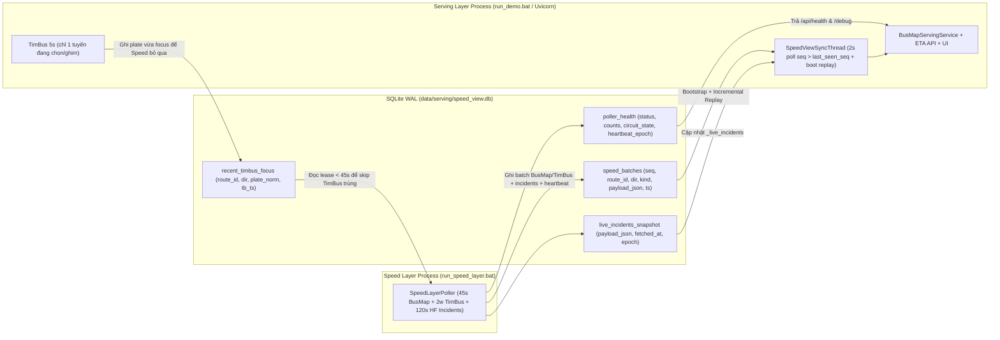

# Spec: Tách Speed Layer thành tiến trình độc lập (Hướng 3 — Lambda Architecture)

- **Ngày lập:** 2026-11-28
- **Trạng thái:** Đề xuất kỹ thuật (chờ review / validate độc lập trước khi triển khai)
- **Phạm vi:** Tầng Speed Layer & Serving Layer (`modules/eta/serving/`, `modules/eta/web_demo/`, `scripts/`, `run_demo.*`, `run_speed_layer.*`)

---

## 1. Bối cảnh & Mục tiêu

### Hiện trạng
- Hiện tại `SpeedLayerPoller` (`modules/eta/serving/speed_poller.py`) chạy dưới dạng một thread nền (`daemon=True`) bên trong cùng tiến trình FastAPI/Uvicorn (`modules/eta/web_demo/app.py`).
- Toàn bộ trạng thái realtime của Speed Layer (`MacroSpeedTracker`, `RouteProjectionTracker`, `CausalFeatures`, `_tb_last_valid`, `_live_incidents_raw`) nằm thuần trong **RAM của singleton `BusMapServingService`**.
- Hệ quả thực tế:
  1. Khởi động Speed Layer sẽ kéo theo luôn Serving Layer (`uvicorn`).
  2. Tắt hoặc restart Web App (`run_demo.bat`) làm mất sạch toàn bộ warm-up 45s vừa thu thập (bị cold-start lại 3–5 phút).
  3. Không thể scale nhiều Uvicorn HTTP workers vì mỗi worker sẽ tự chạy một `SpeedLayerPoller` trùng lặp.
  4. Log HTTP request và log chu kỳ 45s của Speed Layer trộn lẫn trên cùng một terminal.

### Mục tiêu
Tách **Speed Layer** và **Serving Layer** thành **hai tiến trình hệ điều hành độc lập** theo đúng Lambda Architecture:
- `run_speed_layer.bat` / `run_speed_layer.ps1` chỉ chạy **Speed Layer Worker** (thu thập BusMap 45s + trám TimBus có chọn lọc + đồng bộ TomTom incidents 120s), **không khởi động Web/FastAPI**.
- `run_demo.bat` / `run_demo.ps1` chỉ chạy **Serving Layer** (FastAPI + Uvicorn + Web UI), tiêu thụ Real-time View có sẵn để không bị cold-start khi khởi động hoặc restart.

---

## 2. Bất biến bắt buộc (Hard Invariants)

1. **TimBus Politeness Invariant (Ưu tiên cao nhất):**
   - **Tuyệt đối không** quét toàn bộ tuyến qua TimBus ở chu kỳ 5s.
   - **Serving Layer** giữ nguyên cơ chế hiện tại: chỉ gọi TimBus chu kỳ `5s` cho **duy nhất 1 tuyến/chiều đang được người dùng mở hoặc ghim trạm**.
   - **Speed Layer** chu kỳ `45s` dùng **BusMap** làm nguồn chính cho các tuyến baseline, chỉ trám TimBus (2 workers, `anchors[:1]`) cho xe trễ `>= 60s` hoặc biến mất giữa tuyến, và **bắt buộc bỏ qua các xe mà Serving Layer vừa lấy TimBus trong `< 45s` gần nhất** (giữ nguyên ngữ nghĩa của `get_recent_timbus_plates`).
2. **Zero Regression / SSOT Logic Parity:**
   - Công thức 40 biến nhân quả (`CausalFeatures`), `RouteProjectionTracker`, `MacroSpeedTracker` và `BusMapServingService.ingest_speed_layer_vehicles` / `ingest_speed_layer_timbus_hit` / `ingest_live_incidents` **không thay đổi thuật toán**.
   - Serving Layer đồng bộ trạng thái từ Speed Layer thông qua replay các batch đã chuẩn hóa vào chính các hàm `ingest_*` hiện có.
3. **Independent Lifecycle & Graceful Degradation:**
   - Speed Layer chạy một mình bình thường khi Serving chưa bật.
   - Serving Layer vẫn phục vụ bình thường ngay cả khi Speed Layer chưa chạy (tự fallback sang live fetch tại chỗ như hiện tại), và khi Speed Layer đang chạy thì Serving mới khởi động sẽ nạp ngay dữ liệu có sẵn trong rolling window để triệt tiêu cold-start.
4. **Hardware Fit (Windows 11, 16 GB RAM):**
   - Không yêu cầu cài thêm hoặc bật thêm service/daemon ngoài (Redis, Kafka, Docker) cho môi trường chạy demo local.

---

## 3. Lựa chọn kỹ thuật & Lý do ngắn gọn

| Quyết định | Lựa chọn | Phương án bị loại & Lý do chọn |
| --- | --- | --- |
| **Shared Real-time View Bridge** | **SQLite chế độ `WAL`** (`data/serving/speed_view.db`) | Loại **Redis/Kafka** (tốn thêm daemon + dependency ngoài trên Windows 16GB RAM); loại **HTTP push giữa 2 process** (mất dữ liệu nếu Serving đang tắt/restart). SQLite WAL có sẵn trong Python stdlib, bền vững qua restart, hỗ trợ nhiều concurrent reader không block writer. |
| **Chiều đồng bộ dữ liệu** | **2 chiều nhẹ (Bidirectional Light)** | Loại **Speed-only write** vì Serving cần báo lại cho Speed các xe vừa được Serving query TimBus 5s (`recent_timbus_focus`) để Speed không gọi trùng TimBus ở vòng 45s kế tiếp. |
| **Định dạng dữ liệu truyền từ Speed sang Serving** | **Batch-level Event Stream** (`speed_batches` có `seq` tăng dần) + **Snapshot** (`live_incidents`, `poller_health`) | Loại **serialize trực tiếp state dict của `CausalFeatures`/`MacroSpeedTracker`** (phức tạp, dễ lệch phiên bản khi code feature đổi). Replay `speed_batches` đi qua đúng `ingest_speed_layer_vehicles` & `observe_snapshot(..., valid=True)` giúp giữ nguyên 100% logic gốc với ít code nhất. |
| **Dọn rác & kiểm soát dung lượng DB** | **Rolling TTL `3600s`** (khớp `sweep_stale_state`) + `WAL checkpoint(PASSIVE)` cuối mỗi chu kỳ 45s | Tránh file `speed_view.db` và `-wal` phình to khi Speed Layer chạy liên tục nhiều ngày. |
| **Phát hiện reset / restart Speed Worker** | **`writer_session_id` (UUID mỗi lần Speed Worker khởi động)** | Nếu DB bị xóa/tạo mới hoặc `seq` bị reset, Serving phát hiện `writer_session_id` đổi → reset `last_seen_seq = 0` và nạp lại từ đầu sạch sẽ. |

---

## 4. Kiến trúc & Luồng dữ liệu 2 chiều



### Quy tắc xử lý xung đột & Merge dữ liệu
1. **TimBus Focus Lease (`recent_timbus_focus`):**
   - Serving Layer khi có hit TimBus `5s` cho tuyến đang xem chỉ thực hiện `UPSERT` rất nhẹ `(route_id, dir_int, plate_norm, tb_ts)`. Có thể debounce nhẹ (ví dụ chỉ flush khi quá `3s` từ lần ghi trước cho cùng xe hoặc batch 1 lần mỗi poll) để tránh ghi đĩa quá dày.
   - Khi Speed Layer chạy `get_recent_timbus_plates(route_id, dir_int, now_epoch, max_age_sec=45.0)`, nó hợp nhất tập biển số từ `_tb_last_valid` nội bộ của Speed và bảng `recent_timbus_focus` trong SQLite (`tb_ts > now_epoch - 45.0`).
2. **Merge `_tb_last_valid` giữa Serving 5s và Speed 45s:**
   - Khi Serving replay một TimBus hit từ `speed_batches`, luôn so sánh timestamp: chỉ cập nhật `_tb_last_valid[(route_id, dir_int, p_norm)]` nếu `batch_tb_ts >= existing_tb_ts` → đảm bảo dữ liệu TimBus `5s` tươi hơn ở Serving không bao giờ bị ghi đè bởi bản ghi TimBus cũ hơn từ Speed Layer.
3. **Incremental Replay & Anti-Cold-Start Bootstrap:**
   - Khi Serving vừa khởi động, chạy `bootstrap_from_speed_view()` ngay trong `lifespan`: đọc toàn bộ `speed_batches` còn hạn (trong vòng `3600s` gần nhất, sắp theo `seq ASC`) và `live_incidents_snapshot` để nạp sẵn `RouteProjectionTracker`, `MacroSpeedTracker`, `CausalFeatures` trước khi nhận request HTTP đầu tiên.
   - Sau đó một thread nhẹ (`SpeedViewSyncer`, chu kỳ `2s`) chỉ đọc `WHERE seq > last_seen_seq ORDER BY seq ASC` (thường chỉ vài chục dòng mỗi chu kỳ 45s, chi phí < 1ms).

---

## 5. Thiết kế Schema SQLite WAL (`data/serving/speed_view.db`)

Pragmas bắt buộc khi mở kết nối:
```sql
PRAGMA journal_mode = WAL;
PRAGMA synchronous = NORMAL;
PRAGMA busy_timeout = 3000;
PRAGMA temp_store = MEMORY;
```

Các bảng chính:
```sql
CREATE TABLE IF NOT EXISTS speed_batches (
    seq INTEGER PRIMARY KEY AUTOINCREMENT,
    writer_session_id TEXT NOT NULL,
    kind TEXT NOT NULL,            -- 'busmap_route' | 'timbus_hit'
    route_id INTEGER NOT NULL,
    dir_int INTEGER NOT NULL,
    observed_epoch REAL NOT NULL,
    payload_json TEXT NOT NULL,    -- JSON list BusVehicleDTO (hoặc 1 timbus_hit record)
    created_at REAL NOT NULL
);
CREATE INDEX IF NOT EXISTS idx_speed_batches_created ON speed_batches(created_at);

CREATE TABLE IF NOT EXISTS recent_timbus_focus (
    route_id INTEGER NOT NULL,
    dir_int INTEGER NOT NULL,
    plate_norm TEXT NOT NULL,
    tb_ts REAL NOT NULL,
    PRIMARY KEY (route_id, dir_int, plate_norm)
);
CREATE INDEX IF NOT EXISTS idx_timbus_focus_ts ON recent_timbus_focus(tb_ts);

CREATE TABLE IF NOT EXISTS live_incidents_snapshot (
    singleton_id INTEGER PRIMARY KEY CHECK (singleton_id = 1),
    payload_json TEXT NOT NULL,
    fetched_at TEXT,
    updated_epoch REAL NOT NULL
);

CREATE TABLE IF NOT EXISTS poller_health (
    singleton_id INTEGER PRIMARY KEY CHECK (singleton_id = 1),
    writer_session_id TEXT NOT NULL,
    pid INTEGER NOT NULL,
    heartbeat_epoch REAL NOT NULL,
    snapshot_json TEXT NOT NULL    -- khớp schema SpeedLayerPoller.get_health_snapshot()
);
```

---

## 6. Kế hoạch triển khai theo từng file

1. **`modules/eta/serving/speed_view_store.py` (tạo mới, ~180 dòng):**
   - Class `SpeedViewStore(db_path: Path)`: quản lý kết nối SQLite WAL (thread-local connection + write lock nhẹ), khởi tạo schema, và các method:
     - `append_busmap_batch(writer_session_id, route_id, dir_int, observed_epoch, vehicles)`
     - `append_timbus_hit(writer_session_id, route_id, dir_int, bm_v, tb_rec, now_epoch)`
     - `save_incidents(payload, now_epoch)` & `load_incidents()`
     - `save_health(writer_session_id, pid, snapshot, now_epoch)` & `load_health(now_epoch, stale_after_sec=120.0)`
     - `record_focus_timbus_hits(route_id, dir_int, plates_with_ts)` & `get_recent_focus_plates(route_id, dir_int, now_epoch, max_age_sec)`
     - `fetch_batches_since(last_seq, known_session_id, min_epoch)` → trả `(batches, new_last_seq, current_session_id)`
     - `prune_expired(now_epoch, ttl_sec=3600.0)` + `PRAGMA wal_checkpoint(PASSIVE)`
2. **`modules/eta/serving/speed_worker.py` + `scripts/run_speed_layer.py` (tạo mới):**
   - Tách entry point chạy độc lập cho Speed Layer (khởi tạo `BusMapServingService` ở chế độ nhẹ phục vụ projection/static lookup + `SpeedLayerPoller(..., view_store=store)`), chạy vòng lặp chính, bắt `SIGINT`/`SIGTERM` gọn trong `< 1s`, **không import hay chạy FastAPI/Uvicorn**.
   - Lưu ý quan trọng: bên `SpeedLayerPoller`, khi `run_once()` ghi xong `speed_batches`, cần dọn stale state định kỳ và chỉ gọi HTTP BusMap/TimBus/HF.
3. **`modules/eta/serving/speed_poller.py` (cập nhật tương thích ngược):**
   - Thêm tham số tùy chọn `view_store: Optional[SpeedViewStore] = None` và `writer_session_id` vào `SpeedLayerPoller.__init__`.
   - Khi `view_store` được truyền vào:
     - Ghi batch BusMap, TimBus hit, `live_incidents` và `poller_health` xuống `view_store`.
     - Đọc thêm `view_store.get_recent_focus_plates(...)` bên cạnh `_service.get_recent_timbus_plates(...)` để skip xe mà Serving vừa lấy TimBus 5s.
   - Khi `view_store is None`: giữ nguyên 100% hành vi in-memory hiện tại để không làm vỡ bộ unit test cũ.
4. **`modules/eta/serving/serving_service.py` & `modules/eta/web_demo/app.py` (cập nhật):**
   - Bổ sung `SPEED_LAYER_MODE` env var với 3 giá trị:
     - `external` (mặc định khi chạy qua `run_demo.ps1`): **không** chạy `SpeedLayerPoller` trong FastAPI; bật `SpeedViewSyncer` (bootstrap + poll 2s) đọc từ `speed_view.db`; ghi `recent_timbus_focus` khi nhận hit TimBus 5s ở focus mode; `/api/health` đọc `poller_health` từ `speed_view.db` (tự đánh dấu `external_stopped` / `stale` nếu quá `120s` không thấy heartbeat trong giờ vận hành).
     - `embedded`: giữ cơ chế thread nền in-memory cũ (phục vụ fallback nhanh hoặc đơn giản hóa triển khai đơn process).
     - `disabled`: tắt hẳn (dùng cho test cô lập).
   - Ở `ingest_speed_layer_timbus_hit`: kiểm tra timestamp trước khi ghi đè `_tb_last_valid` để hit 5s mới hơn của Serving không bị bản cũ hơn từ Speed đè mất.
5. **`run_speed_layer.ps1` & `run_demo.ps1` (cập nhật):**
   - `run_speed_layer.ps1`: chỉ chạy `python scripts/run_speed_layer.py` (không check cổng `8000`, không chạy `uvicorn`), chỉ in log `[SpeedLayer HH:MM:SS] ...` sạch sẽ và dừng bằng 1 lần `Ctrl+C`.
   - `run_demo.ps1`: chạy `uvicorn` với `SPEED_LAYER_MODE=external` (có thể tăng `--workers` nếu muốn sau này; hiện giữ 1 hoặc configurable), hoàn toàn độc lập với Speed Layer worker.

---

## 7. Rủi ro, Edge Cases & Tiêu chí nghiệm thu

### Rủi ro & Biện pháp kiểm soát
- **Tranh chấp ghi SQLite (`SQLITE_BUSY`)** khi Speed Worker commit `speed_batches` trùng thời điểm Serving ghi `recent_timbus_focus`:
  - Giảm thiểu bằng `WAL` + `busy_timeout = 3000` + transaction ngắn nhất có thể (serialize JSON xong ngoài transaction rồi mới `BEGIN IMMEDIATE`). Ghi `recent_timbus_focus` bọc `try/except sqlite3.OperationalError` non-fatal (nếu lock thoáng qua vẫn không làm sập request ETA của hành khách).
- **Chênh lệch đồng hồ / thứ tự replay:**
  - `seq` tăng đơn điệu do duy nhất Speed Worker sinh ra; Serving replay theo đúng thứ tự `seq ASC`.
  - `_tb_last_valid` so sánh theo epoch `tb_ts` trước khi ghi đè.
- **Lệch cấu hình đường dẫn DB giữa 2 terminal:**
  - Đường dẫn mặc định `speed_view.db` đặt trong cùng thư mục với `SERVING_DB_PATH` (mặc định `data/serving/speed_view.db`), hỗ trợ override qua `SPEED_VIEW_DB_PATH` và tự truyền đồng bộ khi dùng `-DbPath`.
- **Speed Layer chưa chạy khi mở Web App:**
  - `SpeedViewStore` phía Serving mở chế độ an toàn khi file chưa tồn tại (trả rỗng); `/api/health` báo rõ `poller.mode = "external"`, `poller.status = "waiting_external"` (không crash, vẫn live-fetch BusMap & TimBus bình thường khi người dùng chọn tuyến).

### Tiêu chí kiểm thử bắt buộc khi triển khai
1. **Test 2-process concurrency (SQLite WAL):** Một process/thread writer ghi liên tục `speed_batches` + `poller_health`, reader/Serving đồng thời đọc incremental và ghi `recent_timbus_focus` trong lúc đọc/ghi → không phát sinh `OperationalError: database is locked`, đọc đủ 100% batch đúng thứ tự `seq`.
2. **Test TimBus Politeness xuyên tiến trình:** Serving ghi `recent_timbus_focus` cho xe X trên tuyến Y ở `t = 1000`; Speed Worker chạy `run_once(now_epoch=1020)` → khẳng định TimBus fetcher của Speed Worker **không** được gọi cho xe X (skip sạch), và sau `t = 1050` (> 45s) mới gọi lại bình thường nếu xe X vẫn trễ `>= 60s`.
3. **Test Timestamp Merge (5s Serving vs 45s Speed):** Serving có hit TimBus tại `t = 1030`, sau đó replay một batch Speed chứa hit TimBus của cùng xe tại `t = 1010` → `_tb_last_valid` vẫn giữ bản ghi `t = 1030`.
4. **Test Anti-Cold-Start Bootstrap & Session Reset:** Speed Worker ghi 2 chu kỳ, khởi tạo mới `BusMapServingService` (mô phỏng restart Web App) → `MacroSpeedTracker` và `CausalFeatures` khôi phục đúng số quan sát trong TTL; nếu Speed Worker khởi động lại với `writer_session_id` mới (hoặc DB bị recreate), Serving tự reset watermark về `0` và sync lại không lỗi.
5. **Test Graceful Degradation:** Chạy FastAPI với `SPEED_LAYER_MODE=external` khi chưa có `speed_view.db` → `/api/health`, `/api/live-vehicles`, `/api/station-eta` hoạt động bình thường không lỗi 500.
