# KIẾN TRÚC PHÂN RÃ HỆ THỐNG THEO CẤP BẬC MODULE (SRP & DOMAIN BOUNDARIES)
**Dự án**: Hanoi Bus Tracking & ETA Big Data System  
**Mục tiêu**: Chuẩn hóa không gian làm việc (Workspace), phân định rõ Chức năng - Nhiệm vụ - Quyền hạn từng module, quy hoạch Scripts về dạng Single Responsibility Principle (SRP) và cam kết không gây ảnh hưởng đến GitHub Actions Relay Bot.

---

## 1. PHÂN TÍCH RỦI RO & BẢO ĐẢM HOẠT ĐỘNG GITHUB BOT

> [!IMPORTANT]
> **Kết luận**: Việc tổ hợp lại các script và phân rã module **HOÀN TOÀN KHÔNG ẢNH HƯỞNG** đến GitHub Bot nếu tuân thủ kiến trúc **Facade / Thin Entrypoint Pattern**.

### 1.1. GitHub Bot thực sự phụ thuộc vào những gì?
Kiểm tra trực tiếp file cấu hình luồng chạy [`.github/workflows/crawl_bus.yml`](file:///z:/Desktop/Bus_tracking/.github/workflows/crawl_bus.yml):
1. **Lệnh thực thi**: `python scripts/cloud_crawler_step.py`
2. **Target commit & push**: Thư mục `data/metadata/` (`hust_cluster_config.json`, `tomtom_quota_tracker.json`, `daily_catalog_health.json`)
3. **Biến môi trường**: `HF_TOKEN`, `HF_DATASET_ID`, `TOMTOM_KEY`, `GITHUB_TOKEN`
4. **Cơ chế sống còn**: Vòng lặp Relay 9 phút kết thúc an toàn (Exit code 0) để tự kích hoạt `curl` dispatch phiên kế tiếp.

### 1.2. Giải pháp bảo toàn tính liên tục 100%
- Giữ nguyên đường dẫn entrypoint: `scripts/cloud_crawler_step.py`.
- Tách toàn bộ logic phức tạp trong `cloud_crawler_step.py` thành các service đơn nhiệm (`IngestionService`, `CatalogService`, `CloudSyncService`).
- Script `cloud_crawler_step.py` sẽ chỉ đóng vai trò **Orchestrator** (dưới 60 dòng code): khởi tạo và gọi tuần tự các module.
- Các biến môi trường, đường dẫn lưu file dữ liệu và mã thoát (exit codes) được giữ nguyên vẹn 100%.

---

## 2. MA TRẬN PHÂN RÃ MODULE: CHỨC NĂNG, NHIỆM VỤ & QUYỀN HẠN

Hệ thống được chuẩn hóa theo mô hình phân cấp:  
`Module Cấp 1 (Domain)` $\to$ `Module Cấp 1.1 (Sub-domain)` $\to$ `Module Cấp 1.1.1 (Component)`.

```mermaid
graph TD
    M1["Module 1: INGESTION & DATA ACQUISITION"]
    M11["1.1: Telemetry Ingestion (BusMap)"]
    M111["1.1.1: Low-level Transport & Device Pool"]
    M112["1.1.2: Fleet Catalog & Health Manager"]
    M113["1.1.3: Realtime Sanitizer & Kinematic Filter"]
    
    M12["1.2: External Incident Ingestion (TomTom)"]
    M121["1.2.1: Incident Client & Quota Governor"]
    
    M13["1.3: Lake Persistence & Sync"]
    M131["1.3.1: Cloud Lake Sync (Hugging Face)"]
    M132["1.3.2: Local Lake Writer"]

    M2["Module 2: GROUND TRUTH & OSM ROAD NETWORK"]
    M21["2.1: OSM Extractor (Overpass)"]
    M22["2.2: Route Topological Alignment"]
    M23["2.3: Station Centerline Snapper"]

    M3["Module 3: MAP MATCHING & TRAJECTORY FUSION"]
    M31["3.1: Spatial Map Matcher & Chainage"]
    M32["3.2: Virtual Ghost Point Engine"]
    M33["3.3: 1D Route-Curve Interpolator"]

    M4["Module 4: ANALYTICS, AUDITING & VISUALIZATION"]
    M41["4.1: Telemetry Data Auditor"]
    M42["4.2: High-Res Interactive Map Generator"]
    M43["4.3: Traffic Congestion Evaluator"]

    M5["Module 5: RUNNERS & ORCHESTRATION"]
    M51["5.1: GitHub Actions Cloud Runner"]
    M52["5.2: Local / Server Daemon Runner"]
    M53["5.3: Manual Maintenance Tools"]

    M1 --> M11 & M12 & M13
    M11 --> M111 & M112 & M113
    M12 --> M121
    M13 --> M131 & M132
    M2 --> M21 & M22 & M23
    M3 --> M31 & M32 & M33
    M4 --> M41 & M42 & M43
    M5 --> M51 & M52 & M53
```

---

### MODULE 1: INGESTION & DATA ACQUISITION (THU THẬP & NHẬP LIỆU)

#### Module 1.1: Vehicle Telemetry Ingestion (Thu thập vết di chuyển xe buýt)
- **Chức năng**: Giao tiếp với hạ tầng BusMap để trích xuất vị trí, trạng thái động học của 504 xe buýt theo thời gian thực.
- **Thành phần**:
  - **1.1.1: Low-level Transport & Device Pool (`core/transport/`)**:
    - *Nhiệm vụ*: Quản lý kết nối Raw Socket SSL, RAM DNS Cache (`api.busmap.city`), và thuật toán cấp phát thiết bị từ Bể tăng trưởng lũy tiến (Progressive Commuter Pool 300 $\to$ 5.000 ID). Thực hiện đóng dấu `crawled_at` chính xác cho từng xe ngay khi nhận phản hồi HTTP.
    - *Quyền hạn*: Chỉ thao tác tầng Network/Socket. **Không được phép** can thiệp vào phân tích ngữ nghĩa tọa độ hoặc ghi đè file trên đĩa.
  - **1.1.2: Fleet Catalog & Health Manager (`core/catalog/`)**:
    - *Nhiệm vụ*: Quản lý danh bạ 504 xe trên 19 tuyến hành lang HUST. Tự động phát hiện xe thay thế khi xe cũ bị rút về depot hoặc chuyển tuyến. Ghi nhật ký sức khỏe danh bạ (`daily_catalog_health.json`).
    - *Quyền hạn*: Được phép đọc/ghi `data/metadata/hust_cluster_config.json` và `daily_catalog_health.json`. **Không được phép** trực tiếp cào vệt xe hàng loạt.
  - **1.1.3: Realtime Sanitizer & Kinematic Filter (`core/telemetry/`)**:
    - *Nhiệm vụ*: Đảo ngược Lat/Lon (khắc phục lỗi hoán vị của BusMap), tính toán vận tốc động học $v_{calc}$, làm mịn EMA vận tốc ($v_{smooth}$), phát hiện nhảy tọa độ (GPS drift jump) và gán nhãn trạng thái chất lượng (`ACTIVE_VALID`, `STALE_PING`, `IDLE_DEPOT`, `OUT_OF_BOUNDS`).
    - *Quyền hạn*: Nhận dữ liệu thô (raw dict) và trả về dữ liệu chuẩn hóa (clean dict). Là hàm thuần túy (pure function) không sinh hiệu ứng phụ (no side-effects).

#### Module 1.2: External Incident Ingestion (Thu thập dữ liệu giao thông phụ trợ)
- **Chức năng**: Khai thác sự cố giao thông (TomTom Incident API) làm giàu ngữ cảnh cho dự báo tắc đường.
- **Thành phần**:
  - **1.2.1: Incident Client & Quota Governor (`core/traffic/`)**:
    - *Nhiệm vụ*: Kiểm soát ngân sách TomTom sát ngưỡng 80 req/ngày, quản lý trạng thái Circuit Breaker, bóc tách sự cố trên Bounding Box Hà Nội.
    - *Quyền hạn*: Được phép đọc/ghi `data/metadata/tomtom_quota_tracker.json`. **Không được phép** vượt quá ngân sách cho phép.

#### Module 1.3: Lake Persistence & Sync (Lưu trữ và Đồng bộ Hồ Dữ Liệu)
- **Chức năng**: Quản lý ghi cục bộ và đồng bộ lên Cloud Data Lake.
- **Thành phần**:
  - **1.3.1: Cloud Lake Sync (`core/storage/hf_sync.py`)**:
    - *Nhiệm vụ*: Upload các mẻ dữ liệu thô lên Hugging Face Dataset theo chu kỳ, kiểm tra số mẻ trong ngày để tránh ghi đè.
    - *Quyền hạn*: Đọc file tạm từ `data/raw/` hoặc `temp_cloud_output/`, đẩy lên HF API.
  - **1.3.2: Local Lake Writer (`core/storage/local_writer.py`)**:
    - *Nhiệm vụ*: Phân vùng file JSONL theo ngày (`data/raw/bus/YYYY-MM-DD/`).
    - *Quyền hạn*: Ghi dữ liệu nối đuôi (append-only) an toàn vào đĩa.

---

### MODULE 2: GROUND TRUTH & SPATIAL ROAD NETWORK (MẠNG LƯỚI ĐƯỜNG BỘ OSM)

- **2.1: OSM Extractor (`modules/spatial/extractor.py`)**:
  - *Nhiệm vụ*: Tải đồ thị mạng lưới đường bộ, quan hệ tuyến (relations) và vị trí trạm từ OpenStreetMap qua Overpass API.
  - *Quyền hạn*: Chỉ đọc API bên ngoài và lưu cache thô vào `data/osm/`.
- **2.2: Route Topological Alignment (`modules/spatial/topology.py`)**:
  - *Nhiệm vụ*: Hàn gắn các đoạn way rời rạc thành một chuỗi tọa độ liên tục (Continuous Polyline 1D), sửa lỗi đảo ngược chiều hoặc xoay vòng chu kỳ (cyclically-shifted).
  - *Quyền hạn*: Xử lý hình học thuần túy, xuất kết quả ra `data/fused_osm/master_fused_routes_segments.json`.
- **2.3: Station Centerline Snapper (`modules/spatial/snapping.py`)**:
  - *Nhiệm vụ*: Chiếu vuông góc 100% trạm dừng vào tim đường OSM, đảm bảo thứ tự lý trình $s$ đơn điệu tăng dần.
  - *Quyền hạn*: Không được tự ý xóa trạm nếu khoảng cách lệch chưa vượt ngưỡng kiểm duyệt.

---

### MODULE 3: TRAJECTORY FUSION & MAP MATCHING (HỢP NHẤT VẾT XE & XỬ LÝ DỊ THƯỜNG)

- **3.1: Spatial Map Matcher & Chainage Projector (`modules/fusion/matcher.py`)**:
  - *Nhiệm vụ*: Ánh xạ điểm GPS $(lat, lon) \to$ Lý trình tuyến $s \in [0, L]$ và tính khoảng cách lệch tâm $d_{\perp}$.
- **3.2: Virtual Ghost Point Engine (`modules/fusion/ghost_point.py`)**:
  - *Nhiệm vụ*: Thực thi "Chiến thuật Điểm Ma" cho 1% trường hợp xe chạy tránh (detour) hoặc lạc tuyến: giữ nguyên tọa độ GPS trực quan nhưng chiếu điểm ma $s_{ghost}$ lên tuyến để ước lượng ETA ổn định.
- **3.3: 1D Route-Curve Kinematic Interpolator (`modules/fusion/interpolator.py`)**:
  - *Nhiệm vụ*: Nội suy vị trí chuyển động mượt 60 FPS chạy uốn lượn theo đúng tim đường cong OSM (hàm `pointAtChainage`), triệt tiêu 100% lỗi cắt góc 90° (chord shortcutting).

---

### MODULE 4: ANALYTICS, QUALITY AUDITING & VISUALIZATION (PHÂN TÍCH & TRỰC QUAN HÓA)

- **4.1: Telemetry Data Auditor (`modules/analytics/auditor.py`)**:
  - *Nhiệm vụ*: Phân tích thống kê chất lượng dữ liệu: tỷ lệ mất gói tin (packet loss), phân bố độ trễ $\Delta t$, lỗi thời gian đồng hồ `dev` (`device_update_time > crawled_at`), phát hiện các cụm lệch tuyến.
- **4.2: High-Resolution Timeline Map Visualizer (`modules/analytics/visualizer.py`)**:
  - *Nhiệm vụ*: Tạo file HTML Leaflet tự chứa (self-contained) mô phỏng toàn bộ vệt xe 60FPS mượt mà, hỗ trợ lọc theo tuyến, biển số, hiển thị vận tốc màu và vệt đuôi chuyển động.
- **4.3: Traffic Congestion Evaluator (`modules/analytics/congestion.py`)**:
  - *Nhiệm vụ*: Tính toán tỷ lệ dừng đón trả khách và chỉ số ùn tắc tại 19 điểm nghẽn trọng yếu quanh Bách Khoa.

---

### MODULE 5: RUNNERS & ORCHESTRATION (TẦNG ĐIỀU PHỐI THỰC THI - SINGLE RESPONSIBILITY)

Toàn bộ các file trong thư mục `scripts/` được quy về vai trò duy nhất: **Điều phối luồng thực thi (Orchestration)**, không chứa logic nghiệp vụ nặng.

| Script Hiện Tại | Vai Trò SRP Mới | Tác Động GitHub Bot |
| :--- | :--- | :--- |
| `scripts/cloud_crawler_step.py` | Runner chuyên biệt cho GitHub Actions (gọi Module 1.1 + 1.2 + 1.3 theo phiên 9 phút). | **Không đổi interface**, giữ nguyên đường dẫn để workflow chạy trơn tru. |
| `scripts/run_production_crawler.py` | Daemon Runner chạy liên tục (vòng lặp vô hạn) cho máy trạm / VPS / Termux. | Độc lập với GitHub Bot. |
| `scripts/daily_catalog_refresh.py` | Maintenance Runner kiểm tra và làm mới danh bạ xe (chỉ kích hoạt định kỳ sáng sớm). | Độc lập, chỉ tương tác với file metadata. |
| `scripts/sync_from_hf.py` | Utility CLI tải dữ liệu từ Hugging Face về máy phân tích. | Độc lập. |
| `scripts/fuse_telemetry_with_osm.py` | Batch Job khớp vệt GPS vào tim đường OSM. | Độc lập. |
| `scripts/analyze_2026_10_17_deviations.py` | Diagnostic Job kiểm toán chuyên biệt một ngày dữ liệu. | Độc lập. |

---

## 4. KẾ HOẠCH DỌN DẸP WORKSPACE CỤ THỂ

1. **Dọn rác tại thư mục gốc (Root Workspace)**:
   - File `batch_072314.jsonl` (1.3MB tạm): Chuyển vào `data/samples/` hoặc loại bỏ vì đã có trên Hugging Face.
   - File `D? Xu?t Y Tu?ng...pdf` (bị lỗi ký tự): Đổi tên thành chuẩn không dấu `docs/proposals/HUST_Bus_ETA_Proposal.pdf`.
   - Bổ sung `.gitignore` cho các file phụ sinh ra trong quá trình biên dịch LaTeX (`*.aux`, `*.log`, `*.nav`, `*.snm`, `*.toc`).
2. **Quy hoạch thư mục `Test_tomtom/`**:
   - Thư mục chứa các script test ban đầu và hàng trăm tile ảnh OSM (`osm_tiles/`).
   - Đóng gói và lưu trữ vào `archive/legacy_tests/Test_tomtom/` để giữ thư mục làm việc chính tinh gọn, nhẹ nhàng.
3. **Tổ chức lại package `core/` thành các sub-package rõ ràng**:
   - `core/transport/`: Network, Raw SSL Socket, DNS cache, Device ID Pool.
   - `core/telemetry/`: Sanitizer, Kinematic Filter.
   - `core/catalog/`: Fleet manager, Cluster config.
   - `core/traffic/`: TomTom incidents, Quota state.
   - `core/storage/`: Hugging Face sync, Local writer.
   - Tạo các file `__init__.py` để xuất (export) các hàm quen thuộc tại namespace `core.*`, đảm bảo mọi script cũ import không bị vỡ.

