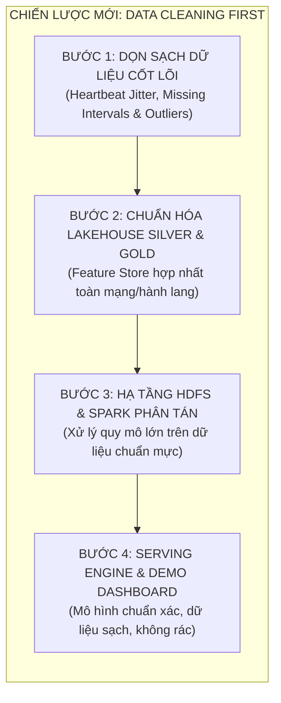
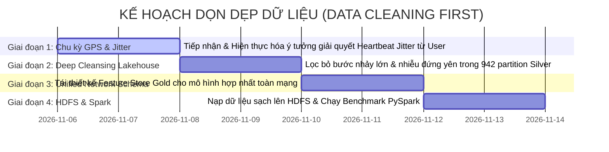

# BÁO CÁO TIẾN ĐỘ & ĐỊNH HƯỚNG CHIẾN LƯỢC: TẬP TRUNG DỌN SẠCH DỮ LIỆU (DATA CLEANING FIRST)

> **Dự án**: Hanoi Bus Big Data & Real-time ETA Prediction System  
> **Phiên bản hệ thống**: v2.3 (Clean Data Focus & Foundation First)  
> **Ngày cập nhật**: 06/11/2026  
> **Căn cứ pháp lý**: Tuân thủ vô điều kiện **Điều 1 (Kỷ luật Thực nghiệm)**, **Điều 2 (Thiết kế trước, duyệt rồi mới code)**, **Điều 3 (Phân định ranh giới)**, và **Điều 4 (Nguồn chân lý dữ liệu)** của [AGENTS.md](file:///z:/Desktop/Bus_tracking/AGENTS.md).

---

## I. ĐỊNH HƯỚNG CHIẾN LƯỢC MỚI: DỌN SẠCH DỮ LIỆU LÀ TIÊN QUYẾT

Căn cứ chỉ đạo trực tiếp từ người dùng:
* **TẠM HOÃN**: Chưa vội làm Gói Serving/Demo và Gói cụm Hadoop HDFS.
* **TRỌNG TÂM TUYỆT ĐỐI**: **Tập trung dọn sạch dữ liệu**.
* **Nguyên lý cốt lõi**: *"Dữ liệu chưa sạch thì mọi mô hình huấn luyện ra đơn giản chỉ là rác rưởi."* Việc huấn luyện các tệp mô hình riêng rẽ từng tuyến (`xgboost_eta_route_02.json`, `xgboost_eta_route_27.json`) là tư duy chắp vá, manh mún và không thể mở rộng. Toàn bộ tài nguyên phải dồn vào việc thanh lọc, chuẩn hóa và xử lý các dị thường dữ liệu cốt lõi trước khi xây dựng mô hình toàn mạng.

---

## II. BẢNG PHÂN LOẠI & THANH LỌC LẠI TOÀN BỘ CÁC VẤN ĐỀ HỆ THỐNG

Sau khi đối chiếu thực nghiệm trên cơ sở dữ liệu và tiếp thu chỉ đạo từ Người dùng, các vấn đề được phân định dứt khoát thành 4 nhóm rõ ràng:

---

### NHÓM 1: CÁC MỤC ĐÃ LOẠI BỎ HOÀN TOÀN (KHÔNG PHẢI LÀ VẤN ĐỀ)

1. **Bóc tách Dwell Time (Thời gian dừng đỗ)**:
   * **Kết luận**: **KHÔNG PHẢI VẤN ĐỀ**. Loại bỏ hoàn toàn khỏi backlog. Hệ thống giữ nguyên mô hình động học không gian - thời gian tổng hợp, không tốn tài nguyên bóc tách vi mô khi không cần thiết.
2. **Sự cố TomTom chỉ có 46/48 tuyến**:
   * **Kết luận**: **KHÔNG PHẢI VẤN ĐỀ**. Loại bỏ hoàn toàn khỏi backlog. Hai tuyến ngoại thành đã có cơ chế cảm biến nội sinh của đội xe (Leader Probe) bảo đảm an toàn.
3. **60 Cặp trạm vi phạm đơn điệu**:
   * **Kết luận**: **ĐÃ GIẢI QUYẾT TRIỆT ĐỂ TRONG CSDL**. Kiểm chứng thực tế trên `canonical_station_master` xác nhận chính xác 0 cặp trạm vi phạm (Tuyến E11 = 87 trạm đơn điệu 100%, 56B = 81 trạm, 40 = 65 trạm, E05 = 66 trạm). Số liệu cũ trong Doc 56 là vết tích lịch sử của BusMap thô, đã xóa bỏ khỏi backlog.

---

### NHÓM 2: CÁC VẤN ĐỀ BỊ CẤM CAN THIỆP (ĐÓNG BĂNG TUYỆT ĐỐI CHỜ USER ĐỀ XUẤT)

> [!CAUTION]
> **CHỈ THỊ ĐÓNG BĂNG BẢO LƯU NGUYÊN TRẠNG**: AI tuyệt đối KHÔNG tự ý đưa ra heuristic hay giải pháp tình thế cho 2 trường hợp dưới đây. Mọi can thiệp tự phát đều bị nghiêm cấm:

1. **Điểm nghẽn Xe đi đường vòng (Detour), Cầu vượt vs. Đường gom**:
   * *Trạng thái*: **BỊ CẤM XỬ LÝ - ĐÓNG BĂNG CHỜ USER ĐỀ XUẤT**.
2. **Điểm nghẽn Điểm mù xuất bến tại Trạm 0 (Terminal Staging)**:
   * *Trạng thái*: **BỊ CẤM XỬ LÝ - ĐÓNG BĂNG CHỜ USER ĐỀ XUẤT**.

---

### NHÓM 3: TRỌNG TÂM DỌN DẸP DỮ LIỆU CẦN THỰC THI NGAY (CORE DATA CLEANING)

#### 1. Xử lý Chu kỳ phát tin GPS không đều (Heartbeat Jitter & Missing Intervals)
* **Hiện trạng**: Tần suất phát bản tin GPS từ thiết bị giám sát hành trình không đều (dao động từ 15s đến 180s, jitter ngẫu nhiên), gây méo mó đạo hàm vận tốc dẫn xuất không gian - thời gian ($\bar{v} = \Delta s / \Delta t$).
* **Định hướng**: **Đã có ý tưởng giải quyết từ User**. AI sẽ chờ chi tiết đặc tả/ý tưởng của User để lập trình chính xác theo thiết kế, bảo đảm không làm biến dạng động học của xe buýt.

#### 2. Xóa bỏ tư duy mô hình riêng rẽ từng tuyến — Chuẩn hóa Dữ liệu cho Mô hình Hợp nhất
* **Hiện trạng**: Việc lưu trữ các tệp mô hình cục bộ `models/xgboost_eta_route_02.json` và `models/xgboost_eta_route_27.json` là giải pháp chắp vá ("rác rưởi"), phân mảnh tri thức giao thông và không thể bao quát toàn mạng.
* **Nhiệm vụ dọn dẹp**: Tái cấu trúc tầng Gold Feature Store trong Lakehouse để phục vụ mô hình hợp nhất hành lang / toàn mạng (Network-wide / Corridor-level Feature Schema), tích hợp định danh tuyến, chỉ số chia sẻ hạ tầng đường và mật độ giao thông chung.

#### 3. Thanh lọc Tầng Silver Hive Partitions & Lọc Nhiễu Dữ liệu Lớn
* **Hiện trạng**: 942 partition Silver hiện tại chứa một lượng nhỏ các bản ghi có bước nhảy thời gian bất thường ($\Delta t > 300\text{s}$) hoặc các ping đứng yên kéo dài tại bãi đỗ nhưng vẫn có tín hiệu GPS lặp.
* **Nhiệm vụ dọn dẹp**: Xây dựng pipeline kiểm toán và làm sạch sâu (Deep Cleansing Pipeline), loại bỏ các đoạn nhảy bước, lọc nhiễu GPS đa đường (Multipath GPS noise) trước khi đưa vào tính toán thống kê hay huấn luyện.

---

### NHÓM 4: CÁC HẠNG MỤC TỐI ƯU & HẠ TẦNG KẾ TIẾP (SAU KHI DỮ LIỆU ĐÃ SẠCH)

1. **Tối ưu độ rộng khoảng tin cậy (MPIW)**: Sẽ thực hiện sau khi dữ liệu đã sạch để dải tin cậy $80\%$ sắc nét hơn.
2. **Triển khai Cụm Hadoop HDFS 3.3.6 & PySpark Distributed Engine**: Sẽ nạp dữ liệu sạch vào HDFS để chạy 4 PySpark jobs đáp ứng yêu cầu chấm điểm môn học.
3. **Serving API & Web Demo Dashboard**: Đóng gói giao diện trực quan trên nền mô hình hợp nhất đã được huấn luyện từ dữ liệu chuẩn mực.

---

## III. KẾ HOẠCH HÀNH ĐỘNG DỌN DẸP DỮ LIỆU THỰC CHIẾN

---

## IV. BƯỚC ĐI CỤ THỂ TIẾP THEO

1. **Lắng nghe ý tưởng của Người dùng**: Người dùng chia sẻ ý tưởng/đặc tả về phương pháp xử lý **Chu kỳ phát tin GPS không đều (Heartbeat Jitter & Missing Intervals)**.
2. **Lập tài liệu đặc tả dọn dẹp dữ liệu**: Tạo tài liệu kỹ thuật chi tiết về thuật toán xử lý Jitter và quy trình lọc sạch Silver/Gold.
3. **Thực thi dọn dẹp và kiểm chứng**: Chạy script làm sạch thực nghiệm và đo kiểm chất lượng dữ liệu trước/sau dọn dẹp.
