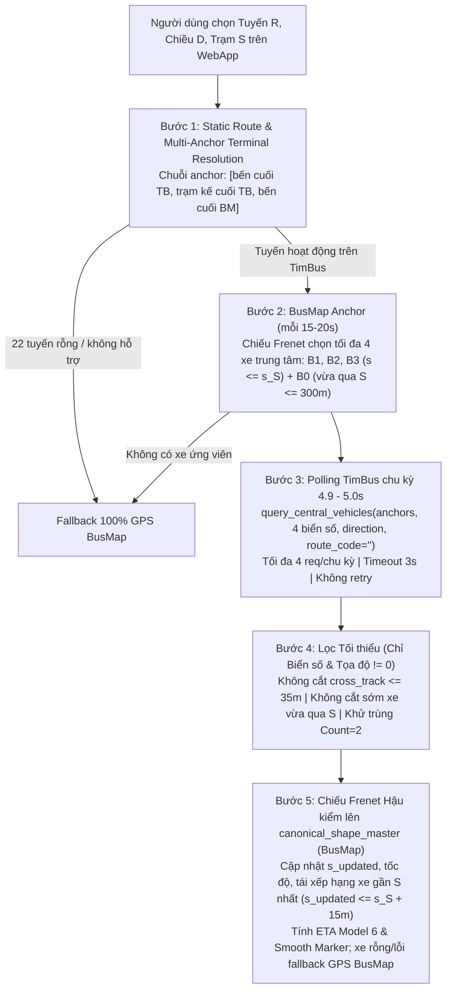

# Quy trình & Kiến trúc Tích hợp TimBus Realtime cho WebApp Demo (Hậu Thẩm định)

> **Tình trạng tài liệu**: Đã cập nhật sau toàn bộ thực nghiệm kiểm chứng (Giải mã trường 3/4/5, Multi-Anchor Terminal, Quét 111 tuyến với `route_param=""`, Audit giả định `cross_track`, và Test ổn định `4.9s × 4 xe`).  
> **Client chuẩn**: [`timbus_tracker.py`](file:///z:/Desktop/Bus_tracking/experiments/timbus/timbus_tracker.py) (`TimBusClient.query_central_vehicles`)  
> **Tài liệu kỹ thuật gốc**: [`TIMBUS_MASTER_HANDOVER.md`](file:///z:/Desktop/Bus_tracking/experiments/timbus/TIMBUS_MASTER_HANDOVER.md)

---

## 1. Kiến trúc Tổng thể: Hybrid Anchor (BusMap) + Targeted Telemetry (TimBus)

TimBus chỉ có **1 endpoint** (`http://www.timbus.vn:9149/SearchBuyt/VehicleState`), yêu cầu truyền `station_id` hợp lệ nằm phía trước xe và **cắt cứng tối đa 1–2 xe/lượt** khi quét theo trạm (`vehicle_param=""` gây Shadowing **92.0%**). Ngược lại, **truy vấn đích danh theo biển số (`vehicle_param=<biển_số>`) + `route_param=""` + neo tại trạm bến cuối** hoàn toàn không bị Shadowing và khớp GPS **0.0 m** (trung vị khi đồng bộ `|Δτ| <= 5s`) với chu kỳ hộp đen ~**5.0 giây**.



---

## 2. Quy trình Vận hành 5 Bước Chi tiết

### Bước 1: Kiểm tra Tuyến & Phân giải Chuỗi Trạm Mỏ Neo (`Multi-Anchor Terminal Resolution`)
Thay vì truyền trạm mục tiêu `S` (dễ trả `[]` nếu `S` không gắn tuyến trên TimBus như trạm `395`, hoặc xe đã đi qua `S`) hay `next_station_id` ngắn hạn (xe vượt nhanh), luôn dùng **bến cuối thực sự của chiều chạy** làm mỏ neo chính, kèm danh sách dự phòng phòng trường hợp bến cuối 2020 bị lỗi thời (đã xảy ra trên tuyến `05`, `104`, `96` và 2 tuyến fallback sang bến BusMap):
1. Thứ tự ưu tiên `station_ids` cho `(R, D)`:
   - `[verified_terminal_sid, penultimate_tb_sid, bm_terminal_sid]` (loại trùng, giữ nguyên thứ tự).
   - Ví dụ đã kiểm chứng trên **Tuyến 32**: chiều `go` (`0`) dùng `[1676, 157]` (`(A) BX Giáp Bát` — chú ý `157` thực chất là `ĐH Bách Khoa`, dùng làm dự phòng, không dùng làm mỏ neo chính); chiều `re` (`1`) dùng `[1778]` (`(B) Nhổn`).
2. Chính sách tuyến không hoạt động:
   - Trên DB 2020 có `65/176` tuyến BusMap không có bản ghi (trừ tuyến mới vẫn bắt được khi `route_code=""` nếu biết biển số + bến cuối hợp lệ, như đã chứng minh với tuyến `122` xe `29B21262`).
   - Có **`22/111`** tuyến trùng mã được xác nhận trả rỗng khi kiểm tra thực tế (`08A`, `08ACT`, `08B`, `08BCT`, `09A`, `09B`, `19`, `21A`, `21B`, `37`, `43`, `46`, `57`, `58`, `59`, `60A`, `60B`, `61`, `64`, `65`, `72`, `74`). Với các tuyến này, WebApp đánh dấu **chỉ dùng GPS BusMap**, tránh gửi request vô ích.

### Bước 2: Neo Đoàn xe từ BusMap — Chọn tối đa 4 Xe Trung tâm (`B1, B2, B3` + `B0`)
Định kỳ **15–20 giây** (hoặc khi người dùng đổi trạm/tuyến), lấy toàn bộ đoàn xe từ BusMap Public API, chiếu Frenet lên `canonical_shape_master` của `(R, D)`:
1. **Nhóm 3 xe phía trước trạm `S` (`s_bus <= s_S`)**: lấy `B1` (gần `S` nhất), `B2` (thứ 2), `B3` (thứ 3). Việc giữ `B2, B3` giải quyết hiện tượng `B1` thực tế đã vượt `S` trong lúc BusMap trễ 20–30s (đã cứu **137–139 ca** trên Tuyến 32).
2. **Nhóm 1 xe vừa đi qua trạm `S` (`s_S < s_bus <= s_S + 300 m`)**: giữ thêm tối đa 1 xe `B0` ngay sau khi qua `S` để hiển thị an toàn / hỗ trợ kiểm tra mượt giao diện khi xe vừa rời trạm.
3. Tổng số mục tiêu không vượt quá **4 biển số/chu kỳ**. (Các xe `dist_to_terminal <= 100 m` có thể bỏ qua vì server TimBus có thể ngừng trả về khi xe đã vào khu vực bến cuối).

### Bước 3: Polling TimBus Chu kỳ 4.9–5.0 giây (`route_code=""`, Multi-Anchor, No-Retry)
Trên vòng lặp UI **4.9–5.0 giây** (khớp với heartbeat phần cứng hộp đen `μ = 4.96s`):
1. Gọi `TimBusClient.query_central_vehicles(station_ids=anchors, plates=target_plates, direction=d_tb, route_code="", timeout=3, inter_request_delay=0.05)`.
2. Bắt buộc giữ mặc định **`route_code=""`**: qua kiểm chứng thực tế trên 28 tuyến rỗng, việc để trống `route_param` khi đã có `vehicle_param` giúp lấy được dữ liệu của các tuyến bị đổi hậu tố trên server (`04->04CT`, `11->11CT`, `23->23CT`, `30->30CT`, `40->40CT`, `86CT->86`) và tuyến mới (`122`), không làm giảm độ chính xác do lọc theo biển số.
3. Chiến lược Anchor thông minh trong `query_central_vehicles`:
   - Nếu `anchors[0]` trả về ít nhất `1` xe hợp lệ thì **dừng không gọi anchor dự phòng** cho các xe còn rỗng (vì các xe đó thường đã qua bến cuối, gọi trạm trước đó càng vô ích và tốn băng thông).
   - Chỉ tự động chuyển sang `anchors[1]`, `anchors[2]` khi toàn bộ `anchors[0]` đều rỗng hoặc lỗi (tự cứu các tuyến có bến cuối 2020 đã dời như `05`, `104`, `96`).
4. **Không retry dồn dập**: nếu timeout (`3s`) hoặc lỗi socket thoáng qua (`WinError 10065`), bỏ qua xe đó ở chu kỳ hiện tại và giữ GPS BusMap gần nhất.

### Bước 4: Kiểm tra Hợp lệ Tối thiểu — Chỉ Khớp Biển số & Tọa độ Hợp lệ
Đây là điểm sửa quan trọng nhất so với thiết kế nháp ban đầu:
1. **Chỉ kiểm tra đúng 2 điều kiện** ở lớp nhận gói tin (đã tích hợp sẵn trong `TimBusClient.query_targeted_vehicle`):
   - `normalize_plate(record.plate) == normalize_plate(target_plate)`
   - `record.latitude != 0.0 or record.longitude != 0.0` (chấp nhận cả tốc độ `0 km/h`).
2. **Khử trùng lặp gói tin**: Server đôi lúc trả về `Count = 2` bản ghi giống hệt nhau cho 1 xe (đo tại bến cuối `1778`) -> chỉ lấy bản ghi hợp lệ đầu tiên.
3. **Nghiêm cấm 3 kiểu lọc sai ở bước này**:
   - **Không** đặt ngưỡng cứng `cross_track <= 35 m` để loại xe: tuyến thực tế đôi lúc đi tránh hoặc khác shape tĩnh BusMap (ví dụ đoạn Quán Sứ vs Lý Thường Kiệt trên Tuyến 32 lệch `104.7–120.6 m`, nút Giải Phóng – Giáp Bát lệch `46.0–68.9 m`).
   - **Không** lọc theo `record.direction` byte cuối gói tin (bị cố định `'Về'` ở **504/504** bản ghi lịch sử).
   - **Không** tự cắt bỏ xe vừa vượt trạm `S` hoặc `status` đổi sớm ở bước thu thập thô; mọi phân loại vượt trạm hay đổi chiều phải xử lý tại Bước 5 bằng hình học tuyến.

### Bước 5: Chiếu Frenet Hậu kiểm, Tái xếp hạng Xe & Tính ETA / Fallback
Toàn bộ logic nghiệp vụ đều chạy trên **hệ quy chiếu BusMap (`canonical_shape_master` + `canonical_station_master`)**:
1. Với mỗi xe trả về `(lat, lon, speed_kmh)` từ Bước 4, chiếu Frenet lên shape chiều `D` của BusMap để lấy `(s_updated, ct_updated)`.
2. Giữ tọa độ gốc BusMap cho những xe trong Top-4 mà TimBus trả rỗng/lỗi ở chu kỳ đó (đánh dấu nguồn `timbus` vs `busmap_fallback`).
3. **Chọn lại xe gần trạm `S` nhất (`B_nearest`)**:
   - Lọc các xe thỏa `s_updated <= s_S + 15.0 m` (có dung sai GPS `15 m` trước khi coi là đã rời trạm).
   - Chọn xe có `s_updated` lớn nhất làm xe gần tới trạm `S` nhất (nếu `B1` đã đi quá `s_S + 15.0 m` so với lúc BusMap cập nhật, `B2` hoặc `B3` tự động thế chỗ, loại bỏ `0` ca nhận nhầm).
4. **Tính ETA & Render giao diện**:
   - Sử dụng `(s_updated, speed_kmh)` từ Bước 5 để suy ra `dist_to_S = s_S - s_updated` và truyền vào Model 6 / nội suy mượt marker giữa 2 nhịp 5s.
   - **Tuyệt đối không** đưa các trường `next_station_id` (`distance_to_queried_station_m`), `distance_m` (`eta_to_queried_station_sec`), hoặc `next_station_name` (`destination_name`) của TimBus vào bất kỳ feature nào của Model 6.

---

## 3. Code Mẫu Tích hợp Chuẩn (Sử dụng `timbus_tracker.py` Mới)

```python
from experiments.timbus.timbus_tracker import TimBusClient

def poll_demo_cycle(anchors: list[int], target_plates: list[str], direction: int, bm_fallback: dict) -> dict:
    """Một chu kỳ 4.9s trên WebApp Demo Backend (cô lập, fallback an toàn)."""
    tb_records = TimBusClient.query_central_vehicles(
        station_ids=anchors,      # VD Tuyến 32 chiều đi: [1676, 157]
        plates=target_plates[:4], # Tối đa 4 biển số (B1, B2, B3 + B0)
        direction=direction,      # 0 (go) hoặc 1 (re)
        route_code="",            # Để rỗng để tránh trượt do đổi mã tuyến (CT/TC)
        timeout=3,
        inter_request_delay=0.05,
    )

    merged = {}
    for raw_plate in target_plates[:4]:
        norm = TimBusClient.normalize_plate(raw_plate)
        rec = tb_records.get(norm)
        if rec is not None:
            merged[norm] = {
                "source": "timbus",
                "lat": rec.latitude,
                "lon": rec.longitude,
                "speed_kmh": rec.speed_kmh,
                "status": rec.status,
                "dist_to_anchor_m": rec.distance_to_queried_station_m,
            }
        else:
            merged[norm] = {
                "source": "busmap_fallback",
                **bm_fallback[norm],
            }
    # Bước 5 tiếp theo: chiếu merged[norm] lên canonical_shape_master của BusMap
    return merged
```

---

## 4. Thông số Cấu hình & Ngưỡng Vận hành Khuyến nghị

| Tham số | Giá trị Khuyến nghị | Cơ sở Thực nghiệm |
| :--- | :--- | :--- |
| Chu kỳ polling TimBus | **`4.9 – 5.0 s`** | Khớp heartbeat phần cứng `μ = 4.96s`; test 20 chu kỳ × 4 xe = `80/80 (100%)`, max chu kỳ `1.91s < 4.9s` |
| Số xe mục tiêu tối đa / chu kỳ | **`4` xe** (`3` trước + `1` vừa qua) | Đủ chống trượt do độ trễ BusMap 20–30s (`96.9%` cứu ca trượt `B1`) mà vẫn giữ lưu lượng thấp |
| `route_code` truyền khi hỏi theo biển số | **`""` (chuỗi rỗng)** | Khôi phục `6/28` tuyến đổi hậu tố (`04CT`..`86`) & bắt được tuyến mới (`122`) |
| `inter_request_delay` trong 1 chu kỳ | **`0.05 s`** | Phân tán burst nhẹ mà vẫn hoàn thành 4 requests dưới `2.0s` |
| Timeout / Retry | **`timeout=3s`, `retry=0`** | Độ trễ P50=`176.8 ms`, P90=`367.3 ms`, max=`530.6 ms`; không retry dồn khi gặp `WinError 10065` |
| Tần suất làm mới BusMap Anchor | **`15 – 20 s`** | Cập nhật danh sách 4 biển số ứng viên & fallback GPS nền |
| Tỷ lệ tọa độ trùng lặp kỳ vọng | **`~9% – 20%`** | Test thực tế `7/76 (9.2%)` ở 4.9s (lý thuyết trôi pha `15–20%`) -> UI cần khử rung `lat/lon` không đổi |
