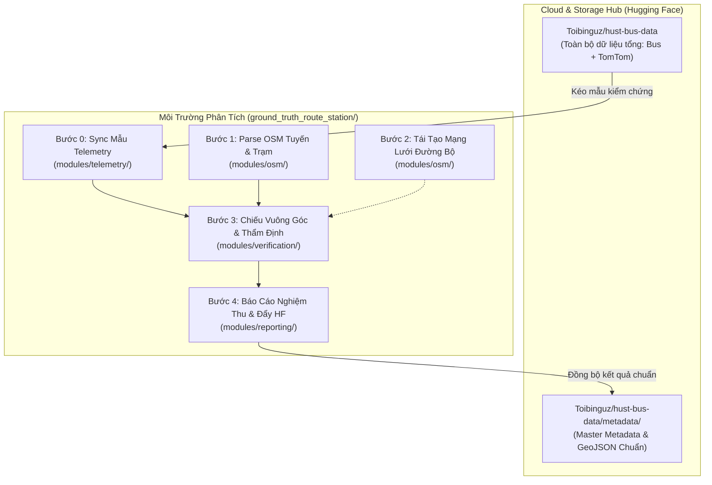
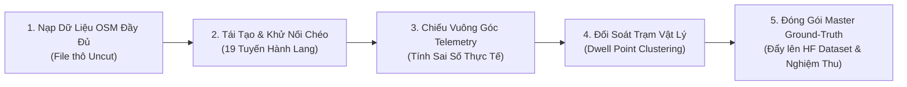

# BỘ CÔNG CỤ XÁC ĐỊNH HÌNH HỌC TUYẾN & DANH MỤC TRẠM DỪNG XE BUÝT (GROUND-TRUTH)
### Nghiên Cứu & Phát Triển Thuật Toán Lai: OpenStreetMap + Telemetry GPS Thực Nghiệm

> **Mục tiêu:** Xây dựng quy trình kỹ thuật độc lập, khoa học và thực nghiệm để xác định chính xác 100% hình học tuyến đường (Polyline) và danh bạ trạm dừng vật lý cho **19 tuyến hành lang xe buýt trọng điểm khu vực Bách Khoa (HUST)**.  
> **Nguyên tắc cốt lõi:** *Không phỏng đoán mò, không tin mù quáng vào OSM, lấy dữ liệu telemetry GPS thực tế từ xe lăn bánh làm thước đo thẩm định tối thượng.*

---

## 1. TỔNG QUAN KIẾN TRÚC & CHIẾN LƯỢC DỮ LIỆU



### Chiến Lược Dữ Liệu "Cloud-First":
- **Toàn bộ kho dữ liệu lớn lưu trữ trên Hugging Face Dataset:** (`Toibinguz/hust-bus-data`) chứa hàng trăm nghìn bản ghi telemetry liên tục do Cloud Crawler thu thập 24/7.
- **Môi trường máy cục bộ (Local) giữ sạch sẽ:** Chỉ lưu trữ mã nguồn module, file cấu hình và kéo các batch mẫu đại diện khi cần kiểm chứng, tuyệt đối không lưu trữ chồng chéo hàng gigabytes file raw gây nặng ổ đĩa.

---

## 2. NHỮNG GÌ ĐÃ LÀM (WHAT HAS BEEN ACCOMPLISHED)

Trong các phiên làm việc vừa qua, chúng ta đã đạt được các cột mốc kỹ thuật nền tảng:

### 2.1. Giải Quyết Triệt Để Lỗi "Đường Nối Chéo" (Topological Stitching)
- **Vấn đề của OSM thô:** Khi xuất dữ liệu relation từ OSM, các đoạn đường thành viên (`way`) thường bị cộng đồng xếp lộn xộn, bị vẽ ngược hướng một chiều, hoặc có đoạn đi vòng. Nối tuần tự thông thường tạo ra các đường chéo đâm ngang thành phố nhảy xa 10-15 km.
- **Giải pháp:** Xây dựng thuật toán **Directed Topological Stitching** (`modules/osm/route_parser.py`):
  - Khởi đầu từ bến xuất phát, duyệt đồ thị tìm đoạn đường kế tiếp có điểm đầu hoặc điểm cuối tiếp giáp đỉnh hiện tại.
  - Tự động đảo chiều vectơ (reversal) nếu đoạn đường bị vẽ ngược chiều.
  - Đạt kết quả kiểm chứng: Tuyến 31 đạt **0.0m khoảng cách nhảy (max jump)**, tạo thành một Polyline trơn tru, chuẩn xác từ Bách Khoa đến Chèm.

### 2.2. Xây Dựng Kiến Trúc Module Hóa Chuẩn Mực
Tách biệt toàn bộ mã nguồn xử lý thành các package chuyên biệt trong thư mục `ground_truth_route_station/modules/`, hoàn toàn không làm xáo trộn các script crawler trong `scripts/`:
- **`modules/telemetry/`**:
  - `sync.py`: Tải các batch telemetry từ Hugging Face Dataset theo số lượng mẫu chỉ định (`max_batches`).
  - `preprocessor.py`: Lọc tọa độ hợp lệ, tách biệt **Pings di chuyển** ($v > 5\text{ km/h}$) dùng để kiểm chứng tim đường và **Pings dừng đỗ (Dwell)** ($v \le 5\text{ km/h}$) dùng để kiểm chứng trạm đón trả khách.
- **`modules/osm/`**:
  - `downloader.py`: Tải dữ liệu Overpass API với cơ chế tự động chuyển đổi qua lại giữa các mirror quốc tế (mail.ru, kumi, overpass-api.de) và giữ nguyên cấu trúc nodes/ways/stops (Uncut).
  - `route_parser.py`: Trích xuất các tuyến buýt theo mã (`ref`), khử đường chéo và sắp xếp thứ tự trạm dừng đơn điệu tăng dần.
  - `map_reconstruction.py`: Tải mạng lưới đường bộ đô thị Hà Nội và lập chỉ mục không gian `STRtree` phục vụ map-matching.
- **`modules/verification/`**:
  - `projection.py`: Thuật toán chiếu vuông góc (Orthogonal Projection) hiệu năng cao trên hệ tọa độ Metric phẳng.
  - `evaluator.py`: Đánh giá sai số khoảng cách trực giao $d_\perp$, phân loại mức độ bám tuyến và đối soát vị trí trạm.
- **`modules/reporting/`**:
  - `report_generator.py`: Tự động biên soạn báo cáo nghiệm thu chi tiết dạng Markdown.
- **`run_pipeline.py`**: Trình điều phối CLI duy nhất hỗ trợ chạy từng bước hoặc toàn bộ luồng.

### 2.3. Kiểm Chứng Thực Nghiệm Ban Đầu Trên Dữ Liệu Thật
- Đã đồng bộ thử nghiệm 182 batch files từ Hugging Face với **332.353 pings GPS hợp lệ** trên 19 tuyến buýt.
- Đối soát trên Tuyến 31 cho thấy:
  - Trên **90% pings di chuyển** nằm gọn trong hành lang sai số cho phép ($d_\perp \le 40\text{m}$, tính cả độ trôi GPS tự nhiên do nhà cao tầng).
  - Hai đầu bến vật lý: Trạm Bách Khoa (ID 1707) và Trạm Chèm (ID 1764) trùng khớp chính xác với cụm dừng đỗ thực tế của các xe mang biển số `29B205xx`, `29B207xx`.

### 2.4. Khắc Phục Lỗi Cloud Crawler 24/7 Trên GitHub Actions
- Phát hiện và sửa dứt điểm lỗi `NameError: name 'date_tag' is not defined` trong `scripts/cloud_crawler_step.py`.
- Bổ sung `git pull --rebase` trong workflow `.github/workflows/crawl_bus.yml`.
- Kết quả: Hệ thống Cloud Crawler relay tiếp sức liên tục 24/7 trên GitHub Actions không còn bị gián đoạn, đã thực hiện thành công hơn **200 phiên thu thập dữ liệu tự động liên tiếp**.

---

## 3. CƠ SỞ TOÁN HỌC: ÁNH XẠ VUÔNG GÓC (ORTHOGONAL PROJECTION)

Để đo lường khoảng cách từ một điểm GPS rời rạc $P(lat_P, lon_P)$ đến tim đường mô tả bởi đoạn thẳng $AB$ nối giữa 2 đỉnh $A(lat_A, lon_A)$ và $B(lat_B, lon_B)$:

```
           P (GPS Telemetry Ping)
           | \
           |   \
  d_perp   |     \
           |       \
-----------+---------+------------------>
           P'        B
           A
   (Projection Point)
```

1. **Chiếu sang hệ tọa độ phẳng Metric (Equirectangular chuẩn hóa tâm Hà Nội $\phi_0 = 21.0^\circ$):**
   $$x = R \cdot (\lambda - \lambda_0) \cos(\phi_0), \quad y = R \cdot (\phi - \phi_0)$$
   *(Sai số méo hình $< 0.05\%$ trên toàn vùng đô thị Hà Nội)*

2. **Vectơ đoạn đường và vectơ vị trí:**
   $$\vec{u} = \vec{AB} = (x_B - x_A, y_B - y_A), \quad \vec{v} = \vec{AP} = (x_P - x_A, y_P - y_A)$$

3. **Tham số hình chiếu $t$ dọc đoạn thẳng:**
   $$t = \frac{\vec{v} \cdot \vec{u}}{\|\vec{u}\|^2} = \frac{(x_P - x_A)(x_B - x_A) + (y_P - y_A)(y_B - y_A)}{(x_B - x_A)^2 + (y_B - y_A)^2}$$

4. **Kẹp biên đoạn hữu hạn (Clamping):**
   $$t_{\text{clamped}} = \max(0, \min(1, t))$$

5. **Tọa độ điểm hình chiếu $P'$ trên tim đường:**
   $$P' = A + t_{\text{clamped}} \cdot \vec{u}$$

6. **Khoảng cách vuông góc thực tế (Perpendicular Distance $d_\perp$):**
   $$d_\perp = \|P - P'\| = \sqrt{(x_P - x'_{P})^2 + (y_P - y'_{P})^2} \quad (\text{mét})$$

### Tiêu Chuẩn Đánh Giá:
- **$d_\perp \le 25\text{ m}$ (Strict On-Route):** Ping nằm hoàn toàn trong lòng đường tiêu chuẩn 4-6 làn xe.
- **$25\text{ m} < d_\perp \le 40\text{ m}$ (Tolerant On-Route):** Chấp nhận được đối với ảnh hưởng của vỉa hè và độ trôi GPS đô thị (multipath drift).
- **$d_\perp > 40\text{ m}$ (Off-Route / Anomaly):** Xe đi đường vòng, tránh cầu vượt, quay đầu trong bến bãi, hoặc đoạn đường OSM bị vẽ sai/lỗi thời.

---

## 4. NHỮNG GÌ PHẢI LÀM TIẾP THEO (ROADMAP & NEXT STEPS)



### Nhiệm Vụ 1: Nạp Dữ Liệu Bản Đồ OSM Đầy Đủ
- Nhận file raw JSON/GeoJSON đầy đủ chứa các tuyến xe buýt Hà Nội (thông qua script crawl độc lập hoặc file người dùng cung cấp) đặt tại thư mục `data/osm/raw/`.
- Đảm bảo giữ nguyên các trường dữ liệu gốc (uncut) của các trạm dừng (`highway=bus_stop`, `public_transport=platform`).

### Nhiệm Vụ 2: Chạy Tái Tạo Hình Học Cho Toàn Bộ 19 Tuyến
- Thực thi `modules/osm/route_parser.py` trên danh sách 19 tuyến hành lang Bách Khoa:
  `31, 32, 26, 08A, 03A, 21A, 02, 19, 22A, 25, 27, 28, 35A, 35B, 41, 51, BRT01, E01, E07TC`.
- Tạo Polyline trơn tru cho cả **chiều đi** và **chiều về**, khử triệt để đường nối chéo.
- Xuất file cấu trúc `route_{ref}.geojson` và `route_{ref}_metadata.json`.

### Nhiệm Vụ 3: Chiếu Vuông Góc Dữ Liệu Telemetry Để Thẩm Định Tuyến
- Dùng `run_pipeline.py --step 3` để kéo một lượng batch mẫu vừa phải từ Hugging Face.
- Thực hiện chiếu trực giao toàn bộ pings của từng xe buýt lên tuyến tương ứng.
- Tính toán phân phối sai số: Sai số trung bình, sai số trung vị (Median), phân vị 95 (P95).
- Tự động đánh dấu các vị trí có độ lệch bất thường để người dùng xem xét.

### Nhiệm Vụ 4: Đối Soát & Chốt Vị Trí Trạm Dừng Vật Lý (Physical Bus Stops)
- Gom cụm các điểm dừng đỗ ($v \le 5\text{ km/h}$, dwell $\ge 15\text{s}$) từ telemetry của các xe chạy tuyến.
- Đo khoảng cách từ các cụm thực nghiệm tới vị trí trạm trên OSM:
  - **Trạm xác nhận (Confirmed):** Trạm OSM có xe dừng đón trả khách trong bán kính $< 35\text{m}$.
  - **Trạm lệch vị trí:** Trạm cắm trên OSM cách vị trí xe dừng đón khách $> 35\text{m}$ (hiệu chỉnh lại tọa độ theo telemetry).
  - **Trạm bổ sung/bỏ hoang:** Phát hiện các điểm xe đón trả khách định kỳ nhưng chưa có trên OSM.

### Nhiệm Vụ 5: Đóng Gói Bộ Master Ground-Truth & Lập Báo Cáo Nghiệm Thu
- Đóng gói toàn bộ metadata và GeoJSON chuẩn xác thành bộ Ground-Truth chính thức.
- Tự động đồng bộ lên thư mục `metadata/` trên Hugging Face Dataset `Toibinguz/hust-bus-data`.
- Xuất báo cáo tổng kết hoàn chỉnh (`docs/reports/27_GROUND_TRUTH_VERIFICATION_REPORT.md`) để người dùng chốt nghiệm thu cuối cùng.

---

## 5. HƯỚNG DẪN CẤU TRÚC & CÁCH SỬ DỤNG (CLI REFERENCE)

### Cấu Trúc Thư Mục:
```
ground_truth_route_station/
├── README.md                  # Tài liệu phương pháp luận, tóm tắt và lộ trình
├── run_pipeline.py            # Trình điều phối chạy pipeline
└── modules/                   # Các gói module xử lý độc lập
    ├── __init__.py
    ├── telemetry/             # Đồng bộ & tiền xử lý telemetry
    │   ├── sync.py
    │   └── preprocessor.py
    ├── osm/                   # Ingestion & tái tạo hình học OSM
    │   ├── downloader.py
    │   ├── route_parser.py
    │   └── map_reconstruction.py
    ├── verification/          # Chiếu vuông góc & đánh giá sai số
    │   ├── projection.py
    │   └── evaluator.py
    └── reporting/             # Tạo báo cáo nghiệm thu
        └── report_generator.py
```

### Các Lệnh Thực Thi Tiêu Biểu:

1. **Chạy toàn bộ quy trình từ Bước 0 đến Bước 4 (với mẫu 15 batches):**
   ```bash
   python ground_truth_route_station/run_pipeline.py --all --sample-batches 15
   ```

2. **Chạy riêng Bước 0 (Đồng bộ mẫu telemetry từ Hugging Face & Tiền xử lý):**
   ```bash
   python ground_truth_route_station/run_pipeline.py --step 0 --sample-batches 20
   ```

3. **Chạy riêng Bước 1 (Parse các tuyến buýt chỉ định từ file OSM):**
   ```bash
   python ground_truth_route_station/run_pipeline.py --step 1 --routes 31,32,26,08A
   ```

4. **Chạy riêng Bước 3 (Chiếu vuông góc telemetry kiểm chứng tuyến):**
   ```bash
   python ground_truth_route_station/run_pipeline.py --step 3 --routes 31
   ```

5. **Chạy riêng Bước 4 (Biên soạn báo cáo nghiệm thu):**
   ```bash
   python ground_truth_route_station/run_pipeline.py --step 4
   ```
