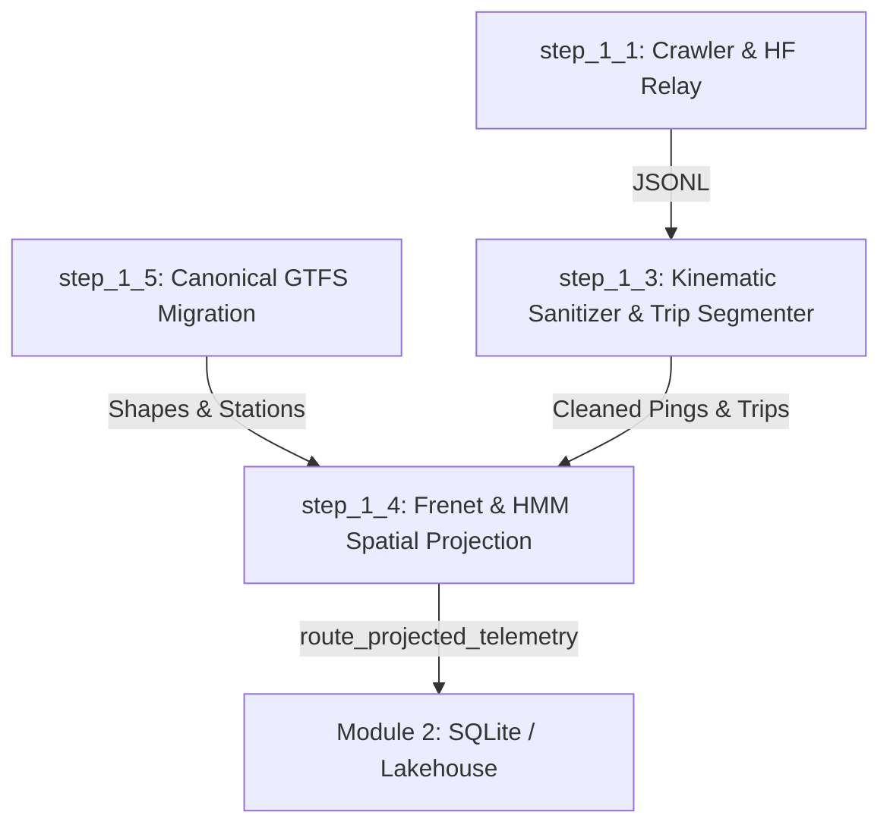

# Module 1: Thu thập & Tiền xử lý Dữ liệu (`module_1_data_ingestion_and_preprocessing`)

- **Vai trò:** Thu thập dữ liệu GPS xe buýt + sự cố giao thông TomTom, làm sạch động học, phân đoạn chuyến và chiếu không gian 1D Frenet/HMM.
- **Đầu vào:** BusMap API, TomTom Incidents API, Hugging Face Dataset (`Toibinguz/hust-bus-data`), `data/ground_truth/busmap_canonical/`.
- **Đầu ra:** Batch JSONL (`data/raw/` & Hugging Face), các bảng `raw_bus_pings`, `route_projected_telemetry`, `fact_route_tomtom_incidents` trong `data/hanoi_bus_system.db`.

## Sơ đồ luồng

## Các Sub-module

| Sub-module | Nhiệm vụ | Tài liệu |
| --- | --- | --- |
| `step_1_1_busmap_crawler_and_relay` | Cloud/Local crawler, TomTom Incidents, Hugging Face sync, catalog refresh | [README.md](step_1_1_busmap_crawler_and_relay/README.md) |
| `step_1_3_telemetry_kinematic_sanitizer` | Lọc ngoại lệ `HANOI_BBOX`, phân loại `IDLE_DEPOT`/`GPS_DRIFT_JUMP`, phân chuyến, nạp SQLite | [README.md](step_1_3_telemetry_kinematic_sanitizer/README.md) |
| `step_1_4_frenet_spatial_projection` | Chiếu tọa độ 2D sang 1D Frenet (`s_bus_m`, `cross_track_m`) và `RouteHMM` | [README.md](step_1_4_frenet_spatial_projection/README.md) |
| `step_1_5_busmap_canonical_migration` | Nạp dữ liệu chuẩn tuyến/hình học/trạm từ `busmap_canonical/` vào SQLite | [README.md](step_1_5_busmap_canonical_migration/README.md) |
