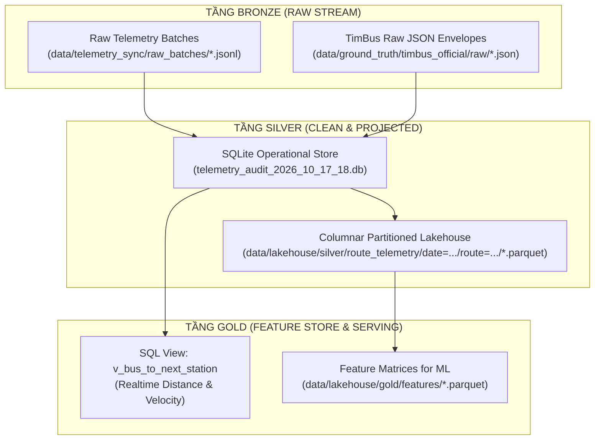

# MODULE 2: LƯU TRỮ VÀ XỬ LÝ DỮ LIỆU LỚN (BIG DATA STORAGE & LAKEHOUSE)
> **Phần 2 - Dự án**: Hanoi Bus Big Data & Real-time ETA Prediction System  
> **Mục tiêu**: Quản trị cơ sở dữ liệu quan hệ/columnar chuẩn hóa (`.db`) và kiến trúc hồ dữ liệu Medallion Parquet (Bronze -> Silver -> Gold) phục vụ truy vấn thời gian thực và phân tích dữ liệu lớn.

---

## 1. CẤU TRÚC SUBCOMPONENTS & CƠ CẤU LƯU TRỮ

```
module_2_big_data_storage_and_lakehouse/
├── step_2_1_sqlite_operational_store/       # Quản trị Operational Database SQLite (.db)
│   ├── db_manager.py                         # API kết nối, kiểm toán tính toàn vẹn và tạo View tự động
│   └── views_and_indexes.sql                 # Định nghĩa các Index B-tree và Materialized Views
├── step_2_2_parquet_medallion_lakehouse/     # Hồ dữ liệu phân tán chuẩn Medallion
│   └── lakehouse_exporter.py                 # Pipeline xuất 285k pings sang 101 phân vùng Parquet
└── step_2_3_columnar_query_engine/           # Động cơ truy vấn cột tốc độ cao (DuckDB / PySpark)
    └── duckdb_lakehouse_client.py            # Truy vấn OLAP thời gian thực trên Parquet / SQLite
```

---

## 2. KIẾN TRÚC DỮ LIỆU (MEDALLION ARCHITECTURE)



---

## 3. HƯỚNG DẪN THỰC THI CHO THÀNH VIÊN NHÓM

### Bước 2.1: Quản trị CSDL SQLite & Kích hoạt View tính khoảng cách
Khởi chạy quản trị viên cơ sở dữ liệu:
```powershell
python module_2_big_data_storage_and_lakehouse/step_2_1_sqlite_operational_store/db_manager.py
```
*Truy vấn SQL mẫu*: Bất kỳ thành viên nào nhận tuyến chỉ cần chạy:
```sql
SELECT route_code, plate, direction, s_bus_m, next_station_name, distance_remaining_m, derived_speed_kmh
FROM v_bus_to_next_station
WHERE route_code = '32' AND distance_remaining_m > 0
LIMIT 10;
```

### Bước 2.2: Xuất dữ liệu sang phân vùng Parquet Lakehouse
Xuất toàn bộ 48 tuyến sang Parquet Snappy phân vùng theo `date` và `route_code`:
```powershell
python module_2_big_data_storage_and_lakehouse/step_2_2_parquet_medallion_lakehouse/lakehouse_exporter.py
```
*Kết quả đầu ra*:
- 101 tệp `data.parquet` chuẩn mực tại `data/lakehouse/silver/route_telemetry/date=YYYY-MM-DD/route_code=XX/`.
- Nén Snappy tiết kiệm 85% dung lượng đĩa và tối ưu hóa truy vấn dạng cột.
