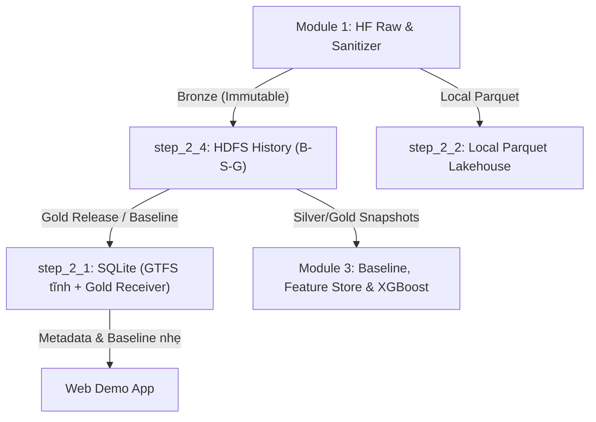

# Module 2: Lưu trữ Dữ liệu & Medallion Lakehouse (`module_2_big_data_storage_and_lakehouse`)

- **Vai trò:** Quản lý kho lưu trữ lịch sử chính trên **HDFS / Medallion Parquet Lakehouse (Bronze – Silver – Gold)**, và giữ **SQLite** làm nền nhẹ cho Web App (metadata GTFS chuẩn + nơi hứng kết quả tổng hợp từ HDFS Gold).
- **Đầu vào:** Hugging Face Raw Batches (`Toibinguz/hust-bus-data`), dữ liệu `data/raw/` & GTFS chuẩn (`step_1_5`).
- **Đầu ra:** HDFS Bronze/Silver/Gold (`step_2_4_hdfs_history/`), Parquet Lakehouse (`data/lakehouse/`), và SQLite nền nhẹ (`data/hanoi_bus_system.db`) cho Web App.

## Sơ đồ luồng

## Các Sub-module

| Sub-module | Nhiệm vụ | Tài liệu |
| --- | --- | --- |
| `step_2_4_hdfs_history` | Kho lưu trữ lịch sử chính trên cụm HDFS/Spark (Bronze spool, Silver P2 transform, Gold snapshot) | [README.md](step_2_4_hdfs_history/README.md) |
| `step_2_2_parquet_medallion_lakehouse` | Xuất Bronze/Silver Parquet cục bộ và kiểm toán chất lượng Silver | [README.md](step_2_2_parquet_medallion_lakehouse/README.md) |
| `step_2_1_sqlite_operational_store` | Nền nhẹ cho Web App: lưu GTFS chuẩn & hứng kết quả tổng hợp từ HDFS Gold | [README.md](step_2_1_sqlite_operational_store/README.md) |
| `step_2_3_columnar_query_engine` | Thư mục giữ chỗ (chỉ có `__init__.py`, truy vấn columnar đọc trực tiếp bằng `pyarrow`) | [README.md](step_2_3_columnar_query_engine/README.md) |
