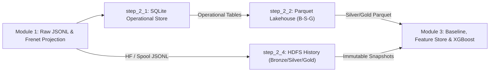

# Module 2: Lưu trữ Dữ liệu & Medallion Lakehouse (`module_2_big_data_storage_and_lakehouse`)

- **Vai trò:** Quản lý 2 tầng lưu trữ bổ trợ: SQLite Operational Store (`data/hanoi_bus_system.db`) cho ETL/serving metadata và Medallion Lakehouse (Parquet cục bộ `data/lakehouse/` + HDFS `step_2_4_hdfs_history/`) cho phân tích và huấn luyện ML.
- **Đầu vào:** `data/raw/`, các bảng đã xử lý từ Module 1 (`raw_bus_pings`, `route_projected_telemetry`, `fact_route_tomtom_incidents`), và Hugging Face raw batches.
- **Đầu ra:** SQLite DB (`data/hanoi_bus_system.db`), Bronze/Silver/Gold Parquet (`data/lakehouse/`), và các phân vùng/snapshot bất biến trên HDFS.

## Sơ đồ luồng

## Các Sub-module

| Sub-module | Nhiệm vụ | Tài liệu |
| --- | --- | --- |
| `step_2_1_sqlite_operational_store` | Quản trị schema và kết nối SQLite (`OperationalDatabaseManager`) | [README.md](step_2_1_sqlite_operational_store/README.md) |
| `step_2_2_parquet_medallion_lakehouse` | Xuất Bronze/Silver Parquet phân vùng Hive và kiểm toán chất lượng Silver | [README.md](step_2_2_parquet_medallion_lakehouse/README.md) |
| `step_2_3_columnar_query_engine` | Thư mục giữ chỗ (chỉ có `__init__.py`, truy vấn columnar đọc trực tiếp bằng `pyarrow`/`duckdb`) | [README.md](step_2_3_columnar_query_engine/README.md) |
| `step_2_4_hdfs_history` | Đường ống lịch sử trên cụm HDFS/Spark (Bronze spool, Silver P2 transform, Gold snapshot) | [README.md](step_2_4_hdfs_history/README.md) |
