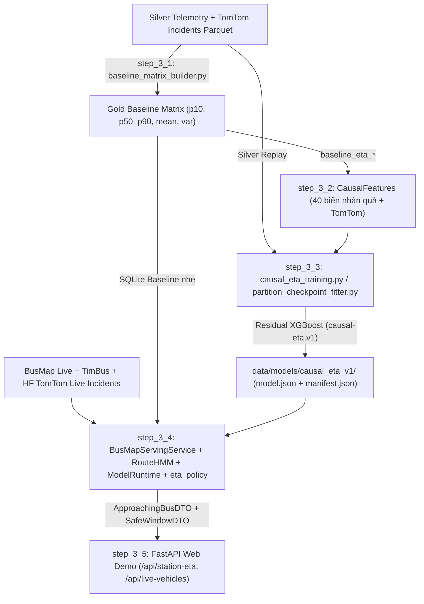

# Module 3: Dự báo ETA Xe buýt & Web Demo (`module_3_bus_eta_prediction`)

- **Vai trò:** Xây dựng ma trận thời gian di chuyển chuẩn (Baseline Matrix), trích xuất 40 đặc trưng nhân quả (`CausalFeatures`, gồm 4 đặc trưng TomTom), huấn luyện mô hình residual XGBoost `causal-eta.v1`, phục vụ dự báo ETA thời gian thực và hiển thị qua Web Demo.
- **Đầu vào:** Silver Lakehouse (`data/lakehouse/silver/`), SQLite (`data/hanoi_bus_system.db`), nguồn live BusMap & TimBus.
- **Đầu ra:** Baseline artifacts (`data/lakehouse/gold/`), mô hình `data/models/causal_eta_v1/`, FastAPI Web Demo (`step_3_5_web_demo/`).

## Sơ đồ Luồng Dữ liệu (Data Flow)

## Các Sub-module

| Sub-module | Nhiệm vụ | Tài liệu |
| --- | --- | --- |
| `step_3_1_historical_baseline_model` | Tính ma trận phân vị thời gian đi/dừng giữa các trạm theo khung giờ & loại ngày | [README.md](step_3_1_historical_baseline_model/README.md) |
| `step_3_2_feature_store_extractor` | Bộ trích xuất 40 đặc trưng nhân quả (36 gốc + 4 TomTom) dùng chung cho replay huấn luyện và inference | [README.md](step_3_2_feature_store_extractor/README.md) |
| `step_3_3_machine_learning_models` | Huấn luyện & đánh giá mô hình residual XGBoost (`causal-eta.v1`) | [README.md](step_3_3_machine_learning_models/README.md) |
| `step_3_4_eta_serving_and_evaluation` | `SpeedLayerPoller` (`45s`), orchestrator serving (`BusMapServingService`), `ModelRuntime`, `eta_policy` | [README.md](step_3_4_eta_serving_and_evaluation/README.md) |
| `step_3_5_web_demo` | Server FastAPI và 2 giao diện tách biệt (`/` Hành khách & `/debug` Console) | [README.md](step_3_5_web_demo/README.md) |
