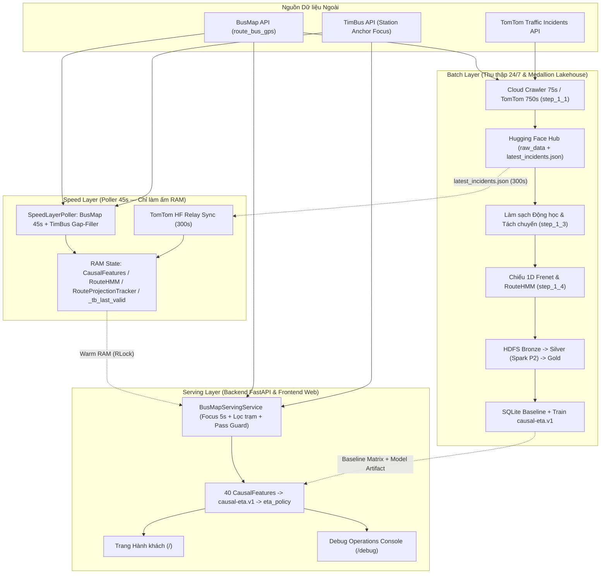
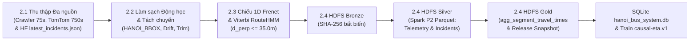
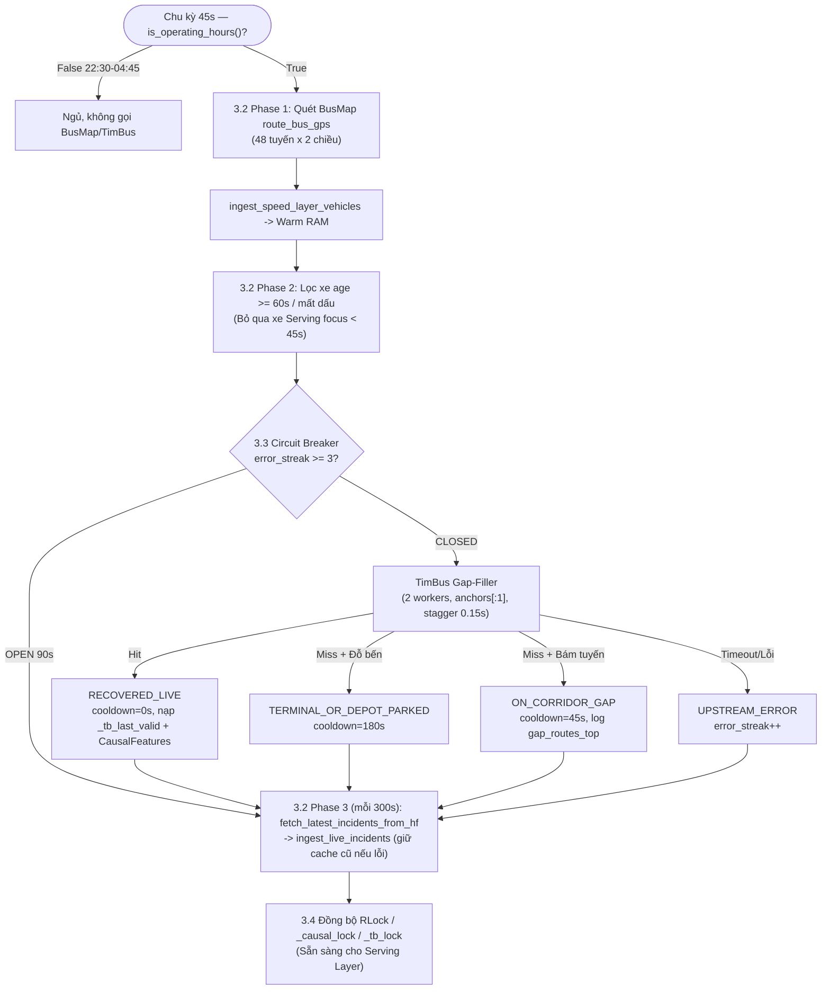
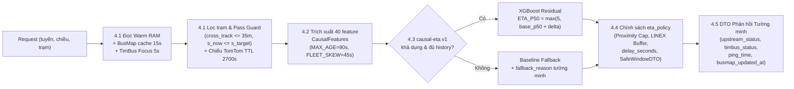
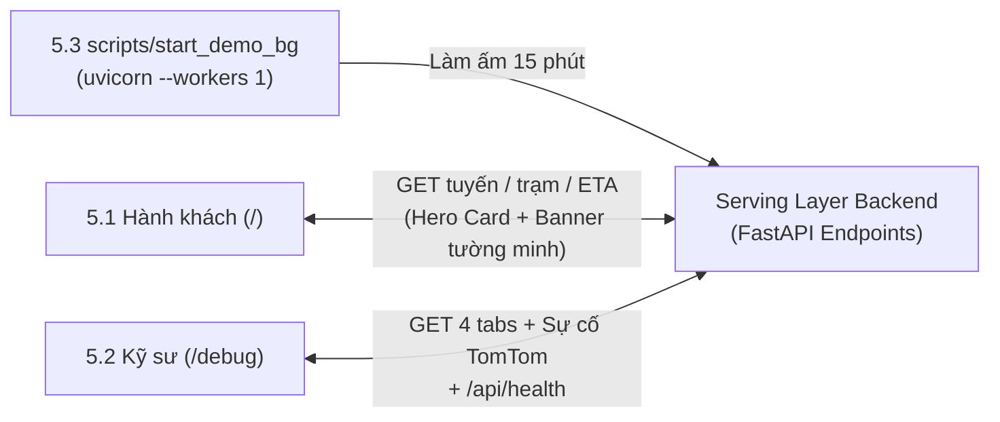

# Hệ thống Dự báo Thời gian Xe buýt Đến trạm (ETA) Thời gian thực tại Hà Nội theo Kiến trúc Lambda 3 Tầng và Mô hình Học máy Nhân quả Tích hợp Sự cố Giao thông

---

## Tóm tắt
Dữ liệu GPS công khai từ một nguồn đơn lẻ (BusMap) thường tồn tại các hạn chế nghiêm trọng như độ trễ cập nhật từ 15–60 giây trở lên, gián đoạn tín hiệu phương tiện giữa tuyến, nhiễu vận tốc tức thời và trạng thái `cold-start` kéo dài 3–5 phút khi khởi chạy hệ thống. Báo cáo này trình bày thiết kế, cài đặt và kết quả thực nghiệm của hệ thống dự báo thời gian xe buýt đến trạm (ETA) thời gian thực tại Hà Nội theo **Kiến trúc Lambda 3 Tầng** gồm **Batch Layer**, **Speed Layer** và **Serving Layer** (Backend suy luận và Frontend vận hành). Ở Batch Layer, dữ liệu đa nguồn (BusMap GPS và TomTom Traffic Incidents) được thu thập 24/7, làm sạch động học, chiếu lên không gian 1 chiều (1D Frenet) bằng thuật toán Viterbi HMM (`RouteHMM`), lưu trữ theo mô hình Medallion Lakehouse (Bronze–Silver–Gold) trên HDFS và tổng hợp thành ma trận baseline lịch sử trong SQLite. Ở Speed Layer, tiến trình nền `SpeedLayerPoller` vận hành theo chu kỳ `45s` kết hợp bổ khuyết dữ liệu từ TimBus và đồng bộ snapshot sự cố TomTom qua Hugging Face (`300s`/lần, dùng chung 1 lượt gọi API với Crawler nhằm tuân thủ quota `80/ngày`, `2500/tháng`), giúp giảm tỷ lệ xe quá hạn `90s` xuống chỉ còn `2` xe (`99.5% < 90s`). Ở Serving Layer, dịch vụ `BusMapServingService` (FastAPI) khai thác trạng thái RAM đã được làm ấm để trích xuất `40` feature nhân quả (`CausalFeatures`) và suy luận phần dư (residual) bằng mô hình XGBoost (`causal-eta.v1`, `1200` cây) kết hợp chính sách ổn định `eta_policy`. Đánh giá out-of-time 7 ngày (`2026-11-13` → `2026-11-19`, `8,306,295` mẫu test) cho thấy mô hình 40 feature tích hợp TomTom đạt **MAE `141.28s`** (giảm `44.83s` so với Baseline `186.11s` và giảm `18.27s` so với mô hình 36 feature `159.55s`); đặc biệt trên nhóm có sự cố giao thông (`has_incident`, `4,642,011` mẫu), MAE giảm mạnh `-29.40s` từ `207.14s` xuống **`177.74s`** và P90 giảm `-81.26s`. Hệ thống đạt `200 passed, 12 skipped, 0 failed` trên bộ kiểm thử `pytest`, vận hành ổn định không lỗi logic trong soak test 8 phút và hiển thị tường minh trên giao diện `/`, `/debug`.

---

## Chương 1. Tổng quan Bài toán và Kiến trúc Lambda 3 Tầng

### 1.1. Bối cảnh và Yêu cầu Thực tiễn tại Hà Nội
Trong vận hành giao thông công cộng đô thị tại Hà Nội, việc cung cấp thông tin thời gian xe buýt đến trạm (Estimated Time of Arrival — ETA) chính xác và ổn định đóng vai trò quyết định đối với trải nghiệm hành khách. Tuy nhiên, việc khai thác trực tiếp dữ liệu GPS từ nguồn BusMap công khai đơn lẻ bộc lộ bốn hạn chế cốt lõi:
1. **Độ trễ cập nhật cao và không đồng đều:** Chu kỳ cập nhật từ thiết bị đầu cuối thường dao động từ `15–60s` trở lên, khiến vị trí hiển thị bị tụt hậu so với thực tế khi xe di chuyển qua các nút giao.
2. **Biến mất phương tiện tạm thời giữa tuyến:** Một số xe bị mất gói tin trên `route_bus_gps` dù vẫn đang lưu thông trên hành lang tuyến, dẫn đến hiện tượng "biến mất xe" đột ngột trên ứng dụng hành khách.
3. **Nhiễu vận tốc tức thời và sai lệch tọa độ:** Dữ liệu vận tốc từ hộp đen thường dao động mạnh (nhiễu tức thời hoặc bằng `0` khi xe dừng đèn đỏ), trong khi tọa độ GPS có thể xuất hiện bước nhảy bất thường (`GPS_DRIFT_JUMP`) hoặc lệch khỏi tim đường chuẩn.
4. **Hiệu ứng `cold-start` kéo dài 3–5 phút:** Khi khởi động dịch vụ phục vụ từ trạng thái rỗng, hệ thống thiếu chuỗi lịch sử quan sát gần nhất để tính vận tốc vĩ mô và các feature đội xe, khiến các phản hồi ETA ban đầu phải rơi về ước tính thô.

Từ thực tế đó, bài toán đặt ra yêu cầu thiết kế một hệ thống vừa có khả năng **lưu trữ và xử lý dữ liệu lịch sử quy mô lớn** theo chuẩn Bronze–Silver–Gold, vừa bảo đảm năng lực **dự báo ETA thời gian thực** có độ trễ thấp, chống `cold-start`, thích ứng với sự cố giao thông trực tuyến và minh bạch trạng thái hệ thống cho cả hành khách lẫn kỹ sư vận hành.

### 1.2. Kiến trúc Lambda 3 Tầng (Batch Layer – Speed Layer – Serving Layer)
Để giải quyết đồng thời bài toán quy mô dữ liệu lịch sử và độ trễ phục vụ thời gian thực, hệ thống được tổ chức theo **Kiến trúc Lambda 3 Tầng**:

- **Batch Layer:** Thực hiện thu thập dữ liệu đa nguồn liên tục 24/7 trên nền tảng đám mây, chuẩn hóa và lưu trữ bất biến trên HDFS theo kiến trúc Medallion Lakehouse (Bronze $\to$ Silver $\to$ Gold). Từ dữ liệu Gold, hệ thống tổng hợp ma trận thời gian di chuyển lịch sử (`agg_segment_travel_times`), xuất bản sang SQLite (`hanoi_bus_system.db`) và huấn luyện mô hình học máy `causal-eta.v1`.
- **Speed Layer:** Tiến trình nền `SpeedLayerPoller` chạy theo chu kỳ `45s` nhằm quét trước toàn mạng lưới, bổ khuyết các xe có tín hiệu cũ từ nguồn TimBus và đồng bộ snapshot sự cố TomTom từ Hugging Face mỗi `300s`. Speed Layer chỉ làm nhiệm vụ thu thập và **làm ấm cache trong RAM** (`CausalFeatures`, `RouteProjectionTracker`, `RouteHMM`, `_tb_last_valid`), tách biệt hoàn toàn khỏi tác vụ lọc trạm và tính toán ETA.
- **Serving Layer:** Bao gồm tầng **Backend** (`BusMapServingService` trên FastAPI) và tầng **Frontend & Vận hành** (`/`, `/debug`, `scripts/`). Serving Layer khai thác trực tiếp RAM đã được Speed Layer làm ấm, kết hợp truy vấn BusMap `route_query` (cache `15s`) và TimBus Focus `5s` theo yêu cầu người dùng để lọc xe tại trạm, trích xuất `40` feature nhân quả, suy luận `causal-eta.v1`, áp dụng chính sách ổn định `eta_policy` và trả kết quả tường minh tới giao diện người dùng.

### 1.3. Sơ đồ Tổng hợp Kiến trúc Lambda 3 Tầng
Sơ đồ dưới đây tổng hợp và liên kết toàn bộ nội dung mục `1.1–1.2`, phân tách rõ **Luồng Dữ liệu (Data Flow)** và **Luồng Logic (Control/Inference Flow)** xuyên suốt cả 3 tầng:

---

## Chương 2. Batch Layer — Thu thập, Tiền xử lý và Medallion Lakehouse

### 2.1. Thu thập Dữ liệu Đa nguồn
Cài đặt tại Module 1 (`step_1_1_busmap_crawler_and_relay`):
- **Cloud Crawler 24/7 trên GitHub Actions (`crawl_bus.yml`):** Mỗi phiên chạy kéo dài `SESSION_DURATION_SEC = 540s` (9 phút) với chu kỳ quét toàn mạng lưới `BUS_POLL_INTERVAL_SEC = 75s`. Để giảm tải và tránh giới hạn tốc độ từ máy chủ nguồn, danh sách xe được chia thành các micro-batch kích thước `BUS_MICRO_BATCH_SIZE = 18` xe, giãn cách `BUS_MICRO_BATCH_DELAY_SEC = 0.40s`, gửi qua kết nối raw SSL socket (`socket_client.py`) có DNS cache (`_IP_CACHE_LOCK`) và timeout `4.2s`. Định danh thiết bị ảo được cấp phát từ bể `MASTER_DEVICE_POOL` (`300` đến `5,000` thiết bị lũy tiến).
- **Thu thập Sự cố Giao thông TomTom (`incident_client.py`):** Hệ thống tắt hoàn toàn TomTom Flow (`ENABLE_TOMTOM_FLOW = False`) và chỉ truy vấn **TomTom Incidents API** trên khung bao đô thị Hà Nội (`HUST_CORRIDOR_BBOX = "105.7000,20.9400,105.9200,21.0900"`) với chu kỳ `TOMTOM_INCIDENT_INTERVAL_SEC = 750s` (~12.5 phút/lần), bảo đảm nằm trong giới hạn quota `MAX_TOMTOM_INCIDENT_DAILY = 80` lượt/ngày và `MAX_TOMTOM_INCIDENT_MONTHLY = 2500` lượt/tháng. Ngay sau khi truy vấn thành công, Crawler đẩy tệp `raw_data/latest_incidents.json` lên Hugging Face (`push_latest_incidents_to_hf`) để Speed Layer tái sử dụng từ **cùng 1 lượt gọi API duy nhất**.
- **Làm mới Danh mục Đầu ngày (`catalog_refresher.py`):** Quét giao diện `route_bus_gps` trên toàn bộ 49 tuyến để đồng bộ khi xe chuyển tuyến (`routeId` thay đổi) và chỉ thanh lọc phương tiện khi trạng thái phản hồi xác nhận `status == "ERROR"`.

### 2.2. Làm sạch Động học và Phân đoạn Chuyến đi
Cài đặt tại Module 1 (`step_1_3`, `trip_segmenter.py`) sử dụng hệ tham số chuẩn hóa SSOT từ `config/system_config.py`:

| Tham số SSOT | Giá trị | Ý nghĩa kỹ thuật |
| :--- | :--- | :--- |
| `HANOI_BBOX` | `lat: 19.50..22.50`, `lon: 104.50..107.50` | Khung bao tọa độ hợp lệ vùng Bắc Bộ, loại bỏ rác `(0,0)` / đảo trục |
| `GPS_DRIFT_MIN_DIST_M` / `GPS_DRIFT_MAX_SPEED_KMPH` | `250.0m` / `80.0 km/h` | Điều kiện đồng thời phát hiện `GPS_DRIFT_JUMP`; cô lập không ghi vào `kinematic_cache` |
| `TERMINAL_STATIONARY_TOL_M` | `15.0m` | Ngưỡng nhận diện xe đỗ tại bến (`IDLE_DEPOT`), phân biệt với `ACTIVE_VALID` và `STALE_PING` |
| `MAX_CONTINUOUS_GAP_SEC` | `300.0s` | Khoảng trống tối đa giữa hai ping liên tiếp trong cùng một đoạn liên tục |
| `MAX_BRIDGEABLE_DETOUR_GAP_SEC` | `1800.0s` | Khoảng trống tối đa cho phép nối chuyến khi xe đi vòng tránh (`detour`) |
| `MAX_BACKWARD_RESET_M` | `200.0m` | Ngưỡng dịch chuyển lùi để xác nhận phương tiện đã quay đầu sang chuyến mới |

Ngoài ra, hàm `trim_terminal_stationary_ends()` thực hiện cắt bỏ chuỗi điểm đứng yên kéo dài tại hai đầu bến nhằm tránh làm sai lệch thời gian di chuyển thực tế trên hành lang tuyến.

### 2.3. Chiếu Không gian 1D Frenet và Mô hình Viterbi HMM
Cài đặt tại `step_1_4_frenet_spatial_projection`:
- **`ShapeProjectionModel`:** Ánh xạ cặp tọa độ WGS84 `(lat, lon)` sang hệ tọa độ 1 chiều gắn với hình học tuyến `(s_bus_m, cross_track_m)`, trong đó `s_bus_m` là lý trình lũy kế dọc theo tim đường (m) và `cross_track_m` ($d_\perp$) là khoảng cách vuông góc tới tim đường.
- **`RouteHMM`:** Sử dụng thuật toán Viterbi HMM để giải quyết bài toán nhập nhằng tại các đoạn tuyến trùng lặp hoặc giao cắt phức tạp (dùng chung giữa Batch Layer với cửa sổ `BATCH_HMM_HORIZON_SEC = 300.0s` và Speed/Serving Layer). Xác suất phát xạ (emission) tuân theo phân phối Gaussian theo `cross_track`, kết hợp xác suất chuyển trạng thái (transition) dựa trên độ tương đồng hướng tiếp tuyến và độ tiến triển lý trình $\Delta s$. Chỉ các quan sát có `cross_track_m <= MAX_CORRIDOR_CROSS_TRACK_M (35.0m)` mới được xuất sang tầng Silver.

### 2.4. Lưu trữ HDFS và Kiến trúc Medallion Lakehouse
Cài đặt tại Module 2 (`step_2_1`, `step_2_2`, `step_2_4`) và tầng tổng hợp (`step_3_1`):
- **Tầng Bronze (`step_2_4`):** Lưu trữ dữ liệu thô tại đường dẫn HDFS `/bus-eta/v1/bronze/hf_raw`, bảo đảm tính bất biến và kiểm chứng toàn vẹn từng lô dữ liệu thông qua mã băm SHA-256 (`receipt.py`, `spool.py`).
- **Tầng Silver (`step_2_4`, `step_2_2`):** Thực thi xử lý phân tán bằng Apache Spark P2 (`p2_transform.py`) và lưu trữ dưới định dạng Parquet nén Snappy cho hai bảng chính: `route_projected_telemetry` (dữ liệu xe đã chiếu 1D Frenet và lọc nhiễu) và `fact_route_tomtom_incidents` (dữ liệu sự cố TomTom đã chiếu lên từng tuyến).
- **Tầng Gold (`step_3_1`, `step_2_4`):** Tổng hợp ma trận thời gian di chuyển lịch sử `agg_segment_travel_times` gồm các phân vị `p10`, `p50`, `p90`, cùng `mean` và `std` theo khóa 5 chiều `(route_id, direction, segment_idx, day_type, hour_slot)`, với `MIN_SAMPLES_FOR_BASELINE = 5` và `MAX_SEGMENT_TRAVEL_TIME_SEC = 1800.0s`. Sau khi tổng hợp, `eta_snapshot.py` đóng gói release snapshot để phục vụ suy luận.
- **SQLite (`data/hanoi_bus_system.db`, `step_2_1`):** Cơ sở dữ liệu gọn nhẹ lưu trữ bảng GTFS chuẩn hóa (`canonical_routes`, `canonical_shapes`, `canonical_stations`) và bảng tổng hợp Gold Baseline phục vụ truy xuất nội bộ với độ trễ dưới mili-giây.

### 2.5. Sơ đồ Tổng hợp Luồng Xử lý Batch Layer

---

## Chương 3. Speed Layer — Poller 45s, Phân loại Trạng thái và Chống Cold-Start

### 3.1. Cơ sở Thiết kế từ Thực nghiệm Đối chiếu BusMap `route_query` và `per_vehicle`
Trước khi xây dựng `SpeedLayerPoller`, hệ thống tiến hành thực nghiệm đối chiếu trực tiếp giữa hai phương thức truy vấn của BusMap là `route_query` (`route_bus_gps`) và `per_vehicle` trên 5 tuyến đại diện (`02, 27, 32, 01, E03`):
- Với toàn bộ các xe cùng xuất hiện ở cả hai giao diện, sai lệch tọa độ và thời gian cập nhật đo được là **`0.0m` / `0.0s`**.
- Toàn bộ **`17/17`** xe vắng mặt trong `route_query` nhưng có mặt trong `per_vehicle` đều là xe đang ở ngoài hành trình (`curr_st=0, next_st=0`, độ lệch tim đường `ct = 254.9..4,059.4m`) hoặc xe có ping bị đóng băng (`29,361..109,161s`).

**Kết luận thiết kế:** Cả Speed Layer và Serving Layer đều sử dụng thống nhất giao diện `route_bus_gps` (route-query). Phạm vi vận hành bao gồm **`48` tuyến Baseline (`756` xe)**, trong đó **`31` tuyến hỗ trợ TimBus (`495` xe, `65.5%`)** và **`17` tuyến BusMap-only (`261` xe)**.

### 3.2. Chu kỳ Thu thập Nền và Bổ khuyết Dữ liệu Thời gian thực
Cài đặt tại `SpeedLayerPoller` (`speed_poller.py`), vận hành hoàn toàn độc lập với Serving Layer theo chu kỳ **`45s`** qua 3 Phase:
- **Phase 1 — Quét BusMap `route_bus_gps`:** Quét toàn bộ 48 tuyến $\times$ 2 chiều, gọi `ingest_speed_layer_vehicles` để cập nhật sẵn `RouteProjectionTracker`, `RouteHMM` và `CausalFeatures` trong RAM.
- **Phase 2 — TimBus Gap-Filler:** Sử dụng `2` worker chạy dàn trải (`stagger_delay_sec = 0.15s`), chỉ truy vấn trạm neo đầu tiên `anchors[:1]` (`primary_anchor_sid`) để giảm tải hệ thống nguồn. Cơ chế này kích hoạt cho các xe có tuổi dữ liệu `age >= 60s` hoặc bị mất dấu giữa tuyến, đồng thời tự động bỏ qua các xe mà Serving Layer vừa focus trong vòng `< 45s` được ghi nhận tại `_tb_last_valid`.
- **Phase 3 — Đồng bộ Sự cố TomTom Trực tuyến qua Hugging Face (`300s`/lần):** Thay vì gọi trực tiếp TomTom API từ Serving/Speed Layer (gây rủi ro vượt quota `80/ngày`), Crawler của Batch Layer đẩy ngay `raw_data/latest_incidents.json` lên Hugging Face sau mỗi lần query TomTom. Speed Layer kéo tệp này về qua `fetch_latest_incidents_from_hf` mỗi `300s` và nạp vào `ingest_live_incidents` (giữ nguyên cache cũ nếu payload tải về bị lỗi), giúp loại bỏ độ trễ chờ chu kỳ 12.5–22.5 phút mà vẫn dùng chung đúng **1 lượt gọi API duy nhất**.
- **Ngừng truy vấn ngoài giờ vận hành (`22:30 – 04:45` giờ Hà Nội):** Khi `is_operating_hours()` trả về `False`, hệ thống đóng toàn bộ các lượt gọi BusMap và TimBus vào ban đêm.

### 3.3. Cơ chế Phân loại 4 Trạng thái và Circuit Breaker
Mỗi lượt truy vấn bổ khuyết TimBus được `SpeedLayerPoller` phân loại vào 1 trong 4 trạng thái nhằm tránh truy vấn lặp vô ích vào xe đang đỗ bến hoặc khi nguồn gặp sự cố:
1. **`RECOVERED_LIVE`:** TimBus trả về vị trí mới (hit) $\to$ nạp vào `_tb_last_valid` và `CausalFeatures`, đặt `cooldown = 0s` và reset `error_streak`.
2. **`TERMINAL_OR_DEPOT_PARKED`:** TimBus không có dữ liệu (miss) kèm `speed == 0` và (`ct > 35m` hoặc khoảng cách tới bến $\le 300\text{m}$) $\to$ áp dụng `cooldown = 180s`.
3. **`ON_CORRIDOR_GAP`:** TimBus miss dù phương tiện vẫn bám hành lang tuyến (`ct <= 35m`, cách bến $> 300\text{m}$) $\to$ áp dụng `cooldown = 45s` và ghi nhận tuyến vào `gap_routes_top`.
4. **`UPSTREAM_ERROR`:** Xảy ra timeout hoặc lỗi kết nối mạng $\to$ tăng biến đếm `error_streak`; khi `error_streak >= 3`, hệ thống mở **Circuit Breaker `90s`** (`circuit_state = "OPEN"`), tạm ngưng gọi TimBus để bảo vệ độ ổn định chung.

### 3.4. Đồng bộ Đa luồng và Bảo toàn Trạng thái RAM
Hệ thống vận hành theo mô hình tiến trình đơn (`uvicorn --workers 1`) nhằm chia sẻ trực tiếp trạng thái RAM giữa luồng nền `SpeedLayerPoller` và các luồng xử lý request của FastAPI. Tính an toàn đa luồng (thread-safety) được bảo đảm thông qua `threading.RLock` bên trong `CausalFeatures` (`causal_eta.py`) kết hợp cùng hai khóa `_causal_lock` và `_tb_lock` trong `BusMapServingService`.

### 3.5. Sơ đồ Tổng hợp Vòng đời Xử lý Speed Layer

---

## Chương 4. Serving Layer (Backend) — Suy luận Thời gian thực, Mô hình `causal-eta.v1` và Chính sách ETA

### 4.1. Luồng Phục vụ Truy vấn và Lọc Phương tiện theo Trạm
Cài đặt tại `BusMapServingService` (`serving_service.py`):
- **Kết hợp RAM và truy vấn trực tiếp:** Khi nhận yêu cầu từ người dùng cho một tuyến/trạm, dịch vụ đọc trạng thái RAM đã được Speed Layer làm ấm, kết hợp truy vấn BusMap `route_bus_gps` (`live_feed.py`, cache `15s`) và đồng bộ TimBus Focus `5s` cho cả hai chiều (`_sync_route_both_directions`).
- **Lọc phương tiện tại trạm (`_filter_station_vehicles` + `project_filter_extrapolate`):** Kiểm tra đồng thời độ cũ gói tin (`<= MAX_TELEMETRY_STALE_SEC = 300.0s`), hành lang tuyến (`cross_track <= 35.0m`), hướng di chuyển (`cos >= HEADING_COS_SIMILARITY_MIN = -0.20` khi tốc độ $\ge 5.0\text{ km/h}$), vị trí trước trạm (`s_now <= s_target`), cơ chế **Pass Guard** `_passed_station_plates` (chống hồi sinh xe đã đi qua trạm từ cache cũ), và làm mượt vận tốc vĩ mô qua `MacroSpeedTracker` ($\Delta s / \Delta t > 120.0\text{s}$).
- **Chiếu hình học và nạp sự cố TomTom trực tuyến (`get_live_incidents_for_route` $\to$ `observe_incidents`):** Áp dụng ngưỡng thời gian sống **TTL `2700s` (45 phút)** cho snapshot `latest`. Để bảo đảm tính nhất quán tuyệt đối giữa môi trường Online và Offline, phép chiếu LineString dùng chung `ShapeProjectionModel.project_directed_point` (lọc điều kiện hướng `cos_theta >= 0.5` trước khi lấy `argmin`) kết hợp `split_matched_vertices_into_runs` để gom các đỉnh liên tiếp thành đoạn đơn điệu trên hành lang tuyến; sau đó quy đổi `delay_seconds` theo tỷ lệ `span_route / eff_inc_span` cho `CausalFeatures` và trả kèm `polylines` trong `RouteIncidentDTO`.

### 4.2. Trích xuất 40 Đặc trưng Nhân quả Thời gian thực
Cài đặt tại `CausalFeatures` (`step_3_2/causal_eta.py`), dùng chung một luồng xử lý duy nhất giữa giai đoạn huấn luyện tái lập (replay train) và suy luận trực tuyến (serving inference), tuân thủ nguyên tắc **chỉ dùng tiền tố quan sát quá khứ** với `MAX_POSITION_AGE = 90.0s` và `MAX_FLEET_SKEW = 45.0s`. Bộ đặc trưng gồm **40 feature** chia thành 6 nhóm:
1. **Tuyến & Thời gian (9):** `route_id_idx`, `direction_id`, `current_station_order`, `target_station_order`, `day_type`, `day_of_week`, `hour_slot`, `sin_time`, `cos_time`.
2. **Hình học & Khoảng cách (7):** `s_bus_m`, `s_target_m`, `remaining_distance_m`, `n_stations_ahead`, `progress_ratio`, `target_progress_ratio`, `dist_to_next_station_m`.
3. **Động học Ego (2):** `ego_speed_avg_3min_kmh`, `ego_speed_avg_5min_kmh`.
4. **Thống kê Baseline (11):** `baseline_eta_p50_sec`, `baseline_eta_mean_sec`, `baseline_eta_p10_sec`, `baseline_eta_p90_sec`, `baseline_eta_p90_minus_p10_sec`, `baseline_eta_rss_std_sec`, `baseline_eta_mean_minus_p50_sec`, `baseline_max_seg_p90_sec`, `baseline_tier0_frac`, `route_base_speed_kmh`, `route_station_spacing_m`.
5. **Đội xe cùng tuyến (7):** `lead_bus_dist_ahead_m`, `follow_bus_dist_behind_m`, `n_active_buses_on_route`, `n_buses_in_corridor_ahead`, `lead_bus_speed_kmh`, `follow_bus_speed_kmh`, `lead_bus_speed_ratio`.
6. **Sự cố TomTom (4):** `inc_ahead_total_delay_sec` *(áp dụng ràng buộc đơn điệu `+1`, chia tỷ lệ chồng lấp `ov_l / eff_inc_span`)*, `inc_dist_to_nearest_m`, `inc_ahead_jam_length_m`, `inc_info_age_sec` *(tuổi snapshot `t_cur - crawled_epoch`)*.

### 4.3. Mô hình Residual XGBoost (`causal-eta.v1`)
Cài đặt huấn luyện tại `step_3_3` và suy luận tại `model_runtime.py`:
- Thay vì dự báo trực tiếp tổng thời gian di chuyển, mô hình dự báo **phần dư** $\delta = \text{eta\_actual} - \text{baseline\_eta\_p50\_sec}$ bằng `XGBRegressor` với hàm mất mát `reg:absoluteerror`, độ sâu `max_depth = 6`, `1200` cây (`best_iteration = 1199`), huấn luyện streaming bằng `xgb.QuantileDMatrix` trên GPU CUDA.
- Giá trị ETA trung vị được tái dựng qua biểu thức:
  $$\text{ETA}_{P50} = \max\big(5.0,\ \text{baseline\_eta\_p50\_sec} + \delta\big)$$
- Hàm `predict_p50_with_reason` kiểm tra tính hợp lệ của vector 40 feature và tuyến mục tiêu, chuyển về baseline một cách tường minh khi thiếu điều kiện suy luận ML.

### 4.4. Chính sách Ổn định và Cửa sổ An toàn ETA
Cài đặt tại `eta_policy.py`:
- **Chặn trần tiệm cận khi 2 xe bám sát nhau (`compute_proximity_capped_etas`):** Khi khoảng cách giữa xe sau và xe trước nhỏ hơn ngưỡng `PROXIMITY_CAP_FULL_M = 80m` (suy giảm tuyến tính qua `FADE_M = 120m`), ETA của xe sau bị ràng buộc theo vận tốc tham chiếu `2.5 m/s` và khoảng đệm `MARGIN = 15s` để tránh đảo thứ tự đến trạm phi lý.
- **Độ trễ và phân loại giao thông:**
  $$\Delta_{\text{delay}} = \max\big(0,\ \text{eta\_core\_p50} - \text{base\_rem\_p50}\big)$$
  Cờ cảnh báo trễ `is_delayed` bật khi $\Delta_{\text{delay}} \ge 120.0\text{s}$ (`REALTIME_DELAY_ALERT_SEC`). Trạng thái giao thông được phân loại thành `UN_TAC` ($v_{\text{obs}} < 10.0\text{ km/h}$ hoặc `is_delayed`), `THONG_THOANG` ($v_{\text{obs}} \ge 20.0\text{ km/h}$ và $\Delta_{\text{delay}} < 30.0\text{s}$) hoặc `BINH_THUONG`.
- **Độ đệm bất đối xứng LINEX (`buffer_seconds`) và Safe Window:**
  $$B = \min\Big(\text{MAX\_SAFE\_BUFFER\_CEILING\_SEC},\ \kappa(d_{\text{station}}) \cdot \big(\alpha\,\sigma_{\text{accum}} + \beta\,\text{HEARTBEAT} + \gamma\,\text{eta\_core\_p50}\big)\Big)$$
  trong đó $\text{MAX\_SAFE\_BUFFER\_CEILING\_SEC} = 180.0\text{s}$, $\alpha = 0.60$, $\beta = 0.5$, $\text{HEARTBEAT} = 15.0\text{s}$, $\gamma = 0.04$, và $\kappa(d_{\text{station}})$ là hàm suy giảm smoothstep bậc 2 trên đoạn $[30.0\text{m},\ 150.0\text{m}]$: $\kappa(d) = 3\xi^2 - 2\xi^3$ với $\xi = \frac{d - 30}{120}$. Từ $B$, hệ thống xuất ra hai cận trong `SafeWindowDTO`: cận sớm ($\text{eta\_core} - B$) và cận muộn ($\text{eta\_core} + B$), lượng tử hóa theo phút trần (`0 phút`, `~1 phút`, `{M} phút`).

### 4.5. Cơ chế Phản hồi Trạng thái Tường minh (Loại bỏ Silent Fallback)
Hệ thống loại bỏ hoàn toàn trạng thái im lặng khi suy giảm chất lượng bằng bộ trường chẩn đoán tường minh trên API:
- `upstream_status` (`ok | empty | upstream_error`) kèm thông điệp `upstream_error` (`live_feed.py`).
- `timbus_status` (`ok | partial_error | upstream_error | unsupported`) kèm `timbus_error` (`timbus_tracker.py`).
- `fallback_reason` (`ok | cold_start_causal | model_unavailable | unknown_route | predict_error`).
- Phân tách hai mốc thời gian của mỗi gói tin: `ping_time` (thời điểm query TimBus) và `busmap_updated_at` (thời điểm thiết bị GPS gốc của BusMap).
- Endpoint `/api/health` công bố trạng thái tổng thể `healthy` / `degraded`, cờ `model_available` và snapshot đầy đủ của `SpeedLayerPoller`.

### 4.6. Sơ đồ Tổng hợp Chuỗi Suy luận Serving Layer (Backend)

---

## Chương 5. Serving Layer (Frontend & Vận hành) — Giao diện Hành khách (`/`), Debug Console (`/debug`) và Scripts

### 5.1. Giao diện Hành khách Tối giản (`/`)
- Sử dụng nền bản đồ vệ tinh Esri (`World_Imagery`), panel điều khiển có khả năng kéo dãn độ rộng (`#panelResizer`, `280–680px`), hỗ trợ thu gọn panel trên desktop và bố cục bottom-sheet 3 mức trên thiết bị di động.
- Ô tìm tuyến (`#routeCombobox`) và ô chọn/lọc trạm tinh gọn (`#stationCombobox`) được đặt ở phía trên vùng hiển thị ETA nhằm nhường tối đa không gian cho danh sách thẻ ETA.
- Khi người dùng click chọn trạm, hệ thống **tự động ghim trạm ngay lập tức và không mở popup trên bản đồ**; làm nổi bật **xe gần trạm nhất** bằng hero card kèm badge halo pulse trên bản đồ, đồng thời hiển thị banner cảnh báo tường minh khi phát sinh lỗi nguồn dữ liệu, dữ liệu cũ hoặc đang ở chế độ ước tính nền.

### 5.2. Debug Operations Console (`/debug`)
- Thiết kế giao diện dark-slate tách biệt, chia 2 cột gồm bản đồ vệ tinh Esri và bảng phân tích kéo dãn tỷ lệ (`#dbgSplitter`), tích hợp **4 tab độc lập** không cuộn trang:
  1. *Trạm & ETA:* theo dõi ETA chi tiết, độ trễ và cận an toàn cho từng xe tiếp cận trạm.
  2. *Đoàn xe & Telemetry:* hiển thị song song hai mốc `TB query` (`ping_time`) và `BM thiết bị` (`busmap_updated_at`), highlight hàng xe gần nhất (`.is-leading`).
  3. ***Sự cố TomTom:*** vẽ trực tiếp LineString sự cố trên bản đồ theo mức độ nghiêm trọng, mở popup chi tiết và zoom tới vị trí sự cố khi click vào từng dòng.
  4. *Hệ thống & Poller:* giám sát snapshot của `SpeedLayerPoller`, trạng thái Circuit Breaker và trạng thái `LIVE TOMTOM INCIDENTS (HF RELAY)`.

### 5.3. Script Khởi chạy Nền và Vận hành Hệ thống
Cài đặt tại thư mục `scripts/` (`start_demo_bg.ps1` / `.bat` và `stop_demo_bg.ps1` / `.bat`) cho phép khởi chạy ngầm `uvicorn --workers 1` trước thời điểm demo khoảng 15 phút để làm ấm Speed Layer, tự động kiểm tra chống chạy trùng cổng (`Exit=1`) và hỗ trợ dừng tiến trình sạch thông qua tệp PID.

### 5.4. Sơ đồ Tương tác Serving Layer (Frontend – Backend API)

---

## Chương 6. Thực nghiệm, Kiểm chứng và Kết luận

### 6.1. Đánh giá Hiệu năng Speed Layer (2 chu kỳ `45s` trực tiếp)
Thử nghiệm đo đạc trực tiếp trên 2 chu kỳ quét liên tiếp của `SpeedLayerPoller`:
- **Chu kỳ 1 (`44.1s`):** Số xe quá hạn `60s` (`eff_stale60`) giảm từ `238 -> 38`, số xe quá hạn `90s` (`eff_stale90`) giảm từ `18 -> 8`; TimBus xử lý `238/238` yêu cầu (`hit=200, miss=38, err=0`) ở tốc độ `5.74 req/s` với độ trễ `P50=145ms`, `P90=246ms`.
- **Chu kỳ 2 (`33.8s`):** `eff_stale60` giảm từ `155 -> 28`, **`eff_stale90` giảm từ `4 -> 2` (`99.5% < 90s`)**; TimBus xử lý `151/151` yêu cầu (`hit=127, miss=24, err=0`) ở tốc độ `4.83 req/s` với độ trễ `P50=176ms`, `P90=333ms`.

### 6.2. Kiểm thử Vận hành Liên tục Toàn hệ thống (~8 phút, `32` ticks, `4,365` gói tin upstream)
- **Độ ổn định Poller:** `SpeedLayerPoller` hoàn thành `9` chu kỳ (`min=41.5s`, `median=46.40s`, `max=57.07s`), duy trì `status=healthy` và `circuit_state=CLOSED` trên toàn bộ `32/32` ticks (`busmap_ok=864`, `recovered_live=974`, `parked_skip=16`, `on_corridor_gap=96`, `upstream_error=1`).
- **Tỷ lệ thành công HTTP:** BusMap đạt `1,137/1,137` (`200 OK`), TimBus đạt `3,224/3,228` (`4` timeout, `0` lỗi `429`/`403`), tần suất truy vấn TimBus trung bình `6.81 req/s` (`Speed=2.42 req/s`, `Serving=4.39 req/s`).
- **Độ tươi dữ liệu và tính đúng đắn ETA:** Trên hai tuyến `32` và `27`, độ tươi đạt `P50=0.6s`, `P90=0.8–1.0s`; ghi nhận `0` lỗi logic (`negative_eta=0`, `extreme_implied_speed=0`, `dist_jump_backwards_gt300m=0`, `eta_sort_order_bug=0`). Hệ thống xử lý đúng thiết kế đối với phương tiện dừng quá `90s` (`29F-001.16` $\to$ `cold_start_causal`) và cập nhật chính xác `_last_cycle_epoch = end_ts`.

### 6.3. Benchmark Out-of-Time 7 Ngày
Đánh giá trên tập kiểm thử độc lập 7 ngày (`2026-11-13` → `2026-11-19`, **`8,306,295` mẫu test**) từ mô hình huấn luyện trên giai đoạn `2026-10-18..2026-11-12` (**`17,866,649` mẫu train**):

| Mô hình / Phiên bản | Overall MAE (`8,306,295` mẫu) | P90 Error | Crossing-balanced MAE | `no_incident` (`3,664,284` mẫu) | `has_incident` (`4,642,011` mẫu) |
| :--- | :---: | :---: | :---: | :---: | :---: |
| **Baseline Lịch sử** | `186.11s` | — | — | — | `237.11s` |
| **`causal_eta_v1` (36f, 900 cây)** | `159.55s` | `379.86s` | `113.36s` | `99.25s` | `207.14s` |
| **Mô hình mới (40f + TomTom, 1200 cây)** | **`141.28s`** (`-18.27s`) | **`327.87s`** | **`102.13s`** | **`95.09s`** (`-4.16s`) | **`177.74s`** (**`-29.40s`**, P90 `-81.26s`) |

- **Phân tích theo horizon (`by_horizon`):** `1 hop`: `45.71s` (baseline `62.50s`); `2–5 hops`: `73.81s` (baseline `95.54s`); `6–15 hops`: `135.33s` (baseline `171.92s`); `16+ hops`: `221.16s` (baseline `301.58s`).
- **Feature Importance của nhóm TomTom:** `inc_ahead_total_delay_sec` (`1,613` splits, gain `3,414.0`), `inc_dist_to_nearest_m` (`581` splits, gain `475.46`), `inc_ahead_jam_length_m` (`979` splits, gain `315.57`), `inc_info_age_sec` (`312` splits, gain `183.78`).

### 6.4. Kiểm thử Tự động và Kiểm chứng trên Trình duyệt Thực tế
- **Bộ kiểm thử tự động (`pytest tests/ --basetemp=runtime/pytest_tmp -q`):** **`200 passed, 12 skipped, 0 failed`**.
- **Kiểm chứng trên Chrome DevTools (`/` và `/debug`):** `0` lỗi console, hiển thị chính xác `5` LineString sự cố trên tuyến `01`, tab *Sự cố TomTom* cùng popup chi tiết hoạt động ổn định. Soak test `8` phút trên API trực tiếp ghi nhận `96/96` phản hồi HTTP 200, `204/204` trace 40f hợp lệ và `0` vi phạm thứ tự quantile.

### 6.5. Kết luận
Hệ thống đã giải quyết đồng bộ hai bài toán cốt lõi của dự báo ETA xe buýt đô thị: (1) khắc phục triệt để độ trễ và `cold-start` của dữ liệu GPS đơn nguồn thông qua kiến trúc Lambda 3 Tầng và `SpeedLayerPoller` `45s`, và (2) tích hợp thành công dữ liệu sự cố giao thông TomTom trực tuyến qua cơ chế Hugging Face Relay trong giới hạn quota `80/ngày` vào mô hình Residual XGBoost `40` feature, giúp giảm MAE tổng thể xuống `141.28s` và giảm `-29.40s` MAE khi tuyến có sự cố giao thông.
