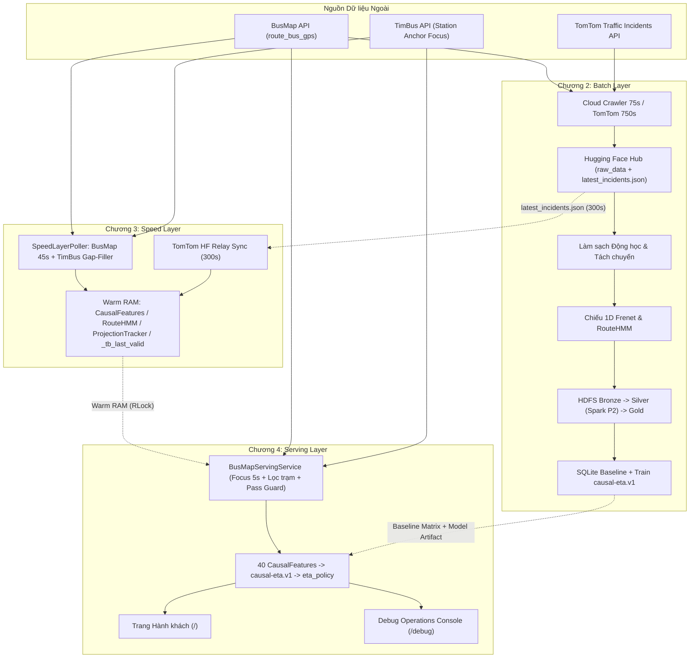
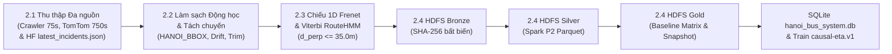
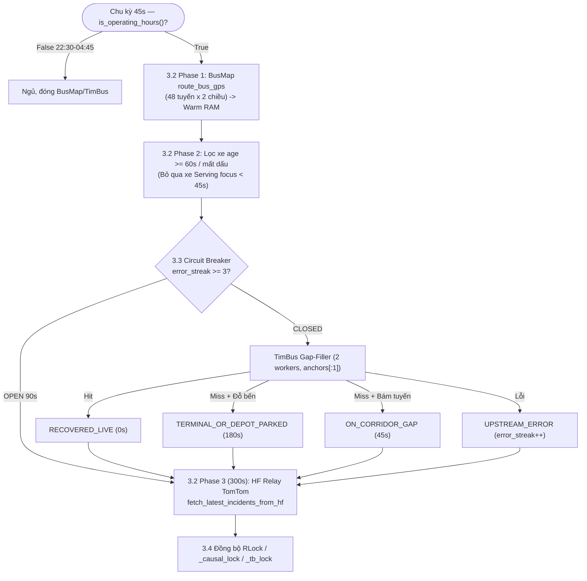
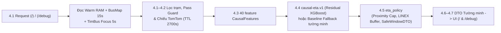

# Hệ thống Dự báo Thời gian Xe buýt Đến trạm (ETA) Thời gian thực tại Hà Nội theo Kiến trúc Lambda 3 Tầng và Mô hình Học máy Nhân quả Tích hợp Sự cố Giao thông

---

## Tóm tắt
Dữ liệu GPS công khai từ nguồn BusMap đơn lẻ thường có độ trễ cập nhật từ 15–60 giây trở lên, mất dấu phương tiện giữa tuyến, nhiễu vận tốc tức thời và gặp hiệu ứng `cold-start` 3–5 phút khi khởi chạy hệ thống.

Báo cáo này trình bày thiết kế, cài đặt và kết quả kiểm chứng của hệ thống dự báo ETA xe buýt thời gian thực tại Hà Nội theo **Kiến trúc Lambda 3 Tầng**: **Batch Layer**, **Speed Layer** và **Serving Layer**.

- **Batch Layer:** Thu thập dữ liệu 24/7, làm sạch động học, chiếu 1D Frenet bằng `RouteHMM`, lưu trữ theo chuẩn Medallion Lakehouse (Bronze–Silver–Gold) trên HDFS, xuất baseline sang SQLite và huấn luyện mô hình `causal-eta.v1`.
- **Speed Layer:** Vận hành `SpeedLayerPoller` chu kỳ `45s`, kết hợp TimBus bổ khuyết và đồng bộ snapshot sự cố TomTom qua Hugging Face (`300s`/lần, dùng chung 1 lượt gọi API với Crawler trong quota `80/ngày`), đưa tỷ lệ xe quá hạn `90s` xuống còn `2` xe (`99.5% < 90s`).
- **Serving Layer:** Khai thác RAM đã làm ấm để trích xuất `40` feature nhân quả (`CausalFeatures`), suy luận phần dư bằng XGBoost (`1200` cây), áp dụng chính sách ổn định `eta_policy` và phục vụ giao diện `/`, `/debug`.

Trên tập kiểm thử out-of-time 7 ngày (`8,306,295` mẫu), mô hình mới đạt **MAE `141.28s`** (giảm `44.83s` so với Baseline `186.11s`); riêng nhóm có sự cố giao thông (`4,642,011` mẫu), MAE giảm `-29.40s` từ `207.14s` xuống **`177.74s`**.

---

## Chương 1. Tổng quan Bài toán và Kiến trúc Hệ thống

### 1.1. Bối cảnh và Yêu cầu Thực tiễn tại Hà Nội
Việc khai thác trực tiếp dữ liệu GPS BusMap công khai đơn nguồn trong giao thông đô thị Hà Nội gặp bốn hạn chế lớn:

- **Độ trễ cập nhật cao:** Chu kỳ đồng bộ từ thiết bị đầu cuối thường dao động `15–60s+`, làm vị trí xe bị trễ khi qua các nút giao.
- **Mất dấu xe giữa tuyến:** Phương tiện có thể tạm thời biến mất khỏi `route_bus_gps` dù vẫn đang di chuyển trên hành lang tuyến.
- **Nhiễu vận tốc và tọa độ:** Vận tốc hộp đen dao động mạnh; tọa độ GPS xuất hiện bước nhảy bất thường (`GPS_DRIFT_JUMP`) hoặc lệch tim đường.
- **Hiệu ứng `cold-start`:** Khi mới khởi động dịch vụ, hệ thống thiếu chuỗi quan sát gần nhất (3–5 phút) để tính vận tốc vĩ mô và feature đội xe.

Do đó, hệ thống cần giải quyết đồng thời hai mục tiêu: xử lý lưu trữ dữ liệu lịch sử quy mô lớn (Bronze–Silver–Gold) và suy luận ETA thời gian thực chính xác, ổn định, minh bạch trạng thái.

### 1.2. Kiến trúc Lambda 3 Tầng
Hệ thống được phân tách thành ba tầng độc lập theo chuẩn Kiến trúc Lambda:

| Tầng | Vai trò cốt lõi | Thành phần chính | Chu kỳ / Độ trễ |
| :--- | :--- | :--- | :--- |
| **Batch Layer** | Thu thập 24/7, chuẩn hóa Medallion Lakehouse, tổng hợp Baseline & huấn luyện ML | Cloud Crawler, Spark P2, HDFS, SQLite, `step_3_3` | Crawler `75s`, TomTom `750s` |
| **Speed Layer** | Quét nền toàn mạng, bổ khuyết TimBus, đồng bộ TomTom HF Relay, chỉ làm ấm RAM | `SpeedLayerPoller` (`speed_poller.py`) | BusMap `45s`, TomTom sync `300s` |
| **Serving Layer** | Lọc trạm, suy luận `causal-eta.v1`, chính sách `eta_policy`, giao diện `/`, `/debug` | `BusMapServingService` (FastAPI), Web UI, `scripts/` | BusMap cache `15s`, TimBus Focus `5s` |

### 1.3. Sơ đồ Tổng hợp Kiến trúc Hệ thống
Sơ đồ dưới đây liên kết **Luồng Dữ liệu** và **Luồng Logic** xuyên suốt cả ba tầng từ mục `1.1–1.2`:

---

## Chương 2. Batch Layer

### 2.1. Thu thập Dữ liệu Đa nguồn
- **Cloud Crawler 24/7:** Vận hành trên GitHub Actions, mỗi phiên kéo dài `540s`, lặp chu kỳ `75s`. Danh sách xe chia thành micro-batch `18` xe, giãn cách `0.40s`, dùng raw SSL socket kèm DNS cache và timeout `4.2s`.
- **Thu thập Sự cố TomTom:** Chỉ gọi TomTom Incidents API (tắt hoàn toàn TomTom Flow) theo chu kỳ `750s` (~12.5 phút/lần) để giữ quota trong giới hạn `80/ngày` và `2500/tháng`. Ngay sau khi query, Crawler đẩy `raw_data/latest_incidents.json` lên Hugging Face để Speed Layer dùng chung 1 lượt gọi API.
- **Làm mới Danh mục Đầu ngày:** Quét `route_bus_gps` trên toàn bộ 49 tuyến để cập nhật `routeId` khi xe đổi tuyến và chỉ xóa xe khi `status == "ERROR"`.

*Cài đặt:* Module 1 (`step_1_1`: `crawl_bus.yml`, `socket_client.py`, `incident_client.py`, `catalog_refresher.py`).

### 2.2. Làm sạch Động học và Phân đoạn Chuyến đi
Mọi ngưỡng làm sạch và tách chuyến được quản lý tập trung theo chuẩn SSOT trong `config/system_config.py`:

| Tham số SSOT | Giá trị | Vai trò xử lý |
| :--- | :--- | :--- |
| `HANOI_BBOX` | `lat: 19.50..22.50`, `lon: 104.50..107.50` | Lọc tọa độ rác `(0,0)` / đảo trục; cô lập `OUT_OF_BOUNDS` |
| `GPS_DRIFT_MIN_DIST_M` / `MAX_SPEED` | `250.0m` / `80.0 km/h` | Điều kiện đồng thời phát hiện `GPS_DRIFT_JUMP`, không ghi vào `kinematic_cache` |
| `TERMINAL_STATIONARY_TOL_M` | `15.0m` | Phân loại `IDLE_DEPOT`, `ACTIVE_VALID`, `STALE_PING`; cắt điểm dừng đầu/cuối bến |
| `MAX_CONTINUOUS_GAP_SEC` | `300.0s` | Ngưỡng khoảng trống tối đa cho ping liên tục |
| `MAX_BRIDGEABLE_DETOUR_GAP_SEC` | `1800.0s` | Khoảng trống tối đa cho phép nối chuyến khi xe đi vòng tránh |
| `MAX_BACKWARD_RESET_M` | `200.0m` | Ngưỡng bước lùi xác nhận xe quay đầu sang chuyến mới |

*Cài đặt:* Module 1 (`step_1_3`, `trip_segmenter.py`, `trim_terminal_stationary_ends()`).

### 2.3. Chiếu Không gian 1D Frenet và Mô hình Viterbi HMM
- **Chiếu 1D Frenet (`ShapeProjectionModel`):** Ánh xạ `(lat, lon)` sang tọa độ dọc tuyến `(s_bus_m, cross_track_m)`.
- **Viterbi HMM (`RouteHMM`):** Giải quyết nhập nhằng tại các đoạn tuyến trùng nhau bằng xác suất phát xạ Gaussian theo `cross_track` và xác suất chuyển trạng thái theo hướng tiếp tuyến cùng độ tiến triển $\Delta s$.
- **Ngưỡng xuất Silver:** Dùng chung `RouteHMM` giữa Batch (`BATCH_HMM_HORIZON_SEC = 300.0s`) và Speed/Serving; chỉ giữ quan sát có `cross_track_m <= MAX_CORRIDOR_CROSS_TRACK_M (35.0m)`.

*Cài đặt:* Module 1 (`step_1_4`).

### 2.4. Lưu trữ HDFS và Medallion Lakehouse
Dữ liệu đi qua ba tầng lưu trữ trên HDFS trước khi trích xuất ra SQLite phục vụ truy xuất nhanh:

| Tầng | Đường dẫn / Định dạng | Nội dung & Cơ chế kiểm soát |
| :--- | :--- | :--- |
| **Bronze** | HDFS `/bus-eta/v1/bronze/hf_raw` | Dữ liệu thô bất biến, kiểm chứng toàn vẹn từng lô bằng SHA-256 (`receipt.py`, `spool.py`) |
| **Silver** | Spark P2 (`p2_transform.py`), Parquet Snappy | `route_projected_telemetry` và `fact_route_tomtom_incidents` |
| **Gold** | Parquet + Release Snapshot (`eta_snapshot.py`) | `agg_segment_travel_times` (`p10`, `p50`, `p90`, `mean`, `std`), `MIN_SAMPLES_FOR_BASELINE = 5`, `MAX_SEGMENT_TRAVEL_TIME_SEC = 1800.0s` |
| **SQLite** | `data/hanoi_bus_system.db` | Cấu trúc GTFS chuẩn (`canonical_routes`, `canonical_shapes`, `canonical_stations`) + bảng Gold Baseline |

*Cài đặt:* Module 2 (`step_2_1`, `step_2_2`, `step_2_4`) và `step_3_1`.

### 2.5. Sơ đồ Tổng hợp Batch Layer

---

## Chương 3. Speed Layer

### 3.1. Thực nghiệm Đối chiếu BusMap `route_query` và `per_vehicle`
Thực nghiệm đối chiếu trực tiếp hai giao diện của BusMap trên 5 tuyến (`02, 27, 32, 01, E03`) cho thấy:
- Độ lệch vị trí và thời gian giữa `route_query` và `per_vehicle` là **`0.0m` / `0.0s`**.
- Toàn bộ **`17/17`** xe vắng mặt trong `route_query` đều là xe ngoài hành trình (`curr_st=0, next_st=0`, `ct = 254.9..4,059.4m`) hoặc ping đóng băng (`29,361..109,161s`).

**Kết luận thiết kế:** Thống nhất dùng `route_bus_gps` (route-query) cho cả Speed Layer và Serving Layer. Phạm vi phục vụ gồm **`48` tuyến Baseline (`756` xe)**, trong đó **`31` tuyến hỗ trợ TimBus (`495` xe, `65.5%`)** và **`17` tuyến BusMap-only (`261` xe)**.

### 3.2. Bộ thu thập Nền 45s và Bổ khuyết Dữ liệu Thời gian thực
Tiến trình nền `SpeedLayerPoller` vận hành theo chu kỳ `45s`, chỉ làm ấm RAM và tách biệt khỏi tác vụ lọc trạm/tính ETA:

- **Phase 1 (BusMap `45s`):** Quét `route_bus_gps` trên 48 tuyến $\times$ 2 chiều, gọi `ingest_speed_layer_vehicles` để làm ấm `RouteProjectionTracker`, `RouteHMM` và `CausalFeatures`.
- **Phase 2 (TimBus Gap-Filler):** Chạy `2` worker dàn trải (`stagger_delay_sec = 0.15s`), chỉ dùng `anchors[:1]` (`primary_anchor_sid`) cho xe `age >= 60s` hoặc mất dấu giữa tuyến; bỏ qua xe Serving Layer vừa focus `< 45s` trong `_tb_last_valid`.
- **Phase 3 (TomTom HF Relay `300s`):** Kéo `raw_data/latest_incidents.json` từ Hugging Face qua `fetch_latest_incidents_from_hf` và nạp vào `ingest_live_incidents` (giữ cache cũ nếu payload lỗi), loại bỏ độ trễ 12.5–22.5 phút mà vẫn giữ 1 lượt gọi API duy nhất.
- **Nghỉ ngoài giờ vận hành (`22:30 – 04:45` giờ Hà Nội):** Khi `is_operating_hours()` trả `False`, hệ thống đóng toàn bộ lượt gọi BusMap/TimBus ban đêm.

*Cài đặt:* `speed_poller.py`.

### 3.3. Cơ chế Phân loại 4 Trạng thái và Circuit Breaker
Mỗi lượt gọi TimBus Gap-Filler được phân loại vào 1 trong 4 trạng thái nhằm chống quét lặp vô ích:

| Trạng thái | Điều kiện kích hoạt | Hành động & Cooldown |
| :--- | :--- | :--- |
| `RECOVERED_LIVE` | TimBus trả về vị trí mới (hit) | Nạp `_tb_last_valid` + `CausalFeatures`, `cooldown = 0s`, reset `error_streak` |
| `TERMINAL_OR_DEPOT_PARKED` | Miss + `speed == 0` + (`ct > 35m` hoặc cách bến $\le 300\text{m}$) | Áp dụng `cooldown = 180s` |
| `ON_CORRIDOR_GAP` | Miss dù bám hành lang (`ct <= 35m`, cách bến $> 300\text{m}$) | Áp dụng `cooldown = 45s`, ghi nhận vào `gap_routes_top` |
| `UPSTREAM_ERROR` | Timeout / lỗi kết nối | Tăng `error_streak`; nếu `>= 3` mở **Circuit Breaker `90s`** (`circuit_state = "OPEN"`) |

### 3.4. Đồng bộ Đa luồng và Bảo toàn Trạng thái RAM
Hệ thống chạy đơn tiến trình (`uvicorn --workers 1`) để chia sẻ trực tiếp RAM giữa `SpeedLayerPoller` và FastAPI. Tính an toàn đa luồng được bảo đảm bằng `threading.RLock` trong `CausalFeatures` (`causal_eta.py`) kết hợp `_causal_lock` và `_tb_lock` trong `BusMapServingService`.

### 3.5. Sơ đồ Tổng hợp Speed Layer

---

## Chương 4. Serving Layer

### 4.1. Luồng Phục vụ Truy vấn và Lọc Phương tiện theo Trạm
- **Đọc Warm RAM & Truy vấn trực tiếp:** Kết hợp trạng thái RAM từ Speed Layer với BusMap `route_bus_gps` (cache `15s`) và TimBus Focus `5s` cho cả hai chiều (`_sync_route_both_directions`).
- **Lọc xe theo trạm:** Kiểm tra độ cũ (`<= 300.0s`), hành lang (`cross_track <= 35.0m`), hướng di chuyển (`cos >= -0.20` khi tốc độ $\ge 5.0\text{ km/h}$), vị trí trước trạm (`s_now <= s_target`).
- **Pass Guard & Làm mượt vận tốc:** Cơ chế `_passed_station_plates` ngăn xe đã qua trạm hồi sinh từ cache cũ; `MacroSpeedTracker` làm mượt vận tốc vĩ mô trên cửa sổ $\Delta s / \Delta t > 120.0\text{s}$.

*Cài đặt:* `serving_service.py`, `live_feed.py`, `eta_policy.py` (`project_filter_extrapolate`).

### 4.2. Chiếu Hình học và Nạp Sự cố TomTom Trực tuyến
- **Ngưỡng TTL:** Snapshot `latest` được áp dụng thời gian sống `2700s` (45 phút).
- **Chiếu đồng nhất Online = Offline:** Dùng chung `ShapeProjectionModel.project_directed_point` (lọc điều kiện `cos_theta >= 0.5` trước khi lấy `argmin`) và `split_matched_vertices_into_runs` để gom các đỉnh thành đoạn đơn điệu.
- **Truyền dữ liệu xuống mô hình & UI:** Quy đổi `delay_seconds` theo tỷ lệ `span_route / eff_inc_span` cho `CausalFeatures` và trả kèm `polylines` trên `RouteIncidentDTO`.

*Cài đặt:* `serving_service.py` (`get_live_incidents_for_route` $\to$ `observe_incidents`).

### 4.3. Trích xuất 40 Đặc trưng Nhân quả Thời gian thực
`CausalFeatures` sử dụng chung một code path cho replay train và serving inference, chỉ dùng tiền tố quan sát quá khứ (`MAX_POSITION_AGE = 90.0s`, `MAX_FLEET_SKEW = 45.0s`):

| Nhóm feature | Số lượng | Danh sách feature (`FEATURES` trong `causal_eta.py`) |
| :--- | :---: | :--- |
| Tuyến & Thời gian | 9 | `route_id_idx`, `direction_id`, `current_station_order`, `target_station_order`, `day_type`, `day_of_week`, `hour_slot`, `sin_time`, `cos_time` |
| Hình học & Khoảng cách | 7 | `s_bus_m`, `s_target_m`, `remaining_distance_m`, `n_stations_ahead`, `progress_ratio`, `target_progress_ratio`, `dist_to_next_station_m` |
| Động học Ego | 2 | `ego_speed_avg_3min_kmh`, `ego_speed_avg_5min_kmh` |
| Thống kê Baseline | 11 | `baseline_eta_p50_sec`, `baseline_eta_mean_sec`, `baseline_eta_p10_sec`, `baseline_eta_p90_sec`, `baseline_eta_p90_minus_p10_sec`, `baseline_eta_rss_std_sec`, `baseline_eta_mean_minus_p50_sec`, `baseline_max_seg_p90_sec`, `baseline_tier0_frac`, `route_base_speed_kmh`, `route_station_spacing_m` |
| Đội xe cùng tuyến | 7 | `lead_bus_dist_ahead_m`, `follow_bus_dist_behind_m`, `n_active_buses_on_route`, `n_buses_in_corridor_ahead`, `lead_bus_speed_kmh`, `follow_bus_speed_kmh`, `lead_bus_speed_ratio` |
| **Sự cố TomTom** | **4** | `inc_ahead_total_delay_sec` *(monotone `+1`, tỷ lệ `ov_l / eff_inc_span`)*, `inc_dist_to_nearest_m`, `inc_ahead_jam_length_m`, `inc_info_age_sec` *(`t_cur - crawled_epoch`)* |

### 4.4. Mô hình Residual XGBoost (`causal-eta.v1`)
- **Kiến trúc mô hình:** `XGBRegressor` với hàm mất mát `reg:absoluteerror`, `max_depth = 6`, `1200` cây (`best_iteration = 1199`), huấn luyện streaming bằng `xgb.QuantileDMatrix` trên GPU CUDA.
- **Công thức tái dựng:** Dự báo phần dư $\delta = \text{eta\_actual} - \text{baseline\_eta\_p50\_sec}$ và tái dựng ETA trung vị:
  $$\text{ETA}_{P50} = \max\big(5.0,\ \text{baseline\_eta\_p50\_sec} + \delta\big)$$
- **Fallback tường minh:** `predict_p50_with_reason` trả về lý do chuyển sang baseline khi thiếu dữ liệu lịch sử hoặc chưa sẵn sàng.

*Cài đặt:* `step_3_3`, `model_runtime.py`.

### 4.5. Chính sách Ổn định và Cửa sổ An toàn ETA
- **Proximity Cap (`compute_proximity_capped_etas`):** Khi hai xe bám sát nhau dưới `PROXIMITY_CAP_FULL_M = 80m` (suy giảm qua `FADE_M = 120m`), chặn trần ETA xe sau theo vận tốc `2.5 m/s` và khoảng đệm `MARGIN = 15s`.
- **Độ trễ & Phân loại giao thông:** $\Delta_{\text{delay}} = \max(0,\ \text{eta\_core\_p50} - \text{base\_rem\_p50})$, bật `is_delayed` khi $\Delta_{\text{delay}} \ge 120.0\text{s}$; phân loại `UN_TAC` ($v_{\text{obs}} < 10.0\text{ km/h}$ hoặc `is_delayed`), `THONG_THOANG` ($v_{\text{obs}} \ge 20.0\text{ km/h}$ và $\Delta_{\text{delay}} < 30.0\text{s}$) hoặc `BINH_THUONG`.
- **Độ đệm bất đối xứng LINEX (`buffer_seconds`):**
  $$B = \min\Big(180.0,\ \kappa(d_{\text{station}}) \cdot \big(0.60\,\sigma_{\text{accum}} + 0.5 \cdot 15.0 + 0.04\,\text{eta\_core\_p50}\big)\Big)$$
  trong đó $\kappa(d)$ là hàm smoothstep bậc 2 trên $[30.0\text{m},\ 150.0\text{m}]$. Từ $B$ tạo 2 cận sớm/muộn ($\text{eta\_core} \mp B$) và lượng tử hóa phút trần trong `SafeWindowDTO`.

*Cài đặt:* `eta_policy.py`.

### 4.6. Cơ chế Phản hồi Trạng thái Tường minh
Hệ thống loại bỏ hoàn toàn silent fallback bằng các trường phản hồi rõ ràng:

| Trường chẩn đoán | Giá trị hợp lệ | Nguồn cài đặt |
| :--- | :--- | :--- |
| `upstream_status` (+ `upstream_error`) | `ok \| empty \| upstream_error` | `live_feed.py` |
| `timbus_status` (+ `timbus_error`) | `ok \| partial_error \| upstream_error \| unsupported` | `timbus_tracker.py` |
| `fallback_reason` | `ok \| cold_start_causal \| model_unavailable \| unknown_route \| predict_error` | `model_runtime.py` |
| Mốc thời gian gói tin | `ping_time` (TimBus query) vs `busmap_updated_at` (GPS thiết bị gốc) | `serving_service.py` |
| Healthcheck `/api/health` | `healthy` / `degraded`, `model_available`, snapshot `SpeedLayerPoller` | `app.py` |

### 4.7. Giao diện Web (`/`, `/debug`) và Vận hành Hệ thống
- **Trang Hành khách (`/`):** Bản đồ Esri vệ tinh (`World_Imagery`), panel kéo dãn `280–680px` (`#panelResizer`), bottom-sheet 3 mức trên mobile, `#routeCombobox` và `#stationCombobox` đặt phía trên vùng ETA. Click trạm tự động ghim không mở popup; nổi bật xe gần nhất (hero card + badge halo pulse) và hiển thị banner cảnh báo tường minh.
- **Debug Operations Console (`/debug`):** Giao diện dark-slate 2 cột (`#dbgSplitter`), **4 tab độc lập** (*Trạm & ETA*, *Đoàn xe & Telemetry*, ***Sự cố TomTom*** vẽ LineString + popup + zoom, *Hệ thống & Poller* hiển thị `LIVE TOMTOM INCIDENTS (HF RELAY)`), đối chiếu song song `TB query` và `BM thiết bị`, highlight xe dẫn đầu (`.is-leading`).
- **Scripts vận hành (`scripts/`):** `start_demo_bg.ps1`/`.bat` và `stop_demo_bg.ps1`/`.bat` chạy ngầm `uvicorn --workers 1` trước demo ~15 phút, chống trùng cổng (`Exit=1`) và dừng sạch theo PID.

### 4.8. Sơ đồ Tổng hợp Serving Layer

---

## Chương 5. Benchmark và Kiểm chứng

### 5.1. Benchmark Speed Layer (2 chu kỳ 45s trực tiếp)
| Chỉ số đo | Cycle 1 (`44.1s`) | Cycle 2 (`33.8s`) |
| :--- | :--- | :--- |
| Xe quá hạn `60s` (`eff_stale60`) | `238 -> 38` | `155 -> 28` |
| Xe quá hạn `90s` (`eff_stale90`) | `18 -> 8` | **`4 -> 2` (`99.5% < 90s`)** |
| TimBus Gap-Filler | `238/238` (`hit=200, miss=38, err=0`) | `151/151` (`hit=127, miss=24, err=0`) |
| Tốc độ & Độ trễ TimBus | `5.74 req/s`, `P50=145ms`, `P90=246ms` | `4.83 req/s`, `P50=176ms`, `P90=333ms` |

### 5.2. Soak Test Vận hành Liên tục (~8 phút)
- **Poller (`32` ticks, `474s`, `4,365` gói tin):** Hoàn thành `9` chu kỳ (`min=41.5s`, `median=46.40s`, `max=57.07s`); duy trì `status=healthy` & `circuit_state=CLOSED` ở `32/32` ticks (`busmap_ok=864`, `recovered_live=974`, `parked_skip=16`, `on_corridor_gap=96`, `upstream_error=1`).
- **Tỷ lệ HTTP:** BusMap `1,137/1,137` (`200 OK`); TimBus `3,224/3,228` (`4` timeout, `0` lỗi `429`/`403`), tần suất trung bình `6.81 req/s` (`Speed=2.42`, `Serving=4.39`).
- **Chất lượng ETA:** Tuyến `32` & `27` đạt `P50=0.6s`, `P90=0.8–1.0s`; `0` lỗi logic (`negative_eta=0`, `extreme_implied_speed=0`, `dist_jump_backwards_gt300m=0`, `eta_sort_order_bug=0`). Xe dừng `>90s` (`29F-001.16`) chuyển `cold_start_causal` đúng thiết kế; đã chuẩn hóa `_last_cycle_epoch = end_ts`.

### 5.3. Benchmark Out-of-Time 7 Ngày
Kiểm thử trên `2026-11-13` → `2026-11-19` (**`8,306,295` mẫu test**) với mô hình huấn luyện trên `2026-10-18..2026-11-12` (**`17,866,649` mẫu train**):

| Mô hình / Phiên bản | Overall MAE (`8,306,295`) | P90 Error | Crossing-balanced MAE | `no_incident` (`3,664,284`) | `has_incident` (`4,642,011`) |
| :--- | :---: | :---: | :---: | :---: | :---: |
| **Baseline Lịch sử** | `186.11s` | — | — | — | `237.11s` |
| **`causal_eta_v1` (36f, 900 cây)** | `159.55s` | `379.86s` | `113.36s` | `99.25s` | `207.14s` |
| **Mô hình mới (40f + TomTom, 1200 cây)** | **`141.28s`** (`-18.27s`) | **`327.87s`** | **`102.13s`** | **`95.09s`** (`-4.16s`) | **`177.74s`** (**`-29.40s`**, P90 `-81.26s`) |

- **Theo horizon (`by_horizon`):** `1 hop`: `45.71s` (baseline `62.50s`); `2–5 hops`: `73.81s` (`95.54s`); `6–15 hops`: `135.33s` (`171.92s`); `16+ hops`: `221.16s` (`301.58s`).
- **Feature Importance TomTom:** `inc_ahead_total_delay_sec` (`1,613` splits, gain `3,414.0`), `inc_dist_to_nearest_m` (`581` splits, gain `475.46`), `inc_ahead_jam_length_m` (`979` splits, gain `315.57`), `inc_info_age_sec` (`312` splits, gain `183.78`).

### 5.4. Kiểm thử Tự động và Trình duyệt Thực tế
- **Suite `pytest` (`pytest tests/ --basetemp=runtime/pytest_tmp -q`):** **`200 passed, 12 skipped, 0 failed`**.
- **Chrome DevTools (`/` và `/debug`):** `0` lỗi console, vẽ `5` LineString sự cố trên tuyến `01`, tab *Sự cố TomTom* & popup hoạt động ổn định; soak test `8` phút đạt `96/96` HTTP 200, `204/204` trace 40f hợp lệ, `0` vi phạm quantile.

---

## Chương 6. Kết luận

### 6.1. Kết quả Đạt được
- **Kiến trúc thời gian thực ổn định:** Speed Layer `45s` kết hợp Serving Layer loại bỏ `cold-start`, giữ `99.5%` phương tiện có độ tươi `< 90s` và `0` lỗi logic trong quá trình vận hành liên tục.
- **Tích hợp sự cố giao thông hiệu quả dưới ràng buộc quota:** Cơ chế TomTom HF Relay dùng chung 1 lượt gọi API (`<= 80/ngày`) giúp mô hình 40 feature giảm MAE tổng thể xuống `141.28s` và giảm mạnh `-29.40s` MAE khi có sự cố giao thông.

### 6.2. Tổng kết Đóng góp
Hệ thống hoàn thiện trọn vẹn chuỗi xử lý từ thu thập dữ liệu thô 24/7, lưu trữ HDFS Medallion Lakehouse, suy luận XGBoost Residual nhân quả đến giao diện hành khách và bảng điều khiển giám sát vận hành minh bạch.
